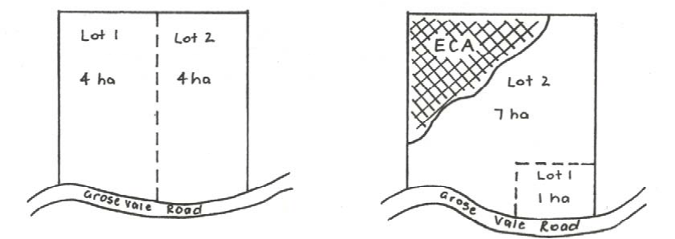

## 1 (c1) Zone

#### Figure E3.4 Subdivision of Land Containing Environmental Constraint

#### Area

> [Picture on page 30: a picture, saved as a picture (images/part-e-specific-areas-page-30-24.gif, 150 dpi).]

GROSE WOLD __________________________________________________________________________________________________________________
