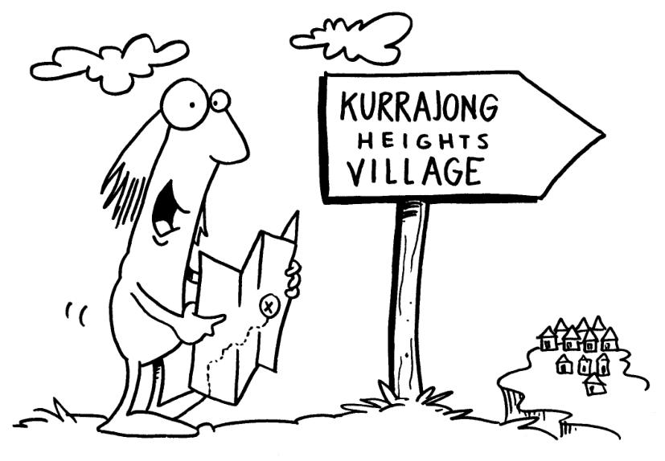

# Hawkesbury Development Control Plan 2002 - Part E Specific Areas

> This chapter is split into 19 section file(s), one per numbered heading, in the order they appear in the PDF.

Source PDF: [DCP_PARTE.pdf](https://planfortomorrow.sharepoint.com/sites/Planfortomorrow/Shared%20Documents/00%20NSW-Planning-Resources/dcp/hawkesbury-development-control-plan-2002/part-e-specific-areas/DCP_PARTE.pdf)

### PART E SPECIFIC AREAS

### CONTENTS

### Part E

| KURRAJONG HEIGHTS VILLAGE |  |
|---|---|
| 1.1 | INTRODUCTION ........................................................................................................................... 1–1 |
| 1.2 | GENERAL PRINCIPLES ............................................................................................................... 1–3 |
| 1.3 | VILLAGE SETTING AND CONTAINMENT ................................................................................... 1–3 |
| 1.4 | VILLAGE CHARACTER ................................................................................................................ 1–4 |
| 1.5 | HERITAGE ITEMS AND NEW DEVELOPMENT .......................................................................... 1–7 |
| 1.6 | LAND USE..................................................................................................................................... 1–9 |
| 1.7 | TRAFFIC ....................................................................................................................................... 1–9 |
| 1.8 | COMMERCIAL ACTIVITY AND TOURISM ................................................................................. 1–10 |
| 1.9 | CONCLUSION............................................................................................................................. 1–11 |
| MACDONALD VALLEY |  |
| 2.1 | INTRODUCTION AND GENERAL PRINCIPLES .......................................................................... 2–1 |
| 2.2 | SITING........................................................................................................................................... 2–1 |
| 2.3 | BUILDING DESIGN AND MATERIALS ......................................................................................... 2–2 |
| GROSE WOLD |  |
| 3.1 | INTRODUCTION ........................................................................................................................... 3–1 |
| 3.2 | SITE ANALYSIS ............................................................................................................................ 3–1 |
| 3.3 | SUBDIVISION ...............................................................................................................................3–4 |
| 3.4 | FLORA AND FAUNA..................................................................................................................... 3–5 |
| 3.5 | EFFLUENT DISPOSAL ................................................................................................................. 3–5 |
| 3.6 | SCENIC QUALITY......................................................................................................................... 3–6 |

____________________________________________________________________________________________________________TABLE OF CONTENTS

i

Chapter 1 KURRAJONG HEIGHTS VILLAGE

> [Picture on page 5: a picture, saved as a picture (images/part-e-specific-areas-page-5-3.gif, 150 dpi).]

<!-- sections -->
## Sections

1. [1.1 INTRODUCTION](01-1-1-introduction.md)
2. [1.2 GENERAL PRINCIPLES](02-1-2-general-principles.md)
3. [1.3 VILLAGE SETTING AND CONTAINMENT](03-1-3-village-setting-and-containment.md)
4. [1.4 VILLAGE CHARACTER](04-1-4-village-character.md)
5. [1.5 HERITAGE ITEMS AND NEW DEVELOPMENT](05-1-5-heritage-items-and-new-development.md)
6. [1.6 LAND USE](06-1-6-land-use.md)
7. [1.7 TRAFFIC](07-1-7-traffic.md)
8. [1.8 COMMERCIAL ACTIVITY AND TOURISM](08-1-8-commercial-activity-and-tourism.md)
9. [1.9 CONCLUSION](09-1-9-conclusion.md)
10. [2.1 INTRODUCTION AND GENERAL PRINCIPLES](10-2-1-introduction-and-general-principles.md)
11. [2.2 SITING](11-2-2-siting.md)
12. [2.3 BUILDING DESIGN AND MATERIALS](12-2-3-building-design-and-materials.md)
13. [3.1 INTRODUCTION](13-3-1-introduction.md)
14. [3.2 SITE ANALYSIS](14-3-2-site-analysis.md)
15. [3.3 SUBDIVISION](15-3-3-subdivision.md)
16. [1 (c1) Zone](16-1-c1-zone.md)
17. [3.4 FLORA AND FAUNA](17-3-4-flora-and-fauna.md)
18. [3.5 EFFLUENT DISPOSAL](18-3-5-effluent-disposal.md)
19. [3.6 SCENIC QUALITY](19-3-6-scenic-quality.md)
