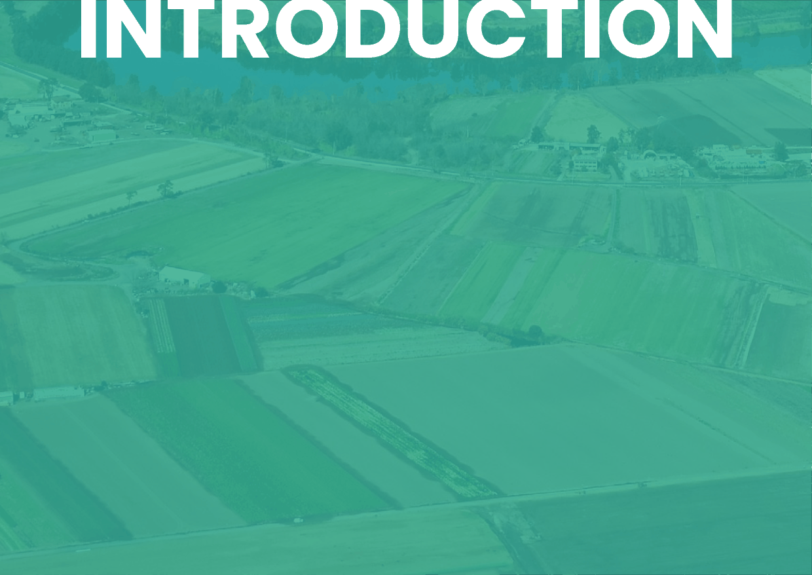

# Hawkesbury Development Control Plan 2023 - Section 1 Introduction

> This chapter is split into 12 section file(s), one per numbered heading, in the order they appear in the PDF.

Source PDF: [Hawkesbury-DCP-2023-Parts-A-and-B-secured - Chapter 1 INTRODUCTION.pdf](https://planfortomorrow.sharepoint.com/sites/Planfortomorrow/Shared%20Documents/00%20NSW-Planning-Resources/dcp/hawkesbury-development-control-plan-2023/section-01-introduction/Hawkesbury-DCP-2023-Parts-A-and-B-secured%20-%20Chapter%201%20INTRODUCTION.pdf)

## CHAPTER 1:

> [Picture on page 1: a picture, saved as a picture (images/section-01-introduction-page-1-2.gif, 150 dpi).]

### INTRODUCTION

<!-- sections -->
## Sections

1. [1.1 WHAT IS THE NAME OF THIS DEVELOPMENT CONTROL PLAN?](01-1-1-what-is-the-name-of-this-development.md)
2. [1.2 WHAT DATE DID THIS DEVELOPMENT CONTROL PLAN COMMENCE?](02-1-2-what-date-did-this-development-control.md)
3. [1.3 WHERE DOES THIS DEVELOPMENT CONTROL PLAN APPLY?](03-1-3-where-does-this-development-control-plan.md)
4. [1.4 WHAT ARE THE OBJECTIVES OF THIS DEVELOPMENT CONTROL PLAN?](04-1-4-what-are-the-objectives-of-this.md)
5. [1.5 RELATIONSHIP BETWEEN THIS DEVELOPMENT CONTROL PLAN AND HAWKESBURY](05-1-5-relationship-between-this-development.md)
6. [1.6 RELATIONSHIP BETWEEN THIS DEVELOPMENT CONTROL PLAN AND RELATED](06-1-6-relationship-between-this-development.md)
7. [1.7 REVOCATION OF HAWKESBURY DEVELOPMENT CONTROL PLAN 2002](07-1-7-revocation-of-hawkesbury-development.md)
8. [1.8 STRUCTURE OF THIS DEVELOPMENT CONTROL PLAN](08-1-8-structure-of-this-development-control.md)
9. [1.9 HOW TO USE THIS DEVELOPMENT CONTROL PLAN](09-1-9-how-to-use-this-development-control-plan.md)
10. [1.10 VARIATIONS TO THIS DEVELOPMENT CONTROL PLAN](10-1-10-variations-to-this-development-control.md)
11. [1.12 SAVINGS AND TRANSITIONAL PROVISIONS](11-1-12-savings-and-transitional-provisions.md)
12. [1.13 AMENDMENT SCHEDULE](12-1-13-amendment-schedule.md)
