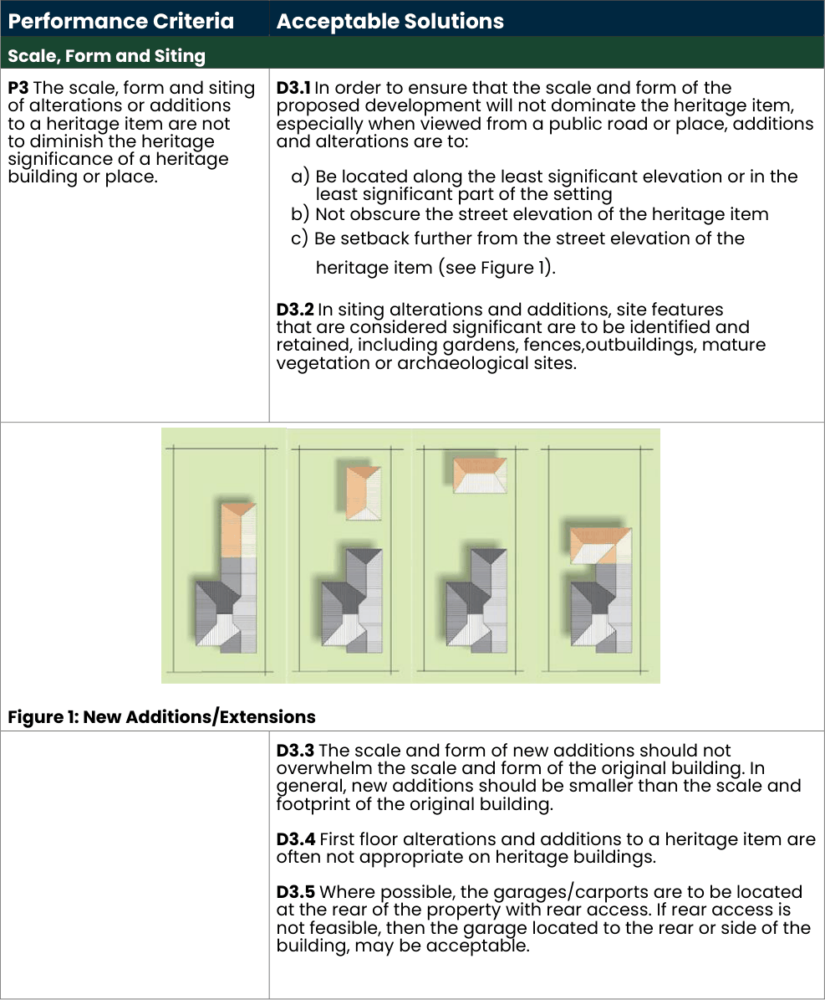
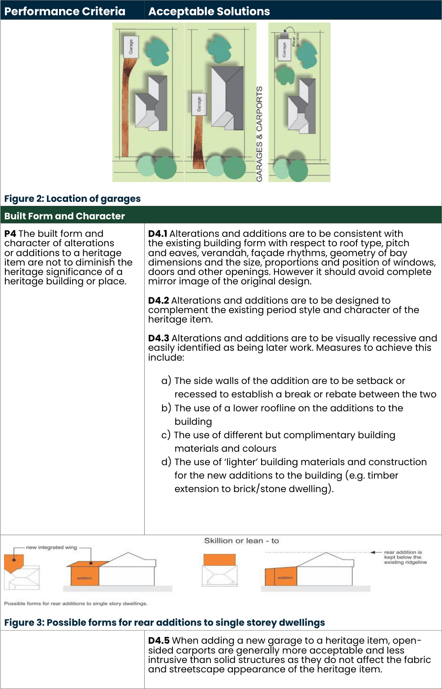
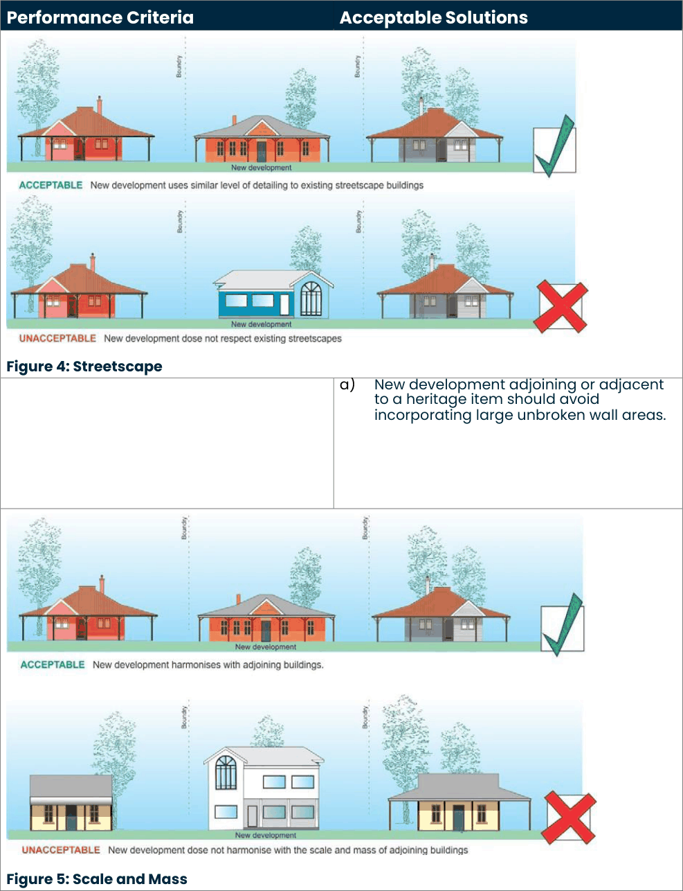
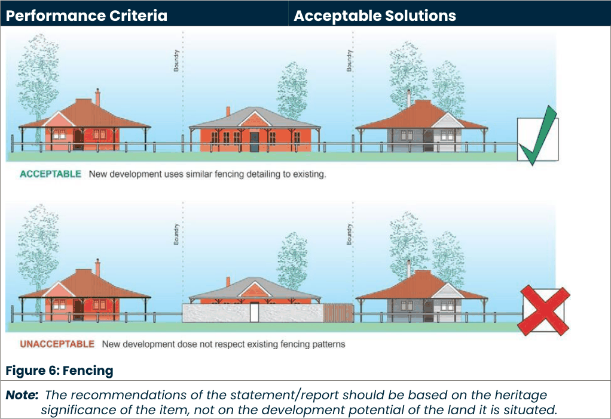

## 6. DEVELOPMENT OUTCOMES

This Section provides objectives, performance criteria and acceptable solutions for

development involving items of heritage significance, under the following subsections:

### 6.1 Conservation and Maintenance

### 6.2 Adaptive Reuse

### 6.3 Alterations and Additions

### 6.4 Finishes, Materials and Colour

### 6.5 New development within the Curtilage of a Heritage Item

### 6.6 Development within a Heritage Conservation Area

6.7 Development in the Vicinity of a Heritage Item or Conservation Area

### 6.8 Development of Archaeological Sites

### 6.9 Subdivision

### 6.10 Landscaping

### 6.11 Signage

### 6.1 CONSERVATION AND MAINTENANCE

| Performance Criteria | Acceptable Solutions |
|---|---|
| Conservation and Maintenance |  |
| P1 The heritage significance of a building is to be conserved through the retention of original features, design and fabric, and through the use of original construction techniques. | D1.1 Heritage buildings and buildings in conservation areas should be appropriately maintained to ensure their long-term conservation. D1.2 Conservation works should be guided by suitably qualified consultants and tradespersons with experience in heritage conservation, including heritage architects, heritage engineers. In accordance with Clause 5.10(3) of the Hawkesbury Local Environmental Plan 2012, applicants must formally notify Council prior to undertaking routine maintenance work. Council may provide exemption to carry out the work without approval, where appropriate. Sufficient information of the nature of the maintenance work must be provided. Seek early advice from Hawkesbury City Council’s free Heritage Advisory Service when planning major maintenance or conservation works. D1.4 Maintenance works have the potential to create a cumulative impact on the heritage significance of a building. Maintenance works should be considered in a holistic manner. D1.5 Development applications for alterations and additions should also include measures for the conservation and maintenance of the heritage elements which are to be retained. D1.6 Original garden elements including outbuildings, fences, stonework, pathways and other like features are to be identified and where appropriate retained, especially if the element is of high heritage significance. Occasionally, replacement of items of lower heritage significance may be acceptable where the element has deteriorated. This must be agreed upon and approved by Council. In this case, the replacement is to match as closely as possible with the original style, design, materials, colour and height of that garden element. Old photographs or careful inspection of remaining fabric can often reveal the original design features and style of the item. D1.7 Original features are to be repaired, rather than be replaced. D1.8 The reconstruction of original lost details is to be based on documentary or physical evidence such as historic photographs, architectural plans or existing building details and should be agreed upon by Council. This should be considered in accordance with the provisions of the ‘Burra Charter’. D1.9 Any features that are considered valuable in reflecting the history and maintaining the character of the item are to be retained. |

#### Performance Criteria Acceptable Solutions

D1.10 The removal of original detailing or the enclosure of

verandahs on the front façade of a heritage item will generally

not be permitted.

D1.11 New decorative features are not to be used on a heritage

item unless documentary, physical or other evidence indicate

that it once existed.

D1.12 Intrusive security measures such as roller shutters, window

bars and the like are not to be introduced to the heritage item or

within heritage conservation areas.

D1.13 Construction techniques are to be compatible and reflect

original building techniques where possible, such as the use of

lime based mortars for re-pointing bricks rather than the use of

cement based mortars.

D1.14 Original or early unpainted brick or stone walls must not be

rendered, plastered, painted or coated.

D1.15 External fixtures such as solar panels, skylights, rainwater

tanks, air conditioning units or other like utility installations are

not to be installed on the front façade of the heritage item or any

other elevation readily visible from a public road or place.

NOTE: Colour coated steel roofing (Colorbond) is not considered to be a suitable

replacement material for galvanised iron, galvanised steel, slate or tile roofing.

Construction techniques should be compatible and reflect original building

techniques where possible, such as the use of lime based mortars for re-pointing

bricks rather than the use of cement based mortars.

### 6.2 ADAPTIVE REUSE

| Performance Criteria | Acceptable Solutions |
|---|---|
| Use of Heritage Items |  |
| P2 The use of a heritage item is to be compatible with the existing structure and layout of the item so as to minimise alterations to the building. | D2.1 The adaptive reuse of a heritage item or a change of use is to demonstrate that: The new use requires minimal alterations to significant fabric and building elements, and that any changes to these are reversible or have minimal impact on the heritage significance of the item. Any internal changes do not compromise the heritage significance of the external appearance of the item. Alterations and/or additions required to support the new use do not obscure the understanding of the item’s significant use. The introduction of new services will not have a detrimental impact on significant fabric or spaces. The new use is consistent with the agreed conservation policy identified in the conservation management plan. |

### 6.3 ALTERATIONS AND ADDITIONS

> [Picture on page 15: a picture, saved as a picture (images/section-03-heritage-page-15-2.gif, 150 dpi).]
> Words printed on the picture (title and legend, copied from the PDF):
> of alterations or additions
> to diminish the heritage
> building or place.

Figure 1: New Additions/Extensions

#### Performance Criteria Acceptable Solutions

#### Scale, Form and Siting

D3.1 In order to ensure that the scale and form of the

proposed development will not dominate the heritage item,

especially when viewed from a public road or place, additions

and alterations are to:

a) Be located along the least significant elevation or in the

P3 The scale, form and siting to a heritage item are not significance of a heritage

least significant part of the setting

b) Not obscure the street elevation of the heritage item

c) Be setback further from the street elevation of the heritage item (see Figure 1).

D3.2 In siting alterations and additions, site features

that are considered significant are to be identified and

retained, including gardens, fences, outbuildings, mature

vegetation or archaeological sites.

D3.3 The scale and form of new additions should not

overwhelm the scale and form of the original building. In

general, new additions should be smaller than the scale and

footprint of the original building.

D3.4 First floor alterations and additions to a heritage item are

often not appropriate on heritage buildings.

D3.5 Where possible, the garages/carports are to be located

at the rear of the property with rear access. If rear access is

not feasible, then the garage located to the rear or side of the

building, may be acceptable.

> [Picture on page 16: a picture, saved as a picture (images/section-03-heritage-page-16-1.gif, 150 dpi).]

Figure 2: Location of garages

Figure 3: Possible forms for rear additions to single storey dwellings

#### Performance Criteria Acceptable Solutions

| Built Form and Character |  |
|---|---|
| P4 The built form and character of alterations or additions to a heritage item are not to diminish the heritage significance of a heritage building or place. | D4.1 Alterations and additions are to be consistent with the existing building form with respect to roof type, pitch and eaves, verandah, façade rhythms, geometry of bay dimensions and the size, proportions and position of windows, doors and other openings. However it should avoid complete mirror image of the original design. D4.2 Alterations and additions are to be designed to complement the existing period style and character of the heritage item. D4.3 Alterations and additions are to be visually recessive and easily identified as being later work. Measures to achieve this include: a) The side walls of the addition are to be setback or recessed to establish a break or rebate between the two b) The use of a lower roofline on the additions to the building c) The use of different but complimentary building materials and colours d) The use of ‘lighter’ building materials and construction for the new additions to the building (e.g. timber extension to brick/stone dwelling). |

D4.5 When adding a new garage to a heritage item, open-

sided carports are generally more acceptable and less

intrusive than solid structures as they do not affect the fabric

and streetscape appearance of the heritage item.

### 6.4 FINISHES, MATERIALS AND COLOURS

| Performance Criteria | Acceptable Solutions |
|---|---|
| Character and Appearance |  |
| P4 The materials, finishes and colours of works to a heritage item or within the vicinity of a heritage item are not to diminish the heritage significance of the heritage building or place. | D4.1 Additions are to use recessive colours and should not visually dominate the existing building, particularly when viewed from the street. D4.2 New materials are to be compatible with the colour, finishes and proportion of existing materials, and they are to be easily recognised as being new without detracting from the character and heritage significance of the existing building. The use of Colorbond or zincalume for roof sheeting, flashing, guttering and downpipes on heritage buildings is not permitted. Instead, recycled or new galvanised steel custom orb sheeting and lead flashing is to be used as a conservation technique for buildings which originally had a corrugated iron roof. D4.3 New decorative elements (such as finials, barge boards, or verandah brackets) are to be avoided (unless documentary, physical or other forms of evidence indicate it once existed), as this can affect the integrity of the heritage item and/or the heritage conservation area. Also, decorative elements of new additions are not to attempt to replicate the architectural or decorative detail of the original, so as to maintain a distinction between old and new. D4.4 The brick laying pattern of alterations and additions is to match that of the existing building. D4.5 Exterior face brick or stone walls and unpainted surfaces are not to be painted, plastered or coated except in exceptional circumstances where this is considered an appropriate conservation measure. D4.6 Original plaster or render is not to be removed. Where repairs or replacement is necessary, this should be undertaken using materials consistent with original render. D4.7 Later cement render to buildings are not to be removed where its removal will damage the face brick or stone. |

| Performance Criteria | Acceptable Solutions D4.8 Original roofing materials are to be retained wherever possible and repaired as necessary with compatible materials. However, if it can be demonstrated that the roofing needs to be replaced, then the new roofing material is to match as closely as possible, the colour, texture and profile of the original material. D4.9 Large areas of concrete driveways are to be avoided, and where possible the use of alternative materials such as gravel, pavers or grass-crete should be explored. D4.10 Colour schemes for heritage buildings are to closely resemble the original colour scheme, or if this is not known, be compatible with the particular architectural period of the building and based on research of the original finishes. Careful paint scrapings may identify the original colours that were used. |
|---|---|
| Note: It may be possible to get second hand bricks to match the original; if not brick manufacturers may be able to provide new bricks which will closely match the original design. |  |
|  | D4.11 Garage or carport designs are to use design detailing, materials and colours that complement the heritage item. However, new garages or carports are to be: a) Be separate from the heritage item where possible b) Preferably be of a ‘lightweight’ construction such as timber with metal roofing c) Avoid replication of decorative detail or finishes found on the heritage item d) Be more simple and contemporary in design e) Consider incorporating landscaping elements, where appropriate, such lattice screens with climbing plants in order to soften the appearance of the structure. |

### 6.5 NEW DEVELOPMENT WITHIN THE CURTILAGE OF A HERITAGE ITEM

| Performance Criteria | Acceptable Solutions |
|---|---|
| Design, Scale, Bulk and Siting |  |
| P5 Any development within the curtilage of a heritage item is to be designed and sited so that the heritage significance of the item is conserved. | D5.1 The development is not to be sited in front of the front building line of the existing heritage item. D5.2 Where a development is within the curtilage of a heritage item, it is to be appropriately designed and located to complement the scale, proportions and geometric alignments of the existing heritage item and ensure the visual prominence of the heritage item is retained. D5.3 The bulk and scale of development is not to dominate its’ surroundings. In order to minimise bulk, new development should be consistent with the predominant height in the street. If it is difficult to determine the predominant height, then it should be consistent with the adjoining buildings. D5.4 Where there is an established pattern of side setbacks that contribute to the character of the streetscape this is to be also reinforced by new development. D5.5 A reasonable “buffer” space is to be provided between the heritage item and the new development to ensure that there will be no adverse impact upon the heritage item. D5.6 Any new development is to ensure consistency with the character and the heritage significance of the established streetscapes. |

### 6.6 DEVELOPMENT WITHIN A HERITAGE CONSERVATION AREA

| Performance Criteria | Acceptable Solutions |
|---|---|
| Design and Siting |  |
| P6 Any development within a Heritage Conservation Area is to be designed and sited so that the heritage significance of the Conservation Area is conserved. | D6.1 Existing heritage buildings in Heritage Conservation Areas are to be retained and conserved. Buildings in Heritage Conservation Areas often have significant internal features which should be retained. D6.1 New development is to be sited and designed so as not to adversely impact upon the heritage significance of the area. D6.2 Development is to be compatible with the surrounding built form and pattern of development by responding sympathetically to: a) Existing form, massing, setbacks, scale and architectural style b) The design and pitch of the roof (if any) c) Site topography and landscape d) Surrounding neighbourhood character and streetscape e) The style, size, proportion and position of the openings for windows and doors (if any) f) Colour, texture, style, size and type of finish of the materials to be used on the exterior of the building g) Existing landscape character (i.e. new development in a conservation area should seek to maintain the landscape character of the area. D6.3 New development in a heritage conservation area must include adequate landscaped area to accommodate deep rooted trees and vegetation to provide a buffer between the new development and the surrounds. |

### 6.7 DEVELOPMENT IN THE VICINITY OF A HERITAGE ITEM OR CONSERVATION

#### AREA

| Performance Criteria | Acceptable Solutions |
|---|---|
| Considerations |  |
| P7 Any development within the vicinity of a heritage item or heritage conservation area is to be designed and sited so that the heritage significance of the item is conserved. | D7.1 Where development is proposed on land adjacent to or within the vicinity of a heritage item or a heritage conservation area the following is to be taken into consideration to ensure that it will complement the identified significance or setting of the heritage item or the heritage conservation area: a) The character, siting, bulk, scale, height and external appearance of the development b) The visual relationship between the proposed development and the heritage item or heritage conservation area c) The potential for overshadowing of the adjoining heritage item or any building within a heritage conservation area d) The colours and textures of materials proposed to be used in the development e) The landscaping and fencing of the proposed development f) The location of car parking spaces and access ways into the development g) The impact of any proposed advertising signs or structures h) The maintenance of the existing streetscape, where the particular streetscape has significance to the heritage item i) The impact the proposed use would have on the amenity of the heritage item j) The effect the construction phase will have on the wellbeing of a heritage item k) Avoid making a replica of a heritage building for infill development l) Incorporate sufficient landscaped area to accommodate deep rooted trees and vegetation to provide screening between the new development and the heritage item or conservation area |

> [Picture on page 22: a picture, saved as a picture (images/section-03-heritage-page-22-1.gif, 150 dpi).]

Figure 4: Streetscape

Figure 5: Scale and Mass

a) New development adjoining or adjacent

to a heritage item should avoid

incorporating large unbroken wall areas.

### 6.8 DEVELOPMENT OF ARCHAEOLOGICAL SITES

| Performance Criteria | Acceptable Solutions |
|---|---|
| Approvals |  |
| P8 Any development within or near an archaeological site is to be designed and sited so that the archaeological site is conserved. | D8.1 Obtain an Archaeological Assessment prior to planning works which are likely to affect an archaeological site or deposit. New development is to be designed to minimise impacts unknown archaeological sites. D8.2 Any development that involves the disturbance of archaeological sites cannot proceed without the appropriate approvals under the NSW Heritage Act 1977. The applicant is to seek advice from the Heritage Branch of the Office of Environment & Heritage and Council’s Heritage Officer in relation to these requirements. D8.3 Archaeological investigations must be carried out according to Office of Environment and Heritage’s Code of practice for archaeological investigation of Aboriginal objects in NSW, available at www.environment.nsw.gov.au/ licences / archinvestigations.htm. |

### 6.9 SUBDIVISION

| Performance Criteria | Acceptable Solutions |
|---|---|
| Lot Layout and Design |  |
| P9 Any subdivision of land containing a heritage item is to be designed and sited so that the heritage significance of the item is conserved. | D9.1 Where a subdivision proposal contains a heritage item, the heritage item and any other associated outbuildings is to be retained on the same allotment. D9.2 An appropriate setting or curtilage for the heritage item is to be defined whilst taking the following into consideration: a) The original form and function of the heritage item b) Any outbuildings, gardens, trees, fencing, gates and archaeological sites c) Adjoining development and allotments d) Access points and orientation e) Any visual links to other related sites, natural features, landmarks, (for example, the visual relationship between a heritage listed homestead on a rural property and surrounding landforms and natural features) f) The significance of the historic subdivision patterns. D9.3 Subdivision of rural allotments containing heritage items should maintain sufficient curtilage around the heritage building to allow the rural character and setting of the heritage item to be interpreted. D9.4 In order to determine whether the proposed curtilage of the heritage item is appropriate, the subdivision plan is to show the proposed building envelops for each proposed allotment. D9.5 Where practicable, any visual linkages and the original access arrangements to the heritage item is to be retained. D9.6 The amalgamation of sites is discouraged in heritage conservation areas because it obscures the original subdivision patterns and can result in unsympathetic development, particularly in terms of form and scale. |

| Performance Criteria | Acceptable Solutions D9.7 Lot boundary changes within heritage conservation areas must demonstrate that: a) The setting of an existing significant building on the site or the setting of development on adjoining sites is not compromised b) Significant features of the existing site or adjoining sites, including streetscape and landscape features, trees, fences, outbuildings and gardens are not adversely impacted c) The change to lot layout is in keeping with the character of the area. |
|---|---|

### 6.10 LANDSCAPING

| Performance Criteria | Acceptable Solutions |
|---|---|
| Design |  |
| P10 Landscaping works are to complement the original garden setting and are not to diminish the heritage significance of the heritage item or its setting. | D10.1 Any landscaping works including re-planting and the introduction of new garden features upon land that contains a heritage item is to be sympathetic to the original garden setting and the significance of existing individual elements of the garden curtilage surrounding the heritage building. D10.2 Existing trees and other vegetation with environmental heritage values are to be retained. D10.3 Where edging is required to separate paths, garden beds and gardens from areas or lawn, traditional brick or tile edging is to be used. D10.4 Existing fences which have been identified as significant or that contribute to the overall setting or character of a heritage item are to be retained or repaired, rather than replaced. Where any new fences are proposed these are to match as closely as possible with the original fencing, or if the original fence type is not known, it is to relate to the architectural character and period of the existing heritage item with respect to design, materials, colour and height. D10.5 High, solid concrete or masonry fences will not be permitted along the front property boundary of land containing a heritage item or land within a heritage conservation area, or in the vicinity of a heritage item or conservation area. Where it is required to reduce traffic noise and maintain residential amenity, alternative measures other than solid fences such as double-glazing, internal room layout and/or landscaping should be investigated. D10.6 Property owners are encouraged to develop a landscape masterplan for the whole site to understand the significance, condition and lifespan of trees. Refer to Hawkesbury City Council Fact Sheet on Fencing. |

> [Picture on page 27: a picture, saved as a picture (images/section-03-heritage-page-27-1.gif, 150 dpi).]

Figure 6: Fencing

Note: The recommendations of the statement/report should be based on the heritage

significance of the item, not on the development potential of the land it is situated.

### 6.11 SIGNAGE Performance Criteria

#### Acceptable Solutions

D11.1  In addition to other Development

Control Plan provisions relating to

signage, development is to comply with

the following:

P11 Signs located on or in the vicinity of a

heritage item or heritage conservation

area are to be designed and located so

that they do not detract from the heritage

significance of the building, place or

streetscape.

New signage should not detract from the heritage

significance or architectural form of any heritage

items or buildings in heritage conservation areas. Signage should not obscure any significant

original or early building details. The number, size, type and design of signs should

not overwhelm the design of heritage buildings

and should not result in visual clutter. Signage should be of a limited colour palette. The

colour of new signage should be compatible with

the predominant materials and colours of the

heritage building or buildings in the conservation

area. The number of signs for each building should be

limited to specify appropriate number and type

of sign - awning sign, under-awning sign, window

sign, banner sign, a-frame, building identification

sign. New signage should not conceal earlier

significant signage that relates to a significant

early use of the building.
