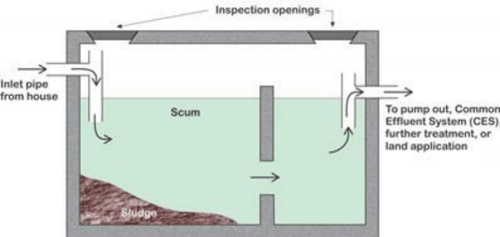
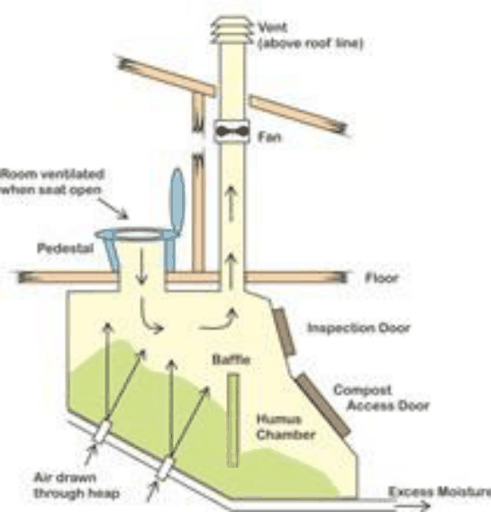
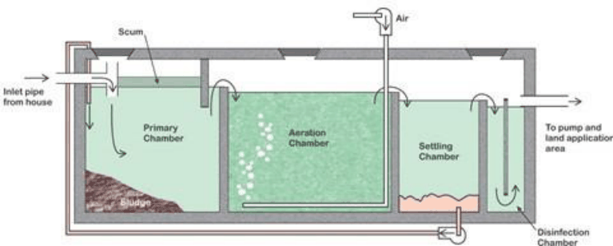

## 1. INTRODUCTION

### 1.1. APPLICATION/PREAMBLE

This Chapter of the Development Control Plan provides the objectives, performance criteria

and deemed-to-satisfy controls for the design, installation, operation and maintenance of on-

site sewage management facilities that hold, process, re-use or otherwise dispose of sewage

or sewage bi-products. These facilities include but are not limited to the following:

#### Septic tanks

A septic tank is a single or multiple chambered tank through which wastewater is allowed to

flow slowly to permit suspended solid matter to settle and be retained, so that organic matter

contained therein can be decomposed (digested) by anaerobic bacterial action in the liquid

(see Figure 1 below).

Generally these tanks are used to treat all waste, grey-water (wastes from baths, showers,

basins, laundries and kitchen) and/or black-water (from a toilet or bidet).

> [Picture on page 3: a picture, saved as a picture (images/section-04-effluent-disposal-page-3-14.gif, 150 dpi).]

#### Figure 1: Cross Section of a Septic Tank

#### Waterless composting toilet

A waterless composting toilet is a waterless system which relies on the principles of

composting by micro-organisms to decompose human waste into humus. Generally these

systems are suited for sites with restricted water supply or sites rely on tank water. These

systems do not treat grey-water, and there are two types of systems. One is the Continuous

System which contains only one chamber (see Figure 2). The other system known as the Batch

System contains several bins, with rotation occurring after each bin is filled. In both systems,

chambers or bins are installed below floor level.

### 45

#### Hawkesbury Development Control Plan 2023

> [Picture on page 4: a picture, saved as a picture (images/section-04-effluent-disposal-page-4-1.gif, 150 dpi).]

#### Figure 1: Cross Section of a Septic Tank

#### Aerated Wastewater Treatment System (AWTS)

An Aerated Wastewater Treatment System (AWTS) is a purpose built system used for the

treatment of sewage and liquid wastes from a single household or multiple dwellings. It

consists of a series of treatment chambers combined with an irrigation system (see Figure 3).

Typically the water from the AWTS is reused by irrigation on the site.

> [Picture on page 4: a picture, saved as a picture (images/section-04-effluent-disposal-page-4-8.gif, 150 dpi).]

#### Figure 3: Aerated Wastewater Treatment System

#### Pump-out system

A traditional pump-out system comprises of a septic tank and a collection well. The content of

the holding well is regularly pumped out by a road tanker for disposal off site.

(i). NSW Department of Health Accreditation Guidelines for on-site sewage management

> [Picture text on page 5 is stored in the PDF without readable letters (no character map), so it could not be copied; see the original PDF.]

systems:

Septic Tank and Collection Well Accreditation Guideline December 2001 Sewage Management Facility, Sewage Treatment Accreditation Guideline (incorporating AWTS and Sand Filters), May 2005 Waterless Composting Toilet Accreditation Guideline, May 2005 Greywater Reuse in Single Domestic Premises April 2000 Domestic Greywater Treatment Systems Accreditation Guidelines Feb 2005.

(ii). Hawkesbury City Council’s Onsite Sewerage Management Strategy 2007 (Revised) (iii). Australian Standards (AS)/New Zealand Standards (NZS):

1546.1 - 2008: On-site Domestic Wastewater Treatment units- Septic tanks

1546.2 - 2008: On-site Domestic Wastewater Treatment units - Waterless composting toilets

1546.3 - 2008: On-site Domestic Wastewater Treatment units – AWTS 1547:2012: On-site domestic wastewater management 3500.5:2000: National plumbing and drainage - Domestic Installations (iv). Plumbing Code of Australia
