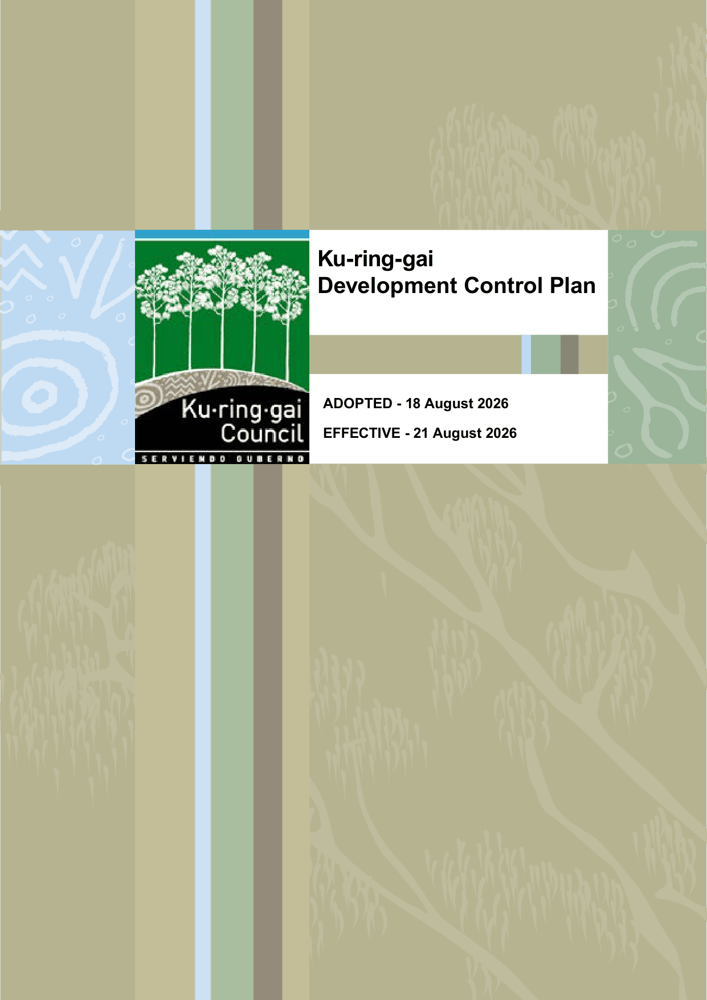
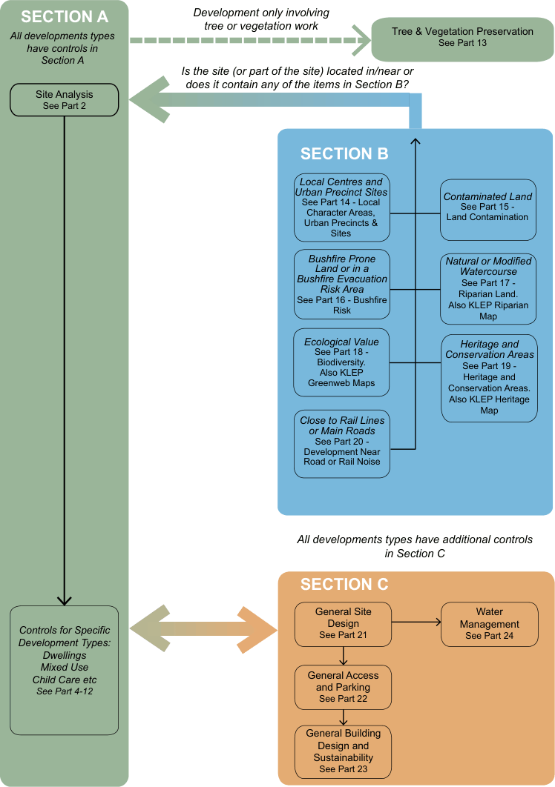

# Ku-ring-gai Development Control Plan - Cover and Contents

Source PDF: [kdcp-cover-contents.pdf](kdcp-cover-contents.pdf)

> [Picture on page 1: a picture, saved as a picture (images/cover-and-contents-page-1-1.gif, 150 dpi).]

### Ku-ring-gai

### Development Control Plan

#### ADOPTED - 18 August 2026 EFFECTIVE - 21 August 2026

#### HOW TO USE THE DCP

Definitions and

#### INTRODUCTION

What is in this DCP

Abbreviations See Part 1B - Dictionary

See Part 1

> [Picture on page 2: a map, saved as a picture (images/cover-and-contents-page-2-8.gif, 150 dpi); the street names and other small labels are on the picture.]
> Words printed on the picture (title and legend, copied from the PDF):
> Development only involving
> tree or vegetation work
> Tree & Vegetation Preservation
> All developments types
> See Part 13
> have controls in
> Is the site (or part of the site) located in/near or
> does it contain any of the items in Section B?
> See Part 2
> Local Centres and
> Urban Precinct Sites
> See Part 14 - Local
> See Part 15 -
> Urban Precincts &
> Bushfire Prone Natural or Modified
> Land or in a
> See Part 16 - Bushfire
> See Part 17 -
> Also KLEP Riparian
> See Part 18 -
> See Part 19 -
> Also KLEP Heritage
> Close to Rail Lines
> or Main Roads
> See Part 20 -
> Road or Rail Noise
> All developments types have additional controls
> in Section C
> See Part 21
> See Part 24
> Controls for Specific
> Child Care etc
> See Part 4-12
> See Part 22
> See Part 23

#### SECTION A

#### SECTION B

#### SECTION C

#### KEY:

#### SECTION A

#### SECTION B

#### SECTION C

i

### CONTENTS

| PART 1 | INTRODUCTION |  |
|---|---|---|
|  | Introduction - How to use this DCP.................................................. | p1-2 |
| 1A | Preliminary................................................................................ | p1-11 |
| 1A.1 | Purpose of this DCP ................................................................... | p1-12 |
| 1A.2 | Name of this DCP ....................................................................... | p1-12 |
| 1A.3 | Commencement Date................................................................. | p1-12 |
| 1A.4 | Land affected by this DCP.......................................................... | p1-12 |
| 1A.5 | General aims of the DCP............................................................. | p1-12 |
| 1A.6 | Relationship to Ku-ring-gai Local Environmental Plan............ | p1-13 |
| 1A.7 | Relationship to State Environmental Planning Policies ............ | p1-14 |
| 1A.8 | Relationships to other DCPs....................................................... | p1-14 |
| 1A.9 | Schedule of Amendments........................................................... | p1-14 |
| 1B 1B.1 1B.2 | Dictionary................................................................................. Definitions...................................................................................... Abbreviations................................................................................ | p1-15 p1-16 p1-39 |

| PART 2 2.1 PART 3 | SECTION A SITE ANALYSIS Introduction........................................................................................ Site Analysis ................................................................................ LAND CONSOLIDATION AND SUBDIVISION Introduction......................................................................................... | p2-2 p2-3 p3-2 |
|---|---|---|
| 3A | General Controls for Consolidation and Subdivision..................... | p3-3 |
| 3A.1 | Lot Shape, Orientation and Design ........................................... | p3-4 |
| 3A.2 | Minimum Lot Depth for Bushfire Prone Land............................ | p3-5 |
| 3A.3 | Building Footprint......................................................................... | p3-9 |
| 3A.4 | Trees and Vegetation................................................................... | p3-10 |
| 3A.5 | Access........................................................................................... | p3-11 |
| 3A.6 | Infrastructure................................................................................. | p3-14 |
| 3B | Land Consolidation................................................................. | p3-17 |
| 3C | Strata and Community Title Subdivision .............................. | p3-21 |
| 3R | References ............................................................................... | p3-23 |
| 3R | Minimum Lot Depth Maps........................................................... | p3-23 |

### CONTENTS

ii

iii

| PART 4 | DWELLING HOUSES |  |
|---|---|---|
|  | Introduction......................................................................................... | p4-2 |
| 4A | Site Design ............................................................................... | p4-3 |
| 4A.1 | Local Character and Streetscape ............................................. | p4-4 |
| 4A.2 | Building Setbacks ........................................................................ | p4-6 |
| 4A.3 | Built-Upon Area ........................................................................... | p4-12 |
| 4A.4 | Landscaping ................................................................................ | p4-14 |
| 4B | Access and Parking ................................................................ | p4-15 |
| 4B.1 | Vehicle Access ............................................................................ | p4-16 |
| 4B.2 | Car Parking Provision ................................................................. | p4-17 |
| 4B.3 | Carports and Garages ................................................................ | p4-18 |
| 4C | Building Design and Sustainability ....................................... | p4-21 |
| 4C.1 | Building Envelopes ...................................................................... | p4-22 |
| 4C.2 | Building Facades ......................................................................... | p4-24 |
| 4C.3 | First Floor Design and Roof Forms ........................................... | p4-26 |
| 4C.4 | Private Open Space .................................................................... | p4-28 |
| 4C.5 | Solar Access ................................................................................ | p4-29 |
| 4C.6 | Natural Ventilation ....................................................................... | p4-30 |
| 4C.7 | Ancillary Facilities ....................................................................... | p4-31 |
| 4C.8 | Fencing ......................................................................................... | p4-35 |
| 4C.9 | Waste Management..................................................................... | p4-37 |
| 4C.10 | Materials and Finishes................................................................. | p4-38 |
| PART 4.1 | SECONDARY DWELLINGS |  |
|  | Introduction......................................................................................... | p4.1-2 |
| 4.1A | Site Design ............................................................................... | p4.1-3 |
| 4.1A.1 | General ......................................................................................... | p4.1-4 |
| 4.1A.2 | Site Layout ................................................................................... | p4.1-5 |
| 4.1A.3 | Building Setbacks and Separation ............................................ | p4.1-7 |
| 4.1B | Access and Parking ................................................................ | p4.1-11 |
| 4.1B.1 | Access .......................................................................................... | p4.1-12 |
| 4.1B.2 | Car Parking Provision ................................................................. | p4.1-14 |
| 4.1C | Building Design and Sustainability ....................................... | p4.1-15 |
| 4.1C.1 | Solar Access ................................................................................ | p4.1-16 |
| 4.1C.2 | Private Open Space .................................................................... | p4.1-17 |
| 4.1C.3 | Building Envelopes ...................................................................... | p4.1-18 |
| 4.1C.4 | Building and Room Sizes ........................................................... | p4.1-19 |
| 4.1C.5 | Building Appearance .................................................................. | p4.1-20 |
| 4.1C.6 | Building Services ........................................................................ | p4.1-21 |
| 4.1C.7 | Visual and Acoustic Privacy ....................................................... | p4.1-22 |
| 4.1C.8 | Storage and Utility Areas ........................................................... | p4.1-23 |

### CONTENTS

iv

|  | DUAL OCCUPANCY AND |  |
|---|---|---|
| PART 5 | SEMI-DETACHED DWELLINGS |  |
|  | Introduction......................................................................................... | p5-2 |
| 5A | Site Design ............................................................................... | p5-3 |
| 5A.1 | Local Character and Streetscape ............................................. | p5-4 |
| 5A.2 | Site Layout ................................................................................... | p5-6 |
| 5A.3 | Building Setbacks ........................................................................ | p5-8 |
| 5A.4 | Built-Upon Area ........................................................................... | p5-18 |
| 5A.5 | Landscaping ................................................................................ | p5-20 |
| 5B | Access and Parking ................................................................ | p5-23 |
| 5B.1 | Vehicle Access ............................................................................ | p5-24 |
| 5B.2 | Car Parking Provision ................................................................. | p5-27 |
| 5B.3 | Carports and Garages ................................................................ | p5-28 |
| 5C | Building Design and Sustainability ....................................... | p5-31 |
| 5C.1 | Building Envelopes ...................................................................... | p5-32 |
| 5C.2 | Building Facades ......................................................................... | p5-34 |
| 5C.3 | Dwelling Design and Layout ...................................................... | p5-37 |
| 5C.4 | Private Open Space .................................................................... | p5-39 |
| 5C.5 | Solar Access ................................................................................ | p5-40 |
| 5C.6 | Natural Ventilation ....................................................................... | p5-41 |
| 5C.7 | Ancillary Facilities ....................................................................... | p5-42 |
| 5C.8 | Fencing ......................................................................................... | p5-46 |
| 5C.9 | Waste Management..................................................................... | p5-48 |
| 5C.10 | Materials and Finishes................................................................. | p5-49 |
| PART 6 | MULTI-DWELLING HOUSING |  |
|  | Introduction......................................................................................... | p6-2 |
| 6A | Site Design ............................................................................... | p6-5 |
| 6A.1 | Local Character and Streetscape ............................................. | p6-6 |
| 6A.2 | Site Layout ................................................................................... | p6-8 |
| 6A.3 | Building Setback .......................................................................... | p6-11 |
| 6A.4 | Building Separation ..................................................................... | p6-13 |
| 6A.5 | Site Coverage .............................................................................. | p6-14 |
| 6A.6 | Deep Soil Landscaping .............................................................. | p6-15 |
| 6B | Access and Parking ................................................................ | p6-17 |
| 6B.1 | Vehicle Access ............................................................................ | p6-18 |
| 6B.2 | Car Parking Provision ................................................................. | p6-19 |
| 6B.3 | Bicycle Parking Provision ........................................................... | p6-22 |
| 6C | Building Design and Sustainability ....................................... | p6-23 |
| 6C.1 | Communal Open Space ............................................................. | p6-24 |
| 6C.2 | Private Open Space .................................................................... | p6-26 |

v

| 6C.3 | Solar Access and Daylight.......................................................... | p6-28 |
|---|---|---|
| 6C.4 | Natural Ventilation ....................................................................... | p6-29 |
| 6C.5 | Dwelling Mix.................................................................................. | p6-30 |
| 6C.6 | Dwelling Placement and Room Design...................................... | p6-31 |
| 6C.7 | Building Entries and Internal Pathways ................................... | p6-34 |
| 6C.8 | Building Facades and Articulation ............................................. | p6-35 |
| 6C.9 | Building Storeys .......................................................................... | p6-37 |
| 6C.10 | Top Storey Design and Roof Forms .......................................... | p6-38 |
| 6C.11 | Internal Ceiling Heights .............................................................. | p6-39 |
| 6C.12 | Visual Privacy .............................................................................. | p6-40 |
| 6C.13 | Storage ......................................................................................... | p6-41 |
| 6C.14 | External Clothes Drying Facilities ............................................. | p6-42 |
| 6C.15 | Fencing ......................................................................................... | p6-43 |
| 6R | References ............................................................................... | p6-45 |
| 6R.1 | Design Quality Principles ........................................................... | p6-46 |
| 6R.1 | Design Quality principles ............................................................ | p6-46 |
| PART 6.1 | MULTI DWELLING HOUSING (TERRACES) |  |
|  | Introduction......................................................................................... | p6.1-2 |
| PART 7 | RESIDENTIAL FLAT BUILDINGS |  |
|  | Introduction......................................................................................... | p7-2 |
| 7A | Site Design ............................................................................... | p7-5 |
| 7A.1 | Local Character and Streetscape............................................... | p7-6 |
| 7A.2 | Site Layout.................................................................................... | p7-8 |
| 7A.3 | Building Setbacks ........................................................................ | p7-10 |
| 7A.4 | Building Separation ..................................................................... | p7-14 |
| 7A.5 | Site Coverage .............................................................................. | p7-15 |
| 7A.6 | Deep Soil Landscaping .............................................................. | p7-16 |
| 7B | Access and Parking ................................................................ | p7-19 |
| 7B.1 | Car Parking Provision ................................................................. | p7-20 |
| 7B.2 | Bicycle Parking Provision ........................................................... | p7-22 |
| 7C | Building Design and Sustainability ....................................... | p7-23 |
| 7C.1 | SEPP (Housing) 2021 and Apartment Design Guide Requirements .............................................................................. | p7-24 |
| 7C.2 | Communal Open Space ............................................................. | p7-25 |
| 7C.3 | Ground Floor Apartments .......................................................... | p7-27 |
| 7C.4 | Apartment Mix and Accessibility ............................................... | p7-29 |
| 7C.5 | Building Entries ........................................................................... | p7-30 |
| 7C.6 | Building Form and Facades ....................................................... | p7-32 |
| 7C.7 | Building Storeys .......................................................................... | p7-36 |

### CONTENTS

vi

| 7C.8 | Top Storey Design and Roof Forms .......................................... | p7-37 |
|---|---|---|
| 7C.9 | Laundry and Air Clothes Drying Facilities ................................ | p7-38 |
| 7C.10 | Fencing ......................................................................................... | p7-39 |
| 7C.11 | Acoustic Privacy .......................................................................... | p7-40 |
| 7C.12 | Services ....................................................................................... | p7-41 |
| PART 7.1 | RESIDENTIAL FLAT BUILDINGS (TWO STOREY) |  |
|  | Introduction......................................................................................... | p7.1-2 |
| PART 8 | MIXED USE DEVELOPMENT |  |
|  | Introduction......................................................................................... | p8-2 |
| 8A | Site Design ............................................................................... | p8-5 |
| 8A.1 | Local Character and Streetscape ............................................. | p8-6 |
| 8A.2 | Site Layout ................................................................................... | p8-8 |
| 8A.3 | Building Setbacks ........................................................................ | p8-10 |
| 8A.4 | Building Separation ..................................................................... | p8-11 |
| 8A.5 | Wind Impact ................................................................................. | p8-13 |
| 8A.6 | Site Coverage............................................................................... | p8-14 |
| 8A.7 | Deep Soil Landscaping............................................................... | p8-15 |
| 8B | Access and Parking ................................................................ | p8-17 |
| 8B.1 | Vehicle and Service Access and Loading Facilities ................ | p8-18 |
| 8B.2 | Car Parking Provision ................................................................. | p8-21 |
| 8B.3 | Bicycle Parking and Support Facilities Provision .................... | p8-24 |
| 8C | Building Design........................................................................ | p8-25 |
| 8C.1 | Solar Access and Daylight ......................................................... | p8-26 |
| 8C.2 | Natural Ventilation ....................................................................... | p8-28 |
| 8C.3 | Room Sizes................................................................................... | p8-29 |
| 8C.4 | Apartment Mix and Accessibility .............................................. | p8-31 |
| 8C.5 | Building Entries .......................................................................... | p8-33 |
| 8C.6 | Internal Common Circulation Areas .......................................... | p8-35 |
| 8C.7 | Roof Forms and Podiums .......................................................... | p8-36 |
| 8C.8 | Communal Open Space ............................................................. | p8-37 |
| 8C.9 | Building Facades and Articulation.............................................. | p8-39 |
| 8C.10 | Ground Floor Commercial Uses ................................................ | p8-44 |
| 8C.11 | Awnings ........................................................................................ | p8-46 |
| 8C.12 | Colonnades .................................................................................. | p8-47 |
| 8C.13 | Internal Ceiling Heights .............................................................. | p8-48 |
| 8C.14 | Visual Privacy .............................................................................. | p8-49 |
| 8C.15 | Acoustic Privacy .......................................................................... | p8-50 |
| 8C.16 | Late Night Trading ....................................................................... | p8-53 |
| 8C.17 | External Clothes Drying Facilities ............................................. | p8-54 |

vii

| 8C.18 | Services ....................................................................................... | p8-55 |
|---|---|---|
| PART 9 | NON-RESIDENTIAL AND OFFICE BUILDINGS |  |
|  | Introduction ........................................................................................ | p9-2 |
| 9A | Site Design ............................................................................... | p9-3 |
| 9A.1 | Building Setbacks ........................................................................ | p9-4 |
| 9A.2 | Building Separation ..................................................................... | p9-5 |
| 9A.3 | Deep Soil Landscaping .............................................................. | p9-6 |
| 9B | Access and Parking ................................................................ | p9-7 |
| 9B.1 | Service Access and Loading Facilities ..................................... | p9-8 |
| 9B.2 | Car Parking Provision ................................................................. | p9-10 |
| 9B.3 | Bicycle Parking Provision ........................................................... | p9-14 |
| 9C | Building Design and Sustainability ....................................... | p9-15 |
| 9C.1 | Solar Access ................................................................................ | p9-16 |
| 9C.2 | Natural Ventilation ....................................................................... | p9-17 |
| 9C.3 | Floor Depth .................................................................................. | p9-18 |
| 9C.4 | Building Entries ........................................................................... | p9-19 |
| 9C.5 | Internal Common Circulation ..................................................... | p9-21 |
| 9C.6 | Roof Forms, Terraces and Podiums ......................................... | p9-22 |
| 9C.7 | Communal Open Space ............................................................. | p9-23 |
| 9C.8 | Building Forms and Facades ..................................................... | p9-25 |
| 9C.9 | Corner Building Articulation ....................................................... | p9-26 |
| 9C.10 | Ground Floor Frontage ............................................................... | p9-27 |
| 9C.11 | Awnings and Colonnades .......................................................... | p9-29 |
| 9C.12 | Internal Ceiling Heights .............................................................. | p9-30 |
| 9C.13 | Visual Privacy .............................................................................. | p9-31 |
| 9C.14 | Acoustic Privacy .......................................................................... | p9-32 |
| 9C.15 | Fencing ......................................................................................... | p9-33 |
| 9C.16 | Services ....................................................................................... | p9-34 |
| PART 10 | CHILD CARE CENTRES |  |
|  | Introduction ........................................................................................ | p10-2 |
| 10.1 | Risk Assessment .............................................................................. | p10-4 |
| 10.2 | Building Height and Setbacks ......................................................... | p10-7 |
| 10.3 | Parking and Access ......................................................................... | p10-9 |
| 10.4 | Dual-Use and Multi-Use Facilities .................................................. | p10-10 |
| PART 11 | SEX INDUSTRY PREMISES |  |
|  | Introduction ........................................................................................ | p11-2 |
| 11.1 | Submitting a Development Application .......................................... | p11-3 |
| 11.2 | Initial Limits on Development Consent ........................................... | p11-4 |
| 11.3 | Sex Services Premises .................................................................... | p11-5 |

### CONTENTS

viii

| 11.4 | Home Occupation (Sex Services) Premises ................................. p11-10 |
|---|---|
| PART 12 | SIGNAGE AND ADVERTISING Introduction ........................................................................................ p12-2 |
| 12.1 | Signage Design ........................................................................... p12-3 |
| 12.2 | Building Identification Signs ....................................................... p12-4 |
| 12.3 | Business Identification Signs ..................................................... p12-5 |
| 12.4 | Advertising Structures ................................................................ p12-8 |
| 12.5 | Advertising on Heritage Items or in Heritage Conservation Areas ............................................................................................ p12-9 |
| 12.6 | Advertising on Outdoor Dining Furniture and Footpath Trading Activities ....................................................................................... p12-10 |
| 12.7 | Illumination of Signs .................................................................... p12-11 |
| 12.8 | Special Signs ............................................................................... p12-12 |
| 12.9 | Temporary Signs ......................................................................... p12-13 |
| 12.10 PART 13 13.1 13.2 13.3 13.4 | Maintenance ................................................................................ p12-15 TREE AND VEGETATION PRESERVATION Introduction ........................................................................................ p13-2 Tree and Vegetation Works ........................................................ p13-4 Exemptions for tree and other Vegetation Works .................... p13-5 Heritage Items or Heritage Conservation Areas ..................... p13-8 Application for Tree and other Vegetation Works .................... p13-10 |

| SECTION B |  |
|---|---|
| PART 14 | LOCAL CHARACTER AREAS, URBAN PRECINCTS AND SITES Introduction......................................................................................... p14-2 Local Character Areas p14-6 Ridge and Centres Character Area p14-8 Green Fingers Character Area p14-11 Western Interface Character Area p14-15 West Pymble Character Area p14-19 Northern Plateau Character Area p14-23 Eastern interface Character Area p14-27 Western Slopes Character Area p14-31 North Turramurra Table Character Area p14-35 St Ives Local Centre.................................................................. p14-39 St Ives Local Centre Context....................................................... p14-40 |
| 14 |  |
| 14.1 |  |
| 14.2 |  |
| 14.3 |  |
| 14.4 |  |
| 14.5 |  |
| 14.6 |  |
| 14.7 |  |
| 14.8 |  |
| 14A |  |
| 14A.1 |  |

ix

| 14A.2 | Public Domain and Pedestrian Access...................................... | p14-41 |
|---|---|---|
| 14A.3 | Proposed Community Infrastructure........................................... | p14-42 |
| 14A.4 | Setbacks......................................................................................... | p14-44 |
| 14A.5 | Built Form...................................................................................... | p14-45 |
| 14A.6 | Building Entries, Car Parking and Service Access.................. | p14-46 |
| 14A.7 | Precinct S1: St Ives Shopping Village........................................ | p14-47 |
| 14A.8 | Precinct S2: Stanley Street Shops............................................. | p14-52 |
| 14A.9 | Precinct S3: Buildings in R4 zones............................................. | p14-58 |
| 14B | Turramurra Local Centre.......................................................... | p14-61 |
| 14B.1 | Turramurra Local Centre Context............................................... | p14-62 |
| 14B.2 | Public Domain and Pedestrian Access...................................... | p14-63 |
| 14B.3 | Proposed Community Infrastructure........................................... | p14-64 |
| 14B.4 | Setbacks......................................................................................... | p14-66 |
| 14B.5 | Built Form..................................................................................... | p14-67 |
| 14B.6 | Building Entries, Car Parking and Service Access.................. | p14-68 |
| 14B.7 | Environmental Protection and Bush Fire Protection................ | p14-69 |
| 14B.8 | Precinct T1: Pacific Highway and Ray Street Retail Area........ | p14-70 |
| 14B.9 | Precinct T2: Rohini Street and Eastern Road Retail Area....... | p14-81 |
| 14B.10 | Precinct T3: Kissing Point Road Retail Area............................. | p14-87 |
| 14B.11 | Precinct T4: Hillview Area............................................................ | p14-95 |
| 14C | Pymble Local Centre .............................................................. | p14-99 |
| 14C.1 | Pymble Local Centre Context.................................................... | p14-100 |
| 14C.2 | Public Domain and Pedestrian Access...................................... | p14-101 |
| 14C.3 | Proposed Community Infrastructure........................................... | p14-102 |
| 14C.4 | Setbacks......................................................................................... | p14-104 |
| 14C.5 | Built Form...................................................................................... | p14-105 |
| 14C.6 | Building Entries, Car Parking and Service Access.................. | p14-106 |
| 14C.7 | Precinct 1: Grandview Street and Pacific Highway Commercial Area......................................................................... | p14-107 |
| 14D | Gordon Local Centre................................................................ | p14-113 |
| 14D.1 | Gordon Local Centre Context .................................................... | p14-114 |
| 14D.2 | Public Domain and Pedestrian Access...................................... | p14-115 |
| 14D.3 | Proposed Community Infrastructure........................................... | p14-116 |
| 14D.4 | Setbacks......................................................................................... | p14-118 |
| 14D.5 | Built Form...................................................................................... | p14-120 |
| 14D.6 | Building Entries, Car Parking and Service Access.................. | p14-121 |
| 14D.7 | Precinct G1: St Johns Avenue and Henry Street..................... | p14-122 |
| 14D.8 | Precinct G2: Pacific Highway Retail........................................... | p14-128 |
| 14D.9 | Precinct G3: Civic Hub................................................................ | p14-134 |
| 14D.10 | Precinct G4: Mixed Use............................................................... | p14-140 |
| 14D.11 | Precinct G5: Buildings in R4 Zones............................................ | p14-146 |
| 14E | Lindfield Local Centre............................................................. | p14-149 |
| 14E.1 | Lindfield Local Centre Context .................................................. | p14-150 |
| 14E.2 | Public Domain and Pedestrian Access...................................... | p14-151 |

### CONTENTS

x

| 14E.3 | Proposed Community Infrastructure.......................................... | p14-152 |
|---|---|---|
| 14E.4 | Setbacks....................................................................................... | p14-155 |
| 14E.5 | Built Form...................................................................................... | p14-157 |
| 14E.6 | Building Entries, Car Parking and Service Access.................. | p14-158 |
| 14E.7 | Precinct L1: Balfour Street Retail Area...................................... | p14-159 |
| 14E.8 | Precinct L2: Pacific Highway Retail Area.................................. | p14-166 |
| 14E.9 | Precinct L3: Tryon Place Mixed Use Area ............................... | p14-172 |
| 14E.10 | Precinct L4: Tryon Road and Lindfield Avenue Retail Area.... | p14-178 |
| 14E.11 | Precinct L5: Lindfield Hub.......................................................... | p14-191 |
| 14E.12 | Precinct L6: 259 -271 Pacific Highway, Lindfield ..................... | p14-204 |
| 14E.13 | Precinct L7: Buildings in R4 Zones............................................. | p14-213 |
| 14E.14 | Precinct L8: Buildings in R4 Zones............................................. | p14-215 |
| 14F | Roseville Local Centre ............................................................ | p14-219 |
| 14F.1 | Roseville Local Centre Context................................................... | p14-220 |
| 14F.2 | Public Domain and Pedestrian Access...................................... | p14-221 |
| 14F.3 | Proposed Community Infrastructure.......................................... | p14-222 |
| 14F.4 | Setbacks....................................................................................... | p14-224 |
| 14F.5 | Built Form...................................................................................... | p14-225 |
| 14F.6 | Building Entries, Car Parking and Service Access.................. | p14-226 |
| 14F.7 | Precinct R1: Hill Street Shops..................................................... | p14-227 |
| 14F.8 | Precinct R2: Pacific Highway Shops.......................................... | p14-233 |
| 14F.9 | Precinct R3: Pacific highway to Roseville Station.................... | p14-238 |
| 14G | Pymble Business Park............................................................ | p14-243 |
| 14G.1 | Urban Precinct ............................................................................ | p14-244 |
| 14G.2 | Public Domain and Pedestrian Access .................................... | p14-246 |
| 14G.3 | Proposed Community Infrastructure ........................................ | p14-248 |
| 14G.4 | Building Setbacks ....................................................................... | p14-250 |
| 14G.5 | Built Form .................................................................................... | p14-252 |
| 14G.6 | Heritage......................................................................................... | p14-254 |
| 14G.7 | Shared On-Site Parking............................................................... | p14-257 |
| 14H | Screen Australia Site............................................................... | p14-259 |
| 14H.1 | Urban Precincts .......................................................................... | p14-260 |
| 14H.2 | Public Domain and Pedestrian Access ................................... | p14-262 |
| 14H.3 | Building Setbacks ....................................................................... | p14-264 |
| 14I | Killara Golf Club....................................................................... | p14-267 |
| 14I.1 | Urban Precinct ............................................................................ | p14-268 |
| 14I.2 | Pedestrian and Vehicular Access ............................................. | p14-271 |
| 14I.3 | Building Setbacks ....................................................................... | p14-274 |
| 14I.4 | Built Form .................................................................................... | p14-276 |
| 14I.5 | Heritage ....................................................................................... | p14-278 |
| 14J | Holford Crescent Gordon......................................................... | p14-281 |
| 14J.1 | Building Setbacks ........................................................................ | p14-282 |

xi

| 14K | 45-47 Tennyson Avenue and 105 Eastern Road, Turramurra | p14-285 |
|---|---|---|
| 14K.1 | Urban Precinct ............................................................................ | p14-286 |
| 14K.2 | Pedestrian and Vehicular Access............................................... | p14-288 |
| 14K.3 | Building Setbacks ....................................................................... | p14-290 |
| 14K.4 | Built Form .................................................................................... | p14-292 |
| 14K.5 | Public Domain ............................................................................. | p14-294 |
| 14L | Part 62 and 64-66 Pacific Highway Roseville ........................ | p14-297 |
| 14L.1 | Urban Precinct ............................................................................ | p14-298 |
| 14L.2 | Pedestrian and Vehicular Access............................................... | p14-300 |
| 14L.3 | Building Setbacks ....................................................................... | p14-302 |
| 14L.4 | Built Form .................................................................................... | p14-304 |
| 14L.5 | Heritage ....................................................................................... | p14-306 |
| 14L.6 | Public Domain ............................................................................ | p14-308 |
| 14M | 47 Warrane Road, Roseville Chase ........................................ | p14-311 |
| 14M.1 | Urban Precinct .......................................................................... | p14-312 |
| 14M.2 | Public Domain, Pedestrian and Vehicular Access ................. | p14-314 |
| 14M.3 | Building Setbacks ....................................................................... | p14-316 |
| 14N | 8a, 14, 16 Buckingham Road .................................................. | p14-318 |
| 14N.1 | Urban Precinct ............................................................................ | p14-319 |
| 14N.2 | Pedestrian and Vehicular Access ............................................ | p14-321 |
| 14N.3 | Building Setbacks ....................................................................... | p14-323 |
| 14N.4 | Built Form .................................................................................... | p14-325 |
| 14N.5 | Heritage ....................................................................................... | p14-327 |
| 14O | 4, 12 and 14 Cowan Road, St Ives (Pymble Golf Club)........... | p14-328 |
| 14O.1 | Urban Precinct ............................................................................ | p14-329 |
| 14O.2 | Pedestrian and Vehicular Access ............................................ | p14-331 |
| 14O.3 | Building Setbacks ....................................................................... | p14-333 |
| 14O.4 | Built Form .................................................................................... | p14-335 |
| 14O.5 | Heritage ....................................................................................... | p14-337 |
| 14P | Turramurra Plaza: 1364-1396 Pacific Highway & 1, 1A, 3, 3A Kissing Point Road, Turramurra.......................... | p14-342 |
| 14P.1 | Urban Precinct.............................................................................. | p14-343 |
| 14P.2 | Pedestrian and Vehicular Access............................................... | p14-345 |
| 14P.3 | Building Setbacks......................................................................... | p14-347 |
| 14P.4 | Built Form...................................................................................... | p14-349 |
| 14P.5 | Public Domain............................................................................... | p14-351 |
| 14R | References - Masterplan ......................................................... | p14-339 |
| 14R.1 | Lindfield Library Site Masterplan |  |
| 14R.2 | Turramurra Community Hub Masterplan |  |
| PART 15 | LAND CONTAMINATION |  |
| 15.1 | Land Contamination ......................................................................... | p15-2 |

### CONTENTS

xii

| PART 16 | BUSHFIRE RISK |  |
|---|---|---|
|  | Introduction ........................................................................................ | p16-2 |
| 16.1 | Bushfire Risk Management ............................................................. | p16-3 |
| PART 17 | RIPARIAN LANDS |  |
|  | Introduction ........................................................................................ | p17-2 |
| 17.1 | General .............................................................................................. | p17-3 |
| 17.2 | Category 1 Environmental Corridor................................................. | p17-6 |
| 17.3 | Category 2 Terrestrial and Aquatic Habitat ................................... | p17-8 |
| 17.4 | Category 3 Bank Stability and Water Quality ................................ | p17-10 |
| 17.5 | Category 3A Watercourse Restoration .......................................... | p17-12 |
| PART 18 | BIODIVERSITY |  |
|  | Introduction ........................................................................................ | p18-2 |
| 18.1 | All Greenweb Categories ................................................................. | p18-4 |
| 18.2 | Category - Core Biodiversity Lands ............................................... | p18-6 |
| 18.3 | Category - Support for Core Biodiversity Lands ........................... | p18-7 |
| 18.4 | Category - Landscape Remnant ..................................................... | p18-9 |
| 18.5 | Category - Biodiversity Corridors and Buffer Areas ..................... | p18-10 |
| 18.6 | Category - Canopy Remnants ......................................................... | p18-11 |
| 18.7 | No Net Loss of Biodiversity............................................................... | p18-12 |
| 18.8 | Explanation of Greenweb Categories and Sub Categories ........ | p18-15 |
| 18R | References ....................................................................................... | p18-19 |
| 18R | Greenweb Maps .......................................................................... | p18-20 |
| PART 19 | HERITAGE ITEMS AND HERITAGE CONSERVATION AREAS |  |
|  | Introduction........................................................................................ | p19-2 |
| 19A | Subdivision and Site Consolidation...................................... | p19-5 |
| 19A.1 | Subdivision and Site Consolidation for New Development within an HCA............................................................................... | p19-6 |
| 19A.2 | Subdivision and Site Consolidation of a Heritage Item............ | p19-7 |
| 19B | Demolition................................................................................ | p19-9 |
| 19B.1 | Demolition within HCAs.............................................................. | p19-10 |
| 19B.2 | Demolition related to a Heritage Item........................................ | p19-11 |
| 19C | Development within HCAs: Alterations and Additions and New Buildings ......................................................................... | p19-13 |
|  | Introduction................................................................................... | p19-14 |
| 19C.1 | Local Character and Streetscape.............................................. | p19-15 |
| 19C.2 | Setbacks and Building Separation ............................................ | p19-19 |

xiii

| 19C.3 | Gardens and Landscaping.......................................................... | p19-20 |
|---|---|---|
| 19C.4 | Access and Parking...................................................................... | p19-21 |
| 19C.5 | Building Design............................................................................. | p19-24 |
| 19C.6 | Roof Forms and Structures Attached to Roofs......................... | p19-28 |
| 19C.7 | Outbuilding and Garden Structures (excluding garages and carports)................................................................................. | p19-30 |
| 19C.8 | Fencing........................................................................................... | p19-31 |
| 19C.9 | Secondary Dwellings within HCAs ........................................... | p19-33 |
| 19D | Heritage Items.......................................................................... | p19-35 |
|  | Introduction.................................................................................... | p19-36 |
| 19D.1 | Adaptive Reuse............................................................................ | p19-37 |
| 19D.2 | Setbacks and Building Separation ............................................ | p19-38 |
| 19D.3 | Gardens and Landscaping.......................................................... | p19-39 |
| 19D.4 | Access and Parking...................................................................... | p19-40 |
| 19D.5 | Building Design............................................................................. | p19-42 |
| 19D.6 | Outbuilding and Garden Structures (excluding garages and carports)........................................................................................ | p19-46 |
| 19D.7 | Roof Forms and Structures Attached to Roofs ........................ | p19-47 |
| 19D.8 | Fencing.......................................................................................... | p19-48 |
| 19E | Secondary Dwellings within HCAs and Heritage Items........ | p19-49 |
| 19E.1 | Secondary Dwellings within HCAs and Heritage Items .......... | p19-50 |
| 19F | Development in the Vicinity of Heritage Items or Heritage Conservation Areas (HCAs).................................................... | p19-51 |
|  | Introduction................................................................................... | p19-52 |
| 19F.1 | Local Character and Streetscape............................................... | p19-53 |
| 19F.2 | Building Setbacks......................................................................... | p19-55 |
| 19F.3 | Gardens and Landscaping........................................................... | p19-58 |
| 19F.4 | Fencing.......................................................................................... | p19-59 |
| PART 20 | DEVELOPMENT NEAR ROAD OR RAIL NOISE |  |
| 20.1 | Development Near Road or Rail Noise .......................................... | p20-2 |

| SECTION C |
|---|
| GENERAL SITE DESIGN Introduction......................................................................................... p21-2 Earthworks and Slope ...................................................................... p21-3 Landscape Design ............................................................................ p21-5 |
| PART 21 |
| 21.1 |
| 21.2 |

### CONTENTS

xiv

| PART 22 | GENERAL ACCESS AND PARKING |  |
|---|---|---|
|  | Introduction......................................................................................... | p22-2 |
| 22.1 | Equitable Access .............................................................................. | p22-3 |
| 22.2 | General Vehicle Access ................................................................... | p22-6 |
| 22.3 | Basement Car Parking ..................................................................... | p22-8 |
| 22.4 | Visitor Parking ................................................................................... | p22-9 |
| 22.5 | Parking for People with a Disability ................................................ | p22-10 |
| 22.6 | Pedestrian Movement within Car Parks ......................................... | p22-11 |
| 22.7 | Bicycle Parking and Facilities .......................................................... | p22-12 |
| 22.8 | Surface Parking ................................................................................ | p22-13 |
| 22R | References ............................................................................... | p22-15 |
| 22R.1 | Car Parking Rates ....................................................................... | p22-16 |
| PART 23 | GENERAL BUILDING DESIGN AND SUSTAINABILITY |  |
| 23.1 23.2 23.3 23.4 23.5 23.6 23.7 23.8 23.9 23R 23R.1 PART 24 | Introduction......................................................................................... Social Impact ..................................................................................... Green Buildings ................................................................................ Sustainability of Building Materials ................................................. Materials, Colours and Finishes ..................................................... Roof Terraces and Podiums ............................................................ Building Services .............................................................................. General Acoustic Privacy ................................................................ General Visual Privacy ..................................................................... Construction, Demolition and Disposal .......................................... References ............................................................................... Examples of ESD Measures ...................................................... WATER MANAGEMENT Introduction......................................................................................... | p23-2 p23-3 p23-4 p23-9 p23-11 p23-15 p23-17 p23-20 p23-21 p23-24 p23-27 p23-28 p24-2 |
| 24A | Site Design for Water Management........................................ | p24-3 |
| 24A.1 | Development Type for Water Management............................... | p24-4 |
| 24A.2 | Location of Development for Water Management.................... | p24-5 |
| 24A.3 | Locating the Development on Site............................................. | p24-7 |
| 24B | Stormwater Discharge ............................................................ | p24-9 |
| 24B.1 | General ......................................................................................... | p24-10 |
| 24B.2 | Stormwater Disposal from Location A Properties ................... | p24-11 |
| 24B.3 | Stormwater Disposal from Location B Properties ................... | p24-15 |
| 24B.4 | Stormwater Disposal from Location C Properties ................... | p24-16 |
| 24B.5 | Stormwater Disposal from Location D Properties ................... | p24-17 |
| 24B.6 | Relocating Pipes and Modifying or Extinguishing Easements Where Council is the Authority .............................. | p24-28 |
| 24C | On-site Stormwater Management .......................................... | p24-29 |

xv

| 24C.1 | General ......................................................................................... | p24-30 |
|---|---|---|
| 24C.2 | Effective Stormwater Management ........................................... | p24-31 |
| 24C.3 | General Controls for On-Site Stormwater Management ........ | p24-33 |
| 24C.4 | Mandatory Rainwater Tank Requirements ............................... | p24-36 |
| 24C.5 | Controls for On-site Detention ................................................... | p24-38 |
| 24C.6 | Stormwater Quality Control ........................................................ | p24-40 |
| 24D | Existing Drainage Systems .................................................... | p24-42 |
| 24D.1 | General ......................................................................................... | p24-43 |
| 24D.2 | Flood Studies and the Design Flood Standard ........................ | p24-44 |
| 24D.3 | Development Over or Adjacent to a Natural Waterbody, Open Channel or Drainage Depression ................................... | p24-46 |
| 24D.4 | Development Over or Adjacent to an Underground Pipeline | p24-48 |
| 24D.5 | Tennis Courts and Other Sporting Surfaces ............................ | p24-50 |
| 24D.6 | Fences .......................................................................................... | p24-51 |
| 24D.7 | Swimming Pools and Spas ........................................................ | p24-52 |
| 24E | Road and Trunk Drainage Design .......................................... | p24-53 |
| 24E.1 | Design Procedures ..................................................................... | p24-54 |
| 24F | On-site Wastewater Management .......................................... | p24-59 |
| 24F.1 | On-site Wastewater Management ............................................. | p24-60 |
| 24R | References ............................................................................... | p24-62 |
| 24R.1 | Design of On-site Detention Systems (OSD) ........................... | p24-63 |
| 24R.2 | Design of Property and Interallotment Drainage Systems ..... | p24-68 |
| 24R.3 | Flood Study Requirements ........................................................ | p24-75 |
| 24R.4 | Terms of Positive Covenants and Restrictions on Use ........... | p24-79 |
| 24R.5 | OSD Exemption Map................................................................... | p24-92 |
| PART 25 | WASTE MANAGEMENT |  |
|  | Introduction ........................................................................................ | p25-2 |
| 25A | General Waste and Recycling ................................................ | p25-3 |
| 25A.1 | General Requirements ............................................................... | p25-4 |
| 25A.2 | Waste Storage Rooms ............................................................... | p25-5 |
| 25A.3 | Access to Collection Points ....................................................... | p25-6 |
| 25A.4 | Construction of Waste and Recycling Rooms .......................... | p25-7 |
| 25A.5 | Residential Buildings .................................................................. | p25-8 |
| 25B | Bulky Goods Waste ................................................................. | p25-15 |
| 25B.1 | On-site Bulky Goods Storage Area .......................................... | p25-16 |
| 25B.2 | On-site Temporary Bulky Goods Collection Point ................... | p25-18 |
| 25R | References ............................................................................... | p25-19 |
| 25R.1 | Council’s Standard Bin Characteristics .................................... | p25-20 |
| 25R.2 | Council’s Collection Vehicle Characteristics............................. | p25-21 |
| 25R.3 | Vehicle Access/Turning Circles ................................................. | p25-22 |
| 25R.4 | What is a Waste Management Plan? ........................................ | p25-23 |
| 25R.5 | Waste Management Plan ........................................................... | p25-24 |
| 25R.6 | Waste Guidelines ........................................................................ | p25-29 |
