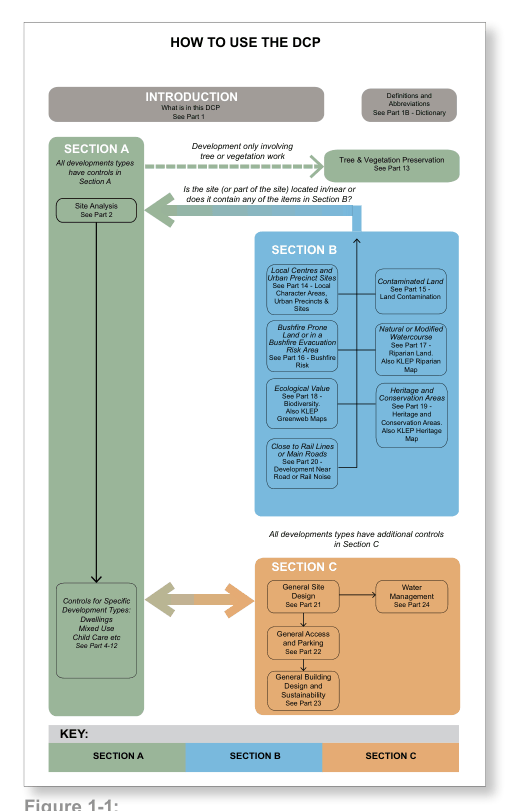

#### 4. Hyperlinks

To facilitate easy referencing between different Sections and Parts,

hyperlinks in the e-version of the DCP are provided within the coloured

boxes at the top of pages, or directly underneath topic headings. The

colour of the box is the same as the signature colour of the Section being

referenced as indicated in the diagram below.

#### Further controls that may apply: SECTION A

PART 2 – Site Analysis

#### SECTION B

PART 19 – Heritage Conservation Areas

#### SECTION C

PART 21 – General Site Design

#### How is the DCP set out?

Following this Introduction and Preliminary Part 1, this DCP is set out in

three (3) Sections: A, B and C, each with a number of Parts. The Sections are designed to be used together to inform the design

process. Refer to Figure 1-1 for a visual representation of the relationship

between the Sections and Parts to help with the use of the DCP. This

diagram is included at the start of the Contents pages.

> [Picture on page 3: a map, saved as a picture (images/part-01-introduction-page-3-22.gif, 150 dpi); the street names and other small labels are on the picture.]
> Words printed on the picture (title and legend, copied from the PDF):
> HOW TO USE THE DCP
> What is in this DCP
> See Part 1B - Dictionary
> See Part 1
> Development only involving
> SECTION A tree or vegetation work Tree & Vegetation Preservation
> All developments types
> See Part 13
> have controls in
> Is the site (or part of the site) located in/near or
> does it contain any of the items in Section B?
> See Part 2
> Local Centres and
> Urban Precinct Sites Contaminated Land
> See Part 14 - Local See Part 15 -
> Urban Precincts &
> Bushfire Prone Natural or Modified
> Land or in a
> See Part 16 - Bushfire
> See Part 17 -
> Also KLEP Riparian
> See Part 18 -
> See Part 19 -
> Also KLEP Heritage
> Close to Rail Lines
> or Main Roads
> See Part 20 -
> Road or Rail Noise
> All developments types have additional controls
> in Section C
> General Site Water
> See Part 21 See Part 24
> Controls for Specific
> Child Care etc
> See Part 4-12
> See Part 22
> See Part 23
> SECTION A SECTION B SECTION C

Figure 1-1:

### INTRODUCTION

#### Illustrated Guide to the DCP

#### Structure of the DCP

This DCP comprises of twenty-six Parts. The parts are divided into a Part

explaining the use of the DCP, followed by three sections A, B and C. A

summary of all the Parts are provided below.

#### Introduction

Part 1 applies to all development types and is critical in:

i) understanding how to navigate through the DCP,

ii)	 understanding the relationship between this DCP and other

statutory documents; and

iii)	 understanding terms within the DCP. Part 1A: Preliminary This Part contains general statutory information about how the DCP was

prepared, the general aims of the DCP and its relationship to the

Ku-ring-gai Local Environmental Plan (KLEP) and other planning and

design documents. Part 1B: Dictionary This part includes definitions to clarify terms used in this DCP. Terms

used in the dictionary of the KLEP also apply to this DCP. This Part also includes a list of the abbreviations used in the DCP.

### SECTION A - applies to all development types

Section A comprises Part 2-13 Part 2 applies to all development types critical in:

i) project feasibility assessment; and

ii)	 the beginning of the design process Part 2 is to be read in conjunction with the Parts of Section B that are

applicable to the site. Parts 3-13 contain detailed provisions that apply to the main development

types likely to be proposed on land covered by the KLEP. Where a

particular development type is not included in Section A, the objectives

and controls in Section C will apply. Parts 3-13 set parameters within which good building design can occur

by illustrating the use of development controls and consistent guidelines

for site and building design, which focus on building performance,

functionality, form, layout and residential amenity. Parts 3-13 are intended to be read in conjunction with the relevant parts in

Section C. The order of provisions within all the Parts is generally consistent with the

order of the design process, although it is recognised that this will not be

the same for all designers. It is also important to recognise that the design

p 1A-4

process is inherently iterative, as shown in Figure 1-1, and that some

Parts will need to be reviewed more than once.

## Part 2: Site Analysis

This Part outlines the requirements for a site analysis. A site analysis is

required for all development proposals. A thorough analysis of the site

and its context enables the consideration of relevant issues at the earliest

stage of the design process. This helps to minimise costs and delays

while supporting good location based design.

## Part 3: Land Amalgamation and Subdivision

This Part provides guidance on amalgamation of multiple lots preventing

isolation of lots; and, guidance on subdivision of lots. The controls provide

detail on specific objectives and controls which are to be taken into

account when amalgamating and/or subdividing lots.

## Part 4: Dwelling House

This Part contains provisions for single dwelling houses and ancillary

structures built in the R2 - Low Density Residential, C4 - Environmental

Living, R3 - Medium Density Residential and R4 - High Density

Residential zones.

## Part 5: Secondary Dwellings

This Part provides detailed provisions for secondary dwellings which

are permissible in R2 - Low Density Residential and C4 - Environmental

Living zones under the KLEP. These controls are to be read in

conjunction with the relevant objectives and controls for dwelling houses

in Part 4.

## Part 6: Multi-Dwelling Housing

This Part provides guidance for multi-dwelling housing developments

being built within R3 - Medium Density Residential and R4 - High Density

Residential zones. Dwelling types can include detached and attached

townhouse dwellings or villas.

## Part 7: Residential Flat Buildings

### INTRODUCTION

This Part contains guidance for residential flat buildings which are

permissible in the R1 - General Residential, R4 -High Density Residential

and MU1 - Mixed Use zones. Where commercial premises are permitted

on the ground floor under Schedule 1 of the KLEP, also refer to Part 8 and

Section B Part 14.

## Part 8: Mixed Use Development

The main focus of this Part is the provision for mixed use buildings within

the E1 - Local Centre zone and MU1 Mixed Use zone. As defined in the

KLEP, a mixed use building is one which contains 2 or more uses. In

the context of Ku-ring-gai, mixed use buildings will typically contain the

following uses:

i) retail or other commercial uses at ground and lower levels; and

ii)	 residential apartments and/or offices on upper levels. This Part also guides refurbishment and new business and retail

development in the E1 - Local Centre and MU1 - Mixed Use zone.

p 1A-5

These developments will typically be alterations and additions to existing

retail or business premises, or single storey retail or business premises,

that do not wish to provide residential development in the upper levels at

this time. Guidance is also provided for the development and operation of

commercial premises in residential flat buildings, where they are

permitted by Schedule 1 (Additional Permitted Uses) of the KLEP. In the case of any inconsistency between the controls in Part 8 and those

in Section B Part 14, the controls in Section B Part 14 will prevail to the

extent of that inconsistency.

## Part 9: Non-Residential and Office Buildings

This Part includes controls for all non-residential building developments

including offices, within the E1 - Local Centre, MU1 - Mixed Use, E3

Productivity Support. For mixed use buildings, it applies to those parts of

the building to be used for non-residential and office purposes.

## Part 10: Child Care Centres

This Part contains the provisions to guide the development of Child Care

Centres. This part complements the provisions of the Children (Education

and Care services National Law Application Act 2010 and the Education

and Care Services National Regulations 2011.

## Part 11: Sex Industry Premises

This Part provides specific planning controls for Sex Services Premises

and Home Occupation (Sex Services) Premises. Under KLEP, Sex Services Premises and Home Occupation (Sex

Services) Premises are permissible with consent in the E1 - Local Centre,

MU1- Mixed Use and B7 - Business Park zones. This Part of the KLEP

which places further restrictions on the location of sex services premises

of the DCP is to be read in conjunction with KLEP.

## Part 12: Signage and Advertising

This Part includes objectives and controls for signage and advertising

structures. This Part of the DCP is to be read in conjunction with State

Environmental Planning Policy (Industry and Employment), Chapter 3

Advertising and Signage, and Schedule 2 of the KLEP which makes

certain signage and advertising permissible as exempt development.

## Part 13: Tree and Vegetation Preservation

This Part of the DCP contains requirements for the preservation of

trees and vegetation on all land covered by the KLEP. This Part is made

in accordance with Chapter 2 of State Environmental Planning Policy

(Biodiversity and Conservation) 2021 and prescribes the trees and

vegetation to which Part 2.3 applies. It replaces the Tree Preservation

Order for the lands to which KLEP applies. This Part provides controls in relation to the protection, management

and long term survival of Ku-ring-gai’s tree and vegetation resource,

both native and exotic. Tree and vegetation works that do not require

Council consent are also listed. This Part establishes a framework for the

submission of applications for tree and vegetation works in Ku-ring-gai. Where trees are located on a Heritage Item property or within a Heritage

Conservation Area, this Part should be read in conjunction with Clause

5.10 of KLEP and Section B Part 20 of this DCP.

### SECTION B - applies to relevent site aspects

Section B contains objectives and controls in relation to special

circumstances or values that may apply to a site or area, regardless of the

zoning or the development type. It is important to be aware of Council’s expectations very early in the

development feasibility or design stage in matters such as urban precincts

and sites, potential land contamination, the management of bushfire risk,

the natural environment, cultural heritage, and safety and amenity close

to railways or busy roads amongst others. In the case of any inconsistency between the controls in Sections

A, B and C, the controls in Section B will prevail to the extent of the

inconsistency.

## Part 14: Local Character Areas, Urban Precincts and Sites

This Part is structured to provide guidance for development within the Ku-

ring-gai Local Character Areas and land identified as an Urban Precinct

or Site. The Local Character Areas guide development in all parts of Ku-ring-gai

and seek to ensure new development demonstrates consideration of the

prevailing local character. The eight Local Character Areas are as follows:

- Ridge and Centres Character Area

- Green Fingers Character Area

- Western Interface Character Area

- West Pymble Character Area

- Northern Plateau Character Area

- Eastern Interface Character Area

- Western Slopes Character Area

- North Turramurra Table Character Area

This Part also identifies certain urban precincts and sites that have

undergone master planning; and associated controls for each of the urban

precincts or sites. For each of the urban precincts or sites a set of site-specific performance-

based provisions are provided to guide development in addition to the

other development controls in Sections A, B and C of this DCP.

### INTRODUCTION

Each urban precinct or site has a number of components as follows:

- Precincts

- Community Infrastructure

- Building Setbacks

- Built Form

- Public Domain and Pedestrian Access

- Building Entries, Car Parking and Service Access

For each of the urban precincts or sites a set of site-specific performance-

based provisions are provided to guide development in addition to the

other development controls in Sections A, B and C of this DCP.

## Part 15: Land Contamination

This Part requires the applicant to consider whether the site is

contaminated. It contains provisions to ensure that the site is suitable,

or can be made suitable, for the proposed development. It supplements

State Environmental Planning Policy (Resilience and Hazards) 2021 –

Chapter 4 Remediation of Land.

## Part 16: Bushfire Risk

This Part applies to land that is identified on Council’s Bush fire Prone

Lands Map and Bush fire Risk Evacuation Map. It includes objectives and

design controls to ensure that any development on these lands manages

risk to life and property while protecting the ecological values of the site

and surrounds. It complements Planning for Bush fire 2019.

## Part 17: Riparian Lands

This Part supports the provisions of Clause 6.4 of the KLEP. It applies to

all land identified within the Riparian Lands and Watercourse Map in the

KLEP. This part provides general guidance for development in riparian lands

(including waterways) as well as additional guidance for development

within specific categories of riparian lands identified on the Riparian

Lands Map.

## Part 18: Biodiversity Controls

This Part supports the provisions of Clause 6.3 of the KLEP. It applies to

all land identified as ‘Biodiversity’ on Terrestrial Biodiversity Map in the

KLEP as well as to development that will have an impact on those lands. It also applies to land identified as “Canopy Remnants” on the Greenweb

maps at Part 18R.1. Applicants are required to check both the KLEP and

DCP maps to determine whether a site is affected by this Part. In combination, these lands are referred to as the Greenweb for the

purposes of this DCP.

## Part 19: Heritage Items and Heritage Conservation Areas

Part 19 applies to any development that is:

i) on a Heritage Item listed under Schedule 5 Environmental

Heritage in KLEP;

ii)	 in a Heritage Conservation Area (HCA) identified in KLEP;

iii)	 in the vicinity of a Heritage Item identified in KLEP. This Part includes objectives and design controls to ensure that any

development involving a Heritage Item conserves and enhances

the Item. It also seeks to mitigate any potential adverse impacts of

new development on the setting of Heritage Items and the Heritage

Conservation Areas.

## Part 20: Development near Rail Corridors and Busy Roads

This Part contains objectives and controls to ensure that development

adjacent to major infrastructure corridors is located and designed to

protect the infrastructure from damage; and, the users of the development

from noise, vibration and other impacts related to development adjoining

major road and rail infrastructure.

### SECTION C - applies to all development

Section C contains general development controls which address planning

issues that are applicable across a range of sites and across different

types, forms and densities of development. To ensure a consistent

approach to issues, this Part applies to all types of development. The Parts in this Section are to be read in conjunction with the Parts of

Section B relevant to the specific site, and the controls under the same

heading in Section A for the specific development type.

## Part 21: General Site Design

This Part provides Council’s controls concerning site design and layout,

with particular attention to the relationship with the site analysis, and to

landscaping, earthworks and slope. The Part provides controls which

minimise the impact of the development on the site’s native vegetation

natural landscape and bushland, manages excavation and any earth

works on a site, and ensures appropriate designing for sloping sites.

## Part 22: General Access and Parking

Issues addressed in this Part includes equitable access and pedestrian

movements; vehicle and bicycle access and parking.

## Part 23: General Building Design and Sustainability

This Part provides general development controls for Building Design and

Sustainability. This section aims to provide information for all building

types on issues including green buildings, building services, waste

management, social impact, sustainability of building materials and

colours, roof terraces and podiums, construction, demolition and waste

disposal.

## Part 24: Water Management

This Part aims to ensure that the water management techniques

employed for any given development are appropriate to both the site

location and the development type as identified in Section B of this DCP.

It therefore applies different controls to different situations and is to be

followed from the start of the design process.

### INTRODUCTION

This Part supports Clause 6.5 of the KLEP. The controls cover stormwater

management, design and water quality, water recycling and reuse (where

reuse for water conservation is not covered by BASIX), subsurface water

management and flood control and minimisation. This Part of the DCP is

also intended as a complementary document to BASIX.

## Part 25: Waste Management

This Part provides objectives and controls to minimise the impact of

waste management generated from development. This Part aims to

provide information on how developments can manage waste, including

waste storage, waste collection, layout of waste and recycling rooms, and

management of bulky goods waste. It considers waste management for

particular development types.

### THIS  PAGE  IS  INTENTIONALLY  BLANK

### 1A
