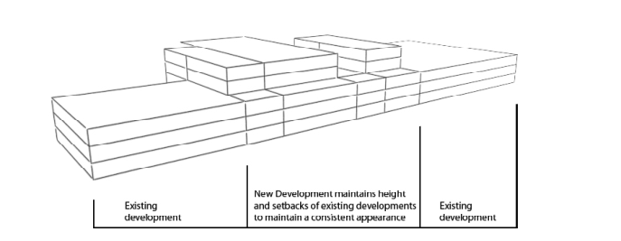

#### 1B Dictionary

1B.1 Definitions 1B.2 Abbreviations

### DICTIONARY

### 1B.1	DEFINITIONS

In this DCP the following definitions apply. Terms used in the dictionary

of the KLEP also applies to this DCP.

accessible car parking car parking that is designed and built in accordance with the provisions

in AS2890.6 to accommodate the needs of occupants with mobility

impairment.

acoustic privacy

a measure of sound insulation between apartments, between

apartments and communal areas, and between external and internal

spaces.

active street frontage

building street frontages at street level that provide direct and level

entry and openings to allow physical and visual access that encourage

interaction between the inside of a building and the external areas

adjoining the building, including footpaths, road reserves or public

spaces. Active street frontages support pedestrian safety and amenity

and provide an interface between the public and private domain. Note: See the definition of ‘street frontage’ and ‘street level‘ in this

dictionary.

adjoining land

land that has a boundary in common with the site on which the

development is proposed or that is separated from the site by not more

than a pathway, driveway, laneway, roadway or similar thoroughfare.

advertisement

has the same meaning as in the KLEP 2015. Note: The term is defined as follows: the term is defined as a sign, notice, device or representation in the

nature of an advertisement visible from any public place or public reserve

or from any navigable water.

advertising structure

has the same meaning as in the KLEP 2015. Note: This term is defined as follows: the term is defined as a structure used or to be used principally for the

display of an advertisement. Advertising structures are a type of signage -

see the definition of signage in this Dictionary.

afflux

the rise in water level in a stream, channel or flow path caused by a

constriction or impediment downstream. two or more a number of lots joined to form a single development site

for the purposes of a development application.

amalgamated

development site amenity

the ‘liveability’ or quality of a place which makes it pleasant and

agreeable to be in for individuals and the community. Amenity is

important in both the public and private domain and includes the

enjoyment of sunlight, views, privacy and quiet.

ancillary

in the context of residential development, includes but is not limited to,

such related facilities as a swimming pool, outbuilding, pergola, patio,

pathway, driveway or tennis court.

aquatic habitat

the natural home of marine or freshwater animals, plants or organisms.

articulation zone

the area of three dimensional modelling at the periphery of the building,

including any changes in façade alignment, balconies, bay windows and

sun shading devices.

at-grade

on ground level (not on a building structure).

attached dwelling

has the same meaning as set down in the KLEP. Note: The term is defined as follows: a building containing 3 or more dwellings, where

a. each dwelling is attached to another dwelling by a common wall, and

b. each of the dwellings is on its own lot of land, and

c. none of the dwellings is located above any part of another dwelling. the long term average number of years between floods which will equal

or exceed the selected event.

average recurrence

interval backwater

that part of a stream, channel or flowpath where the water is kept back

due to some controlling influence or obstruction downstream.

back-up facility

means a facility that assists in the operation of the child care centre

including cot rooms, child-accessible toilet areas, nappy change areas

and bottle preparation areas.

balcony

any unenclosed platform (with balustrades) located at the height of 0.3

metres or more above adjacent finished ground level either cantilevered

or supported over open space, which is attached to a dwelling and used

for the exclusive enjoyment of the occupants.

bank

the primary bank of a waterbody.

barrier free access

approach and entry of a facility which is accessible by persons with

disabilities (eg. grade level entry).

basement

has the same meaning as set out in the KLEP. Note: The term is defined as follows: basement means the space of a building where the floor level of that

space is predominantly below ground level (existing) and where the floor

level of the storey immediately above is less than 1 metre above ground

level (existing).

bay window

a large window or series of windows projecting from the outer wall of a

building and forming a recess within.

bedroom

any habitable room, which in the opinion of Council, is capable of being

used as a bedroom.

### DICTIONARY

biodiversity corridor

an area to facilitate the connection and maintenance of native flora and

fauna habitats. Within the urban landscape, biodiversity corridors may

be broken by roads and other urban elements and may include remnant

trees and associated native and exotic vegetation.

blank wall

an expanse of wall that does not contain any openings. Walls with

advertising or facade modelling, which have no openings, are

considered blank walls.

building height

has the same meaning as in the KLEP. Note: The term is defined as follows: building height (or height of building) means the vertical distance between

ground level (existing) and the highest point of the building, including

plant and lift overruns, but excluding communication devices, antennae,

satellite dishes, masts, flagpoles, chimneys, flues and the like.

the long term average number of years between floods which will equal

or exceed the selected event.

average recurrence

interval backwater

that part of a stream, channel or flowpath where the water is kept back

due to some controlling influence or obstruction downstream.

back-up facility

means a facility that assists in the operation of the child care centre

including cot rooms, child-accessible toilet areas, nappy change areas

and bottle preparation areas.

balcony

any unenclosed platform (with balustrades) located at the height of 0.3

metres or more above adjacent finished ground level either cantilevered

or supported over open space, which is attached to a dwelling and used

for the exclusive enjoyment of the occupants.

bank

the primary bank of a waterbody.

barrier free access

approach and entry of a facility which is accessible by persons with

disabilities (eg. grade level entry).

basement

has the same meaning as set out in the KLEP. Note: The term is defined as follows: basement means the space of a building where the floor level of that

space is predominantly below ground level (existing) and where the floor

level of the storey immediately above is less than 1 metre above ground

level (existing).

bay window

a large window or series of windows projecting from the outer wall of a

building and forming a recess within.

bedroom

any habitable room, which in the opinion of Council, is capable of being

used as a bedroom.

biodiversity corridor

an area to facilitate the connection and maintenance of native flora and

fauna habitats. Within the urban landscape, biodiversity corridors may

be broken by roads and other urban elements and may include remnant

trees and associated native and exotic vegetation.

blank wall

an expanse of wall that does not contain any openings. Walls with

advertising or facade modelling, which have no openings, are

considered blank walls.

building height

has the same meaning as in the KLEP. Note: The term is defined as follows: building height (or height of building) means the vertical distance between

ground level (existing) and the highest point of the building, including

plant and lift overruns, but excluding communication devices, antennae,

satellite dishes, masts, flagpoles, chimneys, flues and the like.

building line or setback has the same meaning as in the KLEP.

Note: The term is defined as follows: building line or setback means the horizontal distance between the

property boundary or other stated boundary (measured at 90 degrees

from the boundary) and:

(a)  a building wall, or

(b)  the outside face of any balcony, deck or the like, or

(c)  the supporting posts of a carport or veranda roof, whichever distance is the shortest.

has the same meaning as in the KLEP 2015.

building identification

sign

Note: The term is defined as follows: means a sign that identifies or names a building and that may

include the name of a building, the street name and number of a

building, and a logo or other symbol but does not include general

advertising of products, goods or services. Building identification

signs are a type of signage—see the definition of signage in this

Dictionary. State Environmental Planning Policy (Sustainable Buildings) 2022.

building sustainability

index (BASIX) building zone

the area within which a building can be built, usually represented in plan

and section.

built-upon area

the area of a site containing any built structure (whether covered or

uncovered, above ground or below ground), any building, carport,

terrace, hard-surface, paving, porous paving, artificial grass, pathway,

gravel area, swimming pool, tennis court, driveway, parking area, or any

like structures, but excluding minor landscape features such as informal

seating, an open garden arch (<4sqm), and ponds (<4sqm).

bush fire hazard

bush fire prone land identified as “bush fire prone vegetation Category

1” or “bush fire prone vegetation Category 2” on the Ku-ring-gai Bush

fire Prone Lands Map.

bushland

land on which there is vegetation which is either a remainder of the

natural vegetation of the land or, if altered, is still representative of the

structure and flora of the natural vegetation. has the same meaning as in the KLEP 2015.

business identification

sign

Note: The term is defined as follows: business identification sign means a sign;

a)	 that indicates

i) the name of the person or business, and

ii)	 the nature of the business carried on by the person at the

premises or place at which the sign is displayed, and

### DICTIONARY

b)	 that may include the address of the premises or place and a

logo or other symbol that identifies the business, but that does not contain any advertising relating to a person who

does not carry on business at the premises or place. Business

identification signs are a type of signage - see the definition of that

term in this Dictionary.

busy road

a freeway, a tollway or a transitway or any other road with an annual

average daily traffic volume of more than 20,000 vehicles and that the

consent authority considers is likely to be adversely affected by road

noise or vibration. Note: Also see definition of major roadway.

catchment

an area of land from which all runoff water flows to the same low point

in a waterbody or drainage depression (creek, river, harbour, etc) and

always relates to a specific location.

### INTRODUCTION INTRODUCTION

### INTRODUCTION INTRODUCTION

|  | 1B.1 DEFINITIONS (CONTINUED) |
|---|---|
| character item | A character item is a building with a commercial streetscape that has a significant facade that warrants retention within the street wall. A character item is not a heritage item. |
| clinical waste | any waste having the potential to cause infection and that has been generated by medical, nursing, dental, veterinary, pharmaceutical or other related activities, includes infectious substances, pathogenic substances, pharmaceutical’s and pharmaceutical residues, cytotoxic substances and wastes from the production and preparation of pharmaceutical products. |
| commercial waste | refuse or waste material arising from any trade or industry but excludes liquid waste, demolition waste, building waste, contaminated waste, green waste or recyclable waste. |
| common area | that part of the site not subject to exclusive or private use by any particular residents or occupants of the building(s) and which is under the control of a body corporate. Common area includes setback areas and communal open spaces that provide landscaping and deep soil areas. |
| communal open space | outdoor open space within the common area with shared facilities such as barbeque, seating, etc. for recreation, relaxation and social activities of residents and occupants of a development. Communal Open Space is not for the exclusive use of individual residents or occupants of any single dwelling. It does not include private open space. |
| community land development | community land development within the meaning of the Community Land Development Act 2021. |
| compatible use | a use for a heritage item which involves no change to its culturally significant fabric, changes which are substantially reversible or changes which make a minimal impact |
| compost | vegetative material capable of being converted to humus by a biological decay process. |
| conservation (general) | the use, management and protection of resources so that they are not degraded, depleted or wasted and are available on a sustainable basis for present and future generations. |
| conservation (of a Heritage Item) | All the processes of looking after an item so as to retain its cultural significance. It includes maintenance and may, according to circumstances, include preservation, restoration, reconstruction and adaptation and will be commonly a combination of more than one of these |
| conservation management strategy | a document that identifies conservation strategies and management strategies that are appropriate to enable the general significance of a heritage item to be retained. |
| contaminated waste | waste which has the potential to cause injury, infection or offence. Sources include medical, nursing, dental veterinary, pharmaceutical and similar facilities engaged in treatment, investigation, teaching or research. Domestic sources include sharps and associated medical waste generated as a result of home based treatment of a medical condition (such as those associated with a diabetes sufferer or dialysis patient). |

contributory property

contributory properties are buildings and sites within a HCA which are

deemed to exhibit one or more of the following characteristics:

i) buildings and sites that make an important contribution to the

character and significance of the HCA. They can be from a key

historical layer, true to an architectural type, style or period,

or highly or substantially intact including their garden setting.

Where subdivision has occurred, the subdivision is within the

key historical period or the area.

ii)	 buildings and sites which are altered from their original form

but are recognisable and could be reasonably reinstated

to that condition or the alterations are not considered to be

detrimental to the integrity of the building; for example, a

building that has been rendered or painted or where the roof

cladding has been replaced but the form is otherwise legible.

iii)	 buildings and sites with new layers/additions sensitive to the

style, form, bulk, scale and materials of the original building.

Note:  Contributory buildings do not necessarily need to be high-quality

buildings but should represent the key historical period of the HCA. An

HCA may also contain high-quality buildings which are not necessarily

from the key historical period.

convective or stack

effect/solar chimney air

convection

results from hot air being pushed up and out of the dwelling by denser

cold air which is drawn in at a lower level. Convective current air flow/air

pressure improves natural ventilation but does not provide natural cross

ventilation.

core (relating to a building) component of building for vertical circulation (eg. lift, stairs). corner dwellings

a dwelling with aspects at least 90 degrees apart. Corner dwellings are

located only on the outermost corners of buildings.

cornice

a decorative horizontal moulding at the top of a building which ‘crowns’

or finishes the external façade.

coved

to make in an inward curving form. A concave surface forming a

junction between a ceiling and a wall.

cross-over dwelling

a dwelling with two opposite aspects that has more than one level or a

change in levels between one side of the dwelling and the other.

### DICTIONARY

cross-through dwelling a dwelling which is on one level with two opposite aspects. curtain wall

a non-bearing wall, often of glass and steel, fixed to the outside of a

building and serving especially as cladding.

dangerous goods

has the same meaning as in the Dangerous Goods Act 1975.

datum or datum line

a significant point or line in space established by the existing or desired

context, often defined as an Australian Height Datum.

daylight

consists of both diffused light from the sky (sky light) and sunlight. Note: See the definition of ‘sunlight’ in this dictionary.

dead tree

a tree is considered dead when it has no living vascular tissue.

deck

an external platform, usually elevated, usually located alongside and

accessible from an interior space or around a swimming pool, and often

made of timber.

deep soil landscaping

the soft landscaped part of the site area:

i) that is not occupied by any structure, whether above or below

the surface of the ground, except for minor structures such as:

- paths to 1.2m wide;

- storm water pipes of 300mm or less in diameter;

- lightweight fences;

- bench seats;

- lighting poles;

- drainage pits with a surface area less than 1m2.

ii)	 that has a minimum width of 2m;

iii)	 that is not used for car parking;

iv)	 may be used for water sensitive urban design, provided it does

not compromise the ability to achieve the screen and canopy

planting required by this DCP. Note: For the purposes of calculating deep soil landscaping and

landscaped areas, any access handle on battle axe sites is excluded.

demolition (heritage)

The damaging, defacing, destroying or dismantling of a heritage item or

a component of a heritage conservation area, in whole or in part.

designated development has the same meaning set down in the Environmental Planning and

Assessment Act 1979.

development

has the same meaning set down in the Environmental Planning and

Assessment Act 1979.

development application has the same meaning set down in the Environmental Planning and

Assessment Act 1979. the Council officer with primary responsibility for assessing the

development application.

development

assessment officer

a Council officer with responsibility for a group of development

assessment officers.

development

assessment team leader drainage easements

the legal rights attached to land whereby another parcel of land has the

right to use part or all of the land for the purpose of draining water.

drainage reserves

the lands vested in Council for drainage purposes.

dripline of a tree

the horizontal extent of the canopy of the tree.

dual aspect dwelling

a dwelling which has unobstructured external door and window

openings in major external walls facing in different directions, including

corner, cross over and cross through dwellings.

dual occupancy

has the same meaning as in the KLEP. Note: The term is defined as follows: dual occupancy means a dual occupancy (attached) or dual occupancy (detached). has the same meaning as in the KLEP.

dual occupancy

(attached)

Note: The term is defined as follows: dual occupancy (attached) means 2 dwellings on one lot of land that are attached to each other, but does not include a secondary dwelling.

has the same meaning as in the KLEP.

dual occupancy

(deattached)

Note: The term is defined as follows: dual occupancy (detached) means 2 dwellings on one lot of land, but does not include a secondary dwelling.

dual-use facility

means a child care centre and another independent use or a child care

centre within a residential dwelling house where both uses are located

on a single site but uses are separated.

earthworks

has the same definition as in the KLEP. Note: The term is defined as follows: earthworks means excavation or filling.

edge effects

the detrimental impacts on natural areas at the interface with urbanised

environments. An increased proportion of edge increases the potential

for:

- Weed invasion;

- Predation by companion animals;

- Disturbance by humans and animals;

- Dumping of garden refuse;

- Wind and light penetration.

Reducing edge effects can assist with maintaining species diversity and

composition, community dynamics, and ecosystem functioning.

effective slope

has the same meaning as in Planning for Bush Fire Protection 2019. Note: The term is defined as follows: the effective slope is considered to be the slope under the vegetation

which will most significantly influence the bush fire behaviour for each

aspect.

erosion control devices measures to assist in minimising erosion and downstream

sedimentation.

excavation

has the same meaning as set down in the KLEP. Note: The term is defined as follows:

### DICTIONARY

excavation means the removal of soil or rock, whether moved to another

part of the same site or to another site, but does not include garden

landscaping that does not significantly alter the shape, natural form or

drainage of the land.

external collection point usual (or agreed) point on the footpath/roadway, where waste and

recyclables are loaded onto vehicles. The waste and recycling

containers are placed on the footpath, by the occupant of the property,

just prior to the collection day and removed after the waste is picked up

by Council’s contractors. Applicable to residential development where

the number of units is less than 6.

façade

the external face of a building.

family day care

means a service that provides care for up to 7 children aged less than

12 years in the home of the family day care provider. Family day care

providers are governed by the management structure of a family day

care scheme.

fascia sign

a type of business identification sign located on the fascia of the awning

of a building.

| fill | has the same meaning as set down in the KLEP. Note: The term is defined as follows: fill means the depositing of soil, rock or other similar extractive material obtained from the same or another site, but does not include: (a) the depositing of topsoil or feature rock imported to the site that is intended for use in garden landscaping, turf or garden bed establishment or top dressing of lawns and that does not significantly alter the shape, natural form or drainage of the land, or (b) the use of land as a waste disposal facility. |
|---|---|
| finished ceiling level (FCL) | the level of the lower surface of the relevant ceiling. |
| finished floor level (FFL) | the level of the upper surface of the relevant floor. |
| firearms outlet | premises used for the display, exhibition or sale of goods which require a license under Section 7 of the NSW Firearms Act (1996). |
| fire egress | a path or opening for going out (ie. an exit) in a fire or emergency situation. |
| flood | a relatively high stream flow that overtops the natural or artificial banks in any part of a stream, river, estuary, lake or dam, and/or overland runoff before entering a waterbody. |
| flood standard | the zone in a plan view of the 1:100 year flow through the property. |
| conveyance zone |  |
| french (or juliet) balcony | a small projecting balcony, generally ornamental or only large enough for one person standing. |
| furnishing | the furniture, appliances, and other movable articles in an outdoor dining area, but excludes planter boxes, utensils, dining sets and the like. |
| gold level | the intermediate highest level of housing within the Livable Housing Guidelines. It features design elements allowing ageing in place and accommodating people with higher mobility needs. Note: Refer to www.livablehousingaustralia.org.au |
| green building | is one that incorporates design, construction and operational practices that significantly reduce or eliminate the negative impact of development on the environment and building occupants. |
| green star rating | is an internationally-recognised assessment of the sustainable attributes of a development which enable it to minimise its impact upon the environment. The Green Building Council of Australia (GBCA) provides a formal certification process for ratings of Four Star Green Star (‘Best Practice’) and above; this service provides for an independent third party review of buildings and their sustainable attributes and initiatives. |
| green waste | organic garden waste. This includes any waste material that in its raw form comprises vegetation (such as grass, leaves, mulch, plants, branches, twigs and tree loppings). Green waste does not refer to wood wastes such as tree stumps or kitchen vegetable scraps. |

greenweb

Greenweb includes:

1\.	 All land identified on the Greenweb map in Part 19 of this

Development Control Plan and includes land identified as:

i) Core Biodiversity Lands;

ii)	 Support for Core Biodiversity Lands;

iii)	 Landscape Remnant;

iv)	 Biodiversity Corridors and Buffer Areas;

v)	 Canopy Remnants

2\.	 Other lands that meet the criteria for Greenweb in accordance with

the methodology contained within the  Ku-ring-gai Biodiversity and

Riparian Lands Study Version 5.

greywater

household wastewater that has not come into contact with toilet waste.

gross pollutant

litter and debris that is transported by urban runoff and that is not less

than 5mm in diameter and/or is retained by a 5mm mesh screen. a structure that acts as a water pollution control measure by intercepting

and retaining gross pollutants (coarse sediment, trash and debris).

gross pollutant trap

(GPT) ground level

has the same meaning as the KLEP. Note: The term is defined as follows: ground level (existing) means the existing level of a site at any point. ground level (finished) means, for any point on a site, the ground surface

after completion of any earthworks (excluding any excavation for a

basement, footings or the like) for which consent has been granted or that

is exempt development. ground level (mean) means, for any site on which a building is situated or

proposed, one half of the sum of the highest and lowest levels at ground

level (finished) of the outer surface of the external walls of the building

habitable room

any room or enclosed space 4sqm or greater used for normal domestic

activities, including living, dining, family, lounge, bedrooms, study,

kitchen, sun room and play room – but excludes bathrooms, separate

toilets, laundries, pantries, walk-in robe, corridors and hallways.

### DICTIONARY

hazardous waste

any waste that because of its physical, biological or chemical properties,

is capable of causing a danger to the life or health of any living thing if

it is released into the environment, and/or is, or contains a substance

described in the Protection of the Environment Operations Act 1997

e.g. can include dangerous goods, poisons, liquids and other waste

containing hazardous components. If in doubt contact the NSW

Environment Protection Authority or Council.

heat island effect

is when urban areas are significantly warmer than their surrounding

rural areas due to the removal and replacement of natural vegetated

landscapes with concrete, asphalt, and buildings which absorb and

trap more heat during the day and release it slowly at night, leading

to higher ambient temperatures. Urban heat can pose a risk to human

health, infrastructure and the amenity of an area. Urban heat islands can

compound the effects of climate change, making higher temperatures

and heatwaves more severe and difficult to manage.

high side

the site slopes upwards from the Primary street.

holding berm

a small bank for retaining water.

hopper

a fitting into which waste is placed and from which it passes into a chute

or directly into a waste container. It consists of a fixed frame and hood

unit (the frame) and a hinged or pivoted combined door and receiving

unit.

hydraulics

the study of flow of fluid. In civil engineering, this concerns mainly flow

of water in waterways – in particular, the changes in flow parameters

such as water level and velocity.

hydrology

the study of water as it relates to rainfall and the runoff process – in

particular, catchment behaviour, flow rates and volumes.

illuminated wall sign

any sign that is internally or externally illuminated.

impervious

land or material that is not readily penetrable by water.

in the vicinity

(of a Heritage Item or

#### HCA)

not only means immediately adjoining a heritage item or HCA, but

depending on site context, can be extended to include other sites with

a high visual presentation due to landform, size or location of a heritage

item or HCA

internal collection point a designated hard stand area suitable in size for the number and type of

containers utilised by the development. Waste and recyclable materials

are placed at the collection point, by the occupant, for collection of the

day of service and are then returned to the designated waste storage

area. Applicable to residential development where the number of units is

more than 4 and for commercial and industrial development.

intervening lot

any lot that is located on the bush fire hazard side of the lot to be

subdivided, and may be directly adjoining or separated by a public or

private road, pathway, access handle to another lot or the like.

invert

the lowest point of a channel or gutter, or the internal base of a pipe. Key vegetation communities contain significant vegetation. These are

defined as:

key vegetation

community

- communities currently listed under the NSW Threatened

Species Conservation (TSC) Act 1995, NSW Fisheries

Management (FM) Act 1994 and / or the Environmental

Protection and Biodiversity Conservation (EPBC) Act 1999.

- Coastal Shale Sandstone Forest (this community type 92%

cleared as listed in the VIS Classification Database. That is,

has less than 8% of its estimated distribution prior to 1750

remaining in the catchment area.

Vegetation condition is a key factor determining the inclusion of remnant

vegetation as a threatened ecological community, under the TSC Act,

FM Act and EPBC Act. In order to recognise that future variations

in federal and state scientific committee determinations and their

interpretation may occur, Key Vegetation Communities have been based

upon vegetation community not condition. As such Key Vegetation

Communities may include areas outside the scope of conditions

required to meet the determination. NSW Office of Environment and Heritage, VIS (Vegetation Information

Systems) Classification Database available at www.environment.nsw.

gov.au/research/Visclassification.htm

Ku-ring-gai Natural Area all Council managed lands classified as community land and

categorised as ‘Natural Areas’ under the NSW Local Government Act

1993, and crown land under Crown Lands Act 1989 (under care control

and management of Ku-ring-gai Council as a natural area).

landmark building

a building of high quality and unique architectural style designed to

be highly responsive to a specific site and its features, and utilizes

architectural elements to be easily seen and recognised as a point of

reference and navigating tool for pedestrians, cyclists and vehicles.

landscaped area

has the same meaning as in the KLEP. Note: The term is defined as follows: landscaped area means a part of a site used for growing plants, grasses and

trees, but does not include any building, structure or hard paved area.

#### LAeq

The equivalent continuous noise level. The level of noise equivalent

to the energy average of noise levels occurring over a measurement

period.

#### LA90

The A-weighted sound pressure level that is exceeded for 90 per cent

of the time over which a given sound is measured. This is considered to

represent the background noise.

light shelf

a horizontal element attached to a window that reflects sunlight up onto

a ceiling surface.

light spill

light that escapes from the area requiring to be lit and lights up adjoining

areas.

### DICTIONARY

| lightwell | a shaft for air or light, enclosed on all sides or which has the potential to be enclosed by future adjoining development, and either open to the sky or glazed. |
|---|---|
| living room | is to be one room of either lounge or dining room, or open plan living areas including eat-in kitchen areas; and it is not to include bedrooms, bathrooms, storage areas, laundries or separate toilets. |
| local fauna habitat | an area of structured vegetation, or alluvial or estuarine vegetation, which provides important habitat for threatened and non-threatened fauna species. Local fauna habitat areas provide stepping stone connections between larger protected areas (including regional fauna habitats and Ku-ring-gai Natural areas). This connection may be direct or through biodiversity corridors. For more detail, see Ku-ring-gai Council (Ku-ring-gai Biodiversity and Riparian Lands Study) . |
| locally indigenous | native vegetation plant species that occurs in the Ku-ring-gai area. |
| local provenance | plant or seed stock of local origin or seed, used to maintain the patterns of variation exhibited by a species over its range, reflecting its evolutionary history. |
| local road | a street with a prime function to provide access to adjacent land uses. |
| low side | the site slopes downwards from the Primary street. |
| maisonette | a two-storey apartment, where the storeys are vertically stacked. |
| main road | a road that is declared to be a main road by an order in force under section 46 of the Roads Act 1993. |
| manor house | has the same meaning as set down in the State Environmental Planning Policy (Exempt and Complying Development Codes) 2008. Note: The term is defined as follows: a residential flat building containing 3 or 4 dwellings, where a. each dwelling is attached to another dwelling by a common wall or .floor, and b. at least 1 dwelling is partially or wholly located above another .dwelling, and c. the building contains no more than 2 storeys (excluding any basement). |

major roadway

Note:  A major roadway for the purposes of this DCP includes:

- Archbold Road

- Bobbin Head Road (between Pacific Highway to Burns Road)

- Boundary Street (between Pacific Highway and Clive Street/

Eastern Valley Way)\

- Burns Road (between Eastern Road and Warrimoo Avenue)

- Eastern Arterial Road

- Eastern Road (between Burns Road and Junction Road)

- Comenarra Parkway

- Fox Valley Road (between Pacific Highway and Comenarra

Parkway)

- Horace Street

- Illoura Avenue (Between the railway bridge to Millewa Avenue)

- Junction Road

- Killeaton Street (between Warrimoo Avenue and Mona Vale

Road)

- Kissing Point Road (between Pacific Highway to The

Comenarra Parkway)

- Lindfield Avenue (between Havilah Road and Tryon Road)

- Lady Game Drive

- Link Road

- M1 Motorway

- Main Road 328: Section of Boundary Street between Pacific

Highway and Babbage Road; Babbage Road; Warringah Road

- Mona Vale Road

- Pacific Highway

- Railway Avenue

- Redleaf Avenue

- Ryde Road

- Secondary Road 2043: Section of Horace Street, Link Road,

Killeaton Street between Stanley Street and Benaroon Avenue

- Telegraph Road

- Yanko Road

### DICTIONARY

Note: The list above is by no means exhaustive. Council may order

that air, noise and/or soil testing be carried out or that a report

be prepared demonstrating the impacts that traffic generated by

the centre will have on the roadway where child care centres are

proposed in the vicinity of other roads that carry a high Section of

traffic. Note: Also see definition of busy road.

medium tree

is a tree capable of achieving 8-12m in height on shale derived soils and

8-10m on sandstone derived soils in the location proposed.

mobile phone base

station

a device used for the transmission of signals through the mobile (or

cellular) telephone network by way of Radio Frequency Electromagnetic

Radiation (RF EME).

mobile care service

means a child care service that visits specific premises at specific

times. The age of children cared for depends on the type of service

provided.

multi dwelling housing has the same meaning as set down in the KLEP.

Note: The term is defined as follows: 3 or more dwellings (whether attached or detached) on one lot of land,

each with access at ground level, but does not include a residential flat

building. has the same meaning as set down in the State Environmental Planning

Policy (Exempt and Complying Development Codes) 2008.

multi dwelling housing

(terraces)

Note: The term is defined as follows: multi dwelling housing where all dwellings are attached and face, and are

generally aligned along, 1 or more public roads.

multi-use facility

a child care centre and other child-related activities or services

(commercial or not-for-profit) operating on a single site often sharing

facilities.

native vegetation

means any of the following types of plants native to New South Wales:

a)	 trees (including any sapling or shrub or any scrub);

b)	 understorey plants;

c)	 groundcover (being any type of herbaceous vegetation);

d)	 plants occurring in a wetland. A plant is native to New South Wales if it was established in New South

Wales before European settlement. Species of plants native to New

South Wales can be identified using Plantnet “official” database. https://plantnet.rbgsyd.nsw.gov.au/search/simple.htm

natural cross ventilation natural ventilation which allows air to flow between positive pressure

on the windward side of a building to the negative pressure on the

leeward side of a building, with openable windows on dual aspects that

enables effective volumes and velocity of air to flow through the dwelling

to provide a greater degree of comfort and amenity for occupants.

A dwelling is considered to be naturally cross ventilated where all

living spaces, all bedrooms and other habitable rooms are on a clear,

unobstructed air flow ventilation path within the dwelling. Natural cross

ventilation is achieved with dual aspect dwelling types including cross-

through, cross-over and corner dwelling types.

natural ventilation

fresh air that enters a room via openings in its external walls on the

outer perimeter of a building without mechanical assistance.

neighbouring land

any land, other than adjoining land, within the Ku-ring-gai local

government area, the enjoyment of which the assessment team leader

considers may be detrimentally affected by the development proposal.

non-habitable room

spaces of a specialised nature not occupied frequently or for extended

periods, including bathrooms, toilets, pantries, walk-in wardrobes,

corridors, lobbies, photographic darkrooms and clothes drying rooms.

north facing

between 30 degrees east and 20 degrees west of true solar north.

### DICTIONARY

| notification | written information provided to potential stakeholders by the Council in the form of a letter, e-mail, information on Council’s website or a sign that may be viewed from a public place. |
|---|---|
| nutrients | substances that provide nourishment to another organism. In the context of stormwater, they consist primarily of Total Phosphorus (filterable phosphorus and particulate phosphorus) and Total Nitrogen (nitrates, nitrites, ammonium compounds and organically bound nitrogen compounds). |
| obvert | the internal top of the pipe or other enclosed drainage system. |
| occupier | a person who lives on the land. |
| on-site detention | a device used to control the rate of stormwater runoff in order to reduce peak discharges during storm events. |
| on-site retention | a device that controls the rate and volume of stormwater runoff to reduce peak and total volume discharges during and after storm events by ensuring that water is reused on the site. |
| open plan operable wall operable window or door orifice Out of School Hours (OOSH) Care overshadowing owner painted sign | dwelling layouts where spaces are not divided into discrete rooms, but are open and connected to allow flexibility of use (typically living, dining, kitchen and study areas). an internal wall which can be moved, for example by sliding, folding, or pivoting, to allow for different room configurations. window or door which can open to the outside. a narrow opening into a pipe or cavity. means a service that provides care for school aged children under 12 years old, usually before or after school hours, on pupil-free days or during school holidays. Centres are usually located on school grounds or in community halls. shadows caused by a proposed structure, together with any existing structures to be retained, but not including shadows cast by trees, vegetation or boundary fences. has the same meaning as in the Environmental Planning and Assessment Act 1979. a sign that is painted directly onto the building fabric. |
| parapet | a horizontal low wall or barrier at the edge of a balcony or roof. Often taken to refer to the decorative element which establishes the street wall height of heritage buildings (see also Cornice). |
| part thereof | in the calculation of the number of items (apartments, parking spaces etc) required, the overall requirement figures are to be rounded up to the nearest whole number. |
| passive surveillance | the casual surveillance of public spaces and streets by the users of the local area or adjoining land. |
| peak discharge | the maximum discharge occurring during a flood event. |
| permitted site discharge | the controlled rate of runoff allowed from a site. |
| pervious | land or material that is penetrable by water. |

#### Planning for Bush fire

#### Protection

the publication produced by the NSW Rural Fire Service and Planning

NSW to provide guidance to Councils, planners, fire authorities,

developers and home owners with regard to bush fire protection

strategies.

platinum level

the highest level of housing within the Livable Housing Guidelines. It

features design elements allowing ageing in place and accommodating

people with higher mobility needs. Note:  Refer to www.livablehousingaustralia.org.au

pole (or pylon) sign

a type of business identification sign that is erected on one or more

poles or pylons independent of any building or other structure.

pollutant

a substance that adversely affects the physical, chemical or biological

properties of the environment.

portico

a porch or walkway with a roof supported by columns, often leading to

the entrance of a building.

potable

drinkable. land which may have been associated with potentially contaminating

activities, as described in Council’s Contaminated Land Policy.

potentially contaminated

land primary street

the street or streets (where there is more than one primary street) to

which the front of a dwelling house, or a main building, on a lot faces

or is proposed to face, and/or which typically forms the main address

of the lot or property and/or has the wider carriageway or carries the

greater volume of traffic. Primary streets include highways, main roads

and local streets.

primary communal open

space

the main consolidated communal open space, providing facilities for

recreation, relaxation and social activities such as seating and barbeque

facilities.

principal active frontage is located on primary streets within the centres and supports a wide

variety of uses and activities on the ground floor and has a very open

and public presence (i.e. windows and doors). Note: Also see Part 8C-14.

private courtyard

private open space which may be on a structure (eg. podium, parking

deck) or at ground level.

private open space

has the same meaning as set down in the KLEP. Note: The term is defined as follows: private open space means an area external to a building (including an

area of land, terrace, balcony or deck) that is used for private outdoor

purposes ancillary to the use of the building.

public exhibition

is where a development application is made available for inspection, by any

person, at the office of Council, and such other places to be determined by

Council for a period not less than fourteen (14) calendar days.

public street

i) any road that is opened or dedicated as a public road, whether

under the Roads Act 1993 or any other Act or law, and

ii)	 any road that is declared to be a public road for the purposes

of the Roads Act 1993.

putrescible waste system food or animal matter (including dead animal parts) or unstable or

untreated biosolids.

### DICTIONARY

| rainscaping | directing runoff from hardstand areas to a garden or lawn area. This includes the following: the garden or lawn must be at least 0.02m below the hardstand area and relatively flat to allow the flow to spread across its full area. |
|---|---|
| rating background level | The overall single figure background level representing each assessment period (day/evening/night) over the whole monitoring period (as opposed to over each 24hr period used for the assessment background level). This is the level used for assessment purposes. It is defined as the median value of: - all the day assessment background levels over the monitoring period for the day; - all the evening assessment background levels over the monitoring period for the evening; or - all the night assessment background levels over the monitoring period for the night. |
| rear boundary recognised public drainage reconstruction (of a Heritage Item) recyclable regional fauna habitat | the boundary furthest from and generally parallel to the street boundary. On corner sites, the rear boundary is the furthest from the Primary Street boundary. On battleaxe sites, the rear (and all other boundaries) are to be nominated for the development. a common stormwater drainage system that conveys public stormwater and that generally includes one or more of the following: street drainage comprising surface systems (formed and unformed kerb and gutter, earth channels); underground systems (pipes, road pits, headwalls, inlets and outlets); natural and constructed open channels Returning a place as nearly as possible to a known earlier state by the introduction of new or old materials into the fabric (not to be confused with conjectural reconstruction). material capable of being reprocessed into useable material and includes any item collected by Council’s Recycling Service (e.g. plastic, vegetation, paper etc). an area generally of structured vegetation, or alluvial or estuarine vegetation, which provides important regional habitat for threatened and non-threatened fauna species. These areas are directly connected to or within large formal reserves within or adjoining the Ku-ring-gai LGA. For more detail, see Ku-ring-gai Council (2014) Ku-ring-gai Biodiversity and Riparian Lands Study) . |
| regionally significant species, populations and habitat | flora and fauna species, populations, ecological communities and habitat identified as regionally significant in Council’s Biodiversity Strategy. |
| remnant | locally native vegetation occurring within fragmented landscapes. Remnants may be small to medium sized patches of vegetation surrounded by highly modified land, used for urban development and associated infrastructure. |
| residential apartment building | has the same meaning as Residential Flat Building under Ku-ring-gai Local Environmental Plan. |

restoration

(of a Heritage Item)

Returning the existing fabric of a place to a known earlier state by

removing accretions or by reassembling existing components without

introducing new material.

| riparian land | land adjoining a waterway (including a piped waterway) and the waterway itself, but not including land adjoining an artificial waterbody. This includes all land identified within the Riparian Lands Map in KLEP. |
|---|---|
| road verge | that part of land between the property boundary line and the roadway edge, usually owned by a public authority. |
| roof or sky advertisement | an advertisement that is displayed on, or erected on or above, the parapet or eaves of a building. |
| runoff | rainfall that ends up as stormwater. |
| Section 4.55(1) modifications | are modifications by Council to consents that involve minor errors, misdescriptions or miscalculations in accordance with Section 4.55(1) of the Environmental Planning and Assessment Act 1979. |
| Section 4.55(1A) modifications | are modifications by Council to consents that involve minimal environmental impact in accordance with Section 4.55(1A) of the Environmental Planning and Assessment Act 1979. |
| Section 4.55(2) modifications | are other modifications by Council to consents that may have an environmental impact in accordance with Section 4.55(2) of the Environmental Planning and Assessment Act 1979. |
| Section 4.56 modifications | are modifications made by consent authorities to consents granted by the Land and Environment Court, in accordance with Section 4.56 of the Environmental Planning and Assessment Act 1979. |
| secondary street | a street that is not a primary street and is typically a local road or lane. |
| secondary communal | a smaller communal open space than the Primary Communal Open |
| open space | Space. |
| sediment | solid material, either mineral or organic, that is in suspension, is being transported, or has been moved from its site of origin by air, wind, water or gravity. |
| semi-detached dwelling | has the same meaning as set down in the KLEP. Note: The term is defined as follows: a dwelling that is on its own lot of land and is attached to only one other dwelling. |
| setback | has the same meaning as in the KLEP. Note: setback has the same meaning as ‘building line or setback’. See the definition of the term in this dictionary. |
| setting (of a Heritage Item) | the immediate or extended environment of a place that is part of, or contributes to, its heritage significance and distinctive character |
| sewerage | the arrangement of pipes that transport sewage. |
| shopfront | the front side of a store facing the street; usually contains display windows. |

signage

signage structure has the same meaning as in the KLEP. Note: means any sign, notice, device, representation or advertisement

that advertises or promotes any goods, services or events and any

structure or vessel that is principally designed for, or that is used for, the

display of signage, and includes any of the following:

a) an advertising structure;

b) a building identification sign;

c) a business identification sign; but does not include a traffic sign or traffic control facilities.

significant tree

a tree which

i) is visible over a wide area due to its size; or

ii)	 is a large specimen in a prominent location; or

iii)	 has ecological values because it forms part of the remnant

vegetation of the area and contributes to the gene flow, has

habitat hollows, provides food for wildlife; or

iv)	 is a rare species in good condition; or

v)	 exhibits exceptional form; or

vi)	 is associated with the history of a place; or

vii)	 forms part of an avenue of trees. Note: Refer to Section 19.7 for a description of significant trees in key

vegetation community (KVCs).

significant urban

vegetation

vegetation, both native and exotic, on private property that is generally mature

and/or prominent in the landscape, or has specific historical or cultural value

in Ku-ring-gai. It includes vegetation that contributes to the overall character

and enjoyment of the surroundings and contributes to a sense of wellbeing.

Significant Urban Vegetation:

• can be located over an entire property or be an individual tree or

small group of trees;

• provides shade and shelter for humans and important habitat for

wildlife; and

### DICTIONARY

• may also preserve biodiversity values and natural landforms.

significant vegetation

native vegetation including threatened and non-threatened species and

communities, trees, shrubs, groundcovers and vines including dead

trees or hollow logs, that:

• have ecological value and provide important habitat or food for

native wildlife;

• contribute to the long-term survival of native fauna species

dependent on the vegetation;

• contribute to the preservation of natural landforms, bushlands,

ridgelines and steep slopes;

• provide unique and valuable habitat for native flora and fauna

species; and are unique to Ku-ring-gai and NSW.

sill height

the vertical height of a window sill above the finished floor level which it

serves.

silver level

the basic level of housing within the Livable Housing Guidelines. It

features design elements allowing ageing in place and accommodating

people with higher mobility needs. Note:  Refer to www.livablehousingaustralia.org.au

single aspect dwelling

a dwelling with one predominant aspect and unobstructed external door

and window openings in only one direction. Doors and windows facing

into notches, slots and indentations are considered to be obstructed. (A

single aspect dwelling does not achieve natural cross ventilation).

site coverage

has the same meaning as set down in the KLEP. Note: The term is defined as follows: site coverage means the proportion of a site area covered by buildings.

However, the following are not included for the purpose of calculating site

coverage: any basement, any part of an awning that is outside the outer walls of a building and that

adjoins the street frontage or other site boundary, any eaves, unenclosed balconies, decks, pergolas and the like. Note: The definition of ‘site coverage’ uses a calculation of the ‘site area’.

Site area in the KLEP states in part ‘...does not include the area of any

land on which development is not permitted to be carried out under this

Plan.’

skylight

an overhead window, as in a roof, admitting daylight.

small tree

is a tree capable of achieving 5–8m in height in the location proposed.

snorkel window

a window that is not visible in its entirety from all points within a

habitable room.

soffit

the underside of a part of a building (such as an arch, overhang,

staircase, cornice or beam etc).

soft landscaping

the area planted with gardens, trees, lawns and/or includes remnants of

the natural landscape.

steeply sloping site

a surface rising or falling at a sharp angle, having a grade of 20% or higher. means any area of the child care centre that restricts unsupervised

access by children or is not intended for use by children.

staff / parent accessible

area stepping stone

geographically isolated remnant that functions as habitat islands

facilitating the movement of flora and fauna and genetic resources

within a modified landscape.

storage space

within dwellings, storage space can be in the form of cupboards in

halls, living rooms and laundries.  Storage in kitchens, bedrooms or

bathrooms do not count towards this requirement.  Storage space may

be partially provided as lockable areas affiliated with the dwelling (within

basement parking).

stormwater

untreated rain water that runs off the land onto which it falls.

strata title

is a system for owning units and dwellings, which generally have a

combination of private property (known as the ‘lot’) and common

property. Common property includes elements such as driveways,

gardens, fencing, vehicle access as well as staircases, foyers and lifts. In a strata title, all the rights and responsibilities of lot owners are clearly

set out. The strata title gives legal proof of a person’s ownership of parts

of a building and site.

street frontage

the building elevation that is directly in front of, and visible from, any

street at the property boundary.

street level

the finished floor level of the pavement or road reserve in front of the

property boundary from which access into the site is generally provided.

streetscape

the character of the locality (whether it be a street or precinct) defined

by the spatial arrangement and visual appearance of built and

landscape features when viewed from the street.

street wall

the wall of the building from street level to the top of the podium, which

faces the street or public domain. A street wall is created when the

facades of consecutive buildings are aligned along the edge of a street.

An ideal street wall offers a sense of consistency and formality and

includes a continuous variety of ground floor businesses.

> [Picture on page 37: a picture, saved as a picture (images/part-01-introduction-page-37-25.gif, 150 dpi).]

string course

a shallow moulding continued across a whole facade which may be

defined by its position.

structural root zone

has the same meaning as in the Australian Standard 4970.

### DICTIONARY

Note: the area around the base of a tree required for the tree’s stability

in the ground. The woody root growth and soil cohesion in this area are

necessary to hold the tree upright. The SRZ is nominally circular with the

trunk at its centre and is expressed by its radius in metres. This zone considers a tree’s structural stability only, not the root zone

required for a tree’s vigour and long-term viability, which will usually be a

much larger area.

studio dwelling

a residential dwelling including one main room which is used as a

bedroom, living room and dining room, and with no separate bedrooms. a single room apartment consisting of one main room used as

a bedroom, living and dining area and a kitchen/kitchenette and

bathroom.

subsurface water (SSW) any moving or stationary body of water or moisture occurring

underneath the land surface, but not below the geological basement.

subterranean room

a room within a residential dwelling that has an external wall to any part

of the room (habitable and non habitable), including external storage,

below the adjacent finished ground level and/or in direct contact with

soil and/or requiring physical or spatial tanking.

| sunlight | direct beam radiation from the sun. Note: See the definition of ‘daylight’ in this dictionary. |
|---|---|
| supporting active frontage | is located on primary streets or secondary streets or lanes. This frontage will support active uses at ground level however it is acknowledged that vehicle and service access will be a requirement. Note: Also see Part 8C-14. |
| sustainable building | a sustainable building is one that addresses social, economic and |
| management | environmental issues to ensure the long-term viability of that building. |
| sustainable waste | managing and controlling the generation of waste so that the needs of the current generation are met without limiting the options and capacity of future generations to meet their own needs. |
| tall tree | is a tree capable of the height prescribed within the relevant DCP control and with a canopy spread of at least 8 metres. |
| terrace (outdoor area) | an unroofed and usually paved area connected to a dwelling and accessible from at least one room. May be on-grade or on a structure (podium). |
| terrestrial habitat | the natural habitat of organisms that live on land |
| threatened ecological | an ecological community listed as an ‘endangered ecological |
| community | community’ or ‘critically endangered ecological community’ under the NSW Threatened Species Conservation Act (1995) or the Commonwealth Environmental Protection of Biodiversity Conservation Act (1999). |
| top hamper sign | a type of business identification sign located above a display window or attached to the transom of a doorway or display window of the building. |
| total suspended solids | are the inorganic and organic particles suspended in the water column. They can be defined as the filterable residue retained on a 2.0 μm pore size filter dried at 105ºC. |
| townhouse | a dwelling included in multi-dwelling housing development, being a dwelling that has a separate ground floor entrance door directly accessible from the circulation pathway from the street or entry point into the main living area or its adjacent foyer and which has a private courtyard area at ground level which is at the same level as the floor level of the living areas within the dwelling. |
| transmitter | see ‘mobile phone base station’ |
| tree | i) a perennial plant with at least one self-supporting woody, fibrous stem, whether native or exotic, which is 5 metres or more in height; or ii) a plant that has a trunk diameter of 150mm or more measured at ground level. |
| tree protection zone | has the same meaning as in the Australian Standard 4970. Note: A specified area above and below ground and at a given distance from the trunk set aside for the protection of a tree’s roots and crown to provide for the viability and stability of a tree to be retained where it is potentially subject to damage by development. |
| tripartite building | a method of visually organising the façade of a building by dividing it into three sections (base, middle, roof). |

trunk drainage

the stormwater drainage system that links property, interallotment and

street drainage with the receiving waters.

unencumbered indoor

play space

means useable play space that excludes items such as passage ways

or thoroughfares, door swing areas, cot rooms, toilets or shower areas

located in the building or any other facility, such as cupboards, that

inhibits opportunity for play.

unencumbered outdoor

play space

means useable play space that excludes items such as car parking

areas, storage sheds and other fixed items that prevent children from

using the space or that obstruct the view of staff supervising children in

the space.

under awning sign

a type of business identification sign that is suspended below the

awning of a building.

unrestricted deep soil

area

the soft landscaped part of the site area that is not occupied by any

structure above or below the surface of the ground, except for storm

water pipes of 300mm or less in diameter.

urban forest

the urban forest of Ku-ring-gai includes the entirety of the trees and

large woody shrubs (both naturally occurring and planted) that grow on

public and private land excluding:

i) Office of Environment and Heritage protected areas (e.g.

Nature Reserves and National Park listed under the National

Parks and Wildlife Act 1974 (NSW)(NPW Act))

ii)	 Ku-ring-gai Natural Areas as categorised under the Local

Government Act 1993 (NSW)

villa

a townhouse which has only one storey.

visitable

a place that can be accessed from the carpark all the way into the

apartment by people who use wheelchairs, in that there must be at least

one wheelchair accessible entry and accessible path of travel to the

living area and to a toilet that is either accessible or visitable as defined

by AS 4299.

### DICTIONARY

visually prominent sites sites that are situated on highly visible locations and include ridge top

locations, escarpments, environmentally sensitive sites on sloping land,

elevated allotments, corner sites, road bends, vista end points and any

site that has the potential to dominate the visual amenity.

volume reduction

equipment

devices which reduce the volume of waste or recyclable material,

including compressing devices such as compactors, balers and

shredding, pulverising or crushing devices.

wall sign

a type of business identification sign that is flat mounted on the exterior

of a building, boundary or fence wall.

walking distance

the shortest distance between two points measured along a route

that may be safely walked by a pedestrian using, as far as reasonably

practicable, public footpaths and pedestrian crossings.

waste

as defined by the Protection of the Environment Operations Act 1997

(POEO Act) includes:

i) any substance (whether solid, liquid or gaseous) that is

discharged, emitted or deposited in the environment in such

volume, constituency or manner as to cause an alteration in

the environment, or

ii)	 any discarded, rejected, unwanted, surplus or abandoned

substance, or

iii)	 any otherwise discarded, rejected, unwanted, surplus or

abandoned substance intended for sale or for recycling,

reprocessing, recovery or purification by a separate operation

from that which produced the substance, or

iv)	 any substance prescribed by the regulations to be waste for

the purposes of this Act.

v)	 a substance is not precluded from being waste for the

purposes of the POEO Act merely because it can be

reprocessed, re-used or recycled.

waste and recycling

room

a designated room or a combination of designated rooms upon the

site (can be located inside or outside) of a building for the housing of

approved containers to store all waste material (including recyclable

material) likely to be generated by the buildings’ occupants.

waste cupboard

a temporary storage area that is designed to hold at least a single

days waste. The waste cupboard is typically located in the kitchen. It

should be designed to enable some separation of recyclables and non-

recyclables.

waste service

compartment

located on each floor of a building for interim storage of recyclables

with access to a hopper and providing a fire rated compartment around

garbage chute hoppers.

wastewater

sewage, greywater or water that is contaminated by human or

commercial processes, and includes water from a domestic pool.

window sign

a type of business identification sign located on the window of a

building.

written submission

a submission in writing in the form of a letter, report, facsimile

transmission, petition, e-mail or other like form.

### 1B.2	ABBREVIATIONS

#### LIST OF ABBREVIATIONS

ACA

Australian Communications Authority

ACIF

Australian Communications Industry Forum

ADG

Apartment Design Guide

AFS

Australian Forestry Standard

AHD

Australian Height Datum

ARI

Average Recurrence Interval

ARPANSA

Australian Radiation Protection and Nuclear Safety Agency

AS

Australian Standard

BASIX

Building Sustainability Index

BCA

Building Code of Australia

CMP

Conservation Management Plan

DA

Development Application

DA guide

Ku-ring-gai Council’s Development Application Guide (available

from Council’s Customer Service Centre)

DCP

Development Control Plan

DEC

Department of Education and Communities

DoCS

NSW Department of Community Services (as it was then)

EFM

Electromagnetic Field Exposure

ESD

Ecologically Sustainable Design

EP&A Act

Environmental Planning and Assessment Act 1979

EV

Electric Vehicle

### DICTIONARY

FSC

Forest Stewardship Council

GBCA

Green Building Council of Australia

GFA

Gross Floor Area

HCA

Heritage Conservation Area

ICNIRP

International Commission on Non-ionising Radio Protection

L

Litre(s)

LHA

Livable Housing Australia

KCP 2010

Ku-ring-gai Contributions Plan 2010

KL

Kilolitres

KLEP

Ku-ring-gai Local Environmental Plan

KPDP 2010

Ku-ring-gai Public Domain Plan 2010

### 1B.2 	ABBREVIATIONS (CONTINUED)

m

Metre(s)

max

Maximum

min

Minimum

MGB

Mobile Garbage Bin

NSW EPA

NSW Environment Protection Authority

OSD

on-site detention

OSR

on-site retention

PEFC

Programme for the Endorsement of Forest Certification

PoEO Act 1997

Protection of the Environment Operations Act 1997

RMS

Roads and Maritime Services

SEPP

State Environmental Planning Policy

SHI

Statement of Heritage Impact

Sydney Water

Sydney Water Corporation

VPA

Voluntary Planning Agreement

WMP

Waste Management Plan

### THIS PAGE IS INTENTIONALLY BLANK
