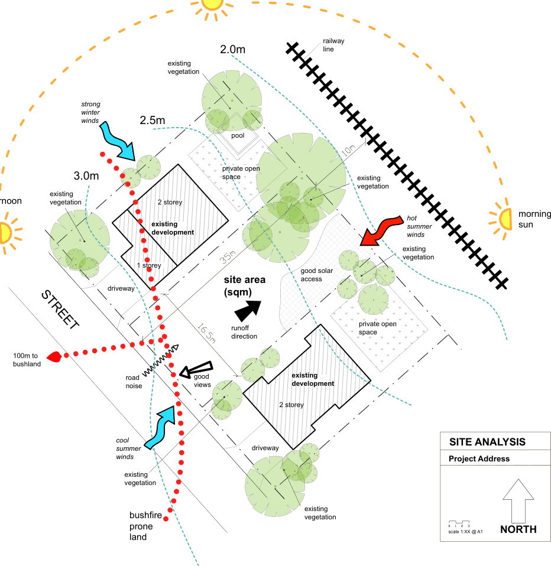

## 5 The site analysis plan is to include, but not be limited to, the following

### characteristics as appropriate:

i) Existing development – Location of existing structures and

natural features adjoining the subject site. ii)	 Key features of adjoining sites – Overshadowing/ solar

### access, overlooking windows, view lines, building bulk, prevailing

street setback, and landscaping/ screening, topography,

inter-allotment drainage easement available to the subject site,

### riparian lands and private and public open space.

### iii)	 Services & facilities – Location of site in relation to community

facilities such as local shopping centres, bike paths, utilities, and

### public transport.

### iv)	 Zone interface - Adjoining zoning (including any proposed

### zoning in a draft LEP).

v)	 Heritage – Heritage Items and Heritage Conservation Areas in

### the surrounding locality and landscape.

### vi)	 Noise & Safety – Noise sources at and external to the site

### (including railway lines, arterial roads, etc).

### Controls

#### midday

#### sun

> [Picture on page 5: a picture, saved as a picture (images/part-02-site-analysis-page-5-4.gif, 150 dpi).]

#### railway

#### line

### 2.0m

#### existing

#### vegetation

#### strong

#### winter

### winds 2.5m

#### pool

#### private open

#### space

### 3.0m

#### existing

#### vegetation
