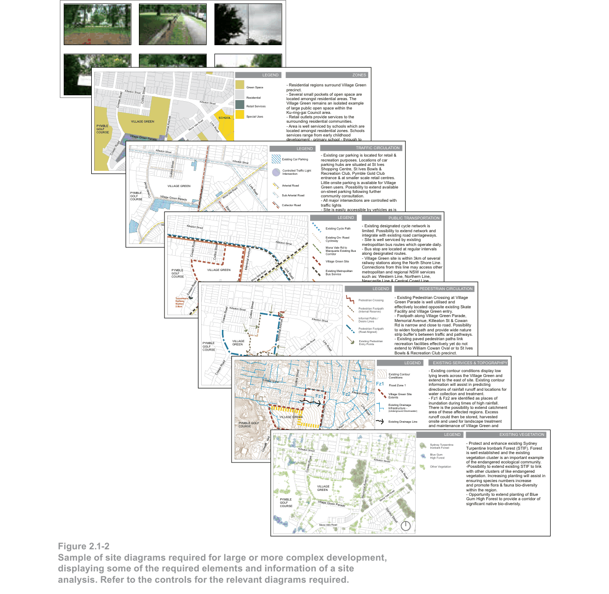

#### 2 storey

### SITE ANALYSIS

#### driveway

#### cool

#### summer

#### winds

#### Project Address

#### existing

#### vegetation

### SITE ANALYSIS

#### existing

#### vegetation

### scale 1:XX @ A1 NORTH

#### bushfire

#### prone

#### land

### Figure 2.1-1

### Sample of a simple site analysis diagram.

### Controls

> [Picture on page 6: a map, saved as a picture (images/part-02-site-analysis-page-6-2.gif, 150 dpi); the street names and other small labels are on the picture.]
> Words printed on the picture (title and legend, copied from the PDF):
> Existing Car Parking
> illea o S ree
> K t n t t
> ill a on Stree
> K e t t
> Controlled Traffic Light
> Co li s S e
> l n tr et
> ll ns S e
> ill aton Stree
> K e t
> Kill aton Street
> C w n Roa
> illea o S ree
> K t n t t
> ill a on Stree
> K e t t
> Sub Arterial Road
> Co an R ad
> COURSE n P
> Village Gree arade
> Mona Vale R
> Co li s S e
> l n tr et
> Link Ro d
> ll ns S e
> al A enue
> ill aton Stree
> K e t
> Kill aton Street
> C w n Roa
> V e a
> illage Gr en P rade
> ill a on Stree
> K e t t
> t n ey S r
> S a l
> Co an R ad
> Mona Vale Road
> COURSE n P
> Village Gree arade
> Mona Vale R
> Existing Car Parking
> Link Ro d
> illea o S ree
> K t n t t
> ill a on Stree
> K e t t
> al A enue
> Co li s S e
> l n tr et
> ll ns S e
> ill aton Stree
> K e t
> Kill aton Street
> C w n Roa
> V e a
> illage Gr en P rade
> Controlled Traffic Light
> ll ns S e
> t n ey S r
> S a l
> Co an R ad
> VILLAGE GREEN Mona Vale Road
> Existing Car Parking
> LEGEND PUBLIC TRANSPORTATION
> COURSE n P
> Village Gree arade
> illea o S ree
> K t n t t
> ill a on Stree
> K e t t
> Mona Vale R
> Link Ro d
> al A enue
> Sub Arterial Road
> Co an R ad
> Existing Cycle Path
> COURSE n P
> Village Gree arade
> Controlled Traffic Light
> V e a
> illage Gr en P rade
> ll ns S e
> Kill aton Street
> al A enue
> Existing On- Road
> ill a o S re
> K e t n t et
> Local Road Stanley Street
> Mona Vale Road
> ille o re
> K at n St et
> Cow n Road
> Informal Paths /
> Existing Car Parking
> t n ey S r
> S a l
> illea o S ree
> K t n t t
> ill a on Stree
> K e t t
> Sub Arterial Road
> Mona Vale Rd to
> Macquarie Existing Bus
> Co an R ad
> n o d
> Col in Str et
> COURSE n P
> Village Gree arade
> Existing Cycle Path
> Mona Vale R
> Village Green Site
> Link Ro d
> al A enue
> Controlled Traffic Light
> Co li s S e
> l n tr et
> ll ns S e
> i l Avenu
> ill aton Stree
> K e t
> Kill aton Street
> M mori l Av
> C w n Roa
> Existing On- Road
> ill a o S re
> K e t n t et
> Mona ale Road
> iL nk Road
> L n Ro
> t n ey S r
> S a l
> o a V l Ro d
> M n a e
> ille o re
> K at n St et
> Cow n Road
> Mona Vale Rd to
> Macquarie Existing Bus
> n o d
> Hornsby to Chatswood
> Planned Bus Corridor
> Sub Arterial Road
> Co an R ad
> l g Gr n a
> Vi la e ee P rade
> Col in Str et
> V l g Gre n r de
> i la e e Pa a
> LEGEND PUBLIC TRANSPORTATION
> Existing Cycle Path
> Village Gree arade
> Village Green Site
> Mona Vale R
> Link Ro d
> al A enue
> i l Avenu
> M mori l Av
> Existing Cycle Path
> ille o re
> K at n St et
> Sta le Street
> Existing On- Road
> V e a
> illage Gr en P rade
> Existing Bus Stop
> M e Road
> ill a o S re
> K e t n t et
> Mona ale Road
> iL nk Road
> L n Ro
> o a V l Ro d
> M n a e
> t n ey S r
> S a l
> Cow n Road
> Existing On- Road
> Mona Vale Rd to
> Macquarie Existing Bus
> Hornsby to Chatswood
> Planned Bus Corridor
> n o d
> l g Gr n a
> Vi la e ee P rade
> Col in Str et
> Mona Vale Road
> ille o re
> K at n St et
> Cow n Road
> Informal Paths /
> V l g Gre n r de
> i la e e Pa a
> Village Green Site
> Mona Vale Rd to
> Macquarie Existing Bus
> i l Avenu
> Existing Cycle Path
> et M mori l Av
> Village Green Site
> Sta le Street
> Existing Bus Stop
> M e Road
> i l Avenu
> iL nk Road
> Existing On- Road
> o a V l Ro d
> M n a e
> Mona ale Road
> Hornsby to Chatswood
> Planned Bus Corridor
> L n Ro
> Col in Str et
> l g Gr n a
> Vi la e ee P rade illeaton Stree
> ille o re
> K at n St et
> Cow n Road
> Informal Paths /
> Flood Zone 1
> LEGEND PUBLIC TRANSPORTATION
> illea o S re
> K t n t et
> ille e t
> K aton Str e
> V l g Gre n r de
> i la e e Pa a
> Mona Vale Rd to
> Macquarie Existing Bus
> Hornsby to Chatswood
> Planned Bus Corridor
> K aton Str et
> ill aton Stree
> K e t
> V l g Gre n r de
> i la e e Pa a
> Village Green Site
> Existing Cycle Path
> Village Green Site
> Existing Bus Stop
> i l Avenu
> M e Road
> Sta le Street
> Existing On- Road
> Existing Bus Stop
> M e Road
> ill a o S re
> K e t n t et
> Mona ale Road
> iL nk Road
> L n Ro
> Li k Road
> o a V l Ro d
> M n a e
> Col in Str et
> Flood Zone 1
> ille o re
> K at n St et
> Cow n Road
> Informal Paths /
> illea o S re
> K t n t et
> ille e t
> K aton Str e
> Existing Drainage Line
> orial A e
> Hornsby to Chatswood
> Planned Bus Corridor
> Mona Vale Rd to
> Macquarie Existing Bus
> Corridor Mem rial Avenue
> n o d
> Mona Vale Road
> K aton Str et
> ill aton Stree
> K e t
> Col in Str et
> V l g Gre n r de
> i la e e Pa a
> Village Green Site
> Village Green Site
> l G d
> Vi lage reen Para e
> Existing Major Electrical
> Mona ale R ad
> Vill ge Green Para e
> i l Avenu
> M mori l Av
> Sta le Street
> ille e t
> K aton Str e
> Existing Bus Stop
> M e Road
> Mona ale Road
> Li k Road
> iL nk Road
> tanley S re t
> L n Ro
> Col in Str et
> o a V l Ro d
> M n a e
> Flood Zone 1
> Fz1 ona V
> M ale Road
> ona Vale R
> M oad S anle Str et
> Existing Drainage Line
> orial A e
> Hornsby to Chatswood
> Planned Bus Corridor
> Mem rial Avenue
> Flood Zone 1
> l g Gr n a
> Vi la e ee P rade
> Mona Vale Road
> K aton Str et
> ill aton Stree
> K e t
> COURSE illea o S re
> K t n t et
> ille e t
> K aton Str e
> V l g Gre n r de
> i la e e Pa a
> Village Green Site
> l G d
> Vi lage reen Para e
> Existing Major Electrical
> Mona ale R ad
> Vill ge Green Para e
> Village Green Site
> Sta le Street
> Existing Bus Stop
> M e Road Sydney Turpentine
> Li k Road
> tanley S re t
> M ale Road
> ona Vale R
> M oad S anle Str et
> Existing Drainage Line
> orial A e
> Mem rial Avenue
> Flood Zone 1
> illea o S re
> K t n t et
> ille e t
> K aton Str e
> Existing Drainage Line
> orial A e
> l G d
> Vi lage reen Para e
> Mona Vale Road
> Existing Major Electrical
> ill aton Stree
> K e t
> Mona ale R ad
> Vill ge Green Para e
> Village Green Site
> l G d
> Vi lage reen Para e
> Existing Major Electrical
> sheet no. 92004_SA_1 status: DRAFT FOR DISCUSSION date: may 2009 scale: 1:2500 (A1) 1:5000 (A3) north
> M ale Road
> ona Vale R
> S anle Str et
> tanley S re t
> Li k Road
> M ale Road
> Col in Str et
> Flood Zone 1
> illea o S re
> K t n t et
> ille e t
> K aton Str e
> Existing Drainage Line
> orial A e
> Mem rial Avenue
> Mona Vale Road
> K aton Str et
> ill aton Stree
> K e t
> Village Green Site
> l G d
> Vi lage reen Para e
> Existing Major Electrical
> Mona ale R ad
> sheet no. 92004_SA_1 status: DRAFT FOR DISCUSSION date: may 2009 scale: 1:2500 (A1) 1:5000 (A3) north
> tanley S re t
> Li k Road
> M ale Road
> S anle Str et
> Existing Drainage Line
> orial A e
> Mem rial Avenue
> Mona Vale Road
> l G d
> Vi lage reen Para e
> Existing Major Electrical
> Mona ale R ad
> Vill ge Green Para e
> sheet no. 92004_SA_1 status: DRAFT FOR DISCUSSION date: may 2009 scale: 1:2500 (A1) 1:5000 (A3) north
> e: 1:2500 (A1) 1:5000 (A3) north
> tanley S re t
> M ale Road
> ona Vale R
> M oad S anle Str et
> FT FOR DISCUSSION date: may 2009 scale: 1:2500 (A1) 1:5000 (A3) north
> sheet no. 92004_SA_1 status: DRAFT FOR DISCUSSION date: may 2009 scale: 1:2500 (A1) 1:5000 (A3) north

Figure 2.1-2

- Existing car parking is l

recreation purposes. Loc

parking hubs are situate

Shopping Centre, St Ives

Recreation Club, Pymble

entrance & at smaller sc

Little onsite parking is av

Green users. Possibility

on-street parking followin

community consultation.

- All major intersections a

traffic lights

- Site is easily accessible

surrounded by heavily us

arterial, collector and loc

- Residential regions surround Village Green

precinct.

- Several small pockets of open space are

located amongst residential areas. The

Village Green remains an isolated example

of large public open space within the

Ku-ring-gai Council area.

- Retail outlets provide services to the

surrounding residential communities.

- Area is well serviced by schools which are

located amongst residential zones. Schools

services range from early childhood

development - primary school - through to

secondary school facilities. Educational

facilities within the area are a mix of private

and public.

- Residential regions surround Village Green

precinct.

- Several small pockets of open space are

located amongst residential areas. The

Village Green remains an isolated example

of large public open space within the

Ku-ring-gai Council area.

- Retail outlets provide services to the

surrounding residential communities.

- Area is well serviced by schools which are

located amongst residential zones. Schools

services range from early childhood

development - primary school - through to

secondary school facilities. Educational

facilities within the area are a mix of private

and public.

M

- Residential regions surround Village Green

precinct.

- Several small pockets of open space are

located amongst residential areas. The

Village Green remains an isolated example

of large public open space within the

Ku-ring-gai Council area.

- Retail outlets provide services to the

surrounding residential communities.

- Area is well serviced by schools which are

located amongst residential zones. Schools

services range from early childhood

development - primary school - through to

secondary school facilities. Educational

facilities within the area are a mix of private

and public.

LEGEND PUBLIC TRANSPORTATION illeaton Stree

- Existing car parking is located for retail &

recreation purposes. Locations of car

parking hubs are situated at St Ives

Shopping Centre, St Ives Bowls &

Recreation Club, Pymble Gold Club

entrance & at smaller scale retail centres.

Little onsite parking is available for Village

Green users. Possibility to extend available

on-street parking following further

community consultation.

- All major intersections are controlled with

traffic lights

- Site is easily accessible by vehicles as is

surrounded by heavily used arterial, sub

arterial, collector and local roads.

- Residential regions surround Village Green

precinct.

- Several small pockets of open space are

located amongst residential areas. The

Village Green remains an isolated example

of large public open space within the

Ku-ring-gai Council area.

- Retail outlets provide services to the

surrounding residential communities.

- Area is well serviced by schools which are

located amongst residential zones. Schools

services range from early childhood

development - primary school - through to

secondary school facilities. Educational

facilities within the area are a mix of private

and public.

- Existing car parking is located for retail &

recreation purposes. Locations of car

parking hubs are situated at St Ives

Shopping Centre, St Ives Bowls &

Recreation Club, Pymble Gold Club

entrance & at smaller scale retail centres.

Little onsite parking is available for Village

Green users. Possibility to extend available

on-street parking following further

community consultation.

- All major intersections are controlled with

traffic lights

- Site is easily accessible by vehicles as is

surrounded by heavily used arterial, sub

arterial, collector and local roads.

- Existing designated cycle network is

limited. Possibility to extend network and

integrate with existing road carriageways.

- Site is well serviced by existing

metropolitan bus routes which operate daily.

- Bus stop are located at regular intervals

along designated routes.

- Village Green site is within 3km of several

railway stations along the North Shore Line.

Connections from this line may access other

metropolitan and regional NSW services

such as: Western Line, Northern Line,

Newcastle Line & Central Coast Line.

- Residential regions surround Village Green

precinct.

- Several small pockets of open space are

located amongst residential areas. The

Village Green remains an isolated example

of large public open space within the

Ku-ring-gai Council area.

- Retail outlets provide services to the

surrounding residential communities.

- Area is well serviced by schools which are

located amongst residential zones. Schools

services range from early childhood

development - primary school - through to

secondary school facilities. Educational

facilities within the area are a mix of private

and public.

- Existing car parking is located for retail &

recreation purposes. Locations of car

parking hubs are situated at St Ives

Shopping Centre, St Ives Bowls &

Recreation Club, Pymble Gold Club

entrance & at smaller scale retail centres.

Little onsite parking is available for Village

Green users. Possibility to extend available

on-street parking following further

community consultation.

- All major intersections are controlled with

traffic lights

- Site is easily accessible by vehicles as is

surrounded by heavily used arterial, sub

arterial, collector and local roads.

- Existing designated cycle network is

limited. Possibility to extend network and

integrate with existing road carriageways.

- Site is well serviced by existing

metropolitan bus routes which operate daily.

- Bus stop are located at regular intervals

along designated routes.

- Village Green site is within 3km of several

railway stations along the North Shore Line.

Connections from this line may access other

metropolitan and regional NSW services

such as: Western Line, Northern Line,

Newcastle Line & Central Coast Line.

- Existing Pedestrian Cro

Green Parade is well utili

effectively located opposi

Facility and Village Green

- Footpath along Village G

Memorial Avenue, Killeato

Rd is narrow and close to

to widen footpath and pro

strip buffer’s between traf

- Existing paved pedestria

recreation facilities effecti

extend to William Cowan

Bowls & Recreation Club

Consider a park-wide ped

linking all active areas.

- No formal pedestrian cro

points from Memorial Ave

or Cowan Rd into the Villa

Consider a formal pedest

entry into reserve to prom

- Residential regions surround Village Green

precinct.

- Several small pockets of open space are

located amongst residential areas. The

Village Green remains an isolated example

of large public open space within the

Ku-ring-gai Council area.

- Retail outlets provide services to the

surrounding residential communities.

- Area is well serviced by schools which are

located amongst residential zones. Schools

services range from early childhood

development - primary school - through to

secondary school facilities. Educational

facilities within the area are a mix of private

and public.

LEGEND EXISTING SERVICES & TOPOGRAPHPY

- Existing designated cycle network is

limited. Possibility to extend network and

integrate with existing road carriageways.

- Site is well serviced by existing

metropolitan bus routes which operate daily.

- Bus stop are located at regular intervals

along designated routes.

- Village Green site is within 3km of several

railway stations along the North Shore Line.

Connections from this line may access other

metropolitan and regional NSW services

such as: Western Line, Northern Line,

Newcastle Line & Central Coast Line.

- Existing designated cycle network is

limited. Possibility to extend network and

integrate with existing road carriageways.

- Site is well serviced by existing

metropolitan bus routes which operate daily.

- Bus stop are located at regular intervals

along designated routes.

- Village Green site is within 3km of several

railway stations along the North Shore Line.

Connections from this line may access other

metropolitan and regional NSW services

such as: Western Line, Northern Line,

Newcastle Line & Central Coast Line.

LEGEND EXISTING SERVICES & TOPOGRAPHPY

M mori l Av

e

a

enu

- Existing designated cycle network is

limited. Possibility to extend network and

integrate with existing road carriageways.

- Site is well serviced by existing

metropolitan bus routes which operate daily.

- Bus stop are located at regular intervals

along designated routes.

- Village Green site is within 3km of several

railway stations along the North Shore Line.

Connections from this line may access other

metropolitan and regional NSW services

such as: Western Line, Northern Line,

Newcastle Line & Central Coast Line.

- Existing Pedestrian Crossing at Village

Green Parade is well utilised and

effectively located opposite existing Skate

Facility and Village Green entry.

- Footpath along Village Green Parade,

Memorial Avenue, Killeaton St & Cowan

Rd is narrow and close to road. Possibility

to widen footpath and provide wide nature

strip buffer’s between traffic and pathways.

- Existing paved pedestrian paths link

recreation facilities effectively yet do not

extend to William Cowan Oval or to St Ives

Bowls & Recreation Club precinct.

Consider a park-wide pedestrian network

linking all active areas.

- No formal pedestrian crossing or entry

points from Memorial Avenue, Killeaton St

or Cowan Rd into the Village Green.

Consider a formal pedestrian crossing and

entry into reserve to promote safer access.

LEGEND EXISTING SERVICES & TOPOGRAPHPY

- Protect and enhance ex

Turpentine Ironbark Fores

is well established and th

vegetation cluster is an im

of the endangered ecolog

-Possibility to extend exis

with other clusters of like

vegetation. Increasing pla

ensuring species number

and promote flora & fauna

within the region.

- Opportunity to extend pl

Gum High Forest to provi

significant native bio-dive

- Existing contour conditions display low

lying levels across the Village Green and

extend to the east of site. Existing contour

information will assist in predicting

directions of rainfall runoff and locations for

water collection and treatment.

- Fz1 & Fz2 are identified as places of

inundation during times of high rainfall.

There is the possibility to extend catchment

area of these affected regions. Excess

runoff could then be stored, harvested

onsite and used for landscape treatment

and maintenance of Village Green and

surrounding green spaces within

Ku-ring-gai Council.

LEGEND EXISTING SERVICES & TOPOGRAPHPY F

- Existing Pedestrian Crossing at Village

Green Parade is well utilised and

effectively located opposite existing Skate

Facility and Village Green entry.

- Footpath along Village Green Parade,

Memorial Avenue, Killeaton St & Cowan

Rd is narrow and close to road. Possibility

to widen footpath and provide wide nature

strip buffer’s between traffic and pathways.

- Existing paved pedestrian paths link

recreation facilities effectively yet do not

extend to William Cowan Oval or to St Ives

Bowls & Recreation Club precinct.

Consider a park-wide pedestrian network

linking all active areas.

- No formal pedestrian crossing or entry

points from Memorial Avenue, Killeaton St

or Cowan Rd into the Village Green.

Consider a formal pedestrian crossing and

entry into reserve to promote safer access.

- Existing designated cycle network is

limited. Possibility to extend network and

integrate with existing road carriageways.

- Site is well serviced by existing

metropolitan bus routes which operate daily.

- Bus stop are located at regular intervals

along designated routes.

- Village Green site is within 3km of several

railway stations along the North Shore Line.

Connections from this line may access other

metropolitan and regional NSW services

such as: Western Line, Northern Line,

Newcastle Line & Central Coast Line.

1

LEGEND EXISTING SERVICES & TOPOGRAPHPY

EXISTING VEGETATION

- Existing contour conditions display low

lying levels across the Village Green and

extend to the east of site. Existing contour

information will assist in predicting

directions of rainfall runoff and locations for

water collection and treatment.

- Fz1 & Fz2 are identified as places of

inundation during times of high rainfall.

There is the possibility to extend catchment

area of these affected regions. Excess

runoff could then be stored, harvested

onsite and used for landscape treatment

and maintenance of Village Green and

surrounding green spaces within

Ku-ring-gai Council.

- Existing Pedestrian Crossing at Village

Green Parade is well utilised and

effectively located opposite existing Skate

Facility and Village Green entry.

- Footpath along Village Green Parade,

Memorial Avenue, Killeaton St & Cowan

Rd is narrow and close to road. Possibility

to widen footpath and provide wide nature

strip buffer’s between traffic and pathways.

- Existing paved pedestrian paths link

recreation facilities effectively yet do not

extend to William Cowan Oval or to St Ives

Bowls & Recreation Club precinct.

Consider a park-wide pedestrian network

linking all active areas.

- No formal pedestrian crossing or entry

points from Memorial Avenue, Killeaton St

or Cowan Rd into the Village Green.

Consider a formal pedestrian crossing and

entry into reserve to promote safer access.

e

- Existing contour conditions display low

lying levels across the Village Green and

extend to the east of site. Existing contour

information will assist in predicting

directions of rainfall runoff and locations for

water collection and treatment.

- Fz1 & Fz2 are identified as places of

inundation during times of high rainfall.

There is the possibility to extend catchment

area of these affected regions. Excess

runoff could then be stored, harvested

onsite and used for landscape treatment

and maintenance of Village Green and

surrounding green spaces within

Ku-ring-gai Council.

LEGEND EXISTING SERVICES & TOPOGRAPHPY

- Protect and enhance existing Sydney

Turpentine Ironbark Forest (STIF). Forest

is well established and the existing

vegetation cluster is an important example

of the endangered ecological community.

-Possibility to extend existing STIF to link

with other clusters of like endangered

vegetation. Increasing planting will assist in

ensuring species numbers increase

and promote flora & fauna bio-diversity

within the region.

- Opportunity to extend planting of Blue

Gum High Forest to provide a corridor of

significant native bio-diveristy.

- Existing contour conditions display low

lying levels across the Village Green and

extend to the east of site. Existing contour

information will assist in predicting

directions of rainfall runoff and locations for

water collection and treatment.

- Fz1 & Fz2 are identified as places of

inundation during times of high rainfall.

There is the possibility to extend catchment

area of these affected regions. Excess

runoff could then be stored, harvested

onsite and used for landscape treatment

and maintenance of Village Green and

surrounding green spaces within

Ku-ring-gai Council.

### st ives village green landscape masterplan

### site context plan

- Protect and enhance existing Sydney

Turpentine Ironbark Forest (STIF). Forest

is well established and the existing

vegetation cluster is an important example

of the endangered ecological community.

-Possibility to extend existing STIF to link

with other clusters of like endangered

vegetation. Increasing planting will assist in

ensuring species numbers increase

and promote flora & fauna bio-diversity

within the region.

- Opportunity to extend planting of Blue

Gum High Forest to provide a corridor of

significant native bio-diveristy.

- Existing contour conditions display low

lying levels across the Village Green and

extend to the east of site. Existing contour

information will assist in predicting

directions of rainfall runoff and locations for

water collection and treatment.

- Fz1 & Fz2 are identified as places of

inundation during times of high rainfall.

There is the possibility to extend catchment

area of these affected regions. Excess

runoff could then be stored, harvested

onsite and used for landscape treatment

and maintenance of Village Green and

surrounding green spaces within

Ku-ring-gai Council.

### st ives village green landscape masterplan

### site context plan

- Protect and enhance existing Sydney

Turpentine Ironbark Forest (STIF). Forest

is well established and the existing

vegetation cluster is an important example

of the endangered ecological community.

-Possibility to extend existing STIF to link

with other clusters of like endangered

vegetation. Increasing planting will assist in

ensuring species numbers increase

and promote flora & fauna bio-diversity

within the region.

- Opportunity to extend planting of Blue

Gum High Forest to provide a corridor of

significant native bio-diveristy.

- Existing contour conditions display low

lying levels across the Village Green and

extend to the east of site. Existing contour

information will assist in predicting

directions of rainfall runoff and locations for

water collection and treatment.

- Fz1 & Fz2 are identified as places of

inundation during times of high rainfall.

There is the possibility to extend catchment

area of these affected regions. Excess

runoff could then be stored, harvested

onsite and used for landscape treatment

and maintenance of Village Green and

surrounding green spaces within

Ku-ring-gai Council.

### st ives village green landscape masterplan

### site context plan

### e masterplan

an

### green landscape masterplan

### ntext plan

Sample of site diagrams required for large or more complex development,

### displaying some of the required elements and information of a site

### analysis. Refer to the controls for the relevant diagrams required.

### st ives village green landscape masterplan

### site context plan
