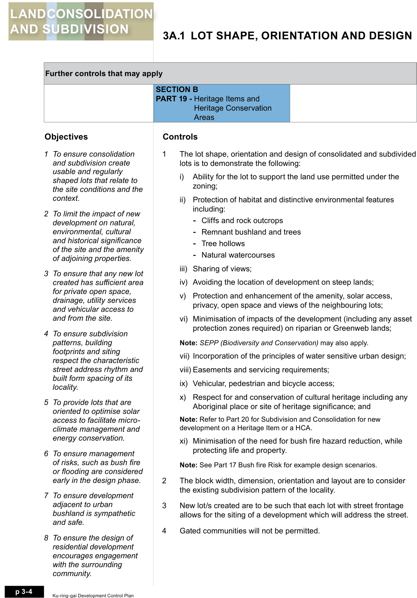

#### 3A General Controls for Consolidation and Subdivision

3A.1 Lot Shape, Orientation and Design 3A.2 	 Minimum Lot Depth for Bush fire Prone Land 3A.3 	 Building Footprint 3A.4 	 Trees and Vegetation 3A.5 	 Access 3A.6 	 Infrastructure

### GENERAL CONTROLS FOR CONSOLIDATION AND SUBDIVISION

> [Picture on page 4: a map, saved as a picture (images/part-03-land-consolidation-and-subdivision-page-4-1.gif, 150 dpi); the street names and other small labels are on the picture.]
> Words printed on the picture (title and legend, copied from the PDF):
> 1	 To ensure consolidation
> and subdivision create
> usable and regularly
> development on natural,
> and historical significance
> of adjoining properties.
> created has sufficient area
> for private open space,
> drainage, utility services
> and vehicular access to
> and from the site.
> Note: SEPP (Biodiversity and Conservation) may also apply.
> 4	 To ensure subdivision
> footprints and siting
> respect the characteristic
> street address rhythm and
> Note: Refer to Part 20 for Subdivision and Consolidation for new
> development on a Heritage Item or a HCA.
> oriented to optimise solar
> access to facilitate micro-
> climate management and
> protecting life and property.
> Note: See Part 17 Bush fire Risk for example design scenarios.
> 6	 To ensure management
> or flooding are considered
> 7	 To ensure development
> adjacent to urban
> bushland is sympathetic
> with the surrounding
