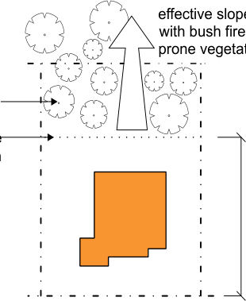
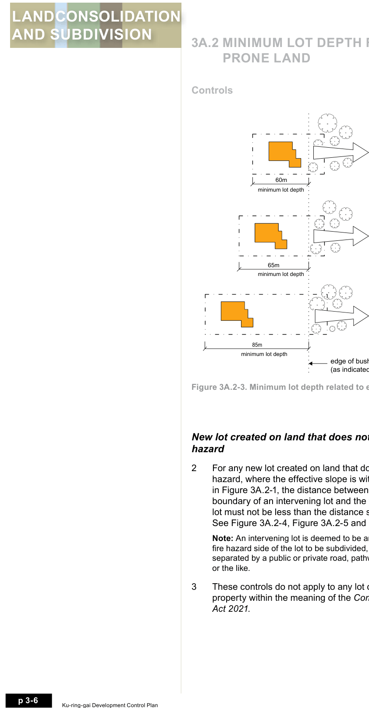
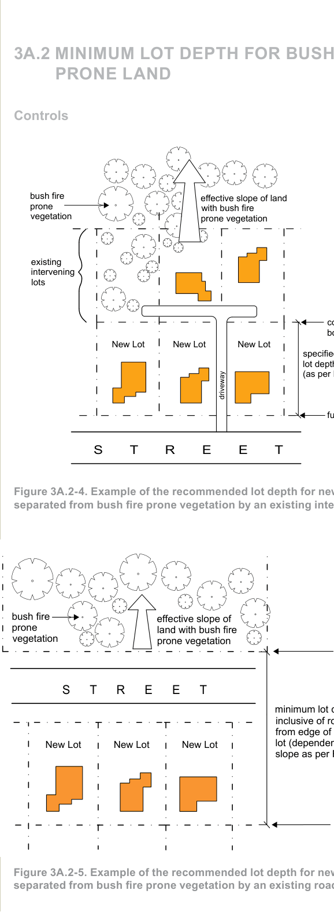
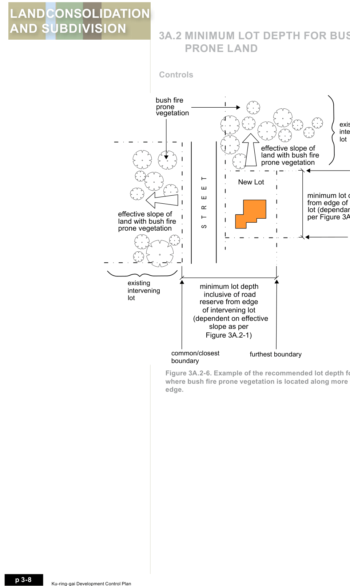

### 3A.2  MINIMUM LOT DEPTH FOR BUSH FIRE

### PRONE LAND

#### Objectives

#### Controls

This part applies to the subdivision of land identified on the “Minimum Lot

Depth Map” (Refer to maps in 3R.1 of this Part).

1	 Apply lot depths that

allow for the creation

of adequate bush fire

setbacks within a lot.

#### New lot/s created on land containing bush fire hazard

2	 Provision of adequate

setbacks within

subdivisions to reduce

bush fire risk to life and

property.

1 For any new lot/s created on land containing a bush fire hazard,

where the effective slope is within the range identified in Figure

3A.2-1, the distance between the bush fire hazard and the furthest

boundary must not be less than the distance specified within this

Figure. See Figures 3A.2-2 and Figure 3A.2-3.

| Effective Slope | Distance (m) |
|---|---|
| Upslope/flat to 5° | 60 |
| More than 5° to 10° | 65 |
| More than 10° | 85 |

3	 Ensure development

facilitates lot depths that

minimise impacts to the

environment on private

and public land.

#### Figure 3A.2-1. Effective slope and the distance between bush fire

hazard and boundary.

Note: These minimum lot depth distances are calculated from Planning for

Bushfire Protection 2019, based on a BAL-29 bushfire construction rating. Note: Refer to Planning for Bush Fire Protection 2019 Appendix 1(A1.4-1.5)

and RFS Guidelines for Single Dwelling Development Applications Part C

(www.rfs.nsw.gov.au) for more detail on how to determine effective slope. Note: Refer to Planning for Bush Fire Protection 2019 for guidance on

landscaping in bush fire prone areas.

> [Picture on page 5: a picture, saved as a picture (images/part-03-land-consolidation-and-subdivision-page-5-37.gif, 150 dpi).]
> Words printed on the picture (title and legend, copied from the PDF):
> with bush fire
> prone vegetation
> 53125,55

effective slope of land

bush fire

prone

vegetation

minimum lot depth

from bush fire

edge of bush fire

prone vegetation

(as indicated on

Bush Fire Prone

Land Map)

prone vegetation

(dependant on effective

slope as per Figure 3A.2-1)

STREET

#### Figure 3A.2-2. Example of new lot on land containing bush fire prone

vegetation.

### GENERAL CONTROLS FOR CONSOLIDATION AND SUBDIVISION

> [Picture on page 6: a picture, saved as a picture (images/part-03-land-consolidation-and-subdivision-page-6-1.gif, 150 dpi).]
> Words printed on the picture (title and legend, copied from the PDF):
> 60m
> minimum lot depth
> 65m
> minimum lot depth
> 85m
> minimum lot depth
> or the like.
> Act 2021.

Figure 3A.2-3. Minimum lot depth related to effective slope.

### PRONE LAND

#### Controls

effective slope

flat to 5°

effective Slope

5°to 10°

effective slope

greater than10°

edge of bush fire prone vegetation

(as indicated on Bush Fire Prone Land Map)

#### New lot created on land that does not contain a bush fire

hazard 2 For any new lot created on land that does not contain a bush fire

hazard, where the effective slope is within the range identified

in Figure 3A.2-1, the distance between the common or closest

boundary of an intervening lot and the furthest boundary of the new

lot must not be less than the distance specified within this Figure.

See Figure 3A.2-4, Figure 3A.2-5 and Figure 3A.2-6. Note: An intervening lot is deemed to be any lot that is located on the bush

fire hazard side of the lot to be subdivided, and may be directly adjoining or

separated by a public or private road, pathway, access handle to another lot

3 These controls do not apply to any lot comprising association

property within the meaning of the Community Land Development

> [Picture on page 7: a map, saved as a picture (images/part-03-land-consolidation-and-subdivision-page-7-1.gif, 150 dpi); the street names and other small labels are on the picture.]
> Words printed on the picture (title and legend, copied from the PDF):
> effective slope of land
> with bush fire
> New Lot New Lot
> separated from bush fire prone vegetation by an existing intervening lot.
> effective slope of
> land with bush fire
> 82360,29 minimum lot depth
> New Lot New Lot
> separated from bush fire prone vegetation by an existing road.

Figure 3A.2-4. Example of the recommended lot depth for new lots

Figure 3A.2-5. Example of the recommended lot depth for new lots

### PRONE LAND

#### Controls

53994,35 common/closest

boundary

(as per Figure 3A.2-1)

furthest boundary

existing

intervening

lot

common/closest

boundary

inclusive of road reserve

from edge of intervening

lot (dependent on effective

slope as per Figure 3A.2-1)

furthest boundary

new lot

subdivision

### GENERAL CONTROLS FOR CONSOLIDATION AND SUBDIVISION

> [Picture on page 8: a map, saved as a picture (images/part-03-land-consolidation-and-subdivision-page-8-1.gif, 150 dpi); the street names and other small labels are on the picture.]
> Words printed on the picture (title and legend, copied from the PDF):
> effective slope of
> land with bush fire
> per Figure 3A.2-1)
> effective slope of
> land with bush fire
> minimum lot depth
> inclusive of road
> reserve from edge
> of intervening lot
> (dependent on effective
> slope as per
> where bush fire prone vegetation is located along more than one

Figure 3A.2-1)

Figure 3A.2-6. Example of the recommended lot depth for new lots

### PRONE LAND

#### Controls

existing

intervening

common/closest

boundary

minimum lot depth

from edge of intervening

lot (dependant on slope as

furthest boundary
