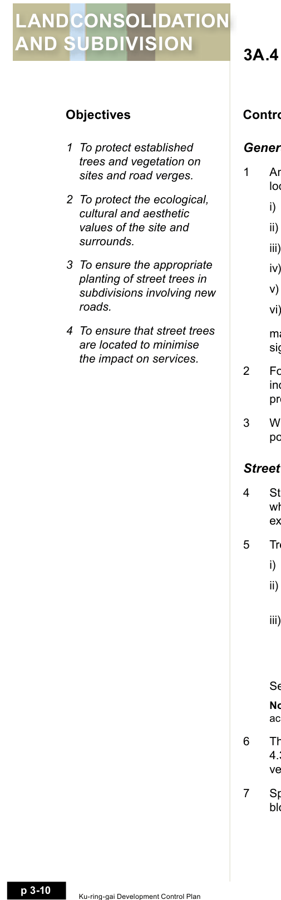

### 3A.4  TREES AND VEGETATION

> [Picture on page 10: a picture, saved as a picture (images/part-03-land-consolidation-and-subdivision-page-10-2.gif, 150 dpi).]
> Words printed on the picture (title and legend, copied from the PDF):
> 1	 To protect established
> trees and vegetation on
> sites and road verges.
> cultural and aesthetic
> surrounds.
> subdivisions involving new
> roads.
> are located to minimise
> the impact on services.

#### Objectives

#### Controls General

1 Any subdivision or consolidation proposal must demonstrate that the

location and design of:

i) building footprints;

ii)	 access ways;

2	 To protect the ecological,

values of the site and

iii)	 roadways, including perimeter roads or trails;

iv)	 services;

v)	 inter-allotment drainage easements; and

3	 To ensure the appropriate

planting of street trees in

vi)	 asset protection zones maximises the retention of, and minimises impacts on existing

significant trees and vegetation on or adjacent to the site.

4	 To ensure that street trees

2 For the purposes of 3A.4 (1) above, significant trees and vegetation

includes but is not limited to cultural plantings, large and visually

prominent trees, bushland and endangered ecological communities. 3 Where a site is particularly constrained a more detailed layout of the

potential development may be required.

#### Street trees

4 Street trees are to be planted where new roads are proposed or

where the likely location of driveway crossings will result in loss of

existing street trees. 5 Trees are to be located:

i) to avoid conflict with the positioning of underground services;

ii)	 a minimum of 0.6m behind the kerbline to allow access to

vehicles;

iii)	 no closer to street lights than the radius of the tree canopy at

maturity. The location of trees in relation to street lights is to

consider the height of the tree and the radius of the canopy at

maturity to ensure that lighting is not obscured by the vegetation. See Figures 3A.6-1 & 3A.6-2. Note: In some circumstances, trees on one side of the road only may be

acceptable, in order to meet the above controls. 6 The canopy is to be capable of being maintained at a minimum of

4.3 metres above the road surface to provide clearance for larger

vehicles. 7 Species are to be selected to minimise leaf drop and to avoid

blockage of drainage systems.
