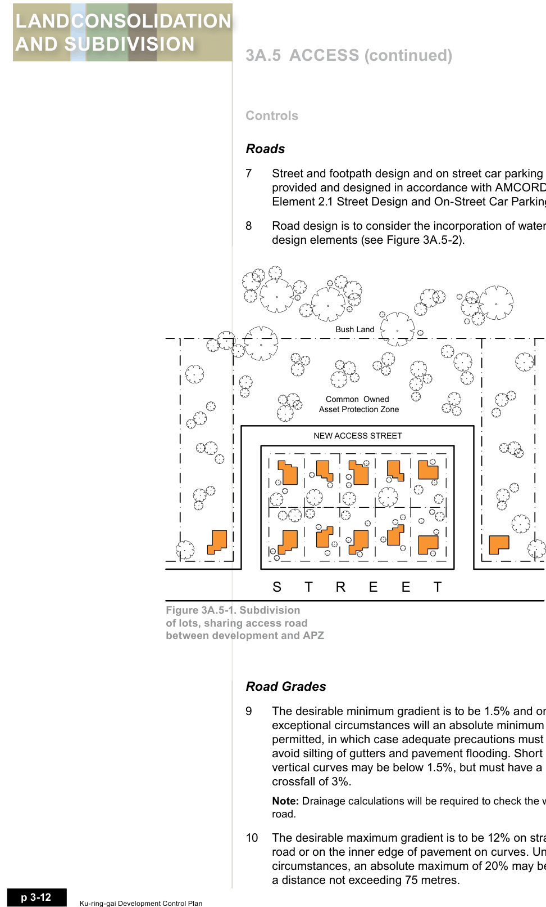

### 3A.5  ACCESS

#### Further controls that may apply

#### SECTION C

PART 24D - Existing Drainage

System

PART 24E - Road and Trunk

Drainage Design

#### Objectives

#### Controls Vehicular Access

1	 To ensure adequate and

safe vehicular access.

1 Each lot must provide access from a constructed or dedicated public

road. Where access is proposed to a section of unconstructed public

road, the newly created lot will need to provide lawful, constructed

access to Council’s satisfaction.

2	 To ensure the pedestrian

and bicycle needs of

residents and visitors

are considered with

particular regard to access

requirements, safety and

security.

2 The minimum width of an access handle to a battle-axe allotment

is 4.6 metres. This may be increased where length, number of lots

and or topography necessitate. Access to multiple dwellings could

require a wider access handle to accommodate passing bays. Note: Australian Standard 2890.1 2004 Off Street Car Parking applies. 3 The maximum number of lots to be served by a single access handle

connected to a public road is 3 lots.

3	 To ensure that public

utilities and services

can be provided without

unnecessary visual clutter

and with regard to the

streetscape and character

of the area.

4 Access for service vehicles, emergency vehicles and waste

collection vehicles must be available. Note: If access is to be provided from a main road it must be in compliance

with the Roads and Maritime Services requirements.

4	 To ensure all road works

conform with Council’s

standard specifications.

#### Pedestrian and Bicycle Access

5 Movement areas are to incorporate convenient, obvious and safe

pedestrian and bike links from the lot to public transport services and

local facilities.

5	 To ensure all newly

constructed roads are

adequately designed

for the scale of the

development and the road

hierarchy.

6 The design and location of footpaths and driveways are to provide

opportunities for surveillance and allow safe movement of residents

and visitors.

6	 To protect life and

property from bush fire

risk. 7	 To minimise the impacts

on bushland from urban

development. 8	 To enable ease of access

for service vehicles,

including waste collection

and removalist vehicles 9	 To ensure adequate

signage of roads.

### GENERAL CONTROLS FOR CONSOLIDATION AND SUBDIVISION

> [Picture on page 12: a picture, saved as a picture (images/part-03-land-consolidation-and-subdivision-page-12-1.gif, 150 dpi).]
> Words printed on the picture (title and legend, copied from the PDF):
> Bush Land
> Common  Owned
> Asset Protection Zone
> NEW ACCESS STREET
> of lots, sharing access road
> between development and APZ
> crossfall of 3%.
> Note: Drainage calculations will be required to check the water flow on the
> road.

Figure 3A.5-1. Subdivision

### 3A.5  ACCESS (continued)

#### Controls Roads

7 Street and footpath design and on street car parking are to be

provided and designed in accordance with AMCORD Guidelines:

Element 2.1 Street Design and On-Street Car Parking. 8 Road design is to consider the incorporation of water sensitive urban

design elements (see Figure 3A.5-2).

#### STREET

#### Road Grades

9 The desirable minimum gradient is to be 1.5% and only in

exceptional circumstances will an absolute minimum of 1% be

permitted, in which case adequate precautions must be taken to

avoid silting of gutters and pavement flooding. Short sections in

vertical curves may be below 1.5%, but must have a minimum

10 The desirable maximum gradient is to be 12% on straight sections of

road or on the inner edge of pavement on curves. Under exceptional

circumstances, an absolute maximum of 20% may be considered for

a distance not exceeding 75 metres.

### 3A.5  ACCESS (continued)

#### Controls

Note: Use of grades over 15% between horizontal curves to meet this

clause will not be accepted. Note: The absolute maximum grade for heavy vehicles, (waste trucks). is

15%. Grades over 15% on straight sections of road must provide a waste

bin pick-up area, where the truck is not required to use the 15% grade. Note: If the road grade is over 12%, the applicant must demonstrate that

driveway grades between the kerb and boundary will not exceed 5%.

#### Turning circles

11 Turning circles are to meet the following minimum requirements:

i) road diameter minimum 21 metres kerb to kerb;

ii)	 a 28 metre diameter is required from boundary to boundary,

or 7m larger than kerb to kerb, where the road is wider than 21

metres;

iii)	 central island – 6 metres diameter kerb to kerb; and

iv)	 maximum crossfall of 5%. Note: Topographical and alignment constraints may require additional verge

width. Consultation with Council at the pre-development application stage

may be required.

#### Names of Roads

12 Names of new roads are to be selected by the applicant and

submitted to Council for approval. Street name plates is to be

constructed in accordance with Council’s standards and erected at

each intersection.

#### Location and design of roads

#### Figure 3A.5-2.

Raingarden retrofit to

roadway - Mentone,

#### Melbourne (www.wsud.org)

13 Where four or more lots adjoin bushland or parkland, a perimeter

road is to be built separating the subdivision from the bushland

or parkland and no dwelling house or business premises will be

permitted to be built on the side of the perimeter road where it

adjoins bushland or parkland. 14 Any fire trails, perimeter and access roads on bush fire prone lands

are to be located between the urban development and bush fire

prone vegetation. These accessways encourage passive recreation

provide bushland views and support the provision of a defendable

space. Managed Asset Protection Zones (APZ) must be located to

the bush fire prone vegetation side of these access ways. Refer to

Figure 3A.5-1. 15 Subdivision is not to interfere with an existing fire trail. Fire trails

are to be kept clear of obstruction and vehicular access should be

maintained at all times. 16 Where perimeter roads are constructed at the edge of bushland and

riparian lands they are to incorporate water sensitive urban design to

minimise negative impacts of stormwater run-off.

### GENERAL CONTROLS FOR CONSOLIDATION AND SUBDIVISION
