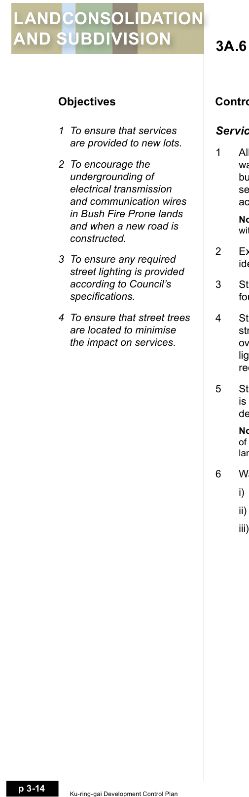
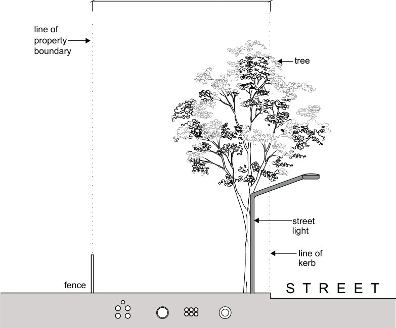
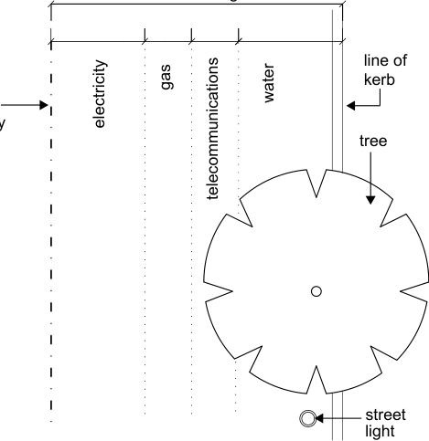
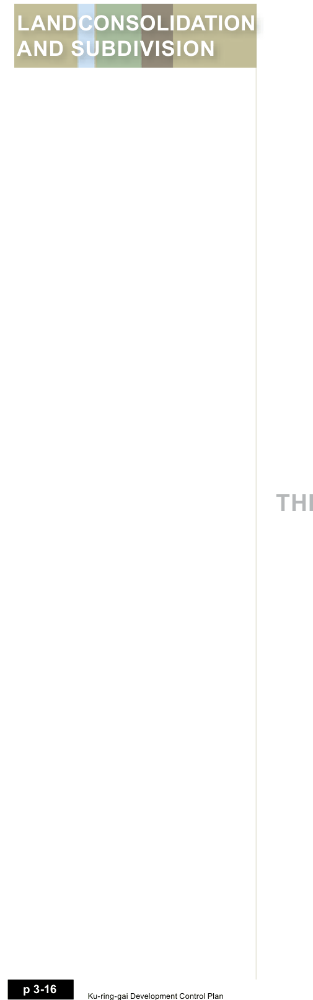

### 3A.6  INFRASTRUCTURE

> [Picture on page 14: a picture, saved as a picture (images/part-03-land-consolidation-and-subdivision-page-14-2.gif, 150 dpi).]
> Words printed on the picture (title and legend, copied from the PDF):
> 2	 To encourage the
> undergrounding of
> electrical transmission
> and communication wires
> constructed.
> street lighting is provided
> according to Council’s
> specifications.
> are located to minimise
> the impact on services.

#### Objectives

#### Controls Services

1	 To ensure that services

are provided to new lots.

1 All lots are to be provided services such as electricity, gas, town

water supply, sewerage and communications. For subdivisions in

bush fire prone land or which include new road construction, these

services are to be underground. Services are to be located in

accordance with Figures 3A.6-1 & 3A.6-2. Note: In Bush fire Prone Lands, services are to be provided in accordance

with the requirements of Planning for Bush Fire Protection (PBP).

in Bush Fire Prone lands

and when a new road is

2 Existing or planned allocation of services and street trees must be

identified on the plan.

3	 To ensure any required

3 Street lighting is to be provided in accordance with luminance levels

found in AS 1158 - Lighting for Roads and Public Spaces.

4	 To ensure that street trees

4 Street lighting is to be located at intervals of 80 – 100 metres on

straight sections of road or every second pole where there is existing

overhead power supply. Where power is located underground, street

lighting is to be located as required to meet the minimum lighting

requirements. 5 Street lighting is to comply with Ausgrid standards. The lighting plan

is to be prepared by a suitably qualified and experienced lighting

designer accredited with Ausgrid. Note: Ongoing responsibility for the supply, depreciation and maintenance

of street lights which do not comply with Ausgrid standards will lie with the

landowner or as agreed at the time of approval and installation. 6 Water management facilities, such as:

i) interallotment drainage for low level lots;

ii)	 on site detention for new roads and driveways;

iii)	 raingardens or bioretention basins are to be provided as required

by Part 24 of this DCP.

### 3A.6  INFRASTRUCTURE (continued)

extent of verge

> [Picture on page 15: a picture, saved as a picture (images/part-03-land-consolidation-and-subdivision-page-15-3.gif, 150 dpi).]
> Words printed on the picture (title and legend, copied from the PDF):
> line of
> property
> boundary
> tree
> street
> light
> line of
> kerb
> fence

#### STREET

gas

water

Figure. 3A.6-1 Provision for the

undergrounding of services.

electricity telecommunications

extent of verge

> [Picture on page 15: a picture, saved as a picture (images/part-03-land-consolidation-and-subdivision-page-15-11.gif, 150 dpi).]
> Words printed on the picture (title and legend, copied from the PDF):
> gas
> line of
> kerb
> water
> electricity
> tree
> telecommunications
> street
> light

line of

property

boundary

### STREET

#### Figure. 3A.6-2 Spacing of street

lighting, trees and services

### GENERAL CONTROLS FOR CONSOLIDATION AND SUBDIVISION

### THIS PAGE IS INTENTIONALLY BLANK

> [Picture on page 16: a picture, saved as a picture (images/part-03-land-consolidation-and-subdivision-page-16-2.gif, 150 dpi).]

### 3B
