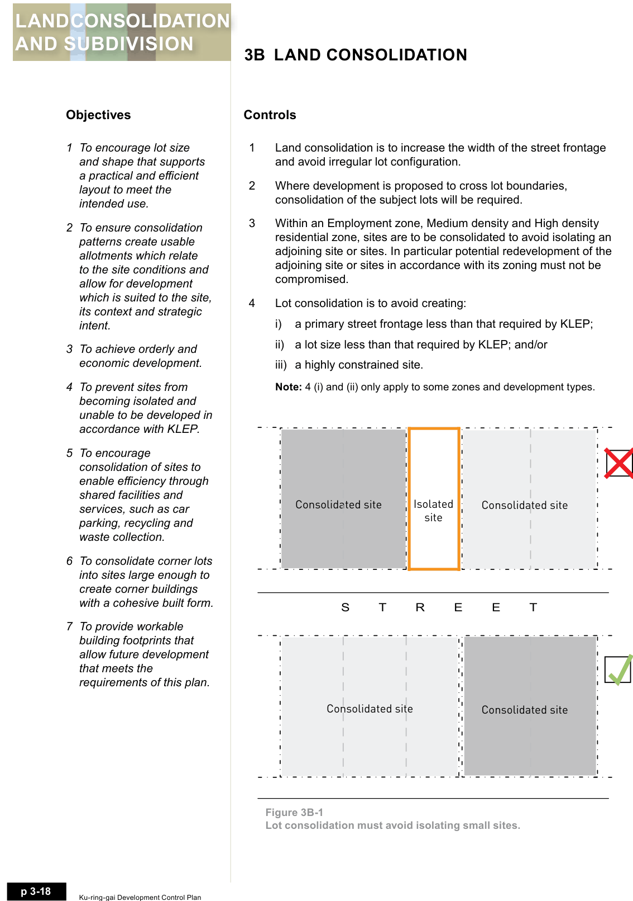
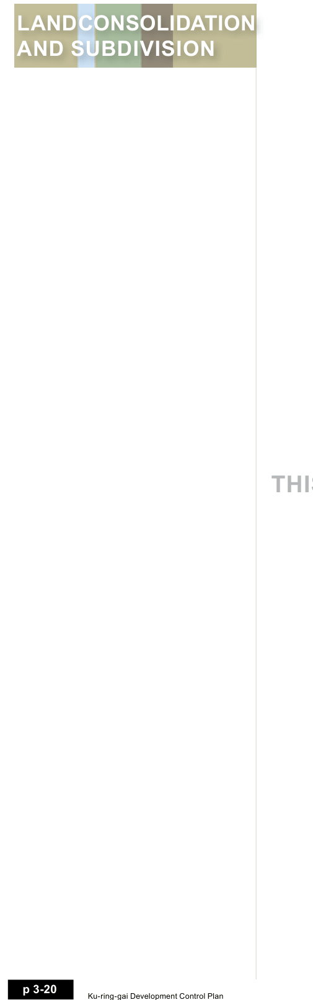

#### 3B Land Consolidation

### LAND CONSOLIDATION

> [Picture on page 18: a map, saved as a picture (images/part-03-land-consolidation-and-subdivision-page-18-1.gif, 150 dpi); the street names and other small labels are on the picture.]
> Words printed on the picture (title and legend, copied from the PDF):
> and shape that supports
> a practical and efficient
> layout to meet the
> 2	 To ensure consolidation
> patterns create usable
> allotments which relate
> allow for development
> its context and strategic
> Note: 4 (i) and (ii) only apply to some zones and development types.
> becoming isolated and
> accordance with KLEP.
> 5	 To encourage
> consolidation of sites to
> enable efficiency through
> shared facilities and
> services, such as car
> parking, recycling and
> create corner buildings
> 7	 To provide workable
> building footprints that
> allow future development
> that meets the
> requirements of this plan.
> Lot consolidation must avoid isolating small sites.

Figure 3B-1

### 3B  LAND CONSOLIDATION

#### Objectives

#### Controls

1 Land consolidation is to increase the width of the street frontage

and avoid irregular lot configuration. 2 Where development is proposed to cross lot boundaries,

consolidation of the subject lots will be required.

1	 To encourage lot size

3 Within an Employment zone, Medium density and High density

residential zone, sites are to be consolidated to avoid isolating an

adjoining site or sites. In particular potential redevelopment of the

adjoining site or sites in accordance with its zoning must not be

4 Lot consolidation is to avoid creating:

i) a primary street frontage less than that required by KLEP;

to the site conditions and

which is suited to the site,

ii)	 a lot size less than that required by KLEP; and/or

3	 To achieve orderly and

iii)	 a highly constrained site.

4	 To prevent sites from

unable to be developed in

6	 To consolidate corner lots

into sites large enough to

with a cohesive built form.

### 3B

### 3B  LAND CONSOLIDATION (continued)

#### Controls

5 For the purposes of this section, a ‘highly constrained site’ is a lot

or lots where heritage, riparian or biodiversity values significantly

reduce the development potential of the lot or lots. 6 Where a development proposal results in an isolated site, as

described in 4 above, the applicant must demonstrate that:

i) Negotiations between the owners of the lots have commenced

prior to the lodgement of the development proposal. Where a

satisfactory result cannot be achieved the development proposal

should include details of the negotiations, demonstrating that a

reasonable offer has been made to the owner of the isolated site:

and

ii)	 Both the isolated site and the development site can be orderly

and economically developed in accordance with the provisions of

KLEP and this DCP, including:

- achieving an appropriate urban form for the location, and

- having an acceptable level of amenity. Note: A reasonable offer, for the purposes of determining the development

application and addressing the planning implications of an isolated lot, is

to be based on at least one recent independent valuation and may include

other reasonable expenses likely to be incurred by the owner of the isolated

property in the sale of the property. To assist in this assessment, applicants

are to submit details and diagrams of development for the isolated site,

that is of appropriate urban form and amenity. The diagram is to indicate

height, setbacks and resultant footprint (both building and basement). This

should be schematic but of sufficient detail to understand the relationship

between the subject application and the isolated site and the likely impacts

of the developments. Important considerations include solar access, deep

soil landscaping, privacy impacts for residential development and the

traffic impacts of separate driveways if the development is on a main road.

The application may need to include a setback greater than the minimum

requirement in the relevant planning controls. Or the development potential

of both sites may need to be reduced

### LAND CONSOLIDATION

### THIS PAGE IS INTENTIONALLY BLANK

> [Picture on page 20: a picture, saved as a picture (images/part-03-land-consolidation-and-subdivision-page-20-2.gif, 150 dpi).]

### 3C

#### 3C Strata And Community Title Subdivision

### STRATA AND COMMUNITY TITLE SUBDIVISION
