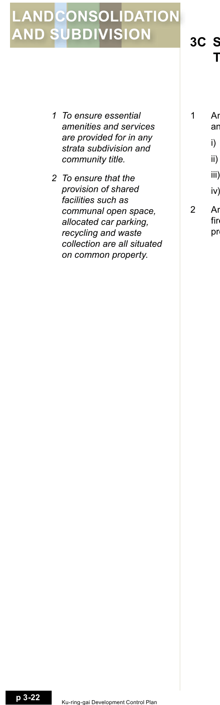

### 3C  STRATA AND COMMUNITY

### TITLE SUBDIVISION

1 Any subdivision must retain the relationship between the building

and/or dwelling and its associated:

i) communal open space(s);

ii)	 parking spaces (visitor and allocated);

> [Picture on page 22: a picture, saved as a picture (images/part-03-land-consolidation-and-subdivision-page-22-7.gif, 150 dpi).]
> Words printed on the picture (title and legend, copied from the PDF):
> 1	 To ensure essential
> amenities and services
> strata subdivision and
> community title.
> provision of shared
> facilities such as
> communal open space,
> allocated car parking,
> recycling and waste
> collection are all situated
> on common property.

are provided for in any

iii)	 water management devices; and

iv)	 waste and recycling facilities. 2 Any buildings included in a subdivision must comply with the relevant

fire safety provisions for that building in relation to each relevant lot

proposed within the development.

2	 To ensure that the

### 3R.1
