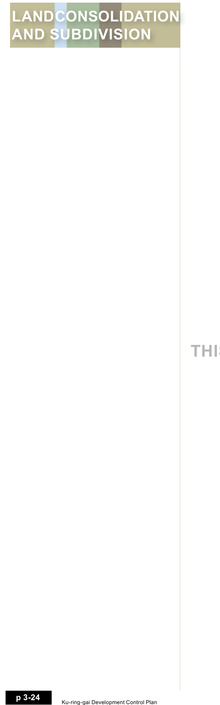

#### 3R References

3R.1 	 Minimum Lot Depth Maps for Bushfire Prone Land

### REFERENCES

### THIS PAGE IS INTENTIONALLY BLANK

> [Picture on page 24: a picture, saved as a picture (images/part-03-land-consolidation-and-subdivision-page-24-2.gif, 150 dpi).]
