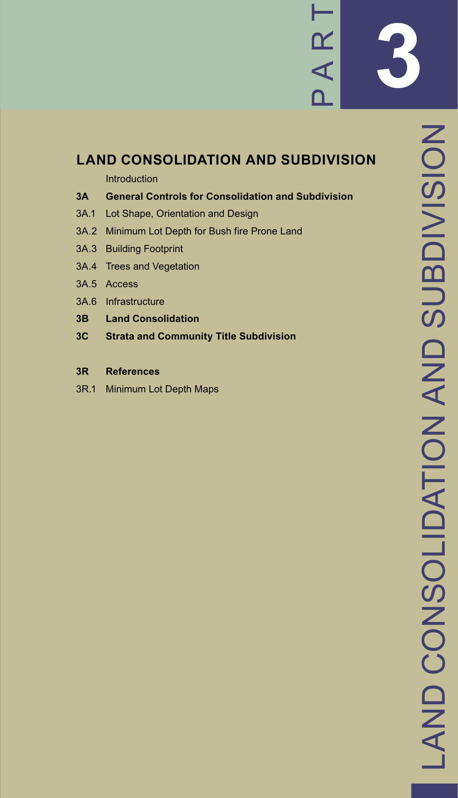
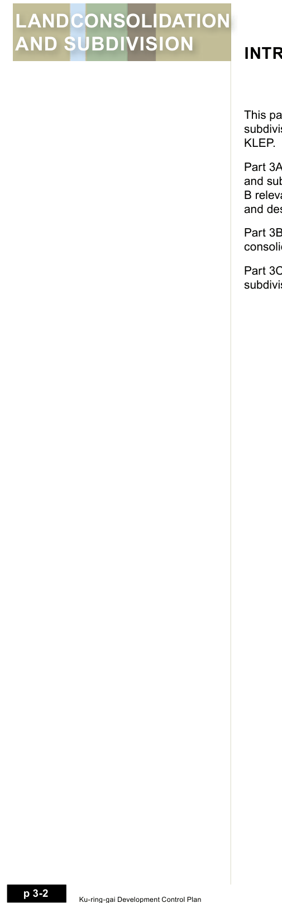

# Ku-ring-gai Development Control Plan - Part 3 Land Consolidation and Subdivision

> This chapter is split into 10 section file(s), one per numbered heading, in the order they appear in the PDF.

Source PDF: [kdcp-section-a-part-3-land-consolidation-and-subdivision.pdf](kdcp-section-a-part-3-land-consolidation-and-subdivision.pdf)

> [Picture on page 1: a picture, saved as a picture (images/part-03-land-consolidation-and-subdivision-page-1-1.gif, 150 dpi).]
> Words printed on the picture (title and legend, copied from the PDF):
> Introduction

### PART

### LAND CONSOLIDATION AND SUBDIVISION

#### 3A General Controls for Consolidation and Subdivision

3A.1 	 Lot Shape, Orientation and Design 3A.2 	 Minimum Lot Depth for Bush fire Prone Land 3A.3 	 Building Footprint 3A.4 	 Trees and Vegetation 3A.5 	 Access 3A.6 	 Infrastructure

#### 3B Land Consolidation 3C Strata and Community Title Subdivision

#### 3R References

3R.1	 Minimum Lot Depth Maps

### LAND CONSOLIDATION AND SUBDIVISION

### INTRODUCTION

This part provides guidance on consolidation of multiple lots and

subdivision of lots in order to meet the aims and objectives within the

> [Picture on page 2: a picture, saved as a picture (images/part-03-land-consolidation-and-subdivision-page-2-4.gif, 150 dpi).]
> Words printed on the picture (title and legend, copied from the PDF):
> subdivision.

KLEP. Part 3A outlines matters that need to be addressed for both consolidation

and subdivision, and is to be read in conjunction with the Parts of Section

B relevant to the site. It also includes guidance on infrastructure provision

and design. Part 3B provides guidance on land consolidation, in particular, when land

consolidation is required. Part 3C provides controls in relation to strata and community title

<!-- sections -->
## Sections

1. [3A General Controls for Consolidation and Subdivision](01-3a-general-controls-for-consolidation-and.md)
2. [3A.1 LOT SHAPE, ORIENTATION AND DESIGN](02-3a-1-lot-shape-orientation-and-design.md)
3. [3A.2 MINIMUM LOT DEPTH FOR BUSH FIRE](03-3a-2-minimum-lot-depth-for-bush-fire.md)
4. [3A.3 BUILDING FOOTPRINT](04-3a-3-building-footprint.md)
5. [3A.4 TREES AND VEGETATION](05-3a-4-trees-and-vegetation.md)
6. [3A.5 ACCESS](06-3a-5-access.md)
7. [3A.6 INFRASTRUCTURE](07-3a-6-infrastructure.md)
8. [3B Land Consolidation](08-3b-land-consolidation.md)
9. [3C STRATA AND COMMUNITY](09-3c-strata-and-community.md)
10. [3R References](10-3r-references.md)
