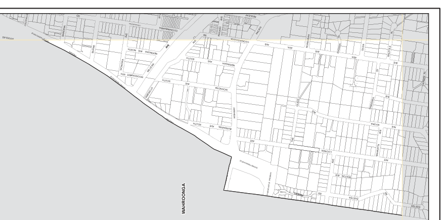

### 3R References

### 3R.1 	 Minimum Lot Depth Maps for Bushfire Prone Land

### REFERENCES

> [Picture on page 2: a map, saved as a picture (images/part-03r-3r-1-minimum-lot-depth-maps-for-bushfire-prone-lan-page-2-1.gif, 150 dpi); the street names and other small labels are on the picture.]
> Words printed on the picture (title and legend, copied from the PDF):
> LAN E LANE REDLEAF
> LAN E MILLEWA
> 21 17-19 6-8
> No 8 No 10
> 7-9 5 3
> 11   -    21
> 50A50 52 54 56
> 18 - 14
> 30 28 17A
> 23 21 17
> 11 9 5
> 14 10 8
> HUGHES FREEWAY 1
> BRENT FO RD
> 26 24 20
> 1693 - 1689
> 14 20 22
> 3 7 9
> 24 28 30
> 37A 39 41 43
> 70 72 74
> 69 71 77 79
> 73 75 83 85
> 9 - 11
> KINGSLEY 14 14A
> 4 9 11
> 43 45 47 49
> 25A 6 4
> 15 17 19 10

#### FIELD

SYDNEY-NEWCASTLE

#### COONANBARRA

#### REDLEAF

#### STUART

FREEWAY

106 104 102 98 96 94 92

#### LOCHVILLE

#### COONANBARRA

#### PACIFIC

#### RAILWAY

#### BAREENA

#### CL

#### DOUGLAS

#### COONANBARRA

#### MUNDERAH

## 23 AVE

#### GILDA

#### NORTH AVE

#### ADA

#### BURNS

#### LOCHVILLE

## 7 RHONDA

#### NERINGAH

#### WALPOLE

#### ADA

#### SOUTH AVE

#### NERINGAH

#### WONIORA 37-41 12

#### MILLEWA

#### NTH

#### WOONONA SOUTH

#### HERBER

#### WOONONA

#### AVE

#### WARWILLA

#### AVE

#### GLADE

#### TANDERRA

#### BUNDARRA 9A 9

#### AVE

#### HIGHWAY 1712

#### FERN

#### SOUTH

#### KOORA

12 10 6 4 2

#### AVE

3 47 45 41 37 37 35 33 31 29

#### AVE

#### BUNDARRA

22 16 14 12 19

#### AVE THE

#### ST

11A 35 37 34 38 40 42 44

#### AVE

#### MAHRATTA 50 52

45 47 49 53 55 64

56 58 60 62 66

#### LUCINDA

#### AVE

#### ST

#### ISIS
