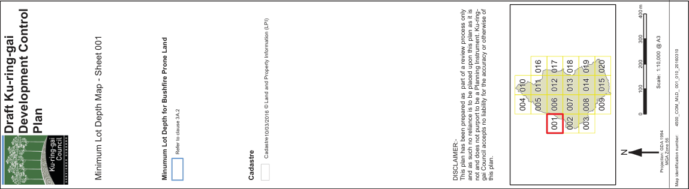
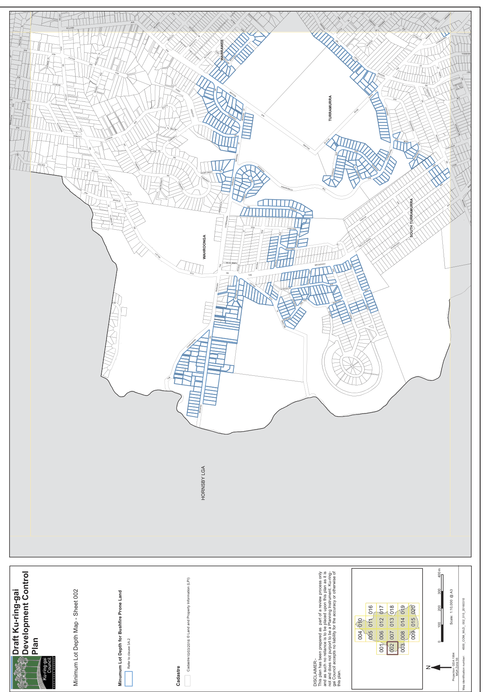

#### 27A EASTBOURNE

47

45

41

39

37 35

24

22

20

18 16

14

12

10

8

6

4

2

2E

2D

2C

2B

#### AVE

#### AVE HEWITT

#### HEWITT

### HORNSBY LGA

> [Picture on page 2: a picture, saved as a picture (images/part-03r-3r-1-minimum-lot-depth-maps-for-bushfire-prone-lan-page-2-108.gif, 150 dpi).]

#### 1:10,000

### 017 018 019

#### Scale:                 @ A3

### 015 020

### 012 013

### 011 016

### 010

### 014

#### 100

#### 200

#### 300

#### 400 m

#### 4500_COM_MLD_ 001_010_20160310

### Draft Ku-ring-gai Development Control Plan

#### © Land and Property Information (LPI)

DISCLAIMER:- This plan has been prepared as  part of a review process only and as such no reliance is to be placed upon this plan as it is not and does not purport to be a Planning Instrument. Ku-ring- gai Council accepts no liability for the accuracy or otherwise of this plan.

> [Picture on page 3: a map, saved as a picture (images/part-03r-3r-1-minimum-lot-depth-maps-for-bushfire-prone-lan-page-3-1.gif, 150 dpi); the street names and other small labels are on the picture.]
> Words printed on the picture (title and legend, copied from the PDF):
> 50A50 52 54 56
> 173A 173B 173C
> 87 89 91 93
> 23 21 17
> 95 97 99 101
> 192 196 198 213
> 11 9 5 3
> 202 204 206
> 183 208 212
> 14 10 8
> 191 193 205
> AULUBA LANE 1A
> 1/ 1 99
> 5/ 1 99
> 4 8 10
> 26 24 20
> 22 16 14
> 70 72 74 76
> 122 124 126
> 73 75 83 85
> 121 123 125
> 1 5 9
> 22 24 28 30
> 82 80 78
> 43 45 47 49
> 14 16A 15A
> 14 12 10 6
> 5 7 9
> 51 53 59
> 8 12 14
> 31 33 35
> AVE 6A 153
> 24 30 34
> 23 8 12
> 4 8 10
> 33 35 37

#### 8 6 FIELD

#### MAY

#### UNNAMED

#### VALLEY

#### FORWOOD

#### FINLAY

#### YERAMBA

#### YERAMBA

## 47 MILDRED

#### ROLAND

#### KISSING

#### CRES

#### WATTLE

#### HUDSON

#### BLYTHESWOOD

#### NIMBRIN

#### SATTERLEY 77

#### BERILDA

#### COMENARRA

#### WALPOLE

#### MONTEITH

#### DAWSON

#### FOX 9

#### MAXWELL

#### ADA

45 47 51 53 55 57 59

#### ROTHWELL

#### WARRAWEE

#### POINT 162

#### MITCHELL

#### CRES MITCHELL

70-72 74 76 78 80

#### ADELONG

#### AVE 86A

#### HERBER

#### THE

#### POINT

#### SOUTH

#### ADA

#### AVE 100

#### KISSING

#### TURRA

#### AVE

#### RD

88 90 92 94 96

#### AMAROO

#### RD

## 164 DR

#### CRES

#### DENNIS

2/ 1 99 3/ 1 99 4/ 1 99

#### ROLAND

#### CL GIPPS 12

#### 5 AVE 3

#### AVE

#### KOORA

#### VALLEY 66

47 45 41 37 37 35 33 31 29 27

#### AVE

#### RD

#### SOUTH

#### PARKWAY

53

#### COOPER

#### CAMPBELL

#### ST NERANG

#### TURRAMURRA

#### AVE

#### AVE

#### MAHRATTA

56 58 60 62 66

#### AVE

#### PL BOYNE

#### PARKINSON

#### 69 71 1 FOX

#### MAHRATTA

107 109 111 113 115

#### BALMARINGA

#### DR

#### LUCINDA

## 141 AVE

#### LUCINDA

#### CAMPBELL

#### S 11

#### CK

#### HI

#### CANOON

#### ROAD

### 20.12 W.

#### AVE

#### AVE

#### AVE

#### ROLAND

#### RD

#### CHISHOLM

#### PL

#### CLYDE

#### AVE

#### RD

#### DR

#### PARKINSON

#### AVE

#### COMENARRA

#### ST

#### NERANG

#### RD

#### EXETER

#### LYON

#### AVE

#### AVE

#### DR

#### CAMPBELL 20

#### HOWSON

#### CYRUS

#### PARKWAY
