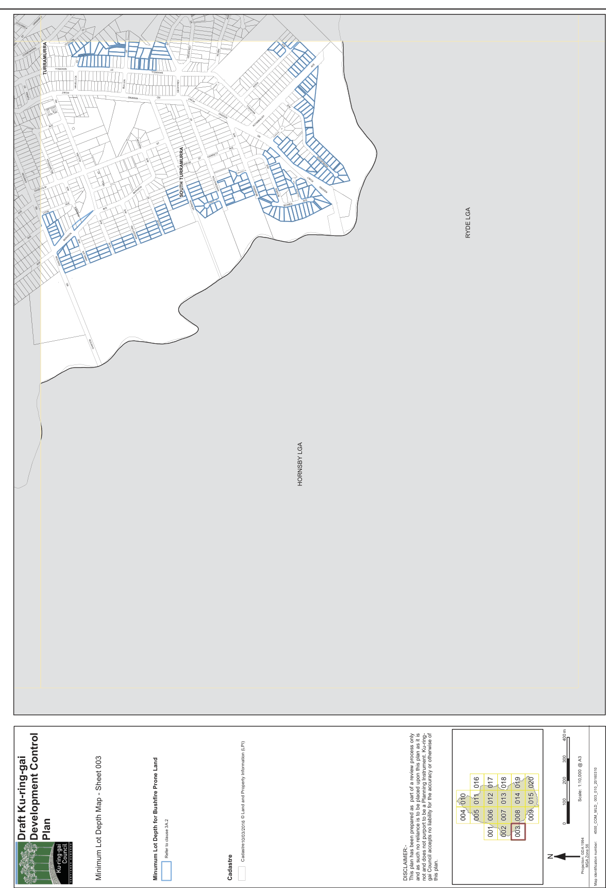
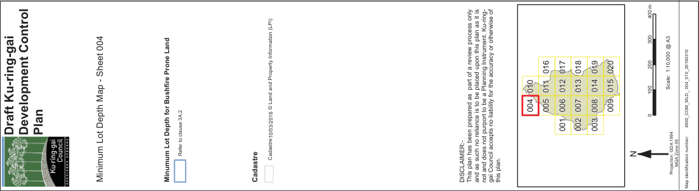
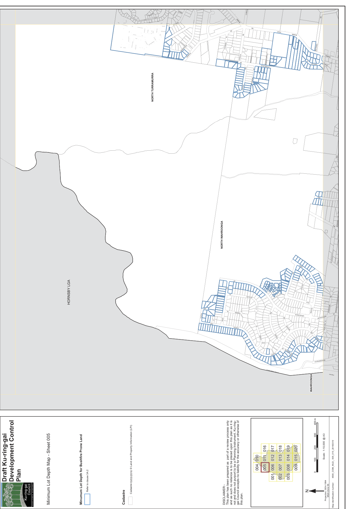
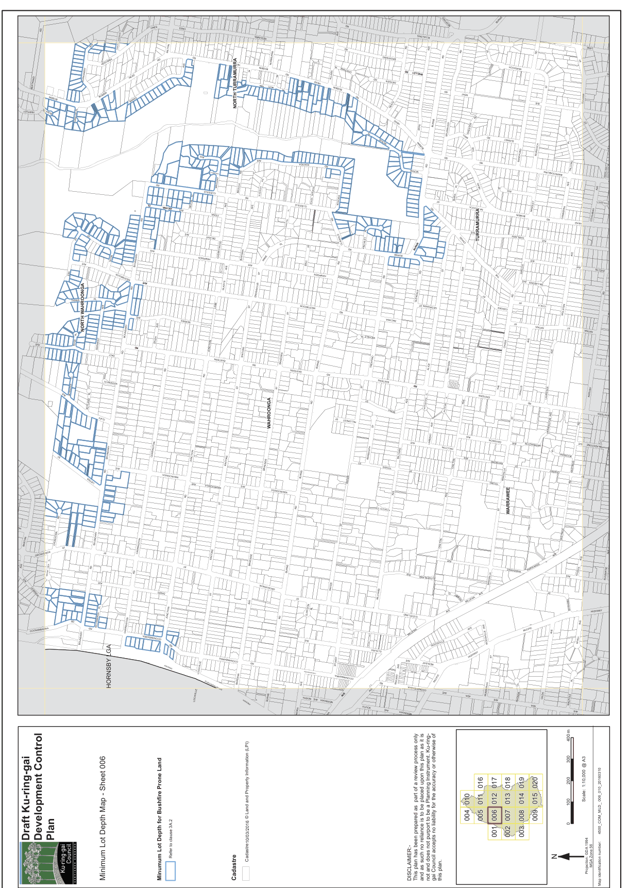

#### 70 3 CL

#### RAINFOREST

#### DR

#### HOWSON

#### AVE

#### CL STAINSBY

#### CL

#### THE

#### VALLEY

#### CAMPBELL

#### AVE 9

#### AVE

#### BARWON

#### GEORGINA

#### CAMPBELL

#### THE

#### COMENARRA

#### HEWITT

#### AVE

#### TERRELL

#### STRONE

#### PL 4

#### ST

#### AVE CANOON

#### RD

3 7 11 15 17 19 21 23

5 25 27 29 26

#### JORDAN

#### FOX

#### WARWICK

#### TAROOK

#### RD

#### AVE

#### CROWN

#### ELIZABETH

2 4 8 10 12 14 16 18 20 28

#### PDE

#### RD

#### KALLANG

#### ST

#### PDE

#### AVE ST

#### SOUTH TURRAMURRA

#### ST

## 4 EURONG

#### FIELD OF MARS

#### RIVERVIEW

#### MUTTAMA

1 7 9 11 13 15 17

19 21 23 25 27

#### VALLEY

#### WAHROONGA

#### LANE 6.1W. 1

28 30 32 34 36

38 40 42 44 46

48 50 52 54 56

#### BROADWAY

#### KERELA 24

#### PARKWAY

#### THE

#### COMENARRA

#### MOONA

#### 176 178 KIOGLE 6

#### RD

#### FOX

#### THE

#### AVE

#### TALGAI AVE WONGALEE

#### PARKWAY

#### AVE

#### CL

#### SEYMOUR

#### FOX

#### VALLEY

## 4 AVE

#### MOUNT   PLEASANT

#### AVE

#### MORONA

12 14 16 18 19

#### AVE

#### ST

#### EURONG

#### AVE

#### LEUNA

#### PL

#### CL ALETA

#### AVE

#### YANILLA

#### MORONA

#### BELTANA

#### RD

#### RD OSBORN

#### COMENARRA

#### RIVERTOP

#### THE 100-106

#### PINE  ST ST

#### BROWNS

#### MYRTLE

### 6.1 W.

### HORNSBY LGA

#### 1:10,000

### 017 018 019

#### Scale:                 @ A3

### 015 020

### 012 013

### 011 016

### 010

### 014

#### 100

#### 200

#### 300

#### 400 m

#### 4500_COM_MLD_ 002_010_20160310

### Draft Ku-ring-gai Development Control Plan

#### © Land and Property Information (LPI)

DISCLAIMER:- This plan has been prepared as  part of a review process only and as such no reliance is to be placed upon this plan as it is not and does not purport to be a Planning Instrument. Ku-ring- gai Council accepts no liability for the accuracy or otherwise of this plan.

> [Picture on page 4: a map, saved as a picture (images/part-03r-3r-1-minimum-lot-depth-maps-for-bushfire-prone-lan-page-4-1.gif, 150 dpi); the street names and other small labels are on the picture.]
> Words printed on the picture (title and legend, copied from the PDF):
> 232 234 258
> 260 262 264 268
> 272 278 280
> AULUBA LANE 1A
> 5/ 1 99
> 257 259 1
> 20 11 265
> 11 18 16
> AND ER SON
> 1 37- 41

#### 61A PARKW

#### AVE 35 ST 42

#### UNNAMED

#### FORWOOD

#### CL

#### HUDSON

#### NIMBRIN 77

#### ROBIN

#### COMENARRA

#### GEOFFREY

#### MAXWELL

43 45 47 53 55 57 59 61 63 65 67

#### 69 73 MAXWELL

#### TURRAMURRA

89 93 95 97 99 101 115

#### EDEN

#### HAVELOCK BULLER

244 246 248 250 252 254 256

#### GEOFFREY

#### POINT

284 288 290 292 294 296 298

#### RD

#### KISSING

#### TURRA

#### POINT

#### RD

#### AVE

#### MAXWELL 7

#### KISSING

#### ST 253

308A 310 310A 312 314 316 318 320 322

#### KOOMBALAH

#### AVE 3

#### AVE RD CURRONG

#### PL 38

#### PAROO

#### AVE GARRETT

#### AULUBA

#### AVE 5

#### ASHBURTON

#### ST CAMBRIDGE

#### BALMARINGA

#### CANOON

#### ST

#### HALL 9

#### SADDINGTON

#### ST

#### CHISHOLM

#### POINT

#### KISSING

#### BARWON

#### BENNING

#### AVE

#### BOWEN

## 26 SOUTH TURRAMURRA

#### AVE

#### AVE

#### BOWEN

#### RD

#### VERNON

#### AVE

#### AVE

#### LYON

#### AVE 5

#### AVE

#### WARNER 2

#### ST

#### COVE

#### KINGSFORD

#### AVE

#### BARWON

#### AVE

#### AVE

#### ULM HINKLER

#### AVE CANOON

#### RD

#### CANOON

### HORNSBY LGA

### Draft Ku-ring-gai Development Control Plan

#### © Land and Property Information (LPI)

DISCLAIMER:- This plan has been prepared as  part of a review process only and as such no reliance is to be placed upon this plan as it is not and does not purport to be a Planning Instrument. Ku-ring- gai Council accepts no liability for the accuracy or otherwise of this plan.

### RYDE LGA

### 017 018 019

### 015 020

### 012 013

### 011 016

### 010

### 014

#### 1:10,000

#### Scale:                 @ A3

#### 100

#### 200

#### 300

#### 400 m

#### 4500_COM_MLD_ 003_010_20160310

### Draft Ku-ring-gai Development Control Plan

### HORNSBY LGA

#### © Land and Property Information (LPI)

DISCLAIMER:- This plan has been prepared as  part of a review process only and as such no reliance is to be placed upon this plan as it is not and does not purport to be a Planning Instrument. Ku-ring- gai Council accepts no liability for the accuracy or otherwise of this plan.

#### NORTH TURRAMURRA

> [Picture on page 5: a picture, saved as a picture (images/part-03r-3r-1-minimum-lot-depth-maps-for-bushfire-prone-lan-page-5-6.gif, 150 dpi).]

### 017 018 019

### 015 020

### 012 013

### 011 016

### 010

### 014

#### 1:10,000

#### Scale:                 @ A3

#### 100

#### 200

#### 300

#### 400 m

#### 4500_COM_MLD_ 004_010_20160310

> [Picture on page 6: a map, saved as a picture (images/part-03r-3r-1-minimum-lot-depth-maps-for-bushfire-prone-lan-page-6-1.gif, 150 dpi); the street names and other small labels are on the picture.]
> Words printed on the picture (title and legend, copied from the PDF):
> 9 - 17
> LEU RA 34
> 4 - 20
> CUTL ER CR.
> 2 - 14
> SI R RODEN
> 3 - 13
> 3 MIDDLETON 28
> 3 - 7
> DRIVE HALIFAX 1 3
> LANCASTER SUTHERL AND
> 1A CRESC ENT
> 1 - 25 26
> BO ULEVAR DE
> NEW TON PL ACE
> 50 48 46 44
> 16 18 20
> 24 22 20
> 178 176 172 170
> PL ACE PATHWAY
> 13 LYN DHURST
> 7 21 PARKVIEW
> 152 16 14
> 4 10 12
> 17 9 6
> 102 100 98
> 94 90 86
> 15 15 11
> 84 82 78 51
> MOUNT  VIEW     PL
> 19 17 21 30
> 33 31 40
> 54 4 7

#### NAGLE

#### BOBBIN

#### DU FAUR

SI R FR ED ERI CK SCHERGER 1

SI R NEVILL E McNAM ARA 8

#### HEAD BOBBIN

SI R NEVILL E McNAM ARA 15

SI R JAMES RO LAND SIR NEVILLE McNAMARA

AVENUE SI R JAMES RO LAND 90

#### HOPKINS

WEL LING TO N PL ACE

#### BERTRAND

#### KIRKPATRICK

#### BOBBIN

#### MURRUA

#### CURAGUL

#### CURAGUL

#### CL 7 HARTLEY

#### 8 6 BUNA CL

#### RD STONECROP

19 21 25 29 31

#### PL

#### NENTOURA

#### AVE

#### GWYDIR

#### NORTH TURRAMURRA

#### ESK

## 29 TAM

33 31 29 27 17

#### AVE

42 40 38 36 34 26

## 28 CL

#### BOWATER

#### AVE

#### NORTH WAHROONGA

#### ST 13

#### CRES

#### AVE

## 4 CL

#### ST

#### CHIFLEY

6 8 10 12 14 16

#### PL SCULLIN

3 5 7 11 15 17 19 22 PATHWAY 18 7

#### HOLT

### HORNSBY LGA

#### AVE PL 29 34 2

#### RD

#### CHUNOOMA 93

#### BARTON

#### FADDEN

#### PATHWAY AVE

#### ST

#### GROSVENOR

#### CURTIN

#### GROSVENOR

#### AVE

#### PAGE

#### AVE

#### AVE 69

#### AVE

#### 67 65 63 61 59 PL

#### CURTIN 53

#### WATSON

#### FISHER

#### FORDE

#### AVE

#### FORREST 14

#### PL 28

#### MIRROOL

#### ST

#### CURTIN

#### RD

## 2 URALBA

#### COONANBARRA

#### SYDNEY-NEWCASTLE

FREEWAY

#### WAHROONGA

#### 1:10,000

### 017 018 019

#### Scale:                 @ A3

### 015 020

### 012 013

### 011 016

### 010

### 014

#### 100

#### 200

#### 300

#### 400 m

#### 4500_COM_MLD_ 005_010_20160310

### Draft Ku-ring-gai Development Control Plan

#### © Land and Property Information (LPI)

DISCLAIMER:- This plan has been prepared as  part of a review process only and as such no reliance is to be placed upon this plan as it is not and does not purport to be a Planning Instrument. Ku-ring- gai Council accepts no liability for the accuracy or otherwise of this plan.

> [Picture on page 7: a map, saved as a picture (images/part-03r-3r-1-minimum-lot-depth-maps-for-bushfire-prone-lan-page-7-1.gif, 150 dpi); the street names and other small labels are on the picture.]
> Words printed on the picture (title and legend, copied from the PDF):
> 17 15 11 9
> DEO DARA  GARDENS
> 12 6 4
> 23 202A 181
> 17 15 11
> 9 7 5 1
> 18 16 14
> 57 55 53
> 145 141 139
> 186 184 182
> 137 135 133 131
> 24 22 20
> MAR ANOA PL
> 101 99 95 93
> 174 170 168
> 162 160 158
> 154 152 150
> 84 82 80
> 65 63 61 2
> 15 9 7
> 57 55 53 GLENROCK
> 12 8 6 4
> 41A 39 37 35A
> 7 5 3
> 125 123 119
> 10 12 14
> 126 124 122 120
> 11 8 6A
> 57 53 51
> 56 54 52 50
> 35 33 27
> 11 9 18 14
> 44 38 36
> 130 134 144
> 18 16 14
> 22 20 12 10
> 146 148 150
> 72 70 68
> 80 78 76 74
> 57 55 21
> 143 147 149
> 97 95 93
> 25 29 31 33
> 26 24 22 20
> 84 82 80
> 76 74 72
> 4 6 8
> 79 77 75 73
> 71 69 67
> 59 57 55
> 46 44 40 38
> 37 33 31
> 19 17 11
> 15 9 7 5
> 32 28 27 25
> GR OV E
> 9 5 3 1
> 16 14 12 8
> 7 5 1
> 10 6 4 2
> 2 4 6
> 35 33 31
> 17 11 9
> 32 30 28
> 26 7 3 1
> 37 35 33 31
> 8 6 4
> 24 ALICE    LAN E
> 31 29 27
> 229 227 225 223
> 205 203A 203 201A
> 168 166 164 181
> 53 51 49
> 7 3 98
> 146 144 142 140
> TENNYSON  L AN E
> 116 - 120
> 97 97A 97B 99
> 61 59A 59 55
> 14 - 16
> 4 4A 2
> 11 9 5 3
> 14 12 10 4
> 16 12 10
> 33 31A 31
> 38 36 30
> 27A 25 23
> 22 17 15
> 21 19 15B 15A
> 16 14 10
> 20 16 65 31
> 9 7A 7 5
> 10A 10 3
> 19 2B 2A
> PIBR AC 52 50A
> 59 59 53
> 100 90 86
> 73 71 69
> 33 29A 29
> 52-54 48 46
> 19 17 15
> MOUNT  VIEW     PL
> 34 32 30
> 29 27 25
> 7 5 3
> 20 16 14
> 22 20 16
> 14 12 8 6
> 28 26 24 22
> 12 10 8 6
> 36 34 32
> 12 - 14
> 141 135 135
> 131 123 2A
> 33 31 27
> 148 146 142
> 1580 - 1596
> 16 12 23
> 15 11 9 1
> 97 95 91 89
> 126 124 120
> 118B 116A 114
> 33 35 37
> 79 77 77
> LAN E LANE REDLEAF
> LAN E MILLEWA
> 21 17-19 6-8
> No 8 No 10
> 7-9 5 3
> 11   -    21
> 50A50 52 54 56
> 18 - 14

#### BURNS

#### BEDFORD

#### RD 43

42A 42 44 50 52 56

#### CRES CRES

#### ELLALONG

#### 61 63 65 67 69 KEDUMBA

#### MILTON

311 307 305 301 299 297 295 291

#### BROWNING

#### 273 271 NORMURRA

#### KEDUMBA 321

57 55 51 49 47 41A

#### HEAD BOBBIN

#### MURDOCH

288 286 284 278-280 276

#### CHATHAM

#### RD SHELLEY

#### RD SHELLEY

#### ALLARA

#### GLENGARRY

#### DRYDEN

#### BERTRAND

#### HEAD BOBBIN

#### RD

#### KENT

#### BOBBIN

#### HEAD

#### BOBBIN

#### BANKS

#### BUCKRA

#### AVE

#### CL

#### KEATS

#### NORTH TURRAMURRA

#### HARTLEY

## 6 BUNA CL

#### RD

#### PL GAWLER 3 350

#### ST

#### RD

#### HEAD

#### BURNS

#### APPS

#### CHESTER
