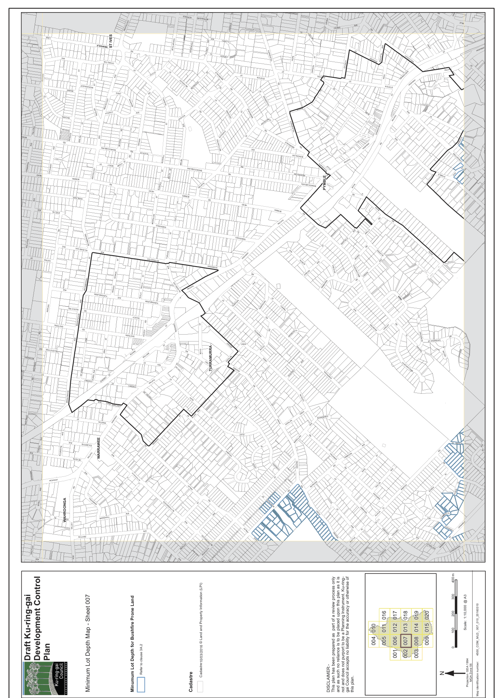

## 34 JUNCTION

#### ST

#### RD

#### RD

#### AVE

#### KILLAWARRA

#### RD

#### AVE

#### PACIFIC

#### COONANBARRA

#### CARRINGTON

#### AVE

## 24 MILLEWA

#### COONANBARRA

#### AVE

#### WOODVILLE AVE

#### BOUNDARY

#### WOODVILLE

#### RD

#### ILLOURA

#### HIGHWAY ST

#### FIELD

#### PL

#### RD

#### COONANBARRA

19 21 23 25 27

#### AVE

#### REDLEAF

#### STUART

#### AVE

106 104 102 98 96 94 92

#### LOCHVILLE

#### COONANBARRA

#### PL

#### PACIFIC

#### RAILWAY

#### BAREENA

#### AVE

#### CL

#### AVE

#### DOUGLAS

### HORNSBY LGA

#### RD COONANBARRA

#### AVE

#### MUNDERAH

## 23 AVE

#### AVE

#### GILDA

#### NORTH AVE

#### AVE ADA

#### AVE

#### BURNS

#### LOCHVILLE

#### RHONDA

#### NERINGAH

#### MYALL

#### WALPOLE

#### ADA AVE

#### SOUTH

#### AVE

#### NERINGAH

#### WONIORA MILLEWA

#### 1:10,000

### 017 018 019

#### Scale:                 @ A3

### 015 020

### 012 013

### 011 016

### 010

### 014

#### 100

#### 200

#### 300

#### 400 m

#### 4500_COM_MLD_ 006_010_20160310

### Draft Ku-ring-gai Development Control Plan

#### © Land and Property Information (LPI)

DISCLAIMER:- This plan has been prepared as  part of a review process only and as such no reliance is to be placed upon this plan as it is not and does not purport to be a Planning Instrument. Ku-ring- gai Council accepts no liability for the accuracy or otherwise of this plan.

> [Picture on page 8: a map, saved as a picture (images/part-03r-3r-1-minimum-lot-depth-maps-for-bushfire-prone-lan-page-8-1.gif, 150 dpi); the street names and other small labels are on the picture.]
> Words printed on the picture (title and legend, copied from the PDF):
> PA T H WA
> WALT ON CL
> 100 98 92 85A
> 88A 88B 88
> 907 - 909
> 35 33 31 41
> 28 26 6
> 14 12 8
> 7 3 1
> BLO OM SBURY
> 12 6 4
> 58 54 52
> 101 99 95
> 162 160 158
> 2 - 12
> 154 152 150
> 85 81 79
> 3 - 5
> 31 29 25 23
> 69 67 65 61
> 41 39 37
> 31 33 35
> 78 76 74
> 14 12 6
> 19 17 15
> 125 123 119
> 58 56 52
> 109 107 105 103
> 37 35 33 31
> 115 113 101
> 126 124 122 120
> 18 7 5
> 21 19 15 9
> 29 25 23
> 86 71 61
> 79 69 65
> 35 33 27 25
> 55 53 37
> RICHARD PORTER WAY
> 30 28 26 24
> 18 16 14
> 27 25 23
> 18 20 22
> 19 21 23
> 1147- 11 49
> 1155 - 1159
> 3 5 7
> 43 39A 39
> 21 17 9A
> 30A 28 7
> 15 11 9 5
> 38A 38 36
> 34 32A 32
> 87 85 81
> 9A 9 11
> 61 55 53A 53
> 44 40 38
> 27 25 23
> 8 4 1
> 1203 - 1209
> 19 10 5
> 53 51 49
> 44 42 40
> 20 - 28
> 2 4 6
> 3 1A 1318-1322
> 36 34 32 30
> 9 11 18
> 41 39 37
> 27 25 19 17
> 59A 59 55
> 64 62A 60
> 19 17 15
> 15 11 9
> 7 14 18 24
> 42 36 34
> 26 24 22
> 49 51 53
> 20 14 4
> 3 135 6A
> LAN E OLIVE
> HIG GS   LN
> 12 2 4-6
> 55 55A 57
> HAD DIN CL .
> 5 1 1380-1388
> 1392 7A-7B 18
> 18 14 8 6
> 14 16 18
> 11 81 83
> 22 24 26
> 30 32 34
> 42 41 43
> 1440 - 1444
> 13 7 3 1
> 17 11 9
> 20 16 14
> 57 59 60
> 68 70 72 74
> 29 8A 107
> 9 16A 18
> 48 11 5
> 20 18 14
> 16 28 29
> 13 19 21
> 50A50 52 54 56

#### KYWONG

#### RD 43

#### CL

#### HIGHLAN

#### KORANGI

#### KORANGI

#### VALE

## 23 ORANA ORANA

#### PENTECOST

#### CANISIUS

#### CL

#### HEYSEN

#### FLOREY 26

137 135 133 129 123 119 119 117 113

115 109 107 105 103 101 99

#### MERRIVALE ST IVES

#### FERN

#### BOOLARONG

#### HIGHWAY

#### MERRIVALE

#### GREENDALE

#### FLOREY

#### CL

#### LINDSAY

#### HOPE

#### TELEGRAPH 40

#### MOCATTA

#### EDWARD
