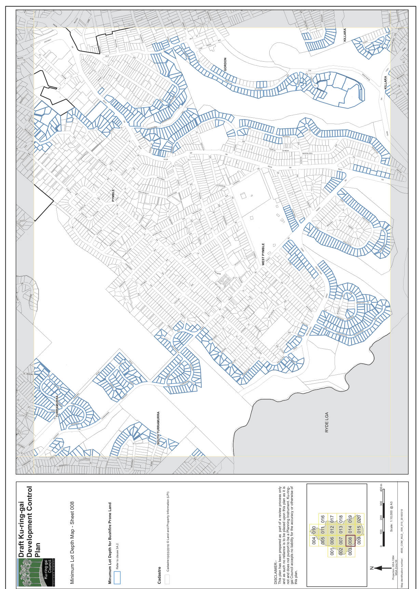

#### 37A PL 77 78

#### PL

#### YOSEFA

#### EULBERTIE

#### HOLMES

#### AVE

#### WARRAWEE

#### HIGHWAY

#### PACIFIC

#### AVE

#### TAMBOON

#### WARATAH

#### AVE

#### HEYDON

#### RD

#### RD

## 85 KISSING

#### LEEDS

#### RD 36

#### 21 16 CORNWALL

#### ST

#### KATE

#### AVE

#### PL

#### ST

#### BORAMBIL 1485

#### ST

#### HIGHWAY

#### BORONIA

#### RD

#### AVE

#### TAYLOR

#### CARINA

#### RD

#### FINLAY

#### RD

#### MIMOSA

#### AVE

#### KONDA

#### RD

#### PL

#### KURUK

#### ST

#### WARATAH 19

#### RD

#### ST

#### MARSHALL

#### MONTROSE

#### BLYTHESWOOD

#### YERAMBA

#### CL

#### POINT

#### AVE

#### DER

#### CL ACACIA

#### AN

#### AVE

## 67 SOL

#### AVE MARSHALL

#### 8 6 FIELD

#### PL

#### WAHROONGA

#### AVE

#### ST

#### ST

#### MAY

#### UNNAMED

#### VALLEY

#### PL

#### FORWOOD

#### AVE

#### FINLAY

#### ST

#### YERAMBA

#### PL

#### YERAMBA

## 47 MILDRED

#### ROLAND

#### KISSING

#### PL

#### CRES

#### WATTLE

#### HUDSON

#### BLYTHESWOOD

#### ST

#### NIMBRIN

#### AVE

#### SATTERLEY 77

#### BERILDA

#### RD

#### COMENARRA

#### MYALL

#### WALPOLE

#### MONTEITH

#### DAWSON

#### FOX 9

#### AVE

#### AVE LAN E

#### MAXWELL

#### PL

#### CRES

#### ADA

#### OTHWELL

#### 1:10,000

### 017 018 019

#### Scale:                 @ A3

### 015 020

### 012 013

### 011 016

### 010

### 014

#### 100

#### 200

#### 300

#### 400 m

#### 4500_COM_MLD_ 007_010_20160310

### Draft Ku-ring-gai Development Control Plan

#### © Land and Property Information (LPI)

DISCLAIMER:- This plan has been prepared as  part of a review process only and as such no reliance is to be placed upon this plan as it is not and does not purport to be a Planning Instrument. Ku-ring- gai Council accepts no liability for the accuracy or otherwise of this plan.

> [Picture on page 9: a map, saved as a picture (images/part-03r-3r-1-minimum-lot-depth-maps-for-bushfire-prone-lan-page-9-1.gif, 150 dpi); the street names and other small labels are on the picture.]
> Words printed on the picture (title and legend, copied from the PDF):
> 8   -   14
> 44 1 - 7
> 16 - 24
> WALT ON CL PATHWAY
> FITZ SIM ONS
> 78 76A 76
> 9 11 15 17
> 57 19 21
> 66 64 62
> 19-23 22 HOLF ORD
> 84 86 88
> 39 41 43
> 36 32 28
> 121 123 125 133
> 45 43 41
> 52 56 58
> 59 57 55
> 59 47 41
> 31 33 35
> YARR AN W ALK
> 43 41 39 37
> 44 42 40 36
> 39 41 58
> 148 152 154
> 188 192 194
> 38 40 42
> 230 232 234-236
> 242 244 246 248
> 25 20 19
> 107 109 111 113
> 114 118 120 122
> WINDSOR  WAL K
> 129 130 132
> 135 139 143A
> 4 6 6 3
> 1 17 19
> 45 47 49
> 3 24 30
> 34 WAL K
> 68 66 64
> EPPLESTON  WA LK
> 14 12 10 6
> 14 18 24
> 3 5 7
> 6 4 2
> 15 11 9A
> 25 23 6
> 2A 15 11
> 20 18 49A
> 27 29 31 15
> 2 17 19
> 54 56 58

#### CARLO

#### HIGHLAN

#### VALE

#### BUSHLANDS

#### SPENCER

#### PACIFIC

#### GLENEAGLES

#### MONA

#### RIDGELAND

#### ST JOHNS

PA T H WA Y

#### BOWES

#### VALE

#### KILLARA

#### MOREE

#### HIGHWAY

#### DUMARESQ

#### BOWES

#### GURIN 24A

#### MCINTYRE

#### RIDGE LYNN

#### MERRIWA VALE

#### CAWARRA 87

#### PACIFIC

#### AVE 76

#### BURG

#### DE

#### AVE

#### GORDON

#### LADY

#### GAME

#### AVE

#### PL 126

#### AVE

#### BRIDGE

#### BEAUMONT

#### BUSHLANDS

#### JOHNS

#### ST. JOHNS 102

## 5 DOYLE

#### ST

#### RD

#### KILLARA

#### ST JOHNS

#### DR

#### RIDGE

#### ST

#### RYDE 7

#### CRAIGLANDS 38 PL AVE

#### ST

#### ORINOCO

#### RD

#### MINNAMURRA 33

#### ST

#### PL

#### AVE

#### MINNAMURRA

#### AVE

53 51 49 47 45 43 41

#### NADENE

#### GAME

#### LIVINGSTONE

#### DUNOON 40

38 36 34 32 30 28 26 24

#### AVE 86A

35 33 31 29 27

#### AVE

20 18 16 14 12

#### AVE

31 29 27 25 23 21

#### PYMBL

#### RYDE

#### ST

#### KOOYONG

#### KIPARRA

#### AVE

#### DUNEBA

#### DUNEBA

30 28 26 24 22

16 14 12 10 6 4

#### ST YARRAN KIPARRA

#### BOLWARRA

## 126 RD

#### BANDALONG

#### 115 121 133 RD

3 7 9 11 15

#### AVE

#### RD 24 26

## 107 AVE

158 160 162 164 168

#### RYDE

#### ST

#### LADY

#### DUNOON

200 204 206 208 210

145 147 149 151 153

172 174 176 180 182

#### ST

#### CROSS

#### LIVINGSTONE

#### ST 4

#### RYDE RD

#### PDE

165 169 (171) 173 175 179 181

#### AVE

#### WYUNA

#### RD

#### CULTOWA 16

#### AVE

#### RD

#### RYDE

#### AVE

#### HAMILTON

#### RD

#### RD

#### LOFBERG

#### CADOW

#### SHADDOCK

ESM T F OR ELE C PU R P

#### PYMBLE

#### LIVINGSTONE

#### PDE

#### AVE

#### AVE

#### LIVINGSTONE

#### KENDALL

#### PDE

#### WARD

#### ST

#### PYMBLE

#### CRES

#### RD

#### ANDREW

#### ST

#### COURALLIE

#### YANKO

#### PL

12 14 16 18 20
