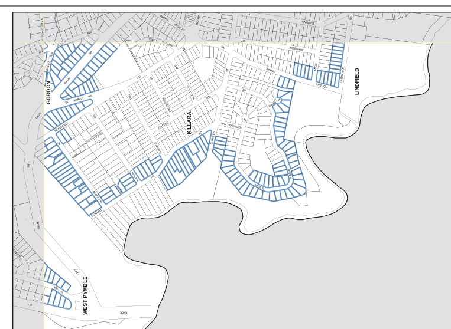

#### 61A PARKWAY

#### AVE 35

#### ST SOUTH TURRAMURRA

#### RD

#### UNNAMED

#### FORWOOD

#### CL

#### ST

#### HUDSON

#### AVE

#### ST

#### NIMBRIN 77

#### ST

#### ROBIN

#### COMENARRA

#### GEOFFREY

#### ST

## 23 AVE

#### MAXWELL ST

#### 1:10,000

### 017 018 019

#### Scale:                 @ A3

### 015 020

### 012 013

### 011 016

### 010

### 014

#### 100

#### 200

#### 300

#### 400 m

#### 4500_COM_MLD_ 008_010_20160310

### Draft Ku-ring-gai Development Control Plan

#### © Land and Property Information (LPI)

DISCLAIMER:- This plan has been prepared as  part of a review process only and as such no reliance is to be placed upon this plan as it is not and does not purport to be a Planning Instrument. Ku-ring- gai Council accepts no liability for the accuracy or otherwise of this plan.

> [Picture on page 10: a map, saved as a picture (images/part-03r-3r-1-minimum-lot-depth-maps-for-bushfire-prone-lan-page-10-1.gif, 150 dpi); the street names and other small labels are on the picture.]
> Words printed on the picture (title and legend, copied from the PDF):
> 7A 8 PATHWAY
> 1 2 89
> 19 21 18
> 36 38 53
> 230 232 234-236
> 242 244 246 248

1 3 5 7 9 11 17 19 21 23 25 27

#### EDMUND

## 2 MOORE

29 31 33 37 39 41 43

#### WHARF FIDDENS

#### GLENEAGLES

#### CRES

2 4 6 8 10 14 16 18 20 22 24 26 28

#### ANEMBO 109

## 111 RD

#### JOHNSON

#### BOWES

#### BOWES

#### 92 94 96 98 100 102 104 KNOX

#### WHARF

#### CARRAMAR

#### DR

#### GAME

108 110 112 114 116 118 120

#### FIDDENS

#### DR

#### LINDFIELD

#### MONTREAL AVE

#### PL

#### BURGH

#### DE

#### GORDON

#### BIMBIL

#### FREDERICK 20

#### RD

#### LADY

#### DR

#### AVE

#### HORWOOD

#### QUEBEC

#### BEAUMONT

#### KILLARA

#### RD

#### CHARLES

#### RD A9

#### PDE

#### EUSTACE

#### DR

#### RD
