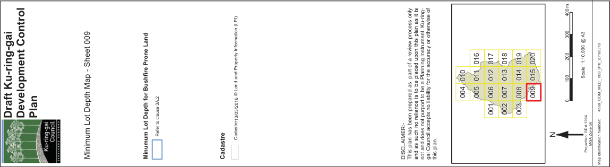
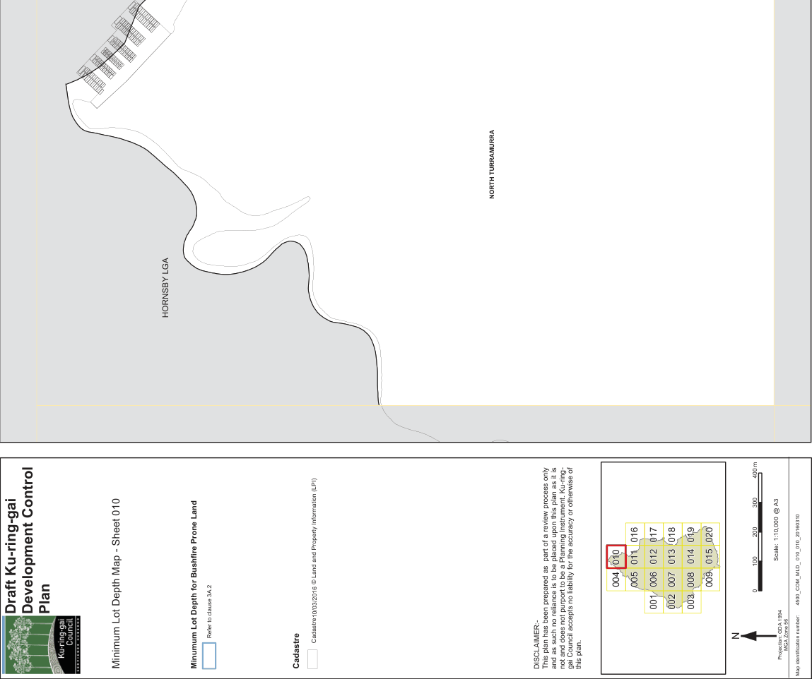
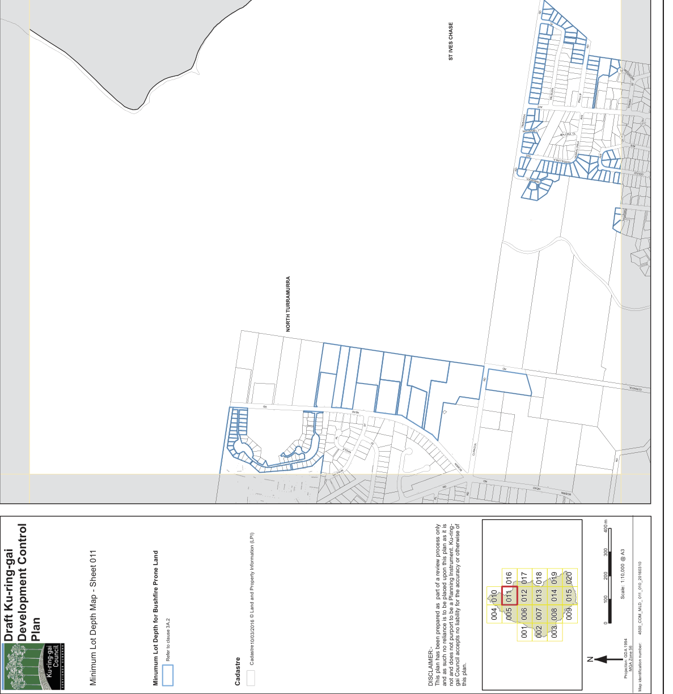

## 36 AVE

43

41

> [Picture on page 10: a picture, saved as a picture (images/part-03r-3r-1-minimum-lot-depth-maps-for-bushfire-prone-lan-page-10-96.gif, 150 dpi).]

### Draft Ku-ring-gai Development Control Plan

#### © Land and Property Information (LPI)

DISCLAIMER:- This plan has been prepared as  part of a review process only and as such no reliance is to be placed upon this plan as it is not and does not purport to be a Planning Instrument. Ku-ring- gai Council accepts no liability for the accuracy or otherwise of this plan.

### 017 018 019

### 015 020

### 012 013

### 011 016

### 010

### 014

#### 1:10,000

#### Scale:                 @ A3

#### 100

#### 200

#### 300

#### 400 m

#### 4500_COM_MLD_ 009_010_20160310

### Draft Ku-ring-gai Development Control Plan

### HORNSBY LGA

### WARRINGAH LGA

> [Picture on page 11: a picture, saved as a picture (images/part-03r-3r-1-minimum-lot-depth-maps-for-bushfire-prone-lan-page-11-4.gif, 150 dpi).]

#### © Land and Property Information (LPI)

#### NORTH TURRAMURRA

DISCLAIMER:- This plan has been prepared as  part of a review process only and as such no reliance is to be placed upon this plan as it is not and does not purport to be a Planning Instrument. Ku-ring- gai Council accepts no liability for the accuracy or otherwise of this plan.

### 017 018 019

### 015 020

### 012 013

### 011 016

### 010

### 014

#### 1:10,000

#### Scale:                 @ A3

#### 100

#### 200

#### 300

#### 400 m

#### 4500_COM_MLD_ 010_010_20160310

### Draft Ku-ring-gai Development Control Plan

### WARRINGAH LGA

#### NORTH TURRAMURRA

#### RD

## 430 HEAD

#### ST

#### 15 12 PL

#### ST NAGLE

## 2 DU FAUR

SI R FR ED ERI CK SCHERGER 1 10

SI R NEVILL E McNAM ARA 8

LANCASTER SUTHERL AND 1 3

1 3 5 7 9 THE

15 17 19 21 23

SI R NEVILL E McNAM ARA

#### © Land and Property Information (LPI)

#### ST IVES

> [Picture on page 12: a map, saved as a picture (images/part-03r-3r-1-minimum-lot-depth-maps-for-bushfire-prone-lan-page-12-19.gif, 150 dpi); the street names and other small labels are on the picture.]
> Words printed on the picture (title and legend, copied from the PDF):
> 13 8 1
> LEU RA 34
> CUTL ER CR. HARRISON
> SI R RODEN
> 2 2 4
> 3 MIDDLETON 28
> 4 CATALINA COURT
> 1A CRESC ENT
> 4 6 8 10
> BO ULEVAR DE
> NEW TON PL ACE
> 32 45 43
> 8 30 28 39
> 8 1 4
> 38 34 26 24
> 16 47 40
> 34 32 30 28
> 26 42 44 46
> 48 52 54 58
> 56 58 60
> 31 29 25
> 44 40 36-38 34
> 9 - 17
> 3 - 13
> 3 - 7
> 1 - 25 26

#### PL 41

#### RD

#### ST IVES CHASE

## 10 PL 6 199C ST

#### SNOWDEN 1 ST

#### MILBURN

## 1 PHILLIP AVE

#### TOMAH

#### WHITMONT

242 240 238 228 226 224 218 212 210 208A 1

#### AVE 2 222 2

#### RD

#### TIMBARRA 6 CL

#### MOONAH

#### CL

#### MAJURA

43 41 29 27 25

#### AVE

#### 23 15 AVE
