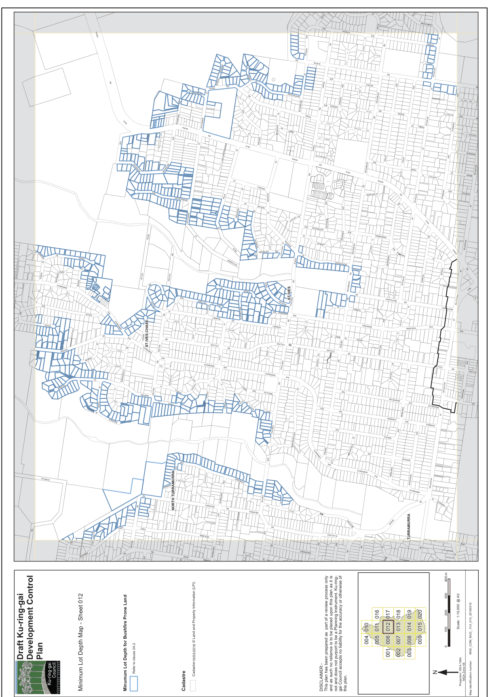

#### 42 40 YARRALUMLA

#### AVE YARRALUMLA 24

#### RD

#### GOULD

63 65 69 71 73 79

#### TIMBARRA

#### RD

#### CURAGUL

#### RD

#### 4 - 20 2 - 14 BOBBIN

#### RD RD

#### HEAD BOBBIN

#### RD

#### CURAGUL

#### RD PL

#### 1:10,000

### 017 018 019

#### Scale:                 @ A3

### 015 020

### 012 013

### 011 016

### 010

### 014

#### 100

#### 200

#### 300

#### 400 m

#### 4500_COM_MLD_ 011_010_20160310

DISCLAIMER:- This plan has been prepared as  part of a review process only and as such no reliance is to be placed upon this plan as it is not and does not purport to be a Planning Instrument. Ku-ring- gai Council accepts no liability for the accuracy or otherwise of this plan.

> [Picture on page 13: a map, saved as a picture (images/part-03r-3r-1-minimum-lot-depth-maps-for-bushfire-prone-lan-page-13-1.gif, 150 dpi); the street names and other small labels are on the picture.]
> Words printed on the picture (title and legend, copied from the PDF):
> 11 7 5
> 14 12 10 6
> 1 11 14
> 10 8 4
> 16 18 22 24
> A1 A3 2A
> CL HILL OAK
> 7 5 3
> 6 4 2
> 12 8 6 4
> 421 419A 419
> 403 399 397
> 6 4 2
> 19 5 7
> CHAPALA 4 59
> 11 9 7
> 2 4 6 8
> 65 63 59
> 2 4 6
> 11 9 5
> 12 10 6 4
> 9 1 3
> 31 27 25
> 11 9 5 3
> 24 22 20A
> 15 11 5 3
> 6 1 AVE
> 3 5 7
> 17 15 9
> 22 (Bund abah)
> 10 8 6 4
> 226 224 218
> 212 210 208A
> 51 49 41
> 63 61 59 53
> 16 4 6
> 12 8 6 4
> 202 200 198
> 102 - 118
> 26 24 22
> 18 16 12
> 18 16 12
> 10 161 15
> 85 83 81 77A
> 2 8 36
> 42 44 46
> 69 67 65
> 1 3 9
> 48 52 54 58
> 68 64 60
> 59 57 55
> 31 27 25
> 58 56 54
> 10 8 6 4
> 17 - 19
> 48 46 44
> 2 6 8
> 10 12 14
> 131 129 127 125
> 119 117 115
> 109 107 105
> 156 154 152
> 103 101 99 97
> 19 17A 20
> 33 27 23 21
> 59 55 53
> 41 39 37
> 52 50 48 44
> 17 11 9 7
> 154 148 146 144
> 6 4 2
> 31 25 23
> 102 100 98
> 9 15 11
> 54 45 37A
> 12 10 6 4
> 59 57 55 53
> 73 52 50 48
> 8 6 4 2
> 37 35 31
> 60 58 56
> 30-32 28 26
> 38 36 34
> 7 5 3 1
> 17 15 11 9
> 48A 42 40 38
> 17 15 11
> 34 19 17
> 32 30 22
> 18 16 14 12
> 8 6 4 2
> 44 40 36
> 26 30 32
> 46 37A39 37
> 17 19 21 23
> 50 52 54
> 1 STEPHANIE PL
> 6B 4 2A 2
> 50 48A 27
> 3 5 10 12
> 11 9 7
> 11 15 17
> 20 18 16
> 19A 19 17
> 34 32 30 28
> 47 51 53
> 43 45 55
> 7 3 1
> 7 5 3
> 10 10 8 4
> 4 6 11 15
> 289 285 277

#### 19 21 ST 42 1

#### HAYLE

#### CAMBOURNE

#### HAYLE

#### ATHENA

#### MONA

#### ATHENA

#### ATHENA

#### ACRON

#### RD

#### ST

#### DOUGLAS

#### LINIGEN

#### ST

#### RD

#### GARDENS

#### JESSICA

#### AVE

#### ARONIA

#### AVE

#### RD

#### AYRES

#### ACRON

#### AVE

#### ROMA

## 14 PL

#### ST

#### TREVALGAN

#### AVE

#### RD WHITEHAVEN

#### AVE

#### CARISSA

#### CARISSA

#### AVE 9

#### RD ST

#### BLACKBURN

#### AVE

#### PL

#### RD KAREN

15 11 9 7 5 3

#### ROMA

14 12 10 8 6 2

#### AVE

#### LUCIA

#### VALE

#### ST

#### TAMBU

#### KITCHENER

#### PL

#### FLINDERS

#### KIRBY

#### BRANDON

#### RD

#### AVE

#### RICHMOND

#### AVE

#### AVE

#### WALKER

#### ST

#### DOUGLAS

#### ST

#### AYRES 12

#### ST

#### ST

#### 12 8 6 4 SHANNON

## 26 AVE

#### VALE

#### MONA

#### MONA 335

#### WILLIS

#### OXLEY

#### ST

#### AVE

#### RD

#### HUME

#### RICHMOND

#### RICHMOND

#### KILLEATON

#### ST BRIAR

#### VALE

#### MONA

#### RD

#### RD

#### WOODBURY

#### WOODBURY

#### HASSELL

#### ST

#### ST

#### AVE

#### AVE

#### DAINTON

12 10 8 6 4

#### CL

#### SUFFOLK

#### FLINDERS

#### PALM

16 14 12 8 6

#### GREENVALLEY

#### MAWSON

#### DOUGLAS

#### AVE

#### AVE

#### ST

#### ST ASHLAR

#### AVE

#### RD ST

#### MONTEREY

#### ST

#### ST

#### KITCHENER 22

#### RD

#### VALE

#### AVE

#### DELAWARE

#### ST

#### JEFFERSON 21

#### AVE

#### CL

#### ST

#### WARRABINA

#### RD

#### MAUNDER HAWLEY

#### MAWSON

#### WEMBURY

#### AVE 3 20A

#### PALM

## 4 WEMBURY RD

#### PL

#### WOODBURY

#### MONA

#### BINA

## 26 ST

#### WARRA

#### SNOWDEN 9 11 17

#### PL

#### ST CRAIG ST

#### RD

#### AYRES

#### MURCHISON

#### BUNDABAH

#### KITCHENER

(M UR C H ISO N  ST)

#### RD

#### CL

#### 3 CRES 9

#### MYRTLE 261

#### TOMAH

#### ROAD

#### 20.12W

#### RD

#### DALTON

#### RD

#### GARRICK

#### WHITMONT

#### DOUGLAS

7.3 2 / 3. 66 W.

#### RD

ESM T F OR SE RV IC ES

#### PRIORY

#### CRES

#### PL

#### WARRIMOO 8

#### LINK

#### RD

#### WOODBURY

#### TUDOR PL

#### ST IVES

#### RD

19 17 11 9 7

56 54 50 48 46 44

#### RD KENTHURST RD

## 29 HILLSIDE

40 38 34 30 28

#### ST

#### KILLEATON

#### KILLEATON

#### RALEIGH

#### PL TURT

#### TOOLANG

#### AVE

#### CL DELA

35A 35 33 31 29 27 17 15 11 9 7 1

#### AVE

#### DALTON

29 27 25 23 21 19 17 15

#### KENTHURST

#### PL TORRES 16A

#### PL 51

#### AVE

11 9 7 3 1

#### AVE

#### MEMORIAL 87

#### AVE

14

#### GOULD

#### RD

#### AVE

#### ELIZABETHAN

48 46 44 42 38 34

#### ST

#### ROMNEY RD

#### RD

#### AVE

23 15 9 7 5 3

24 22 20 18 16 14 12

#### GOULD

#### MEMORIAL

63 65 69 71 73 79

#### AVE

#### ROMNEY

#### MEMORIAL

#### WARRIMOO

#### AVE

#### AVE

#### RD

#### PL

#### OVENS

#### PL BASS PL

#### BASS

#### ST

#### COLLINS RD

#### RD

#### COLLINS

75 73 71 69 67 65

148 146 144 142 140 138

#### ST IVES CHASE

#### MUDIES

#### RD

#### RD

#### DALTON

#### 36-38 AWATEA

#### RD

128 126 124 122 120

#### WARRIMOO

#### COLLINS RD
