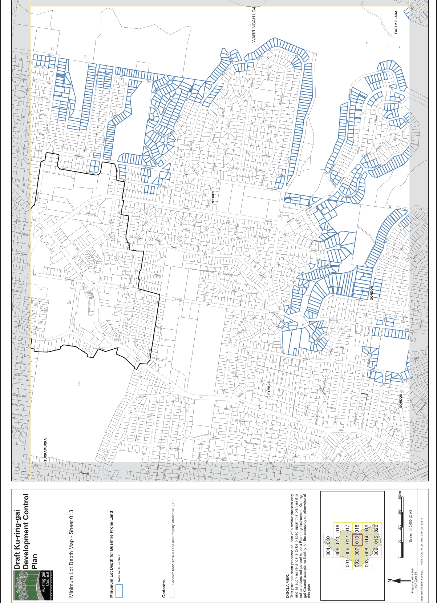

## 29 NORMURRA

48 46

#### PL CARINGAL

44 42 38 36 32

#### MIOWERA

#### RD

17 11A 7A 5 3

#### NORTH TURRAMURRA

#### RD MIOWERA

## 23 AVE

#### AVE

18 16 12 10 4

#### AVE

#### BURNS

#### BEDFORD

#### RD 43

47 45 41 39 37

42A 42 44 50 52 56

#### CRES CRES

#### RD

31 29 25 23 21

64 66 68 74 76 78

#### AVE

#### ELLALONG

#### 61 63 65 67 69 KEDUMBA

#### TURRAMURRA

#### AVE

137 135 133 129 123

#### RD

#### LANE

#### RD

#### AVE

#### ST

#### MILTON

#### RD

#### RD

24 20 18 16 14

311 307 305 301 299 297 295 291

#### RD

#### RD

318

#### BROWNING

#### RD

#### ST

#### 273 271 NORMURRA

#### KEDUMBA

57 55 51 49 47 41A

#### AVE

#### MURDOCH

#### HEAD BOBBIN

#### PL

#### CHATHAM

#### NGARRY

#### 1:10,000

### 017 018 019

#### Scale:                 @ A3

### 015 020

### 012 013

### 011 016

### 010

### 014

#### 100

#### 200

#### 300

#### 400 m

#### 4500_COM_MLD_ 012_010_20160310

### Draft Ku-ring-gai Development Control Plan

#### © Land and Property Information (LPI)

DISCLAIMER:- This plan has been prepared as  part of a review process only and as such no reliance is to be placed upon this plan as it is not and does not purport to be a Planning Instrument. Ku-ring- gai Council accepts no liability for the accuracy or otherwise of this plan.

#### BENWERRIN

> [Picture on page 14: a map, saved as a picture (images/part-03r-3r-1-minimum-lot-depth-maps-for-bushfire-prone-lan-page-14-2.gif, 150 dpi); the street names and other small labels are on the picture.]
> Words printed on the picture (title and legend, copied from the PDF):
> 10 8 4
> CL HILL OAK
> 4 6 8 10
> 9 11 15
> 12 8 6 4
> 1 3 5
> 11 9 7 3
> 52 56 58
> 11 9 5
> 12 10 6 4
> 7 9 11
> 11 9 5 3
> 4 6 8
> 46 44 42
> 8 6 4 2
> 15 17 19 21
> 12 16 18
> 11 15 17
> 76 80 82
> 92 96 98
> 91 102 104 106
> 25 29 37
> 23 27 31 33
> 11 9 7
> 22 24 26
> 30 - 32
> 52 56 58
> 2 4 8 10
> 12 82 47
> 60 - 70
> 9 - 15
> 21 27 29
> 45 51 53 55
> WALLIS PL 2
> (228  -   232)
> 30 26 24
> 22 20 18 16
> 6 10 14
> 9 7 1
> 56 58 60
> 102 - 118
> 3 5 3 4
> 49 55 57
> 47 51 53
> 2 5 24
> SHERW OO D
> CAM ELO T
> 31 27 25
> 3 - 7
> 1 3 5
> 17 - 19
> 15A 15 11 7
> 5 9 89
> 15 17 19 21
> 46 48 50
> 6 1 4
> PL 2 6
> ANT HO NY BLAIR
> 60 62 66 68
> ANN E M ARIE
> 25 112 110
> 20 18 16
> 14 10 8
> 75 71 67
> 76 74 72 70
> 66 60 58 52
> 37 35 31
> 64 27 28
> 64A 48 46
> 167 169 169A
> WATE RBO AR D
> 60 58 56 54
> 64 62 60A
> 148 - 152
> 30 26 24 22
> 16 14 12
> 48 - 46 127
> 17 15 9
> 27 25 23
> 7 5 3
> 1 2E 102
> 94 92 90
> 4 6 8
> ST RAT HWO OD
> 55 51 45
> 5 3 1
> 14 10 8 6
> 20 18 5
> PA T H WA
> WALT ON CL
> 17 15 11
> 97 95 93
> 122 120 118
> 100 98 92
> 83 81 79

#### KOOLA

#### KIMBERLEY

### WARRINGAH LGA

#### DOUGLAS

#### ACRON

#### AVE

#### AVE

#### HUNTER

#### AVE

## 2 DR

#### AVE

#### PL KENNEDY

#### ST

#### PL

#### AVE

#### ROAD 12

#### MELALEUCA 10

#### AVE

14 16 18 20 22 24 26

15 11 9 7 5 3

#### ST

#### TORRENS

#### PAUL 27

#### AVE

#### LUCIA

#### ST

#### AVE

#### WOODWARD

#### ST

#### RD

#### LEA

#### L

## 12 I

#### GREV

#### FLINDERS

## 11 RD

#### BURRANEER 80

#### CL

## 31 AVE

#### DR

#### WATERHOUSE

#### AVE

#### AVE 47

#### AVE

#### RISORTA

#### ST

#### RD

#### 12 8 6 4 SHANNON

#### LEVERTON

#### AVE

#### CARMEN

#### AVE

#### AVE

#### ELEGANS

#### BRYCE

#### AVE

#### CRES

#### AVE

#### NICHOLSON

#### AVE

#### AVE

#### KALLISTA

16 12 10 8 6 4 2

#### KILLEATON

#### ST BRIAR

#### PL

#### AVE

#### CASSANDRA

#### CASSANDRA

2 4 6 8 10 12 14
