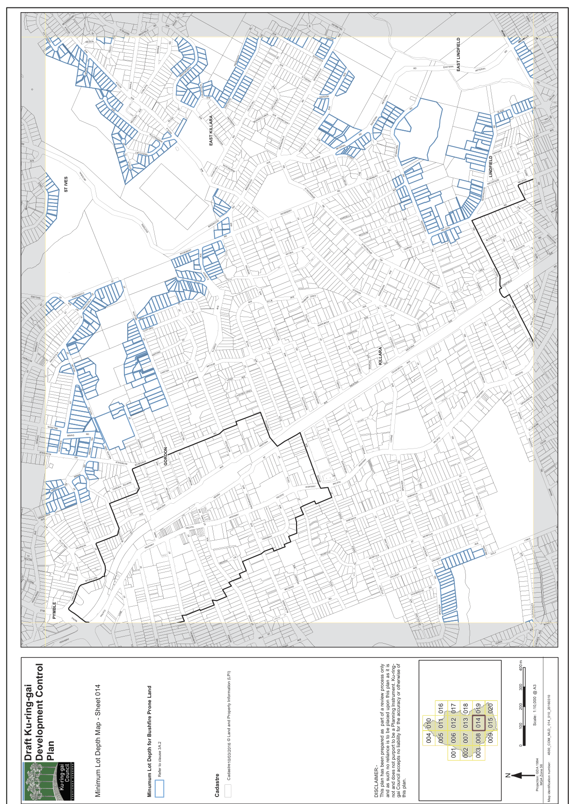

## 23 ORANA

#### AVE ORANA

#### RD

#### PENTECOST

#### CANISIUS

#### TURRAMURRA

#### CL

#### LANE

#### HEYSEN

#### LANE

137 135 133 129 123 119 119 117 113

#### AVE

#### FLOREY 26

109 107 105 103 101 99

#### 116 114 112 108 106 104 MERRIVALE

#### AVE

#### FERN

#### ST

#### BOOLARONG

#### HIGHWAY

#### MERRIVALE

#### RD

#### ST

#### GREENDALE

#### ST

#### AVE

#### FLOREY

#### CL

#### LINDSAY

#### LLESLEY

#### TELEGRAPH

#### MOCATTA

#### 1:10,000

### 017 018 019

#### Scale:                 @ A3

### 015 020

### 012 013

### 011 016

### 010

### 014

#### 100

#### 200

#### 300

#### 400 m

#### 4500_COM_MLD_ 013_010_20160310

### Draft Ku-ring-gai Development Control Plan

#### © Land and Property Information (LPI)

DISCLAIMER:- This plan has been prepared as  part of a review process only and as such no reliance is to be placed upon this plan as it is not and does not purport to be a Planning Instrument. Ku-ring- gai Council accepts no liability for the accuracy or otherwise of this plan.

> [Picture on page 15: a map, saved as a picture (images/part-03r-3r-1-minimum-lot-depth-maps-for-bushfire-prone-lan-page-15-1.gif, 150 dpi); the street names and other small labels are on the picture.]
> Words printed on the picture (title and legend, copied from the PDF):
> 9 18A 67
> 8 12 5-7
> 1A SLA D E
> 13 11 7 5
> 5 3 1
> 15 - 19
> 12 10 8
> 46 44 42
> (8) 6 4
> 36 34 32
> EDW AR DS
> 11 7 5
> 33 2 AVE
> 6 33 40
> 72 74 6
> 2 - 4
> 19 15 11 9
> 20 - 26
> COM M ONW EALTH
> 2 - 4 10
> 36 - 40
> 47 1 A1
> CAITH NE SS 560
> 2 - 4
> 1 - 9
> 44 42 40 38
> 5 22 20 18
> KI LLARA  PL 642
> 1 - 7
> 657 - 661
> 669 667 663
> CHURCH  H ILL
> (3 1 )
> (2 5 ) 729
> 787 785A785 781-3777-9
> 24 22 20
> RADF ORD PL
> MET ZLER PL
> 3   -   11
> 28  -  30 39
> 1 - 7
> 8   -   14
> 44 1 - 7
> 20 18 5
> 16 - 24
> WALT ON CL PATHWAY
> 93 91 89
> 99 97 95

#### CL

#### BENWERRIN

#### ADAIR

#### SALISBURY

#### KOOLA

#### PL REDFIELD

#### REDFIELD

#### TRYON

#### TRYON

#### 7 5 3 1 AVE

#### OWEN

#### ROPER

#### KIMBERLEY

#### DEAKIN

#### ARCHBOLD

#### ARCHBOLD

#### SAVOY

#### BARRIE

#### CL

#### EASTGATE

#### TRUSCOTT

#### EASTERN

#### ARTERIAL

#### HEATH
