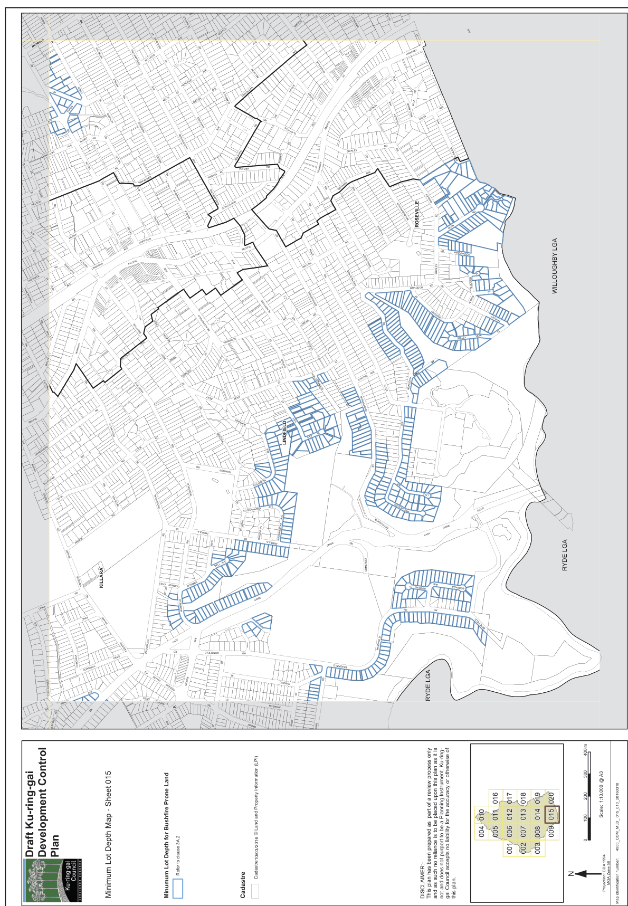

## 33 ST

## 7 AVE

#### LAING

#### STANHOPE

#### AVE

#### WERONA

#### POWELL

#### CRES

#### RD

#### LAGONDA

#### WALK HIGHWAY

#### ST

#### GREENGATE

#### AVE

#### GRASSMERE

#### 20 NORTHCOTE 21

#### ST

#### ST

#### TAYLOR

#### ST

#### MARIAN

#### ELVA

## 10 BALDWIN

#### FORSYTH

#### RD

#### ELLSMORE

#### RD

#### MINNS

#### RD

#### NELSON

#### LORNE

#### PACIFIC

#### LENNOX

#### COOK 48

#### WHARF

#### FIDDENS

#### AVE

#### EDWARD

#### GLENVIEW

#### MCINTOSH

#### POWELL

#### ST

#### ST

#### MELKIN END ROSEDALE

#### RD

#### ROSEDALE

#### GORDON

#### 16 14 ROSEDALE

#### RD

#### HIGHWAY

#### MINNS

#### RD

#### RD

#### WERONA

#### AVE

#### RD

#### GREENGATE

#### MINNS

#### ST

#### CL

#### BRUCE

#### ST

#### CECIL

#### PRINCE

#### PACIFIC

#### GR

#### SQUARE

#### HIGHWAY

#### LYON

#### ST GARDEN

#### RD

#### SPENCER

#### R . O . W . AVE

#### ASHLEY

#### ST

#### WARWICK

#### HENRY

#### PACIFIC

#### AVE

#### KHARTOUM

#### ST

#### ST

#### AVE

#### AVE

#### RAVENSWOOD

#### BUCKINGHAM

#### WERONA AVE

#### ENS

#### WHARF

#### ST

#### 20B HIGHWAY

#### AVE

#### HIGHLANDS

#### WARWICK

#### AVE ST.JOHNS

#### ROBERT

#### AVE

#### AVE

#### PACIFIC

#### ST

#### MT.WILLIAM

#### AVE

#### ST

#### PARK

#### ST

#### NORFOLK

#### YARABAH

#### AVE

#### BURGOYNE

#### ST

#### CARLOTTA

#### HIGHWAY

#### MAITLAND

#### PEARSON

#### 24 20 ST

#### ESSEX

#### ESSEX

#### ST

#### ST

#### ST

#### MILDURA

#### GOLF

#### RD

#### LINKS

#### NORFOLK

#### AVE 15A

#### RD

#### SPENCER

#### CR

#### WILTON

#### CL

#### CALVERT

#### AVE

## 35 OBERON

#### ST

#### ST

#### AVE

#### AVE

#### PL

#### AVE

#### CALVERT

#### RD

#### MT.WILLIAM

#### ANATOL

#### PENNANT

#### CECIL

#### NORFOLK

#### BROWNS

#### CORONGA

#### FITZROY

#### ST

#### RD HIGHBRIDGE

#### ST

#### RD

#### CARLOTTA

#### HIGHLANDS

#### VALE

#### BUSHLANDS

#### SPENCER

#### LANE

#### PACIFIC

#### GLENEAGLES

## 4 PYMBLE

#### MONA

#### RIDGELAND

#### AVE

#### ST JOHNS 45

PA T H WA Y

#### BOWES AVE

#### ST

#### VALE

#### MOREE

#### DUMARESQ

#### HIGHWAY

#### GURIN

#### AVE BOWES

#### ST

#### AVE RIDGE

#### MCINTYRE

#### RD

#### ERRIWA

#### 1:10,000

### 017 018 019

#### Scale:                 @ A3

### 015 020

#### EAST LINDFIELD

### 012 013

### 011 016

### 010

### 014

#### 100

#### 200

#### 300

#### 400 m

#### 4500_COM_MLD_ 014_010_20160310

### Draft Ku-ring-gai Development Control Plan

#### © Land and Property Information (LPI)

DISCLAIMER:- This plan has been prepared as  part of a review process only and as such no reliance is to be placed upon this plan as it is not and does not purport to be a Planning Instrument. Ku-ring- gai Council accepts no liability for the accuracy or otherwise of this plan.

> [Picture on page 16: a map, saved as a picture (images/part-03r-3r-1-minimum-lot-depth-maps-for-bushfire-prone-lan-page-16-1.gif, 150 dpi); the street names and other small labels are on the picture.]
> Words printed on the picture (title and legend, copied from the PDF):
> 39 & 1A
> 15 - 17
> 3 - 5
> 71 LA N E
> 23 (H owar d)
> 106 102 100
> 112- 116 110
> 1A SLA D E
> LAN E 4
> 9 7 5 3
> 16 18 20
> 2A 2 12
> 2B 17 19 21
> 19 11 9
> LAN E RUSSELL
> 15 ALST ON
> STRICKL AN D LANE
> 15 - 19
> LAN E 3-11
> 39 41 43
> (210 - 214)
> ST RICKL AN D
> 41 43 45 42
> HAVIL AH 35 33
> 321 319 305 307
> 313 315 317
> 328 326 324
> WOO DFO RD
> 5 - 7
> 6 - 8
> 85 8 10
> 6 - 10
> 17 19 18
> 117 119 121
> 54 56 58
> 1 - 3
> 90 - 92
> 62 64 66
> 47 3 5
> 81 93 95C
> COM M ONW EALTH
> 3 5 9
> 5 - 7
> 38 40 8
> 45 47 36
> 6 - 8
> 2 6 8 3
> 10 12 14 16
> 10 12 14
> PUBLIC    R OAD
> 11 11A 17
> 15 11 9
> 1 3 PATHWAY
> 11 9 14
> 10 12 16 18
> 7 20 22
> 5 3 6 26
> 19 PATH WAY
> 115 115A 117 121
> SQ UADRON                         CT AVE
> 5 9 11
> 32 34 40
> 85 87 89
> 129 108 110

#### GREGORY

#### LA

#### VICTORIA

#### MARTIN BANCROFT

#### CLANVILLE

#### GERALD

#### OWEN

#### ARCHBOLD

#### ARCHBOLD

#### MARJORIE

#### HIGHWAY

#### LORD

#### MC LEOD

#### CHELMSFORD 20

#### WYVERN

#### ROSEVILLE

#### BELGIUM

#### PDE

#### ARRUNGA

#### HARBOUR

#### MIDDLE

#### AVE

#### GROVE

#### 8 4 RD

#### RD

#### OWEN

#### ST

#### CORONA

TH ERI FL E WA Y

#### TRAFALGAR

#### FINDLAY

#### OLIVER

#### ST KEITH

#### ST

#### CLANVILLE

#### LOWANA

M I LE SI XTH

#### NOLA

SIXTH

#### AVE

#### LARKIN

#### TRYON

#### DULWICH

#### MACLAURIN

#### THE

#### KINGS

#### RD

#### AVE

#### AVE

#### HOWARD

#### AVE

#### POCKLEY

#### HILL

#### RD

#### MARJORIE

#### PACIFIC

#### AVE ROSLYN

#### RD

#### CLANVILLE

#### ST

#### SHORT

#### ST

#### RD

#### 9 11 RD

#### SHIRLEY RD

#### KELBURN

#### ALEXANDER

#### PDE

#### RAWHITI

#### RD

#### VALLEY

#### AVE LIGHTCLIFF

#### ST

#### FINDLAY

#### TRYON RD

#### RD

#### WAIMEA

#### HIGHWAY

#### ST

#### AVE

#### RD

#### WAIMEA

#### AVE

#### TRAFALGAR

#### RD

192 BAYSW ATER LA NE

#### RD

#### ONTARIO

#### ST

#### SMITH 20

#### SHIRLEY 24

#### CHELMSFORD

#### AVE

#### CHELMSFORD

#### NELSON

#### RD

#### RD

#### STRICKLAND ET ON

#### RD

#### RD

#### RD

#### HARBOUR

#### HARBOUR

#### MIDDLE

#### MIDDLE

#### BROMBOROUGH

#### AVE

#### RUSSELL
