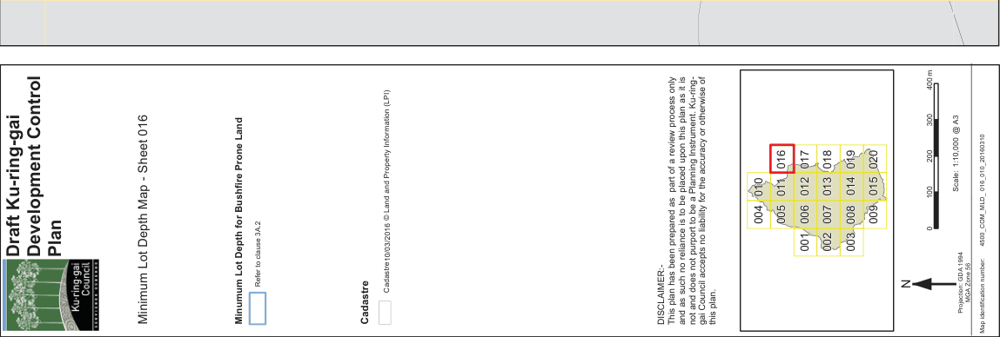
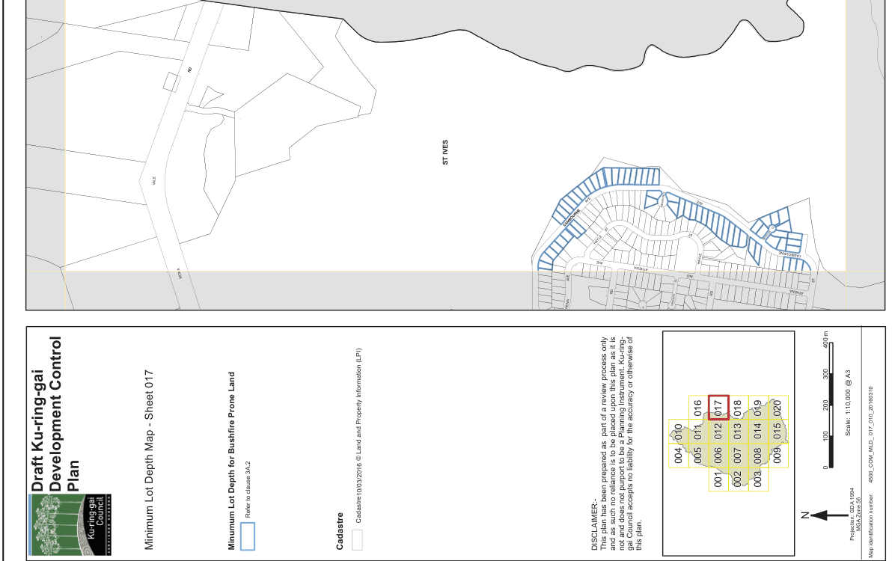
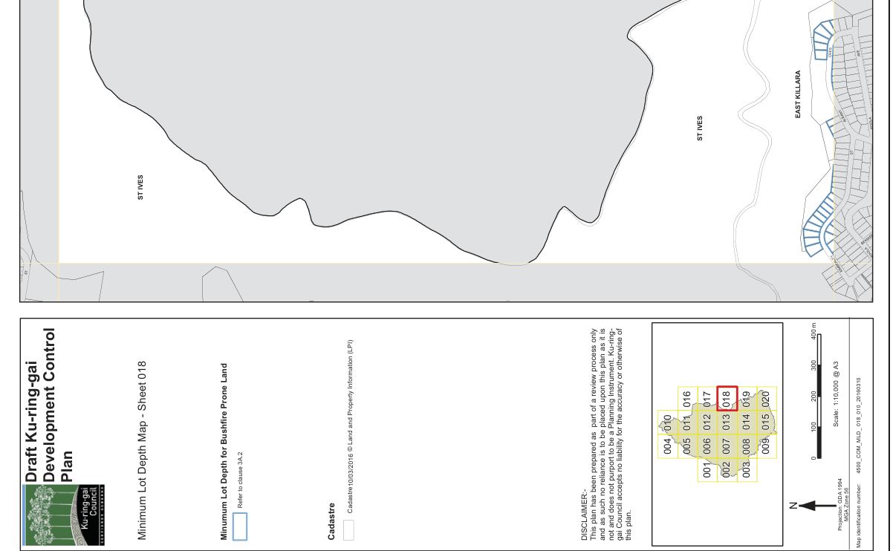

#### 92 94 96 98 100 102 104 KNOX

#### AVE BOWES

#### ST

#### WHARF

#### CARRAMAR

#### 1:10,000

### 017 018 019

#### Scale:                 @ A3

### 015 020

### 012 013

### 011 016

### 010

### 014

#### 100

#### 200

#### 300

#### 400 m

#### 4500_COM_MLD_ 015_010_20160310

### Draft Ku-ring-gai Development Control Plan

#### © Land and Property Information (LPI)

DISCLAIMER:- This plan has been prepared as  part of a review process only and as such no reliance is to be placed upon this plan as it is not and does not purport to be a Planning Instrument. Ku-ring- gai Council accepts no liability for the accuracy or otherwise of this plan.

### Draft Ku-ring-gai Development Control Plan

### WARRINGAH LGA

#### © Land and Property Information (LPI)

DISCLAIMER:- This plan has been prepared as  part of a review process only and as such no reliance is to be placed upon this plan as it is not and does not purport to be a Planning Instrument. Ku-ring- gai Council accepts no liability for the accuracy or otherwise of this plan.

#### ST IVES

### 017 018 019

### 015 020

### 012 013

### 011 016

### 010

### 014

452A

> [Picture on page 17: a picture, saved as a picture (images/part-03r-3r-1-minimum-lot-depth-maps-for-bushfire-prone-lan-page-17-13.gif, 150 dpi).]

#### 1:10,000

#### Scale:                 @ A3

#### 100

#### 200

#### 300

#### 400 m

#### 4500_COM_MLD_ 016_010_20160310

### Draft Ku-ring-gai Development Control Plan

460

#### RD

#### RD 451

#### VALE

#### MONA

### WARRINGAH LGA

> [Picture on page 18: a map, saved as a picture (images/part-03r-3r-1-minimum-lot-depth-maps-for-bushfire-prone-lan-page-18-8.gif, 150 dpi); the street names and other small labels are on the picture.]
> Words printed on the picture (title and legend, copied from the PDF):
> 454a 454 461
> 30 32 34 36
> 45 2 61
> 43 3 63
> 19 21 42 1
> 25 27 44
> 57 55 53
> 69 51 49
> 44 42 33
> 40 38 36 31
> 23 21 17 15
> 16 10 8
> 12 9 85
> 10 7 7
> PL 10 3

#### ST IVES

#### AVE

## 4 AVE

8 65 67 69 71 73

#### CAMBOURNE

#### CAMBOURNE

#### ST

#### ST HAYLE

#### CAMBOURNE

#### HAYLE

#### AVE ATHENA

#### AVE 29 27 25

#### AVE

#### ST

28 11 9 7 5 3

24 22 20 18 14 12

#### RD

#### ATHENA

#### RD

#### ATHENA

#### 1:10,000

### 017 018 019

#### Scale:                 @ A3

### 015 020

### 012 013

### 011 016

### 010

### 014

#### 100

#### 200

#### 300

#### 400 m

#### 4500_COM_MLD_ 017_010_20160310

#### © Land and Property Information (LPI)

DISCLAIMER:- This plan has been prepared as  part of a review process only and as such no reliance is to be placed upon this plan as it is not and does not purport to be a Planning Instrument. Ku-ring- gai Council accepts no liability for the accuracy or otherwise of this plan.

#### ST

### Draft Ku-ring-gai Development Control Plan

#### ST IVES

### WARRINGAH LGA

> [Picture on page 19: a map, saved as a picture (images/part-03r-3r-1-minimum-lot-depth-maps-for-bushfire-prone-lan-page-19-5.gif, 150 dpi); the street names and other small labels are on the picture.]
> Words printed on the picture (title and legend, copied from the PDF):
> 33 22 116
> 41 103 101

#### © Land and Property Information (LPI)

DISCLAIMER:- This plan has been prepared as  part of a review process only and as such no reliance is to be placed upon this plan as it is not and does not purport to be a Planning Instrument. Ku-ring- gai Council accepts no liability for the accuracy or otherwise of this plan.

#### ST IVES

### 017 018 019

### 015 020

### 012 013

### 011 016

### 010

### 014
