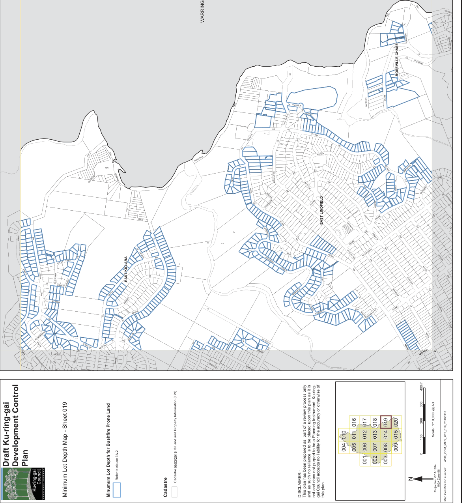

## 26 AVE

#### CRES

#### EAST KILLARA

#### ALBANY

## 4 KOOLA

#### ST

#### AVE

#### BENWERRIN KOOLA

#### KIMBERLEY

#### 1:10,000

#### Scale:                 @ A3

#### 100

#### 200

#### 300

#### 400 m

#### 4500_COM_MLD_ 018_010_20160310

> [Picture on page 20: a map, saved as a picture (images/part-03r-3r-1-minimum-lot-depth-maps-for-bushfire-prone-lan-page-20-1.gif, 150 dpi); the street names and other small labels are on the picture.]
> Words printed on the picture (title and legend, copied from the PDF):
> 11 6 2
> 2 ATT UNG A
> 5 PATHWAY 6
> 6 2 3
> 86D 3 7 20
> 23 51 53
> 21 43 49
> 38 62 62
> 37 35 33
> 44 42 40 3
> 1A 15 34
> LAN E 2
> WEL LING TO N
> 181 179 177
> 42 71 73 75
> 69 65 63
> 35 5 8
> 11 9 7
> 9 18A 67
> 8 12 5-7
> 8 5 3
> 6 4 2

#### PDE DAVIDSON

#### PDE

### WARRINGAH LGA

#### RD 20 4

#### ORMONDE

#### AVE

#### THE KINGSWAY RD RD CARDIGAN

#### RD

#### ROSEVILLE CHASE RD

## 15 CHASE

#### 102A PL ULMARRA

#### PDE

#### PDE

#### DAVIDSON

#### PL MAYFAIR

#### WELLINGTON
