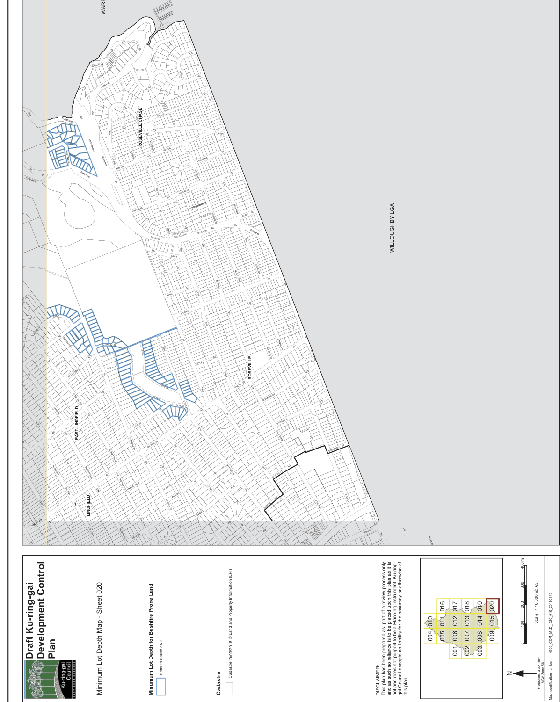

## 40 BARRIE

#### ROBINSON 14 12 10

#### RD

#### LOOMBAH

#### LOOMBAH

#### RD

#### ST

#### RD

#### HARBOUR

#### MIDDLE

#### CL

#### BENWERRIN

#### PL ADAIR

#### AVE

#### PL

#### PL

#### SALISBURY

#### KOOLA

#### PL REDFIELD

#### AVE

#### RD REDFIELD

#### TRYON

#### TRYON

#### 7 5 3 1 AVE

#### AVE 26 24 22

#### ST

#### ST

#### OWEN

#### ST

#### ROPER

#### KIMBERLEY

#### DEAKIN

#### ARCHBOLD

#### ARCHBOLD

#### RD

#### AVE

#### SAVOY

#### AVE

#### RD

#### BARRIE

#### RD

#### RD

#### CL

#### EASTGATE

#### TRUSCOTT

#### 1:10,000

### 017 018 019

#### Scale:                 @ A3

### 015 020

### 012 013

### 011 016

### 010

### 014

#### 100

#### 200

#### 300

#### 400 m

#### 4500_COM_MLD_ 019_010_20160310

### Draft Ku-ring-gai Development Control Plan

#### © Land and Property Information (LPI)

DISCLAIMER:- This plan has been prepared as  part of a review process only and as such no reliance is to be placed upon this plan as it is not and does not purport to be a Planning Instrument. Ku-ring- gai Council accepts no liability for the accuracy or otherwise of this plan.

### WARRINGAH LGA

> [Picture on page 21: a map, saved as a picture (images/part-03r-3r-1-minimum-lot-depth-maps-for-bushfire-prone-lan-page-21-2.gif, 150 dpi); the street names and other small labels are on the picture.]
> Words printed on the picture (title and legend, copied from the PDF):
> BRI DGE  PASSAG E
> 18 9A 7
> 84-86 99 9
> BATHS 8 10
> PATHWAY 6 20A
> 54 2 25 24
> 87 3 31
> 11 19 19 29
> GRIFITH 29B 29A
> 55 29C 19
> 21 11 9
> 5 3 1
> 6 4 2
> 1 LAN E
> 15 13 11
> 2 25 21A
> 29 27 27A
> 32 30 28
> 26 24 22
> MA RG AR ET
> 3 7 30
> GOL FERS 19
> 28A 68 22
> 9 7 5
> 44 16 14
> PA TH WA Y
> REC RE ATION   WALK
> (2 - 12)
> (22 - 30)
> 17 - 25
> 5 - 15
> 39 & 1A
> 4 6 7

#### ST

15 8 1A LO CK LEY PD E

#### RD 17

78 NO RM AC WALK
