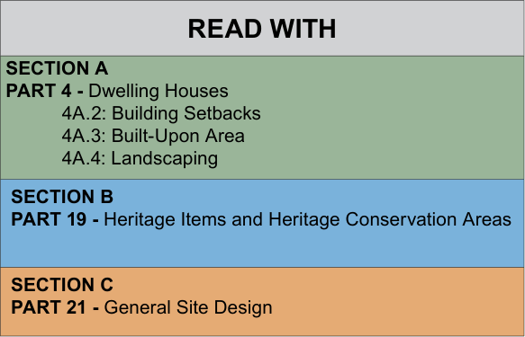
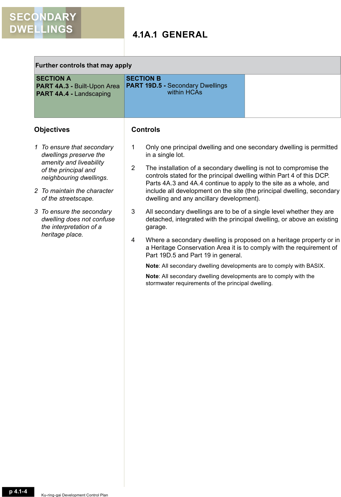
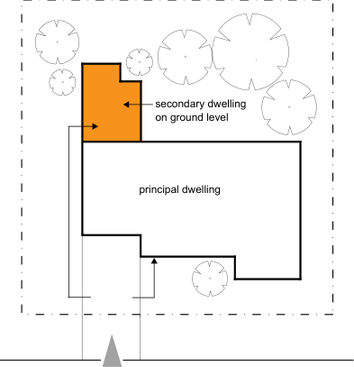
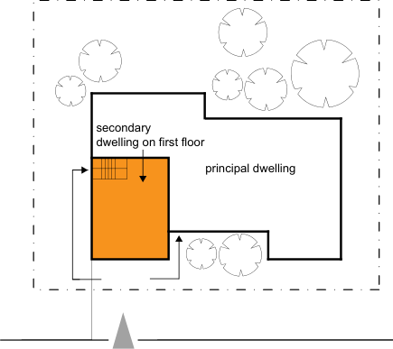
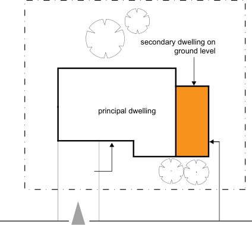
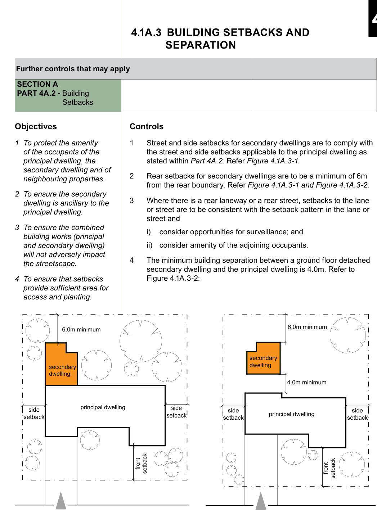
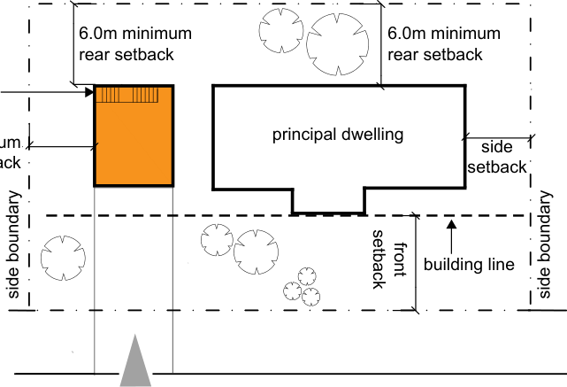
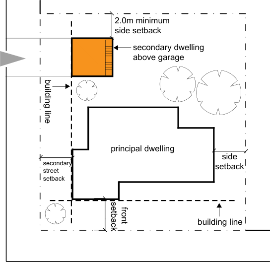

#### 4.1A Site Design

4.1A.1  	General 4.1A.2  	Site Layout 4.1A.3  	Building Setbacks

> [Picture on page 3: a picture, saved as a picture (images/part-04-1-secondary-dwellings-page-3-6.gif, 150 dpi).]
> Words printed on the picture (title and legend, copied from the PDF):
> 4A.2: Building Setbacks
> 4A.3: Built-Upon Area
> 4A.4: Landscaping

### READ WITH

#### SECTION A

PART 4 - Dwelling Houses

#### SECTION B

PART 19 - Heritage Items and Heritage Conservation Areas

#### SECTION C

PART 21 - General Site Design

### SITE DESIGN

> [Picture on page 4: a map, saved as a picture (images/part-04-1-secondary-dwellings-page-4-1.gif, 150 dpi); the street names and other small labels are on the picture.]
> Words printed on the picture (title and legend, copied from the PDF):
> PART 4A.4 - Landscaping
> in a single lot.
> dwellings preserve the
> amenity and liveability
> of the principal and
> of the streetscape.
> dwelling does not confuse
> the interpretation of a
> Note: All secondary dwelling developments are to comply with BASIX.
> Note: All secondary dwelling developments are to comply with the
> stormwater requirements of the principal dwelling.

### 4.1A.1  GENERAL

#### Further controls that may apply

#### SECTION B

PART 19D.5 - Secondary Dwellings

#### SECTION A

PART 4A.3 - Built-Upon Area

#### Controls

#### Objectives

1 Only one principal dwelling and one secondary dwelling is permitted

1	 To ensure that secondary

2	 To maintain the character

2 The installation of a secondary dwelling is not to compromise the

controls stated for the principal dwelling within Part 4 of this DCP.

Parts 4A.3 and 4A.4 continue to apply to the site as a whole, and

include all development on the site (the principal dwelling, secondary

dwelling and any ancillary development). 3 All secondary dwellings are to be of a single level whether they are

detached, integrated with the principal dwelling, or above an existing

3	 To ensure the secondary

4 Where a secondary dwelling is proposed on a heritage property or in

a Heritage Conservation Area it is to comply with the requirement of

Part 19D.5 and Part 19 in general.

### 4.1A.2  SITE LAYOUT

#### Further controls that may apply

#### SECTION C

PART 21 - General Site Design

#### Controls

#### Objectives

1 A secondary dwelling may be detached from the principal dwelling in

the form of:

1	 To ensure the secondary

dwelling has easy access

and provides good

amenity for occupants.

i) a single storey separate structure located at ground level, within

the land belonging to the principal dwelling and behind the front

building line of the principal dwelling, refer Figure 4.1A.2-1 or;

ii)	 a structure located above a detached garage associated with

the principal dwelling and where the garage is behind the front

building line, refer Figure 4.1A.2-2.

2	 To retain the existing Ku-

ring-gai landscape and

neighbourhood character

of a single dwelling in a

garden setting.

2 A secondary dwelling may be attached to the principal dwelling in

the form of:

i) a single storey addition to the principal dwelling. Refer Figure

4.1A.2-3;

3	 To ensure that the

secondary dwelling does

not adversely impact the

liveability and amenity of

the principal dwelling.

ii)	 incorporated within the principal dwelling in the form of internal

modifications to the principal dwelling on the ground floor or first

floor. Refer Figures 5A.2-4 and 5A.2-5.

4	 To ensure that the

secondary dwelling does

not visually dominate the

principal dwelling.

secondary dwelling on

ground level

### SITE DESIGN

secondary dwelling

above detached

garage

principal dwelling

principal dwelling

building line

building line

access to principal

dwelling

access to principal

dwelling

### STREET

### STREET

#### Figure 4.1A.2-1:

#### Detached secondary dwelling within the principal

dwelling site.

#### Figure 4.1A.2-2:

#### Detached secondary dwelling above a detached

garage.

### 4.1A.2 SITE LAYOUT (continued)

#### Controls

3 A secondary dwelling may be allowed at the front of the principal

dwelling only where it is attached to and integrated into the built form

of the principal dwelling and does not read as a separate building or

dwelling. Note: In all cases, the secondary dwelling is to meet the set requirements.

> [Picture on page 6: a picture, saved as a picture (images/part-04-1-secondary-dwellings-page-6-8.gif, 150 dpi).]
> Words printed on the picture (title and legend, copied from the PDF):
> secondary dwelling
> on ground level
> principal dwelling

#### Figure 4.1A.2-3:

#### Attached secondary

dwellings as an

extension.

> [Picture on page 6: a picture, saved as a picture (images/part-04-1-secondary-dwellings-page-6-13.gif, 150 dpi).]
> Words printed on the picture (title and legend, copied from the PDF):
> secondary
> dwelling on first floor
> principal dwelling

#### STREET

> [Picture on page 6: a picture, saved as a picture (images/part-04-1-secondary-dwellings-page-6-15.gif, 150 dpi).]
> Words printed on the picture (title and legend, copied from the PDF):
> secondary dwelling on
> ground level
> principal dwelling

#### STREET

#### STREET

#### Figure 4.1A.2-4:

#### Attached secondary dwelling incorporated within

the principal dwelling on ground floor.

#### Figure 4.1A.2-5:

#### Attached secondary dwelling incorporated within

the principal dwelling on first floor.

> [Picture on page 7: a map, saved as a picture (images/part-04-1-secondary-dwellings-page-7-1.gif, 150 dpi); the street names and other small labels are on the picture.]
> Words printed on the picture (title and legend, copied from the PDF):
> PART 4A.2 - Building
> principal dwelling, the
> secondary dwelling and of
> building works (principal
> and secondary dwelling)
> will not adversely impact
> provide sufficient area for
> access and planting.

Figure 4.1A.3-2:

### 4.1A.3  BUILDING SETBACKS AND

### ...SEPARATION

#### Further controls that may apply SECTION A

#### Controls

#### Objectives

1 Street and side setbacks for secondary dwellings are to comply with

the street and side setbacks applicable to the principal dwelling as

stated within Part 4A.2. Refer Figure 4.1A.3-1.

1	 To protect the amenity

of the occupants of the

2 Rear setbacks for secondary dwellings are to be a minimum of 6m

from the rear boundary. Refer Figure 4.1A.3-1 and Figure 4.1A.3-2.

2	 To ensure the secondary

dwelling is ancillary to the

3 Where there is a rear laneway or a rear street, setbacks to the lane

or street are to be consistent with the setback pattern in the lane or

street and

i) consider opportunities for surveillance; and

ii)	 consider amenity of the adjoining occupants.

3	 To ensure the combined

4 The minimum building separation between a ground floor detached

secondary dwelling and the principal dwelling is 4.0m. Refer to

4	 To ensure that setbacks

### SITE DESIGN

### STREET

### STREET

#### Figure 4.1A.3-1:

#### Setback controls for attached secondary

dwellings.

#### Figure 4.1A.3-2:

#### Setback controls for ground floor detached

secondary dwellings.

### 4.1A.3 BUILDING SETBACKS AND SEPARATION

### (continued)

#### Controls

5	 To ensure secondary

dwelling above garages

do not dominate or detract

from the streetscape

character.

5 Secondary dwellings will only be permitted above a detached

garage accessed from a primary or secondary street where the side

setback to the garage is 2.0m minimum from the adjoining property

boundary and where the front setback of the garage is not forward of

the principal dwelling building line. Refer Figure 4.1A.3-3 and Figure

4.1A.3-4.

rear boundary

> [Picture on page 8: a picture, saved as a picture (images/part-04-1-secondary-dwellings-page-8-16.gif, 150 dpi).]
> Words printed on the picture (title and legend, copied from the PDF):
> 6.0m minimum
> rear setback
> 6.0m minimum
> rear setback
> principal dwelling
> side
> setback
> building line
> front
> setback

secondary dwelling

above garage 2.0m minimum

side setback

#### Figure 4.1A.3-3:

Setback controls for

secondary

dwellings above a

detached garage.

### STREET

> [Picture on page 8: a map, saved as a picture (images/part-04-1-secondary-dwellings-page-8-27.gif, 150 dpi); the street names and other small labels are on the picture.]

secondary frontage

### STREET

#### Figure 4.1A.3-4:

Setback controls for

secondary dwellings

above a detached garage

accessible from a

secondary street.

primary frontage

### STREET

### 4.1A.3 BUILDING SETBACKS AND

### SEPARATION (continued)

#### Controls

6 Secondary dwellings will only be permitted above a detached garage

where the rear setback to the garage is 6.0m minimum from the

adjoining property rear boundary. Refer Figure 4.1A.3-3. 7 Secondary dwellings above detached garages fronting a rear lane

or street are to be integrated with the existing rear line or street

character and not present as a 2 storey wall to the rear lane or

street. This may be achieved by:

i) incorporating the secondary dwelling into the garage roof form.

ii)	 providing a step back to the secondary dwelling above the

garage so that the garage reads as a single storey structure

facing the rear lane or street.

### SITE DESIGN

### THIS  PAGE  IS  INTENTIONALLY BLANK

### 4.1B
