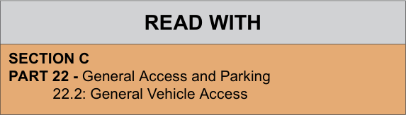
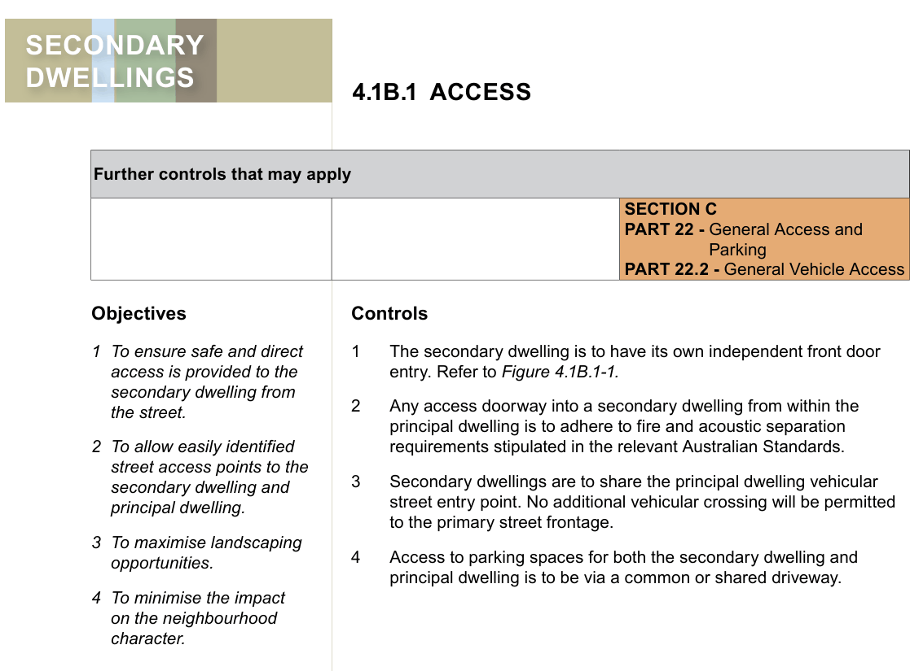
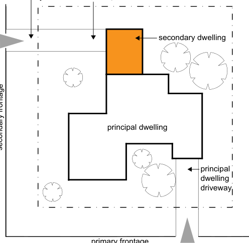

#### 4.1B 	 	Access and Parking

4.1B.1  	Access 4.1B.2  	Car Parking Provision

> [Picture on page 11: a picture, saved as a picture (images/part-04-1-secondary-dwellings-page-11-5.gif, 150 dpi).]
> Words printed on the picture (title and legend, copied from the PDF):
> 22.2: General Vehicle Access

### READ WITH

#### SECTION C

PART 22 - General Access and Parking

### ACCESS AND PARKING

> [Picture on page 12: a picture, saved as a picture (images/part-04-1-secondary-dwellings-page-12-1.gif, 150 dpi).]
> Words printed on the picture (title and legend, copied from the PDF):
> Parking
> secondary dwelling from
> the street.
> secondary dwelling and
> principal dwelling.
> 3	 To maximise landscaping
> opportunities.
> on the neighbourhood
> character.

### 4.1B.1  ACCESS

#### Further controls that may apply

#### SECTION C

PART 22 - General Access and

PART 22.2 - General Vehicle Access

#### Controls

#### Objectives

1 The secondary dwelling is to have its own independent front door

entry. Refer to Figure 4.1B.1-1.

1	 To ensure safe and direct

access is provided to the

2 Any access doorway into a secondary dwelling from within the

principal dwelling is to adhere to fire and acoustic separation

requirements stipulated in the relevant Australian Standards.

2	 To allow easily identified

street access points to the

3 Secondary dwellings are to share the principal dwelling vehicular

street entry point. No additional vehicular crossing will be permitted

to the primary street frontage. 4 Access to parking spaces for both the secondary dwelling and

principal dwelling is to be via a common or shared driveway.

4	 To minimise the impact

secondary

dwelling

principal dwelling

principal dwelling

main

entry

entry to

secondary

dwelling above

entry to

secondary

dwelling

main

entry

secondary

dwelling

principal dwelling

principal dwelling

main

entry entry to

secondary

dwelling

entry to secondary

dwelling above main

entry

#### Figure 4.1B.1-1:

Secondary dwellings entries are subservient to the entry to the principal dwelling.

### 4.1B

### 4.1B.1 ACCESS (continued)

#### Controls

5 Where the principal dwelling has a secondary street frontage,

a second vehicular access for the secondary dwelling may be

considered. Refer to Figure 4.1B.1-2.

hardstand car parking

space for secondary

dwelling

new driveway from

secondary street

> [Picture on page 13: a picture, saved as a picture (images/part-04-1-secondary-dwellings-page-13-12.gif, 150 dpi).]
> Words printed on the picture (title and legend, copied from the PDF):
> secondary dwelling
> principal dwelling
> principal
> dwelling
> driveway
> primary frontage

secondary frontage

### STREET

### SITE DESIGN

### STREET

#### Figure 4.1B.1-2:

Separate vehicle access for secondary dwelling from a

secondary street.

### 4.1B.2  CAR PARKING PROVISION

#### Objectives

#### Controls

1	 To minimise the impact of

additional parking on the

streetscape.

1 Car parking for secondary dwellings is to be limited to an open

hardstand area only (the car parking hardstand space is to be a

minimum of 2.5m wide x 5.4m long). No garage or carport structure

will be permitted. 2 Where possible, hardstand area for the secondary dwelling is to be

screened by landscaping.

2	 To enable functional off

street car parking spaces

for the principal and

secondary dwelling.

3 The parking space for the secondary dwelling is to have direct

access that will not obstruct the driveway of the principal dwelling.

Stacked car parking will not be permitted. 4 The following car parking rates are applicable for secondary

dwellings:

| Secondary dwelling accommodation | Min. car parking spaces required | Max. car parking spaces required |
|---|---|---|
| Studio/bedsit | 0 | 1 |
| 1 bedroom | 0 | 1 |
| 2 bedrooms | 1 Or 0 - if within 400m walking distance of a railway station or a bus stop within a strategic bus corridor. | 1 |

Note: Secondary dwelling parking requirements are in addition to the

requirements for the principal dwelling.

### 4.1C
