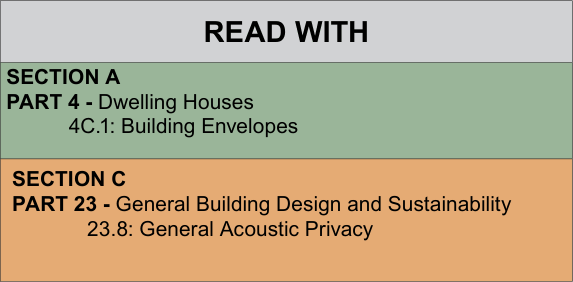
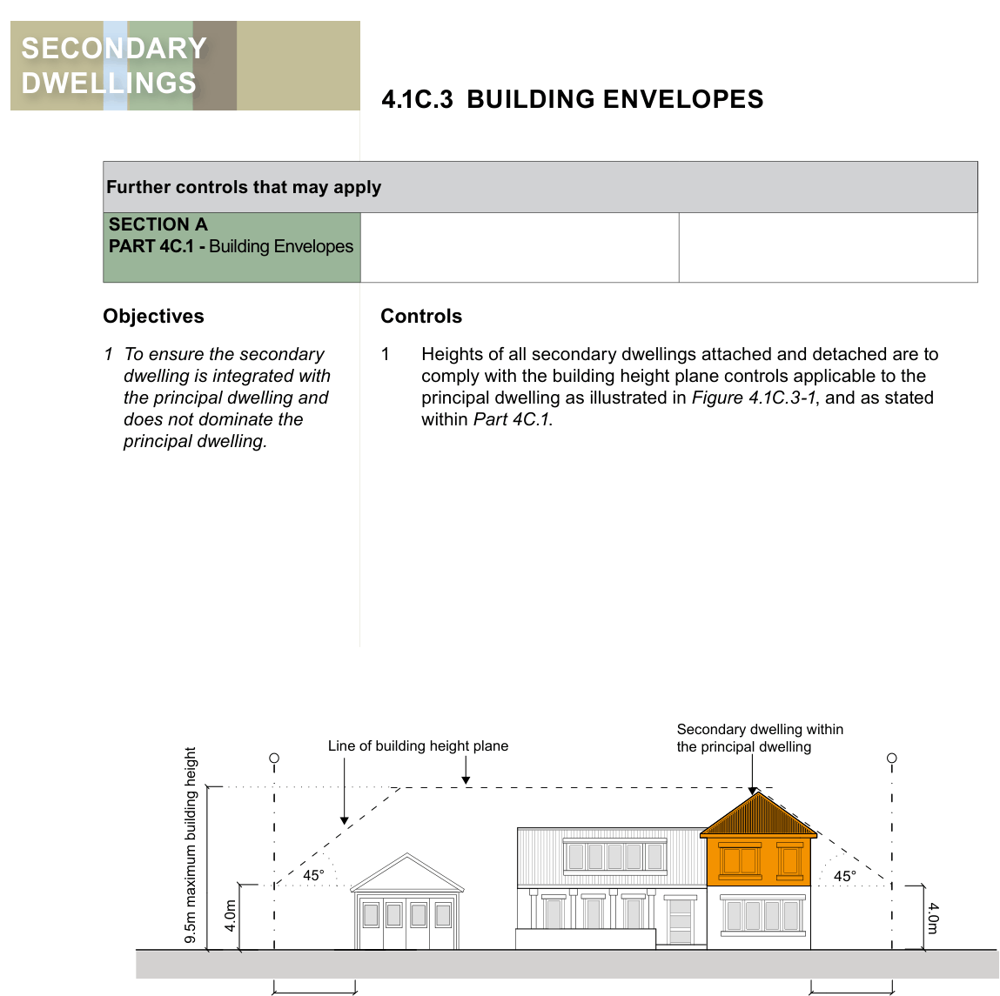
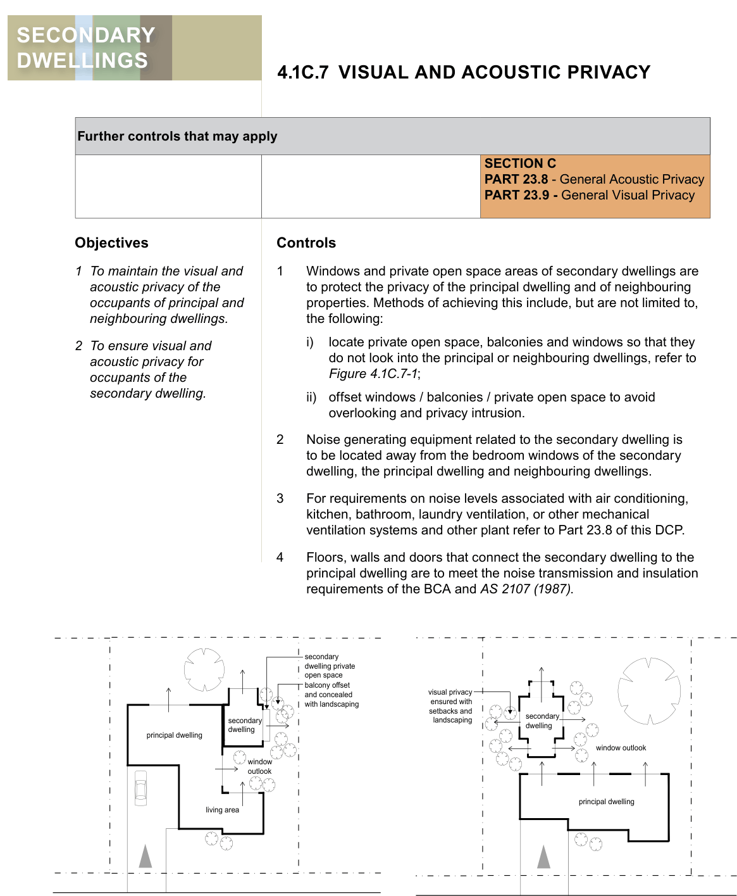

#### 4.1C Building Design and Sustainability

4.1C.1  	Solar Access 4.1C.2  	Private Open Space 4.1C.3  	Building Envelopes 4.1C.4  	Building and Room Sizes 4.1C.5  	Building Appearance 4.1C.6  	Building Services 4.1C.7  	Visual and Acoustic Privacy 4.1C.8  	Storage and Utility Areas

> [Picture on page 15: a picture, saved as a picture (images/part-04-1-secondary-dwellings-page-15-11.gif, 150 dpi).]
> Words printed on the picture (title and legend, copied from the PDF):
> 4C.1: Building Envelopes
> 23.8: General Acoustic Privacy

### READ WITH

#### SECTION A

PART 4 - Dwelling Houses

#### SECTION C

PART 23 - General Building Design and Sustainability

### BUILDING DESIGN AND SUSTAINABILITY

### 4.1C.1  SOLAR ACCESS

#### Objectives

#### Controls

1 All habitable rooms of secondary dwellings are to have a window.

The use of skylights or highlight windows as the primary source of

daylight and ventilation is prohibited.

1	 To ensure secondary

dwellings have good

internal amenity with direct

access to daylight in all

habitable rooms.

2 The secondary dwelling is to achieve at least 3 hours solar access

between 9am and 3pm on 21st June to living areas and private open

space unless no practicable alternative is available. 3 Secondary dwellings are to maintain at least 3 hours solar access

between 9am and 3pm on the 21st June to the living spaces and

private open spaces of the principal dwelling.

2	 To ensure secondary

dwellings do not

negatively impact on solar

access to the living areas

or private open space of

neighbouring properties.

4 Secondary dwellings are to maintain at least 4 hours solar access

between 9am and 3pm on the 21st June to the living spaces and

private open spaces of the neighbouring dwellings.

3	 To minimise the impact

of new buildings and

works on solar collection

devices.

5 Secondary dwellings are not to overshadow existing solar panels/

photovoltaic cells of the principal dwelling or neighbouring dwellings. 6 Where existing overshadowing by buildings is greater than that

permitted in 5C.1(2-5) of this Part, sunlight is not to be reduced by

more than 20%.

p 5-16

### 4.1C.2  PRIVATE OPEN SPACE

#### Objectives

#### Controls

1 Private open space for the secondary dwelling is to lead directly off

the internal living area.

1	 To provide useable

outdoor space to all

secondary dwellings.

2 A secondary dwelling at ground level is to have a minimum

nominated useable private open space area of 25m2, with a

minimum dimension of 3.0 metres. This area may be located within

the secondary dwelling setbacks.

2	 To retain adequate

private open space for the

principal dwelling.

3 Freestanding walls or fencing are not to be used to separate or

screen the private ground floor open space of a secondary dwelling.

Landscaping may be used as a screening device. 4 A secondary dwelling on the first floor level is to have an allocated

private open space such as a balcony or terrace that is accessible

directly from the living area. The minimum provision is indicated in

the table below:

| Type | Minimum Balcony/ Terrace Requirement | Minimum Dimension Requirement |
|---|---|---|
| Studio | 8m2 | 2.4m |
| 1 bedroom | 10m2 |  |
| 2 bedrooms | 12m2 |  |

5 Where a first floor secondary dwelling proposal demonstrates that it

is unable to provide private open space upon the first floor, Council

may consider provision of that space at the ground level in line with

5C.2 (2) of this Part, at a location directly visible from the first floor

living area of the secondary dwelling. 6 Private open space is to be orientated to receive a minimum 3

hours of solar access between 9am and 3pm on 21st June where

practicable.

### BUILDING DESIGN AND SUSTAINABILITY

> [Picture on page 18: a picture, saved as a picture (images/part-04-1-secondary-dwellings-page-18-1.gif, 150 dpi).]
> Words printed on the picture (title and legend, copied from the PDF):
> within Part 4C.1.
> dwelling is integrated with
> the principal dwelling and
> does not dominate the
> principal dwelling.

### 4.1C.3  BUILDING ENVELOPES

#### Further controls that may apply SECTION A

PART 4C.1 - Building Envelopes

#### Controls

#### Objectives

1 Heights of all secondary dwellings attached and detached are to

comply with the building height plane controls applicable to the

principal dwelling as illustrated in Figure 4.1C.3-1, and as stated

1	 To ensure the secondary

Line of building height plane

Secondary dwelling within

the principal dwelling

> Words printed on the picture (title and legend, copied from the PDF):
> 9.5m maximum building height

side setback

side setback

#### Figure 4.1C.3-1:

#### Building height plane- secondary dwelling within the principal dwelling.

### 4.1C.4  BUILDING AND ROOM SIZES

#### Objectives

#### Controls

1 The minimum floor area for a secondary dwelling is 40m2 except

where the secondary dwelling is located over an existing double

garage where the application will be considered on merit.

1	 To protect the streetscape

and the amenity of

neighbouring properties

by controlling building bulk

and scale and associated

overlooking.

Note: The maximum floor area of a secondary dwelling is referred to in

Clause 5.4(9) of KLEP which states: If development for the purposes of a

secondary dwelling is permitted under this Plan, the total floor area of the

dwelling (excluding any area used for parking) must not exceed whichever

of the following is the greater:

(a) 60 square metres,

(b) 25% of the total floor area of the principal dwelling.

2	 To ensure that the

secondary dwelling has

functional internal areas

with high amenity.

2 A maximum of two bedrooms are permitted within the secondary

dwelling.

min 3m

3 All bedrooms and living spaces are to have a minimum plan

dimension of 3m, excluding wardrobe space. Refer Figure 4.1C.4-1.

min 3m

Wardrobe

4 The secondary dwelling is to function as an independent dwelling,

and include a kitchen, bathroom and laundry.

min 3m

min 3m

Balcony

min 3m

min 3m

min 3m

Wardrobe

Wardrobe

#### Figure 4.1C.4-1:

#### Minimum plan dimension 3m x 3m for habitable rooms

min 3m

Balcony

min 3m

min 3m

Wardrobe

### BUILDING DESIGN AND SUSTAINABILITY

### 4.1C.5  BUILDING APPEARANCE

#### Objectives

#### Controls

1 The secondary dwelling is to incorporate similar or complementary

design and construction features, finishes, materials and colours to

the principal dwelling.

1	 To ensure the streetscape

and dwelling character

of the neighbourhood is

maintained.

2 Attached secondary dwellings are to be integrated into the principal

dwelling and to maintain the appearance of a single house by

utilising similar proportions, height, roof shape, fenestration, material

and finishes as the principal dwelling.

2	 To integrate attached

secondary dwellings with

the principal dwelling, so

that it appears as a single

house when viewed from

the street.

3 Detached secondary dwellings are to be sympathetic to the design

of the principal dwelling in terms of its roof shape, fenestration,

materials and finishes. 4 The entry to the secondary dwelling is not to conflict with the

prominence of the entry to the principal dwelling (Refer Figure 4.1C.5-

1).

3	 To ensure that detached

secondary dwellings

are visually linked to the

principal dwelling.

### 4.1C.6  BUILDING SERVICES

#### Objectives

#### Controls

1 Services provided to the secondary dwelling are to include:

i) water and sewerage;

ii) electricity;

1	 To ensure the secondary

dwelling and the principal

dwelling are able to

operate as independent

dwellings.

iii) gas;

iv) telephone and internet;

v) waste storage and collection;

2	 To encourage the

conservation of water and

energy.

vi) letterbox. 2 Separate provision and metering of water, electricity and gas are

to be provided to ensure the secondary dwelling may be billed

separately by infrastructure providers.

### BUILDING DESIGN AND SUSTAINABILITY

> [Picture on page 22: a picture, saved as a picture (images/part-04-1-secondary-dwellings-page-22-1.gif, 150 dpi).]
> Words printed on the picture (title and legend, copied from the PDF):
> acoustic privacy of the
> occupants of principal and
> neighbouring dwellings.
> acoustic privacy for
> occupants of the
> secondary dwelling.
> overlooking and privacy intrusion.

Figure 4.1C.7-1;

### 4.1C.7  VISUAL AND ACOUSTIC PRIVACY

#### Further controls that may apply

#### SECTION C

PART 23.8 - General Acoustic Privacy

PART 23.9 - General Visual Privacy

#### Controls

#### Objectives

1	 To maintain the visual and

1 Windows and private open space areas of secondary dwellings are

to protect the privacy of the principal dwelling and of neighbouring

properties. Methods of achieving this include, but are not limited to,

the following:

i) locate private open space, balconies and windows so that they

do not look into the principal or neighbouring dwellings, refer to

2	 To ensure visual and

ii) offset windows / balconies / private open space to avoid

2 Noise generating equipment related to the secondary dwelling is

to be located away from the bedroom windows of the secondary

dwelling, the principal dwelling and neighbouring dwellings. 3 For requirements on noise levels associated with air conditioning,

kitchen, bathroom, laundry ventilation, or other mechanical

ventilation systems and other plant refer to Part 23.8 of this DCP. 4 Floors, walls and doors that connect the secondary dwelling to the

principal dwelling are to meet the noise transmission and insulation

requirements of the BCA and AS 2107 (1987).

#### STREET

#### STREET

#### Figure 4.1C.7-1:

Windows, balconies, private open space must be located to avoid visual intrusion.

### 5C

### 4.1C.8  STORAGE AND UTILITY AREAS

#### Objectives

#### Controls

1 All secondary dwellings are to provide internal storage space in

accordance with the following table:

| Type | Minimum storage space requirement |
|---|---|
| Studio | 3m3 |
| 1 Bedroom | 6m3 |
| 2 Bedroom | 8m3 |

1	 To ensure storage

provision and access to a

utility area.

2 Where separate clothes lines and bins storage areas are provided

for the secondary dwelling, they are:

i) to be screened so that they are not visible from the street;

ii) to be screened from the principal dwelling; and

iii) not to compromise the amenity of entry into the secondary

dwelling.

### BUILDING DESIGN AND SUSTAINABILITY

### THIS PAGE IS INTENTIONALLY BLANK

p 5-24
