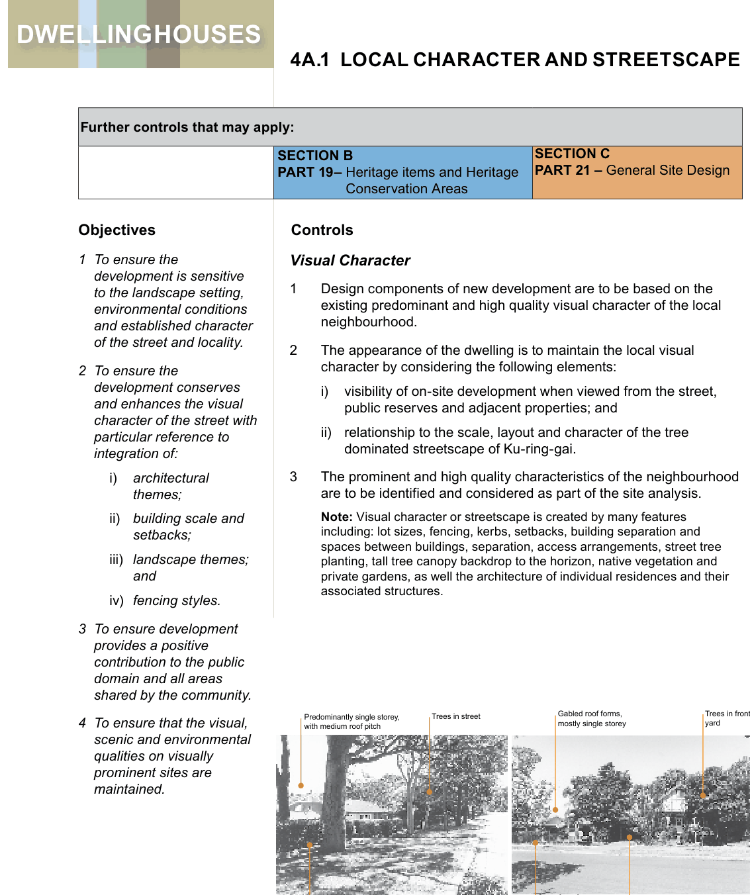

#### 4A Site Design

4A.1 Local Character and Streetscape 4A.2 Building Setbacks 4A.3 Built-Upon Area 4A.4 Landscaping

### READ WITH

#### SECTION A

PART 2 – Site Analysis

#### SECTION B

PART 15 – Land Contamination

PART 16 – Bushfire Risk

PART 17 – Riparian Lands

PART 18 – Biodiversity

PART 19 – Heritage and Conservation Areas

PART 20 – Development Near Road or Rail Noise

#### SECTION C

PART 21 – General Site Design

21.2: Landscape Design

PART 24 – Water Management

### SITE DESIGN

> [Picture on page 4: a map, saved as a picture (images/part-04-dwelling-houses-page-4-1.gif, 150 dpi); the street names and other small labels are on the picture.]
> Words printed on the picture (title and legend, copied from the PDF):
> 1	 To ensure the
> development is sensitive
> to the landscape setting,
> and established character
> dominated streetscape of Ku-ring-gai.
> 2	 To ensure the
> and enhances the visual
> particular reference to
> ii)	 building scale and
> iii)	 landscape themes;
> Note: Visual character or streetscape is created by many features
> including: lot sizes, fencing, kerbs, setbacks, building separation and
> spaces between buildings, separation, access arrangements, street tree
> planting, tall tree canopy backdrop to the horizon, native vegetation and
> private gardens, as well the architecture of individual residences and their
> iv)	 fencing styles.
