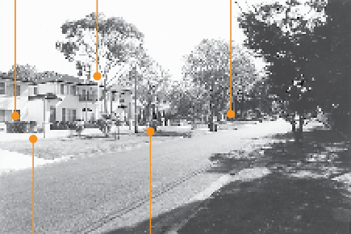
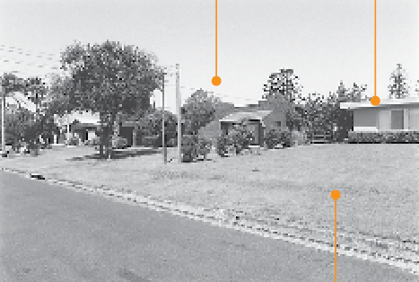
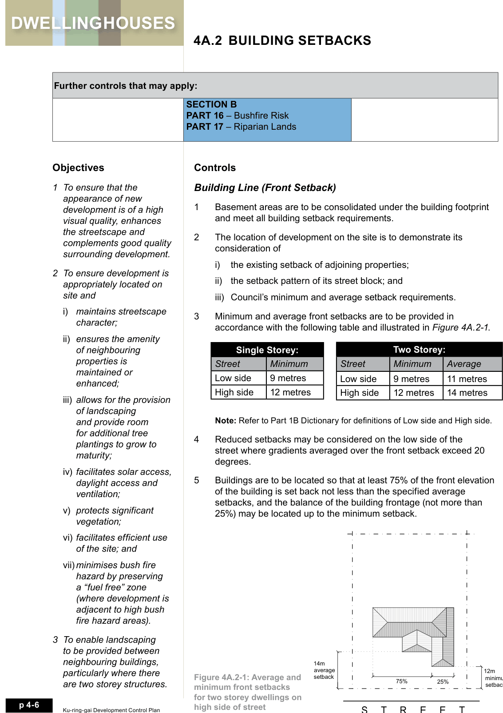

### 4A.1  LOCAL CHARACTER AND STREETSCAPE

#### Further controls that may apply:

#### SECTION C

PART 21 – General Site Design

#### SECTION B

PART 19– Heritage items and Heritage

#### Controls

#### Objectives

#### Visual Character

1 Design components of new development are to be based on the

existing predominant and high quality visual character of the local

of the street and locality.

2 The appearance of the dwelling is to maintain the local visual

character by considering the following elements:

i) visibility of on-site development when viewed from the street,

public reserves and adjacent properties; and

ii)	 	relationship to the scale, layout and character of the tree

character of the street with

3 The prominent and high quality characteristics of the neighbourhood

are to be identified and considered as part of the site analysis.

3	 To ensure development

provides a positive

contribution to the public

domain and all areas

shared by the community.

Trees in street

Trees in front yard

Gabled roof forms, mostly single storey

Predominantly single storey, with medium roof pitch

4	 To ensure that the visual,

scenic and environmental

qualities on visually

prominent sites are

maintained.

Open front fences Garages set back from

street alignment

Hedges or open front fencing

#### Figure 4A.1-1:

#### Qualities of visual character.

### 4A.1 	LOCAL CHARACTER AND STREETSCAPE

### (continued)

#### Controls

Mixture of flat and

Uniform setback

Trees in front yard

Predominantly 2 storey development

Low front fences

> [Picture on page 5: a picture, saved as a picture (images/part-04-dwelling-houses-page-5-12.gif, 150 dpi).]

pitched roofs

> [Picture on page 5: a picture, saved as a picture (images/part-04-dwelling-houses-page-5-14.gif, 150 dpi).]

Uniform building setback

Landscaped footpath

No front fences

#### Figure 4A.1-2:

#### Qualities of visual character.

#### Public Domain and Communal Space

4 Development is to integrate with surrounding sites by:

i) being of an appropriate scale retaining consistency with the

surrounds when viewed from the street, public domain or

adjoining development and not exceeding two storeys;

ii)	 minimising overshadowing; and

iii)	 integrating built form and soft landscaping (gardens and trees)

within the tree canopy that links the public and private domain

throughout Ku-ring-gai.

#### Visually Prominent Sites

### SITE DESIGN

Note: Visually prominent sites are situated in highly visible locations and include

ridge top sites, escarpments, environmentally sensitive sites on sloping land,

elevated corner allotments, road bends, vista end points, and any site that has

the potential to dominate and impact visual amenity.

5\.	 Development on visually prominent sites is to:

i) be integrated into the existing landscape through the site

planning process and avoid tall and bulky structures;

ii)	 have a selection of external colours and finishes that are

sensitive to the site and locality;

iii)	 retain significant landscape and vegetation elements;

iv)	 consider views to the site as well as those from the site; and

v)	 soften visual impact by extensive landscaping including larger

trees and shrubs.

6 Colours of materials used in sites adjoining or in close proximity to

bushland areas and conservation areas must be in harmony with the

built and natural landscape elements of the area.

> [Picture on page 6: a map, saved as a picture (images/part-04-dwelling-houses-page-6-1.gif, 150 dpi); the street names and other small labels are on the picture.]
> Words printed on the picture (title and legend, copied from the PDF):
> appearance of new
> visual quality, enhances
> the streetscape and
> complements good quality
> appropriately located on
> i)	 maintains streetscape
> ii)	 ensures the amenity
> Note: Refer to Part 1B Dictionary for definitions of Low side and High side.
> and provide room
> for additional tree
> plantings to grow to
> iv)	facilitates solar access,
> daylight access and
> v)	 protects significant
> vi)	facilitates efficient use
> of the site; and
> vii)	minimises bush fire
> hazard by preserving
> a “fuel free” zone
> (where development is
> adjacent to high bush
> fire hazard areas).
> 3	 To enable landscaping
> to be provided between
> particularly where there
> are two storey structures.
> minimum front setbacks
> for two storey dwellings on
> high side of street

Figure 4A.2-1: Average and
