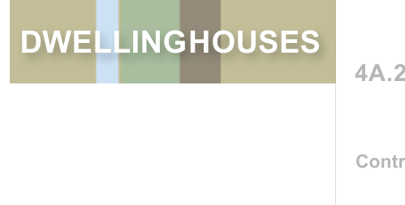
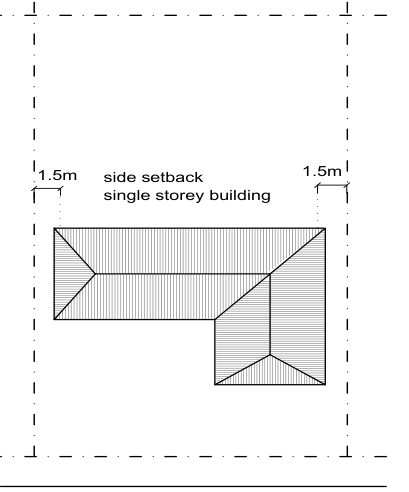
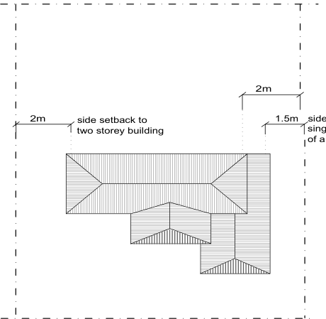
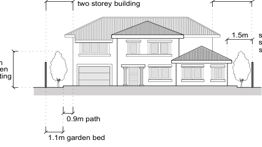
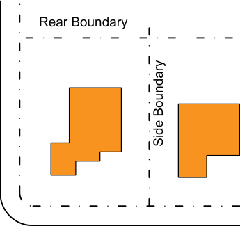
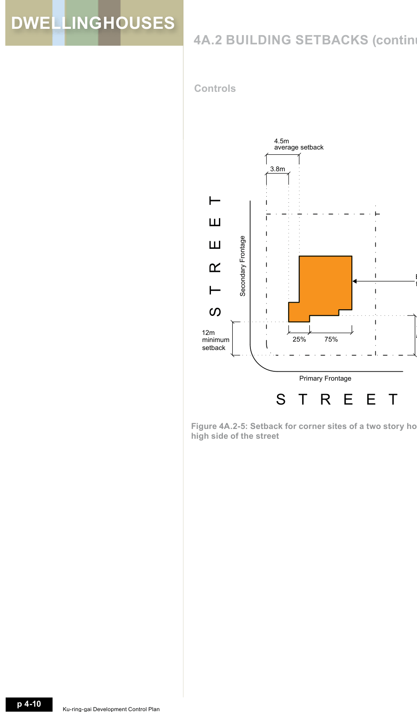
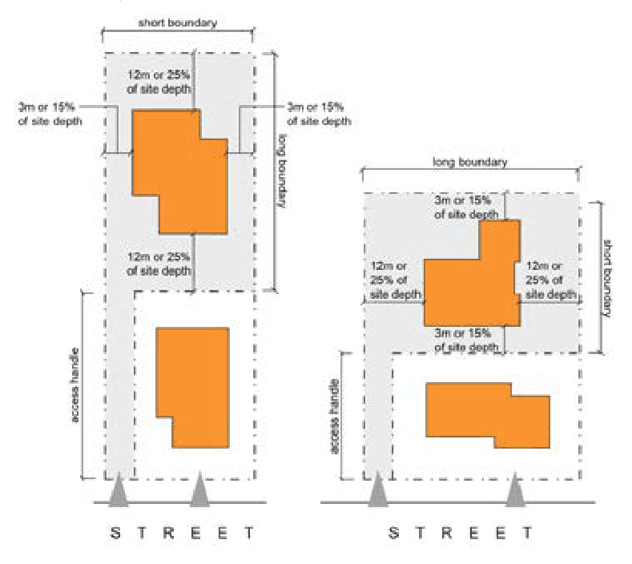
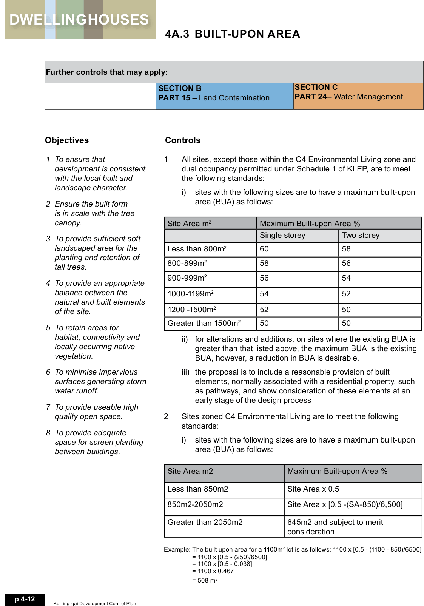

### 4A.2  BUILDING SETBACKS

#### Further controls that may apply:

#### SECTION B

PART 16 – Bushfire Risk

PART 17 – Riparian Lands

#### Controls

#### Objectives

#### Building Line (Front Setback)

1 Basement areas are to be consolidated under the building footprint

and meet all building setback requirements. 2 The location of development on the site is to demonstrate its

consideration of

1	 To ensure that the

development is of a high

i) the existing setback of adjoining properties;

ii)	 the setback pattern of its street block; and

2	 To ensure development is

iii)	 Council’s minimum and average setback requirements. 3 Minimum and average front setbacks are to be provided in

accordance with the following table and illustrated in Figure 4A.2-1.

| Single | Storey: |  | Two Storey: |  |
|---|---|---|---|---|
| Street Low side | Minimum 9 metres | Street Low side | Minimum 9 metres | Average 11 metres |
| High side | 12 metres | High side | 12 metres | 14 metres |

iii)	 allows for the provision

4 Reduced setbacks may be considered on the low side of the

street where gradients averaged over the front setback exceed 20

5 Buildings are to be located so that at least 75% of the front elevation

of the building is set back not less than the specified average

setbacks, and the balance of the building frontage (not more than

25%) may be located up to the minimum setback.

#### STREET

### 4A.2 BUILDING SETBACKS (continued)

#### Objectives

#### Controls Building Line (Rear Setbacks)

6 For sites with a depth greater than 48m, a minimum 12m rear

setback is to be provided.

4	 To provide privacy

and soften the visual

appearance when viewed

from the street and from

the neighbouring property.

7 Where sites have a depth of less than 48m, a minimum rear setback

of 25% of the average site depth is to be provided.

#### Building Line (Side Setbacks)

5	 To maintain visual amenity

and solar access of private

open space.

8 The minimum distances to a side boundary are as per the following

table and illustrated in Figure 4A.2-2 to 4A.2-3:

| Site Width | Single Storey Building Setback - including single storey elements of two storey buildings | Two Storey Building Setback - including any upper level |
|---|---|---|
| Less than 20m | 1.5m | 2m |
| 20m or more | 9% of site width | 12% of site width |

6	 To ensure that side

setbacks provide

adequate solar access

and day light access. 7	 To ensure dwellings on

battle-axe lots are sited

to have minimum impact

on the amenity of private

open spaces and living

areas on neighbouring

properties.

9 Side setbacks are to accommodate a pathway and at least 0.6m of

landscaping width for single storey buildings, and 1.1m for 2 storey

houses. Where sites are of greater widths (over 20m) larger side

setbacks should be progressively provided. 10 Side setbacks are to accommodate shrubs to a height of 3-4m for

two storey houses, and 2-3m for single storey houses.

### SITE DESIGN

> [Picture on page 8: a picture, saved as a picture (images/part-04-dwelling-houses-page-8-1.gif, 150 dpi).]

#### Controls

#### Figure 4A.2-2: Side setbacks

– Single Storey dwellings for

sites less than 20m width

> [Picture on page 8: a picture, saved as a picture (images/part-04-dwelling-houses-page-8-6.gif, 150 dpi).]
> Words printed on the picture (title and legend, copied from the PDF):
> 1.5m
> 1500
> 1500
> 1.5m side setback
> single storey building
> 1.5m
> 1500
> 1500
> 1.5m side setback
> single storey building

#### Figure 4A.2-3: Side setbacks

– Two Storey dwellings for

sites less than 20m width

> [Picture on page 8: a map, saved as a picture (images/part-04-dwelling-houses-page-8-10.gif, 150 dpi); the street names and other small labels are on the picture.]
> Words printed on the picture (title and legend, copied from the PDF):
> side setback to
> two storey building
> side setback to
> two storey building

side setback to single storey element of a two storey building

side setback to single storey element of a two storey building

#### STREET

### STREET

#### STREET

2m

2m

#### STREET

side setback to

> [Picture on page 8: a map, saved as a picture (images/part-04-dwelling-houses-page-8-24.gif, 150 dpi); the street names and other small labels are on the picture.]
> Words printed on the picture (title and legend, copied from the PDF):
> two storey building
> side setback to
> two storey building
> 1.1m garden bed

1.5m

1450

1450

side setback

single storey building

1.5m

1.5m

1450

1450

side setback

single storey building

1.5m

side setback to single

storey element of a two

storey building

2904,53

side setback to single

storey element of a two

storey building

2-3m

screen

planting

3-4m

screen

planting

2904,53

3-4m

screen

planting

900

2-3m

screen

planting

650

900

0.9m path 0.6m garden bed

650

0.9m path 0.6m garden bed

1.1m garden bed

#### Controls

#### Corner and Dual Frontage Sites Setbacks

11 For building sites with a corner frontage, the front and rear boundary

setbacks apply to the Primary street frontage as illustrated in Figure

4A.2-4. 12 Where a development seeks to change the secondary frontage into

the primary frontage then the new primary frontage is to provide

all setbacks in accordance with section 4A.2 Building Line (front

> [Picture on page 9: a picture, saved as a picture (images/part-04-dwelling-houses-page-9-9.gif, 150 dpi).]
> Words printed on the picture (title and legend, copied from the PDF):
> Rear Boundary
> Side Boundary

setback).

Secondary Frontage

#### STREET

Primary Frontage

### STREET

#### Figure 4A.2-4: Primary and Secondary Street Frontages

### SITE DESIGN

13 The minimum and average setbacks to the secondary street

frontage on corner sites are as per the following table and illustrated

in Figure 4A.2-5.

|  | Minimum | Average |
|---|---|---|
| Setback | 3.8m | 4.5m |

14 On secondary street frontages, buildings are to be located so that

not more than 50% of the secondary front elevation of the building is

set back not less than 3.8m, and at least 50% of the secondary front

elevation of the building is to be located to average a 4.5m setback. 15 Setbacks to side and rear boundaries are to be in accordance with

the minimum setbacks applying to dwellings which are not on corner

lots.

> [Picture on page 10: a picture, saved as a picture (images/part-04-dwelling-houses-page-10-1.gif, 150 dpi).]
> Words printed on the picture (title and legend, copied from the PDF):
> 12m
> minimum
> setback

#### Controls

4.5m

average setback

Building

footprint

### STREET

14m

average setback

(two storey only)

Primary Frontage

### STREET

Figure 4A.2-5: Setback for corner sites of a two story house on the

high side of the street

### 4A.2 BUILDING SETBACKS

#### Controls

#### Battle-Axe Lots

16 Rectangular battle-axe blocks (excluding the access handle) are to

provide the following minimum setback as illustrated 4A.2-6:

i) the setbacks from the two long boundaries is to be a minimum of

15% of the site width or 3m, whichever is the greater.

ii)	 	the setback from any boundary excluding the two long

boundaries, is to be a minimum of 12m for sites with a depth

greater than 48m. Where sites have a depth of less than 48m,

a minimum setback of 25% of the average site depth is to be

provided. Note: For irregular blocks or particularly narrow blocks, or in special cases (e.g. the dwelling is single storey) Council may vary these figures, provided it can be shown that the objectives have been met. Note: Where there is potential conflict with uses on neighbouring lots, greater side setbacks are to be provided.

> [Picture on page 11: a picture, saved as a picture (images/part-04-dwelling-houses-page-11-18.gif, 150 dpi).]

### SITE DESIGN

#### Figure 4A.2-6 Setback battle-axe lots

> [Picture on page 12: a map, saved as a picture (images/part-04-dwelling-houses-page-12-1.gif, 150 dpi); the street names and other small labels are on the picture.]
> Words printed on the picture (title and legend, copied from the PDF):
> PART 24– Water Management
> 1	 To ensure that
> development is consistent
> area (BUA) as follows:
> landscaped area for the
> planting and retention of
> balance between the
> natural and built elements
> of the site.
> habitat, connectivity and
> locally occurring native
> 6	 To minimise impervious
> surfaces generating storm
> quality open space.
> area (BUA) as follows:
> 8	 To provide adequate
> space for screen planting
> Example: The built upon area for a 1100m2 lot is as follows: 1100 x [0.5 - (1100 - 850)/6500]
> = 1100 x [0.5 - (250)/6500]
> = 1100 x [0.5 - 0.038]
> = 1100 x 0.467
> = 508 m2
