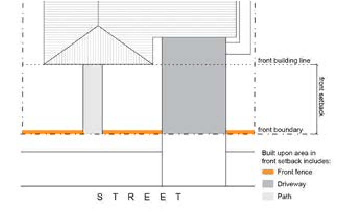
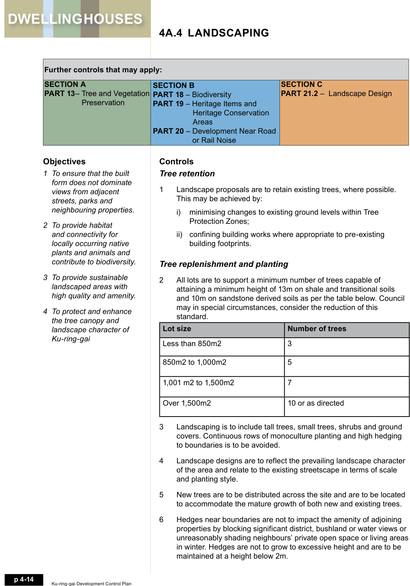

### 4A.3  BUILT-UPON AREA

#### Further controls that may apply:

#### SECTION C

#### SECTION B

PART 15 – Land Contamination

#### Controls

#### Objectives

1 All sites, except those within the C4 Environmental Living zone and

dual occupancy permitted under Schedule 1 of KLEP, are to meet

the following standards:

with the local built and

i) sites with the following sizes are to have a maximum built-upon

| Site Area m2 | Maximum Built-upon Area % |  |
|---|---|---|
|  | Single storey | Two storey |
| Less than 800m2 | 60 | 58 |
| 800-899m2 | 58 | 56 |
| 900-999m2 | 56 | 54 |
| 1000-1199m2 | 54 | 52 |
| 1200 -1500m2 | 52 | 50 |
| Greater than 1500m2 | 50 | 50 |

2	 Ensure the built form

is in scale with the tree

3	 To provide sufficient soft

4	 To provide an appropriate

ii)	 for alterations and additions, on sites where the existing BUA is

5	 To retain areas for

greater than that listed above, the maximum BUA is the existing

BUA, however, a reduction in BUA is desirable.

iii)	 the proposal is to include a reasonable provision of built

elements, normally associated with a residential property, such

as pathways, and show consideration of these elements at an

early stage of the design process

7	 To provide useable high

2 Sites zoned C4 Environmental Living are to meet the following

standards:

i) sites with the following sizes are to have a maximum built-upon

| Site Area m2 | Maximum Built-upon Area % |
|---|---|
| Less than 850m2 | Site Area x 0.5 |
| 850m2-2050m2 | Site Area x [0.5 -(SA-850)/6,500] |
| Greater than 2050m2 | 645m2 and subject to merit consideration |

### 4A.3  BUILT-UPON AREA (continued)

#### Controls

ii)	 for alterations and additions on sites where the existing BUA is

greater than that listed above, the maximum BUA is the existing

BUA, however, a reduction in BUA is desirable.

iii)	 the proposal is to include a reasonable provision of built

elements, normally associated with a residential property, such

as pathways, and show consideration of these elements at an

early stage of the design process.

Note: Applicants should make reasonable provisions for built elements

such as pathways normally associated with a residential property as part

of the built upon area. Council will also include elevated pathways as

structures and built upon areas 3 The front setback for any development for a dwelling house is to

have a maximum BUA of 30% (see Figure 4A.3-1).

> [Picture on page 13: a picture, saved as a picture (images/part-04-dwelling-houses-page-13-16.gif, 150 dpi).]

### SITE DESIGN

#### Figure 4A.3-1: Maximum Built Upon Area in the front setback

> [Picture on page 14: a map, saved as a picture (images/part-04-dwelling-houses-page-14-1.gif, 150 dpi); the street names and other small labels are on the picture.]
> Words printed on the picture (title and legend, copied from the PDF):
> PART 18 – Biodiversity
> or Rail Noise
> form does not dominate
> views from adjacent
> streets, parks and
> 2	 To provide habitat
> and connectivity for
> locally occurring native
> plants and animals and
> contribute to biodiversity.
> 3	 To provide sustainable
> landscaped areas with
> high quality and amenity.
> the tree canopy and
> landscape character of
> and planting style.
