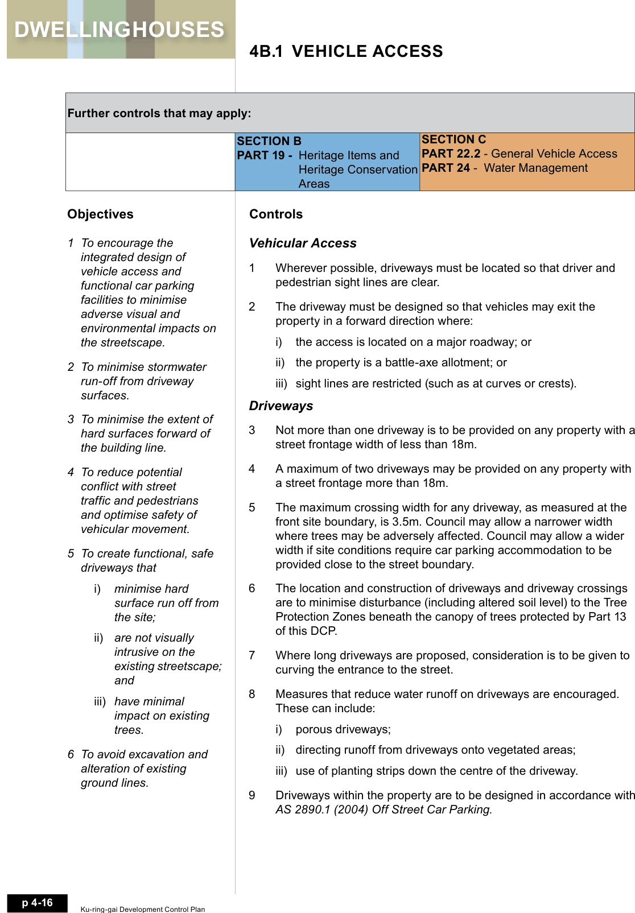

#### 4B Access and Parking

4B.1 Vehicle Access 4B.2 Car Parking Provision 4B.3 Carports and Garages

### READ WITH

#### SECTION B

PART 19- Heritage Items and Heritage Conservation Areas

#### SECTION C

PART 22 - General Access and Parking

22.2: General Vehicle Access

PART 24 - Water Management

### ACCESS AND PARKING

> [Picture on page 16: a map, saved as a picture (images/part-04-dwelling-houses-page-16-1.gif, 150 dpi); the street names and other small labels are on the picture.]
> Words printed on the picture (title and legend, copied from the PDF):
> 1	 To encourage the
> integrated design of
> vehicle access and
> functional car parking
> facilities to minimise
> adverse visual and
> environmental impacts on
> 2	 To minimise stormwater
> run-off from driveway
> hard surfaces forward of
> the building line.
> 4	 To reduce potential
> conflict with street
> traffic and pedestrians
> and optimise safety of
> i) minimise hard
> surface run off from
> of this DCP.
> ii)	 are not visually
> intrusive on the
> iii)	 have minimal
> impact on existing
> alteration of existing
