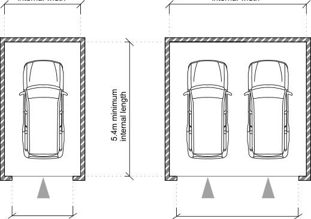
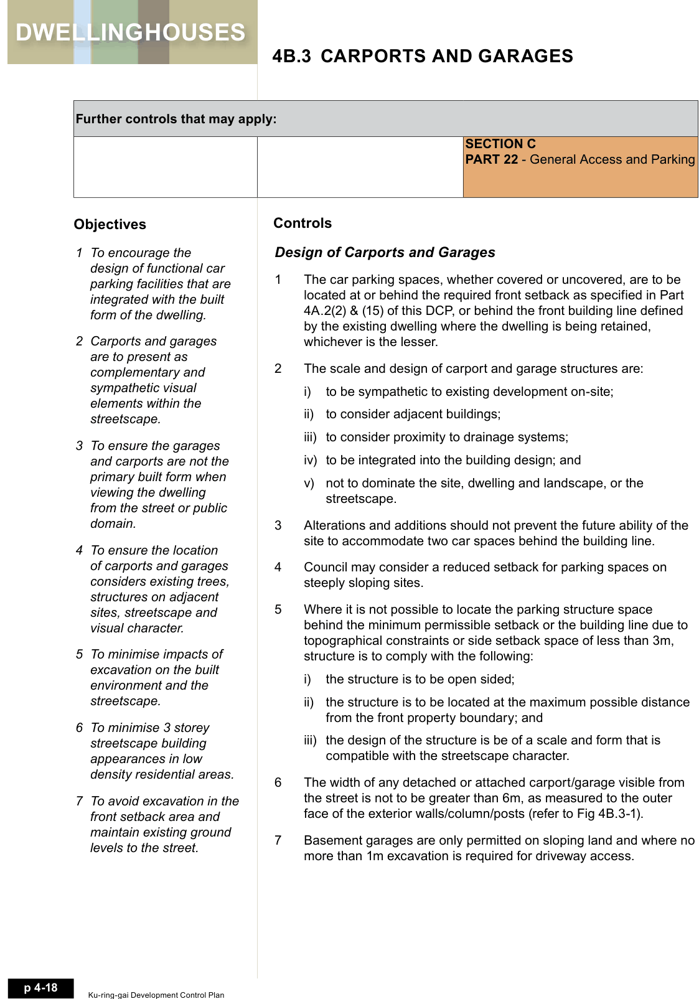

### 4B.2  CAR PARKING PROVISION

#### Objectives

#### Controls Number of car spaces

1	 To encourage the

provision of functional car

parking facilities.

1 The number of on-site parking spaces provided should be in

accordance with Section C Part 22R of this DCP. 2 Single occupancy dwellings are to provide 2 spaces on-site as

determined by Section A Part 4B.3(5)

2	 To minimise adverse

visual and environmental

impacts on the

streetscape.

3 Provision of more than 2 car spaces is discouraged in locations

where there is availability of public transport. 4 Where more than 2 car spaces are proposed, triple (or greater width)

garage openings within the front elevation are not permitted.

3	 To ensure car spaces

are of sufficient size to

accommodate a standard

vehicle.

5 The minimum dimensions of a residential parking space are to be as

follows and as illustrated in Figure 4B.2-1 6 Internal access to car parking and the required car parking area

is to be no greater than 31sqm. Car parking and access to that

car parking, exceeding the requirements of this control will not be

excluded from the gross floor area as defined in KLEP 2015.

SINGLE GARAGE

DOUBLE GARAGE

CARPORT

3m minimum

internal width

5.4m minimum

> [Picture on page 17: a picture, saved as a picture (images/part-04-dwelling-houses-page-17-36.gif, 150 dpi).]
> Words printed on the picture (title and legend, copied from the PDF):
> 3000
> 5400
> 5400
> 5.4m minimum
> internal length
> 2400
> 4800

internal width

2.7m

2700,63

5570

5.4m

### carport entry ACCESS AND PARKING

2.4m minimum door opening

4.8m minimum door opening

Figure 4B.2-1 Minimum dimensions for unobstructed garage and open carport (AS 2890.1)

> [Picture on page 18: a map, saved as a picture (images/part-04-dwelling-houses-page-18-1.gif, 150 dpi); the street names and other small labels are on the picture.]
> Words printed on the picture (title and legend, copied from the PDF):
> 1	 To encourage the
> design of functional car
> parking facilities that are
> integrated with the built
> form of the dwelling.
> whichever is the lesser.
> 2	 Carports and garages
> are to present as
> elements within the
> primary built form when
> viewing the dwelling
> steeply sloping sites.
> of carports and garages
> considers existing trees,
> structures on adjacent
> sites, streetscape and
> excavation on the built
> environment and the
> appearances in low
> density residential areas.
> front setback area and
> maintain existing ground
> levels to the street.
