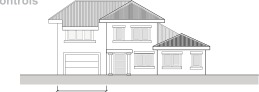
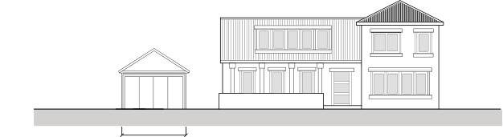
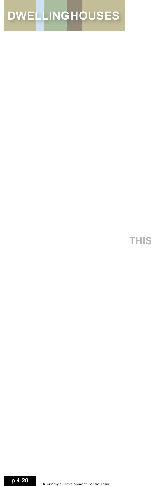

### 4B.3  CARPORTS AND GARAGES

#### Further controls that may apply:

#### SECTION C

PART 22 - General Access and Parking

#### Objectives

#### Controls Design of Carports and Garages

1 The car parking spaces, whether covered or uncovered, are to be

located at or behind the required front setback as specified in Part

4A.2(2) & (15) of this DCP, or behind the front building line defined

by the existing dwelling where the dwelling is being retained,

2 The scale and design of carport and garage structures are:

i) to be sympathetic to existing development on-site;

ii)	 to consider adjacent buildings;

iii)	 to consider proximity to drainage systems;

iv)	 to be integrated into the building design; and

v)	 not to dominate the site, dwelling and landscape, or the

3	 To ensure the garages

and carports are not the

from the street or public

3 Alterations and additions should not prevent the future ability of the

site to accommodate two car spaces behind the building line. 4 Council may consider a reduced setback for parking spaces on

4	 To ensure the location

5 Where it is not possible to locate the parking structure space

behind the minimum permissible setback or the building line due to

topographical constraints or side setback space of less than 3m,

structure is to comply with the following:

i) the structure is to be open sided;

5	 To minimise impacts of

ii)	 the structure is to be located at the maximum possible distance

from the front property boundary; and

iii)	 the design of the structure is be of a scale and form that is

compatible with the streetscape character.

6	 To minimise 3 storey

6 The width of any detached or attached carport/garage visible from

the street is not to be greater than 6m, as measured to the outer

face of the exterior walls/column/posts (refer to Fig 4B.3-1).

7	 To avoid excavation in the

7 Basement garages are only permitted on sloping land and where no

more than 1m excavation is required for driveway access.

### 4B.3 CARPORTS AND GARAGES (continued)

> [Picture on page 19: a picture, saved as a picture (images/part-04-dwelling-houses-page-19-2.gif, 150 dpi).]

#### Controls

6m maximum garage width

6m maximum garage/carport

width, lean to structure

> [Picture on page 19: a picture, saved as a picture (images/part-04-dwelling-houses-page-19-7.gif, 150 dpi).]

6m maximum garage/carport

with detached structure

#### Figure 4B.3-1- Maximum widths of garages and carports

#### Location of Parking Structures

8 Location of all new driveways and services are to enable

preservation of existing site or street trees to which Part 13 of this

DCP applies. 9 Where a site has a frontage to more than one road and/or service

lane, access is to be obtained from:

i) the road or service lane that is lower on the road hierarchy,

and/ or

ii)	 the road or service lane that carries the lower volume of traffic. Note: Road hierarchy and traffic volumes will be determined by Council at its discretion.

#### Detached Carports and Garages

### ACCESS AND PARKING

10 Detached garages are to be single storey and set back 1.5m

minimum from side and rear boundaries. 11 Detached carports are to be single storey and set back 0.6m

minimum from side and rear boundaries. Note: Where there is any inconsistency between this Part and Part 22 of this

DCP in relation to vehicular access, car parking or garages, this section

prevails to the extent of the inconsistency.

### THIS PAGE IS INTENTIONALLY LEFT BLANK

> [Picture on page 20: a picture, saved as a picture (images/part-04-dwelling-houses-page-20-2.gif, 150 dpi).]

### 4C
