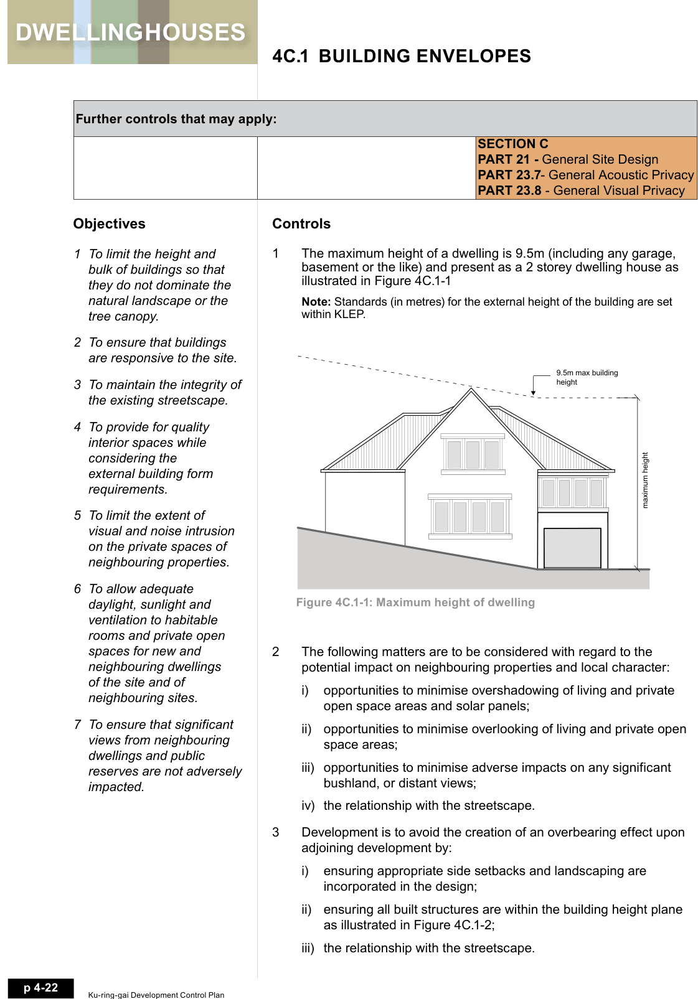

#### 4C Building Design and Sustainability

4C.1 Building Envelopes 4C.2 Building Facades 4C.3 First Floor Design and Roof Forms 4C.4 Private Open Space 4C.5 Solar Access 4C.6 Natural Ventilation 4C.7 Ancillary Facilities 4C.8 Fencing 4C.9 Waste Management 4C.10 	 Materials and Finishes

### READ WITH

#### SECTION B

PART 20 - Development Near Road or Rail Noise

#### SECTION C

PART 21 – General Site Design

21.1: Earthworks and Slope

21.2: Landscape Design

PART 23 – General Building Design and Sustainability

23.7: Acoustic Privacy

23.8: Visual Privacy

23.3: Sustainability of Building Materials

PART 24 – Water Management

24C: On-site Stormwater Management

24D.5: Tennis Courts and Other Sporting Surfaces

24D.7: Swimming Pools and Spas

24F: Onsite Wastewater Management

### BUILDING DESIGN AND SUSTAINABILITY

> [Picture on page 22: a map, saved as a picture (images/part-04-dwelling-houses-page-22-1.gif, 150 dpi); the street names and other small labels are on the picture.]
> Words printed on the picture (title and legend, copied from the PDF):
> illustrated in Figure 4C.1-1
> Note: Standards (in metres) for the external height of the building are set
> natural landscape or the
> 9.5m max building
> the existing streetscape.
> interior spaces while
> external building form
> visual and noise intrusion
> 6	 To allow adequate
> daylight, sunlight and
> ventilation to habitable
> rooms and private open
> spaces for new and
> bushland, or distant views;
> views from neighbouring
> dwellings and public
> reserves are not adversely
> incorporated in the design;

Figure 4C.1-1: Maximum height of dwelling
