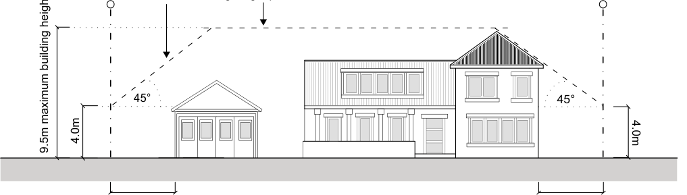
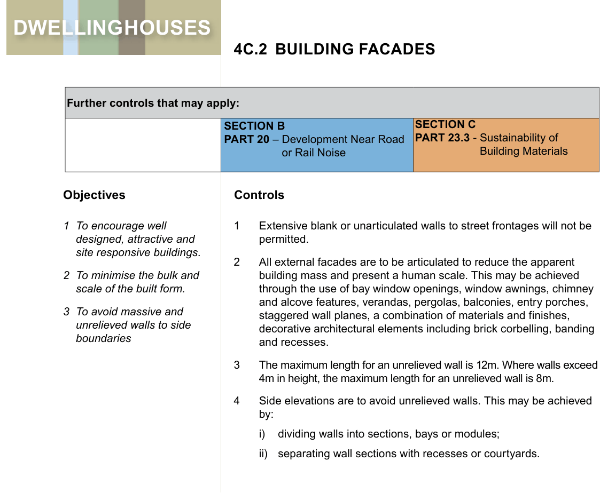

### 4C.1  BUILDING ENVELOPES

#### Further controls that may apply:

#### SECTION C

PART 21 - General Site Design

PART 23.7- General Acoustic Privacy

PART 23.8 - General Visual Privacy

#### Objectives

#### Controls

1 The maximum height of a dwelling is 9.5m (including any garage,

basement or the like) and present as a 2 storey dwelling house as

1	 To limit the height and

bulk of buildings so that

they do not dominate the

2	 To ensure that buildings

are responsive to the site. 3	 To maintain the integrity of

4	 To provide for quality

5	 To limit the extent of

on the private spaces of

2 The following matters are to be considered with regard to the

potential impact on neighbouring properties and local character:

of the site and of

i) opportunities to minimise overshadowing of living and private

open space areas and solar panels;

ii)	 opportunities to minimise overlooking of living and private open

iii)	 opportunities to minimise adverse impacts on any significant

7	 To ensure that significant

iv)	 the relationship with the streetscape. 3 Development is to avoid the creation of an overbearing effect upon

adjoining development by:

i) ensuring appropriate side setbacks and landscaping are

ii)	 ensuring all built structures are within the building height plane

as illustrated in Figure 4C.1-2;

iii)	 the relationship with the streetscape.

### 4C.1 BUILDING ENVELOPES (continued)

#### Controls

Line of building height plane

> [Picture on page 23: a picture, saved as a picture (images/part-04-dwelling-houses-page-23-4.gif, 150 dpi).]
> Words printed on the picture (title and legend, copied from the PDF):
> 45°
> 45°
> 2500
> 2500
> 2500
> 4.0m
> 4.0m
> 9.5m maximum building height
> 2500
> 2500

side setback

side setback

#### Figure 4C.1-2: Building height plane.

4 Basements are to be:

i) consolidated under the building footprint.

ii)	 minimised and no habitable spaces are permitted;

8	 To minimise 3 storey

streetscape building

appearances and maintain

a low density domestic

scale in residential areas.

iii)	 include a maximum ceiling height of 2.2m to all non-habitable

rooms.

iv)	 limited to a maximum 50% of the building footprint where rooms,

excluding the garage, have no door to the building exterior.

9	 To avoid excavation

outside the building line

and ensure deep soil

provision.

5 Excavation for a basement garage or other rooms on land that is not

steeply sloping is not permitted. Note: Conditions of Consent will prohibit future use of cellar, storage, and/or

garage areas as habitable rooms.

### BUILDING DESIGN AND SUSTAINABILITY

> [Picture on page 24: a picture, saved as a picture (images/part-04-dwelling-houses-page-24-1.gif, 150 dpi).]
> Words printed on the picture (title and legend, copied from the PDF):
> Building Materials
> or Rail Noise
> permitted.
> 1	 To encourage well
> designed, attractive and
> site responsive buildings.
> unrelieved walls to side
> boundaries
> and recesses.
