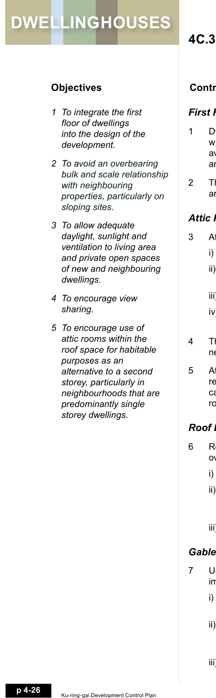
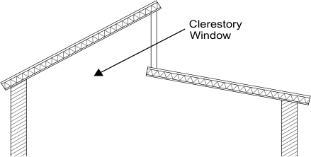
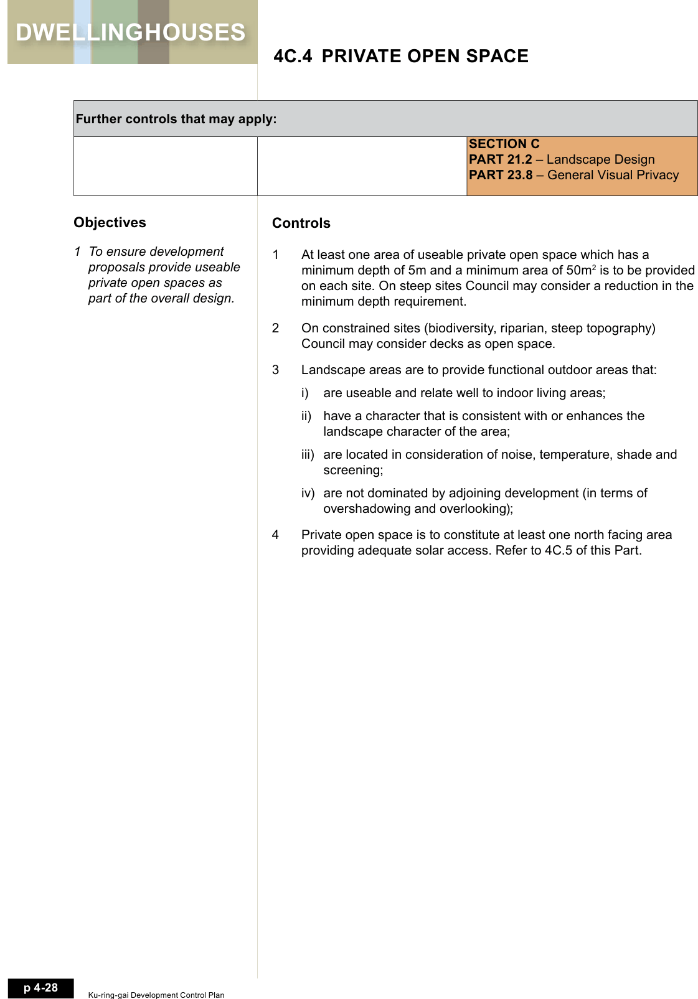

### 4C.3  FIRST FLOOR DESIGN AND ROOF FORMS

> [Picture on page 26: a map, saved as a picture (images/part-04-dwelling-houses-page-26-2.gif, 150 dpi); the street names and other small labels are on the picture.]
> Words printed on the picture (title and legend, copied from the PDF):
> floor of dwellings
> bulk and scale relationship
> properties, particularly on
> 3	 To allow adequate
> daylight, sunlight and
> ventilation to living area
> and private open spaces
> of new and neighbouring
> 4	 To encourage view
> attic rooms within the
> roof space for habitable
> purposes as an
> alternative to a second
> storey, particularly in
> neighbourhoods that are

#### Controls

#### Objectives

#### First Floor Design

1	 To integrate the first

into the design of the

1 Dwelling design is to avoid an overbearing bulk/scale relationship

with neighbouring properties. Consideration is to be given to

avoiding large vertical wall surfaces by stepping back upper levels

and containing within the existing/proposed roof space. 2 The placement of windows in first floor walls facing side boundaries

are to respect the privacy of neighbouring properties.

2	 To avoid an overbearing

#### Attic Rooms

3 Attic room designs are to avoid:

i) increasing the bulk of the building;

ii)	 causing undue overshadowing of adjacent properties and open

spaces;

iii)	 causing loss of significant views from adjacent properties; or

iv)	 being excessive in scale and bulk relative to the rest of the

building.

4 The form and placement of any windows is to respect the privacy of

neighbouring properties. 5 Attic rooms are to be located within the existing roof forms and

retain the streetscape appearance of the existing buildings. In some

cases depending on location of building and shape of roof, higher

roof forms for attics may be considered.

5	 To encourage use of

#### Roof Line

6 Roof structures are to be designed to minimise bulk and

overshadowing of neighbouring buildings and open spaces by:

i) considered selection of material, colour and pitch;

ii)	 use of low-angled pitched roofs providing that they are

compatible with existing development and the streetscape

character; or

iii)	 inclusion of habitable rooms within the roof space.

#### Gables

7 Unless otherwise consistent with the form of development within the

immediate locality, gables are:

i) to be positioned a minimum of 0.2m below the main roof ridge

height;

ii)	 not to occupy any more than 40% of the face of any gable wall

and not occupy more than 20% of the face of any roof or slope

for a gable window;

iii)	 not extend beyond the external wall of the dwelling.

### 4C.3 	FIRST FLOOR DESIGN AND ROOF FORMS

### (continued)

#### Controls Dormers

8 Dormer windows are to be located and have a size, bulk and scale

that do not dominate the roof form or add excessively to the bulk of

the building. 9 Dormer windows may only be provided on buildings with an

architectural character or style that is suitable for dormer features. 10 Unless otherwise consistent with the form of development within the

immediate locality, the configuration of dormer windows must satisfy

the following:

i) be positioned a minimum of 0.2m below the main roof ridge

height;

ii)	 not to extend beyond the external wall of the dwelling;

iii)	 be set back from the sides of the roof by a minimum of 500mm. 11 Dormers occurring in the same roof plane must be similarly sized

and configured, and arranged symmetrically.

#### Clerestory Windows and Skylights

12 The location, size, configuration and layout of clerestory windows

and skylights must be sympathetic to the overall design of the

dwelling and the streetscape.

> [Picture on page 27: a picture, saved as a picture (images/part-04-dwelling-houses-page-27-23.gif, 150 dpi).]
> Words printed on the picture (title and legend, copied from the PDF):
> Clerestory
> Window

Skylight

#### Figure 4C.3-1 Clerestory window and skylight

#### Mechanical Equipment

13 Plant and equipment is to be integrated into the overall design of

the roof and be contained within the roof form or screened behind

parapet walls. These elements include lift overruns, plant equipment

and air conditioning.

### BUILDING DESIGN AND SUSTAINABILITY

> [Picture on page 28: a picture, saved as a picture (images/part-04-dwelling-houses-page-28-1.gif, 150 dpi).]
> Words printed on the picture (title and legend, copied from the PDF):
> 1	 To ensure development
> proposals provide useable
> private open spaces as
> minimum depth requirement.
> screening;
> overshadowing and overlooking);
