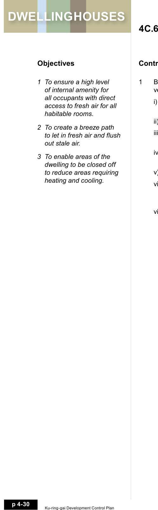

### 4C.6  NATURAL VENTILATION

> [Picture on page 30: a picture, saved as a picture (images/part-04-dwelling-houses-page-30-2.gif, 150 dpi).]
> Words printed on the picture (title and legend, copied from the PDF):
> of internal amenity for
> all occupants with direct
> habitable rooms.
> out stale air.
> to reduce areas requiring
> heating and cooling.

#### Controls

#### Objectives

1 Building design is to incorporate measures for natural cross

ventilation. This may be achieved by:

i) locating openings such as windows, sky lights, doors in opposite

walls;

1	 To ensure a high level

access to fresh air for all

ii)	 include open plan living areas;

iii)	 include doors that can section off heating and cooling living

areas;

2	 To create a breeze path

to let in fresh air and flush

iv)	 include vents above or in internal doors to facilitate cross

ventilation;

v)	 elevate the house so that air can circulate beneath it;

3	 To enable areas of the

dwelling to be closed off

vi)	 positioning of opening to control air flow, for example, use

clerestory windows, rood ventilators and vents in ridges, eaves

and ceilings to create convection currents; and

vii)	 carports and garages should be placed so that they do not block

ventilation into the house.
