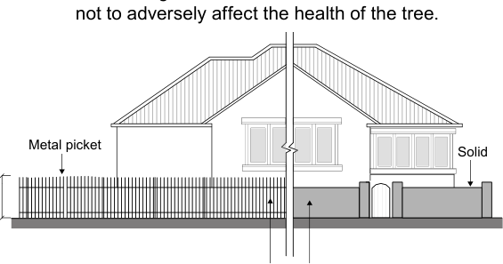
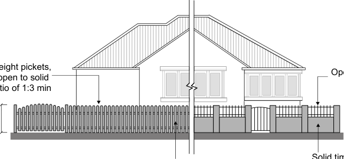
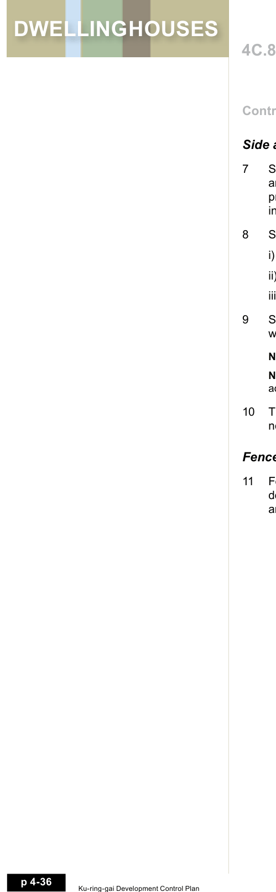

### 4C.8  FENCING

#### Controls

#### Objectives

#### Front Fences

1 Fences are to:

1	 Front fences are to

maintain the streetscape

character by being

consistent with the

established pattern of

fences.

i) restrict visually solid forms (such as masonry, lapped and

capped timber or brushwood) to 0.9m in height above existing

ground level;

ii)	 restrict the height of visually transparent fences (such as metal

grille or timber picket) to 1.2m, (a transparent fence has an open

to solid ratio of not less than 1:3).

2 Front fences in excess of 1.2m will only be permitted in areas where

they are compatible and consistent with the streetscape. All such

fences are to be set back at least 1m from the street boundary with

provision of low maintenance screen planting in the setback area. 3 Front fencing is not encouraged in areas where it does not form part

of the overall streetscape. In such areas, the front boundary can be

defined by low hob walls, by garden beds or planting. 4 Front fencing is to enable outlook from dwellings to the street for

safety and surveillance and should be generally low and visually

permeable.

#### Figure 4C.8-1:

Combination of hedges,

metal picket and solid

masonry.

5 Shrub plantings on boundaries are desirable; however, hedges along

the entire front boundary are to be no higher than the allowable

fence height. 6 The footings of a fence within the Tree Protection Zone of a tree are

> [Picture on page 35: a picture, saved as a picture (images/part-04-dwelling-houses-page-35-36.gif, 150 dpi).]
> Words printed on the picture (title and legend, copied from the PDF):
> Solid
> Metal picket
> 2692,84

not to adversely affect the health of the tree.

2692,84

1.2m

maximum

0.9m

maximum

Street fencing

> [Picture on page 35: a picture, saved as a picture (images/part-04-dwelling-houses-page-35-44.gif, 150 dpi).]
> Words printed on the picture (title and legend, copied from the PDF):
> Full height pickets,
> open to solid
> ratio of 1:3 min
> 2692,84

Open pickets

1.2m

maximum

### BUILDING DESIGN AND SUSTAINABILITY

Solid timber or

masonry

Street fencing

fence can be

totally transparent

#### Figure 4C.8-2:

#### Types of street fencing

### 4C.8 FENCING (continued)

> [Picture on page 36: a picture, saved as a picture (images/part-04-dwelling-houses-page-36-2.gif, 150 dpi).]

#### Controls Side and rear fences

7 Side fences forward of the front building line are to be unobtrusive

and allow for continuity of landscape vista between adjoining

properties. Where this character predominates it must be respected

in new developments. 8 Side fences on corner sites are to be designed and located so as to:

i) maintain the streetscape character;

ii)	 be consistent with the established pattern of fences;

iii)	 ensure an adequate amount of useable private open space; and 9 Side fences forward of the front building line should be compatible

with the established front fencing in the street. Note: The provisions of the Dividing Fences Act 1991 also apply. Note: Common boundary fencing proposals require the consent of the

adjoining land owner. 10 The footings of a fence within the structural root zone of a tree are

not to adversely affect the health of the tree.

#### Fences adjoining bushland

11 Fences adjoining bushland should protect the bushland from

domestic animals, blend harmoniously with the bushland setting,

and allow movement of small fauna species where appropriate.
