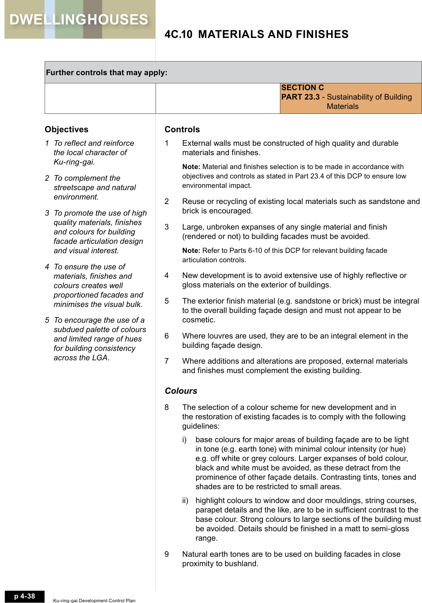

### 4C.9  WASTE MANAGEMENT

#### Further controls that may apply:

#### SECTION C

PART 23.3- Sustainability of Building

Materials

PART 24F - On-site Wastewater

Management

#### Controls

#### Objectives

#### General

1 During the design of the development, construction waste is to be

minimised by:

1	 To enable efficient,

effective and sustainable

waste management

practices.

i) using recycled materials, selecting materials that reduce waste

or do not require disposal, or can be reused or recycled in the

future;

ii)	 designing with minimal site disturbance by avoiding unnecessary

excavation or fill.

2 Council’s standard waste and recycling service is:

2	 To ensure waste collection

and storage within the site

that does not affect the

amenity of residents with

regard to odour, visual

appearance or noise

disturbance.

Waste Type

Bin Type

Waste (garbage)

1 x 120L

Co-mingled recycling (glass, steel

and aluminium cans and plastic)

1 x 240L

3	 To ensure waste and

recycling storage areas

are designed and

constructed to meet

the requirements of the

building’s use and its

occupants.

Recycling of paper and cardboard 1 x 240L Green waste

1 x 360L

4	 To ensure design and

management of waste and

recycling facilities protect

public health and the local

environment.

3 Developments is to allocate, within each property boundary, an area

for storing Council specified waste and recycling bins, preferably

located at the rear of the premises to minimise visual clutter. The

storage area is to be a minimum of 3m from openable windows and

integrated with the landscaping. Refer to 23R.5 of this Part for bin

characteristics.

5	 To ensure the design

of the development

incorporates effective

waste minimisation

principle.

4 An on-site area for composting of green and food waste is to be

allocated and indicated in the development application plan.

### BUILDING DESIGN AND SUSTAINABILITY

> [Picture on page 38: a map, saved as a picture (images/part-04-dwelling-houses-page-38-1.gif, 150 dpi); the street names and other small labels are on the picture.]
> Words printed on the picture (title and legend, copied from the PDF):
> materials and finishes.
> the local character of
> Note: Material and finishes selection is to be made in accordance with
> objectives and controls as stated in Part 23.4 of this DCP to ensure low
> 2	 To complement the
> streetscape and natural
> brick is encouraged.
> quality materials, finishes
> and colours for building
> facade articulation design
> and visual interest.
> Note: Refer to Parts 6-10 of this DCP for relevant building facade
> materials, finishes and
> colours creates well
> proportioned facades and
> minimises the visual bulk.
> building façade design.
> subdued palette of colours
> for building consistency
> across the LGA.
> proximity to bushland.
