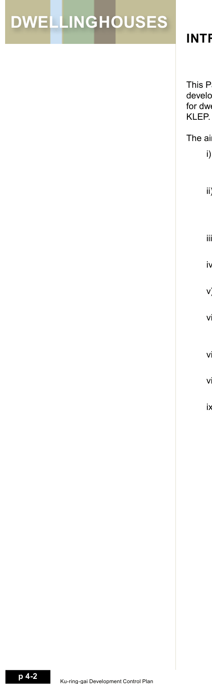

# Ku-ring-gai Development Control Plan - Part 4 Dwelling Houses

> This chapter is split into 20 section file(s), one per numbered heading, in the order they appear in the PDF.

Source PDF: [kdcp-section-a-part-4-dwelling-houses.pdf](kdcp-section-a-part-4-dwelling-houses.pdf)

### PART

### DWELLING HOUSES

Introduction

#### 4A Site Design

4A.1 	 Local Character and Streetscape 4A.2 	 Building Setbacks 4A.3 	 Built-Upon Area 4A.4 	 Landscaping

#### 4B Access and Parking

4B.1 	 Vehicle Access 4B.2 	 Car Parking Provision 4B.3 	 Carports and Garages

#### 4C Building Design and Sustainability

4C.1 	 Building Envelopes 4C.2 	 Building Facades 4C.3 	 First Floor Design and Roof Forms 4C.4 	 Private Open Space 4C.5 	 Solar Access 4C.6 	 Natural Ventilation 4C.7 	 Ancillary Facilities 4C.8 	 Fencing 4C.9 	 Waste Management 4C.10 	 Materials and Finishes

### DWELLING HOUSES

### INTRODUCTION

This Part applies to development for a detached dwelling house and

development ancillary to a dwelling house. This Part guides development

for dwelling houses to be consistent with the aims and objectives within

The aims of this Part are to:

i) Encourage development which does not dominate, but

harmonises with and contributes to the treed landscape and is

sympathetic to the street and locality in which it is proposed.

ii)	 	Ensure that with each development sufficient landscaping is

provided to contribute to the conservation and replenishment of

the tree canopy of Ku-ring-gai, including locally occurring native

tree species suited to the site.

iii)	 Protect and minimise the impact of development on adjoining

properties

iv)	 Protect and minimise the impact of development on the natural

environment

v)	 Ensure development that minimises the depletion of raw

materials and non-renewable resources

vi)	 Ensure that development meets the needs of the present without

compromising the ability of future generations to meet their own

needs

vii)	 Encourage housing of the highest possible architectural,

environmental and amenity standards.

viii)	Manage residential development in a way that embraces

innovative design and contemporary lifestyles

ix)	 Ensure that there are more certain outcomes for applicants and

the community.

> [Picture on page 2: a picture, saved as a picture (images/part-04-dwelling-houses-page-2-28.gif, 150 dpi).]
> Words printed on the picture (title and legend, copied from the PDF):
> KLEP.

### 4A

<!-- sections -->
## Sections

1. [4A Site Design](01-4a-site-design.md)
2. [4A.1 LOCAL CHARACTER AND STREETSCAPE](02-4a-1-local-character-and-streetscape.md)
3. [4A.2 BUILDING SETBACKS](03-4a-2-building-setbacks.md)
4. [4A.3 BUILT-UPON AREA](04-4a-3-built-upon-area.md)
5. [4A.4 LANDSCAPING](05-4a-4-landscaping.md)
6. [4B Access and Parking](06-4b-access-and-parking.md)
7. [4B.1 VEHICLE ACCESS](07-4b-1-vehicle-access.md)
8. [4B.2 CAR PARKING PROVISION](08-4b-2-car-parking-provision.md)
9. [4B.3 CARPORTS AND GARAGES](09-4b-3-carports-and-garages.md)
10. [4C Building Design and Sustainability](10-4c-building-design-and-sustainability.md)
11. [4C.1 BUILDING ENVELOPES](11-4c-1-building-envelopes.md)
12. [4C.2 BUILDING FACADES](12-4c-2-building-facades.md)
13. [4C.3 FIRST FLOOR DESIGN AND ROOF FORMS](13-4c-3-first-floor-design-and-roof-forms.md)
14. [4C.4 PRIVATE OPEN SPACE](14-4c-4-private-open-space.md)
15. [4C.5 SOLAR ACCESS](15-4c-5-solar-access.md)
16. [4C.6 NATURAL VENTILATION](16-4c-6-natural-ventilation.md)
17. [4C.7 ANCILLARY FACILITIES](17-4c-7-ancillary-facilities.md)
18. [4C.8 FENCING](18-4c-8-fencing.md)
19. [4C.9 WASTE MANAGEMENT](19-4c-9-waste-management.md)
20. [4C.10 MATERIALS AND FINISHES](20-4c-10-materials-and-finishes.md)
